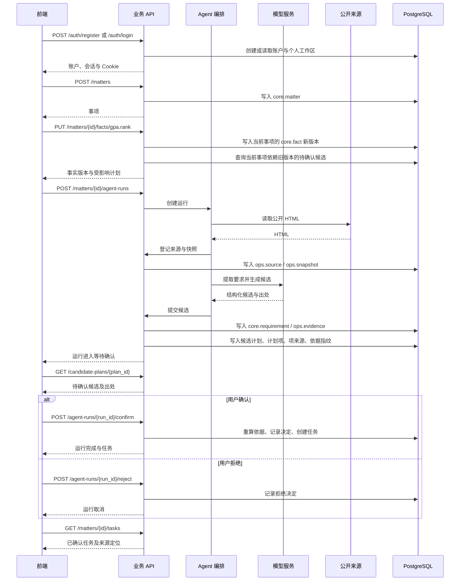

# Alpha 核心业务流程 API

| 项目 | 内容 |
| :--- | :--- |
| 接口前缀 | `/api/v1` |
| 数据格式 | JSON，UTF-8 |
| 适用范围 | Alpha 多用户后端 |
| 业务契约 | [`docs/development/alpha-scope-contract.md`](../development/alpha-scope-contract.md) |
| 数据库结构 | Alpha schema 迁移 `0001`—`0017` |

## 1. 范围

本接口覆盖 Alpha 核心演示的后端业务：

- 创建个人事项，读取事项列表与事项详情。
- 读取公开 HTML 来源或登记调用方提供的正文与快照，按事项读取来源链。
- 按事项保存与读取个人事实（GPA、成绩排名、英语水平、证书与竞赛），维护事项内事实版本。
- 创建 Agent 运行，由后端完成来源读取、要求提取、条件自查与候选计划持久化。
- 持久化候选要求、候选计划、计划项及计划项出处。
- 读取候选计划，由用户确认或拒绝。
- 确认后生成个人任务，读取任务及其来源定位。
- 注册、登录、退出、读取当前账户、修改密码，以及管理员账户管理。

个人事实按事项保存与读取，版本规则、类型注册表与候选失效语义见[个人事实接口](facts.md)（迁移 `0012`）。
账户、会话与管理员接口见[账户、登录与管理员接口](accounts.md)（迁移 `0017`）。

来源可以通过两种方式进入事项：调用方提供已取得的正文、发布信息和原文片段，或由本接口读取公开 HTML 页面后登记。读取只访问公开 HTTP/HTTPS 地址，不解析 PDF、附件或需要登录的页面。候选要求与候选计划可以直接写入，也可以由 Agent 运行读取公开来源后生成并持久化。

## 2. 通用约定

### 2.1 请求与响应

- 请求体和响应体均为 JSON 对象。
- 标识使用 UUID 字符串。请求中的路径参数与 JSON 字段均为标准 UUID 格式。
- `date` 字段使用 `YYYY-MM-DD`。
- `timestamptz` 字段使用 ISO 8601 带时区时间，响应统一换算为 UTC，例如 `2026-09-09T01:00:00+00:00`。
- 请求字段执行严格校验，未声明的字段会被拒绝。
- 字符串字段在写入前去除首尾空白。

### 2.2 身份与数据边界

除注册、登录、退出与健康检查外，所有业务接口要求有效登录会话。认证使用服务端会话 Cookie：

| 项目 | 值 |
| :--- | :--- |
| Cookie | `offerpilot_session` |
| 普通会话有效期 | 12 小时 |
| 记住登录会话有效期 | 30 天 |
| Cookie 属性 | `HttpOnly`、`SameSite=Lax`、`Path=/`，HTTPS 部署启用 `Secure` |

每次请求由 Cookie 解析当前账户及其个人工作区。数据库事务设置 `app.current_workspace_id`，行级安全策略按该工作区过滤事项、要求、候选计划、计划项、计划项来源、计划和任务。个人事实按当前事项过滤，并要求事项位于当前工作区、记录所有者等于工作区所有者；模型传输同意按当前用户过滤，并要求记录所有者等于工作区所有者。事项、个人事实、候选计划与任务的读取同时校验事项归属。

缺失、过期或已撤销的会话统一返回 `401 authentication_required`。普通用户访问管理员接口返回 `403 admin_required`。管理员访问业务接口时仍使用自己的个人工作区，不能读取其他用户的私人数据。

### 2.3 错误结构

所有业务错误使用统一结构：

```json
{
  "error": {
    "code": "plan_already_decided",
    "message": "候选计划已有终态决定",
    "next": "重新读取候选计划状态",
    "details": {
      "status": "confirmed",
      "decision": "confirmed"
    }
  }
}
```

| 字段 | 说明 |
| :--- | :--- |
| `code` | 稳定错误码，调用方按该字段分支处理 |
| `message` | 可直接展示的中文说明 |
| `next` | 建议的下一步操作，可能省略 |
| `details` | 结构化补充信息，可能省略 |

请求字段校验失败时返回 `422 validation_error`，`details.issues` 列出字段路径、校验类型和说明：

```json
{
  "error": {
    "code": "validation_error",
    "message": "请求字段未通过校验",
    "next": "按 issues 修正请求后重试",
    "details": {
      "issues": [
        {
          "path": "body.scope_year",
          "code": "greater_than_equal",
          "message": "Input should be greater than or equal to 2020"
        }
      ]
    }
  }
}
```

### 2.4 主流程



### 2.5 账户接口

账户接口均相对 `/api/v1`：

| 方法与路径 | 作用 | 认证 |
| :--- | :--- | :--- |
| `POST /auth/register` | 注册普通用户、创建个人工作区并登录 | 无 |
| `POST /auth/login` | 登录；`remember=true` 使用 30 天持久会话 | 无 |
| `POST /auth/logout` | 撤销当前会话并清除 Cookie | 可选 |
| `GET /auth/me` | 读取当前账户与当前会话 | 登录 |
| `POST /auth/password` | 修改本人密码并撤销全部会话 | 登录 |
| `GET /admin/users` | 管理员搜索与分页读取账户 | 管理员 |
| `PATCH /admin/users/{id}/status` | 启用或停用账户 | 管理员 |
| `PATCH /admin/users/{id}/role` | 调整普通用户与管理员角色 | 管理员 |
| `POST /admin/users/{id}/password-reset` | 重置目标账户密码 | 管理员 |
| `DELETE /admin/users/{id}` | 软删除目标账户 | 管理员 |

注册后账户立即生效。管理员不能通过管理员接口实际修改自己的状态、角色、密码或删除自己；系统始终保留至少一个有效管理员。详细请求、响应、筛选参数与错误码见[账户、登录与管理员接口](accounts.md)。

## 3. 事项

### 3.1 创建事项

`POST /api/v1/matters`

请求字段：

| 字段 | 类型 | 必填 | 约束 |
| :--- | :--- | :--- | :--- |
| `goal` | string | 是 | 1—200 字符 |
| `type_code` | string | 否 | 默认 `pre_recommend`，2—32 字符，须为已启用的事项类型 |
| `scope_year` | integer | 是 | 2020—2100 |
| `scope_attrs` | object | 否 | 适用范围属性，原样保存 |

请求示例：

```json
{
  "goal": "申请 2027 年福州大学数学与统计学院推免",
  "type_code": "pre_recommend",
  "scope_year": 2027,
  "scope_attrs": {
    "school": "福州大学",
    "college": "数学与统计学院",
    "batch": "2027 届"
  }
}
```

响应 `201`：

```json
{
  "matter": {
    "id": "a0000000-0000-4000-8000-000000000001",
    "workspace_id": "00000000-0000-7000-8000-000000000002",
    "type_code": "pre_recommend",
    "type_name": "推免",
    "goal": "申请 2027 年福州大学数学与统计学院推免",
    "status": "draft",
    "scope_year": 2027,
    "scope_attrs": {
      "school": "福州大学",
      "college": "数学与统计学院",
      "batch": "2027 届"
    },
    "archived_at": null,
    "created_at": "2026-09-09T01:00:00+00:00",
    "updated_at": "2026-09-09T01:00:00+00:00",
    "tasks": {
      "total": 0,
      "done": 0,
      "open": 0
    },
    "latest_plan": null
  }
}
```

事项创建时绑定该事项类型最新发布的模板版本，创建后状态为 `draft`。`latest_plan` 返回该事项最新候选计划的标识、状态、版本号、依据状态和旧事实列表；依据状态按[个人事实接口](facts.md)的规则计算。

### 3.2 读取事项列表

`GET /api/v1/matters`

返回当前账户个人工作区中的事项，按 `updated_at` 倒序排列：

```json
{
  "matters": [
    {
      "id": "a0000000-0000-4000-8000-000000000001",
      "workspace_id": "00000000-0000-7000-8000-000000000002",
      "type_code": "pre_recommend",
      "type_name": "推免",
      "goal": "申请 2027 年福州大学数学与统计学院推免",
      "status": "draft",
      "scope_year": 2027,
      "scope_attrs": {
        "school": "福州大学",
        "college": "数学与统计学院"
      },
      "archived_at": null,
      "created_at": "2026-09-09T01:00:00+00:00",
      "updated_at": "2026-09-09T01:00:00+00:00",
      "tasks": {
        "total": 0,
        "done": 0,
        "open": 0
      },
      "latest_plan": null
    }
  ]
}
```

### 3.3 读取事项详情

`GET /api/v1/matters/{matter_id}`

响应结构同创建事项的 `matter` 对象。事项不存在或不属于当前工作区时返回 `404 matter_not_found`。

## 4. 来源与要求

### 4.1 登记来源与快照

`POST /api/v1/matters/{matter_id}/sources`

请求字段：

| 字段 | 类型 | 必填 | 约束 |
| :--- | :--- | :--- | :--- |
| `url` | string | 是 | HTTP/HTTPS URL，最长 500 字符，不允许内嵌凭据 |
| `publisher` | string | 是 | 1—160 字符 |
| `title` | string | 是 | 1—500 字符，保存到快照提取结果 |
| `scope` | string | 否 | 最长 200 字符 |
| `scope_year` | integer | 是 | 2020—2100 |
| `published_date` | date | 否 | 来源发布日期 |
| `valid_from` / `valid_to` | date | 否 | `valid_to` 不得早于 `valid_from` |
| `content` | string | 是 | 来源正文 |
| `content_hash` | string | 否 | 64 位小写十六进制 SHA-256；省略时按 UTF-8 正文计算 |
| `fetched_at` | timestamptz | 否 | 省略时使用服务端当前时间 |
| `status` | string | 否 | `active`、`withdrawn`、`invalid`，默认 `active` |
| `auto_check_status` | string | 否 | `pending`、`passed`、`failed`、`conflict`，默认 `pending` |
| `roi_status` | string | 否 | `original`、`reposted`、`expired`、`ambiguous`，默认 `original` |
| `fragments` | array | 否 | 原文定位片段，元素含 `locator_kind`、`locator`、`quote` |
| `source_id` | UUID | 否 | 指定来源标识；省略时按 URL 生成稳定标识 |
| `snapshot_id` | UUID | 否 | 指定快照标识；省略时按 URL 与内容哈希生成稳定标识 |

`locator_kind` 可取 `section`、`page`、`text_span`、`table_row`、`list_item`。

请求示例：

```json
{
  "url": "https://math.fzu.edu.cn/info/1171/10393.htm",
  "publisher": "福州大学数学与统计学院",
  "title": "福州大学数学与统计学院2027年推荐优秀应届本科毕业生免试攻读研究生的工作方案",
  "scope": "2027 届、本院、校内推免推荐",
  "scope_year": 2027,
  "published_date": "2026-09-08",
  "content": "（5）符合推荐条件的学生，由本人自愿向学院提出申请，并于2026年9月10日下午15:00前提交《推荐免试攻读研究生资格申请表》以及相应科研成果和学科竞赛等奖项证明材料及成绩单（符合推免条件但放弃的同学需要提供放弃推免资格承诺书，本人签字按手印）。",
  "fragments": [
    {
      "locator_kind": "section",
      "locator": "第（5）项",
      "quote": "（5）符合推荐条件的学生，由本人自愿向学院提出申请，并于2026年9月10日下午15:00前提交《推荐免试攻读研究生资格申请表》以及相应科研成果和学科竞赛等奖项证明材料及成绩单（符合推免条件但放弃的同学需要提供放弃推免资格承诺书，本人签字按手印）。"
    }
  ]
}
```

响应 `201`：

```json
{
  "source": {
    "id": "b0000000-0000-4000-8000-000000000001",
    "publisher": "福州大学数学与统计学院",
    "url": "https://math.fzu.edu.cn/info/1171/10393.htm",
    "scope": "2027 届、本院、校内推免推荐",
    "scope_year": 2027,
    "valid_from": null,
    "valid_to": null,
    "status": "active",
    "auto_check_status": "pending",
    "roi_status": "original",
    "last_fetched_at": "2026-09-09T01:00:00+00:00",
    "created_at": "2026-09-09T01:00:00+00:00"
  },
  "snapshot": {
    "id": "b0000000-0000-4000-8000-000000000002",
    "source_id": "b0000000-0000-4000-8000-000000000001",
    "version_no": 1,
    "content_hash": "34599dc85bf72ca19837918f55c7cd275b9505bde994bbbea898ac7fa7b3abea",
    "title": "福州大学数学与统计学院2027年推荐优秀应届本科毕业生免试攻读研究生的工作方案",
    "published_date": "2026-09-08",
    "text": "（5）符合推荐条件的学生，由本人自愿向学院提出申请，并于2026年9月10日下午15:00前提交《推荐免试攻读研究生资格申请表》以及相应科研成果和学科竞赛等奖项证明材料及成绩单（符合推免条件但放弃的同学需要提供放弃推免资格承诺书，本人签字按手印）。",
    "fragments": [
      {
        "locator_kind": "section",
        "locator": "第（5）项",
        "quote": "（5）符合推荐条件的学生，由本人自愿向学院提出申请，并于2026年9月10日下午15:00前提交《推荐免试攻读研究生资格申请表》以及相应科研成果和学科竞赛等奖项证明材料及成绩单（符合推免条件但放弃的同学需要提供放弃推免资格承诺书，本人签字按手印）。"
      }
    ],
    "fetched_at": "2026-09-09T01:00:00+00:00",
    "is_current": true
  },
  "created": {
    "source": true,
    "snapshot": true
  }
}
```

登记规则：

- 来源按 URL 去重。同一 URL 的发布主体、适用年度或事项类型不一致时返回 `409 source_conflict`。
- 快照按来源与 `content_hash` 去重。同一内容重复登记时返回既有快照，`created.snapshot` 为 `false`。
- 新内容按来源自动分配递增的 `version_no`，并成为当前快照。
- `created.source` 与 `created.snapshot` 分别表示本次请求是否创建了新记录。
- `title`、`published_date`、`content` 和 `fragments` 保存在快照的提取结果中。

### 4.2 读取并登记公开来源

`POST /api/v1/matters/{matter_id}/sources/read`

业务接口读取一份公开 HTML 页面，按 4.1 的规则登记来源与快照，并返回可直接交给 Agent 的来源文档。

请求字段：

| 字段 | 类型 | 必填 | 约束 |
| :--- | :--- | :--- | :--- |
| `url` | string | 是 | 公开 HTTP/HTTPS URL，最长 500 字符，不允许内嵌凭据 |
| `publisher` | string | 是 | 1—160 字符 |
| `scope` | string | 否 | 最长 200 字符 |
| `scope_year` | integer | 是 | 2020—2100 |
| `title` | string | 否 | 1—500 字符；省略时使用网页标题 |

请求示例：

```json
{
  "url": "https://math.fzu.edu.cn/info/1171/10393.htm",
  "publisher": "福州大学数学与统计学院",
  "scope_year": 2027,
  "scope": "2027 届、本院、校内推免推荐"
}
```

响应 `201`：

| 字段 | 说明 |
| :--- | :--- |
| `source`、`snapshot`、`created` | 与 4.1 登记来源的响应相同 |
| `document` | Agent 来源文档，字段见下表 |

`document` 字段：

| 字段 | 说明 |
| :--- | :--- |
| `source_version_id`、`snapshot_id` | 登记后的快照标识，两值相同 |
| `source_id` | 登记后的来源标识 |
| `version_no` | 快照版本号 |
| `title`、`publisher`、`url`、`year`、`scope`、`published_date` | 登记后的来源与快照元数据 |
| `content` | 规范化正文 |
| `content_hash` | 原始 HTML 响应的 SHA-256 |
| `fetched_at` | 本次成功获取页面的时间 |
| `source_status`、`auto_check_status`、`roi_status` | 来源状态 |
| `is_repost`、`is_expired` | 由 `roi_status` 派生的标记 |
| `fragments` | 原文片段，元素含 `locator_kind`、`locator`、`quote` |

读取与登记规则：

- 读取在数据库事务外执行。事项不存在或不属于当前工作区时先返回 `404 matter_not_found`，不发起读取。
- 读取只接受 HTML 与 XHTML 响应，限制总耗时、响应大小和片段数量；每次跳转都重新解析并校验目的地址，只连接公网地址。
- 成功后按 URL 与原始响应摘要登记来源和快照。同一 URL、同一响应的重复读取返回既有记录，`created` 均为 `false`。
- `title`、`published_date`、`content` 和 `fragments` 来自实际响应；请求中的 `title` 覆盖网页标题。
- 读取失败返回 `source_read_failed`，`details.code` 为来源读取错误码，`details.retryable` 表示是否可以重试。错误码为 `unsafe_url`、`invalid_request`、`network_error`、`http_error`、`unsupported_content_type`、`empty_content`、`response_too_large`、`too_many_fragments`、`decode_error`、`parse_error` 或 `incomplete_response`。
- 网络不可达、响应不完整或来源返回 5xx 时返回 `502`；地址不合规、页面类型不符、正文为空或解析失败时返回 `422`。

### 4.3 读取事项来源链

`GET /api/v1/matters/{matter_id}/sources`

返回与当前事项关联的来源。来源读取或登记成功后立即关联当前事项；候选要求或候选计划项引用快照也会建立关联。已读取但尚未生成要求或计划的来源会出现在结果中，其快照 `requirements` 为空，表示“已读取，待分析”。

```json
{
  "sources": [
    {
      "id": "b0000000-0000-4000-8000-000000000001",
      "publisher": "福州大学数学与统计学院",
      "url": "https://math.fzu.edu.cn/info/1171/10393.htm",
      "scope": "2027 届、本院、校内推免推荐",
      "scope_year": 2027,
      "valid_from": null,
      "valid_to": null,
      "status": "active",
      "auto_check_status": "pending",
      "roi_status": "original",
      "last_fetched_at": "2026-09-09T01:00:00+00:00",
      "created_at": "2026-09-09T01:00:00+00:00",
      "snapshots": [
        {
          "id": "b0000000-0000-4000-8000-000000000002",
          "source_id": "b0000000-0000-4000-8000-000000000001",
          "version_no": 1,
          "content_hash": "34599dc85bf72ca19837918f55c7cd275b9505bde994bbbea898ac7fa7b3abea",
          "title": "福州大学数学与统计学院2027年推荐优秀应届本科毕业生免试攻读研究生的工作方案",
          "published_date": "2026-09-08",
          "text": "（5）符合推荐条件的学生，由本人自愿向学院提出申请，并于2026年9月10日下午15:00前提交《推荐免试攻读研究生资格申请表》以及相应科研成果和学科竞赛等奖项证明材料及成绩单（符合推免条件但放弃的同学需要提供放弃推免资格承诺书，本人签字按手印）。",
          "fragments": [
            {
              "locator_kind": "section",
              "locator": "第（5）项",
              "quote": "（5）符合推荐条件的学生，由本人自愿向学院提出申请，并于2026年9月10日下午15:00前提交《推荐免试攻读研究生资格申请表》以及相应科研成果和学科竞赛等奖项证明材料及成绩单（符合推免条件但放弃的同学需要提供放弃推免资格承诺书，本人签字按手印）。"
            }
          ],
          "fetched_at": "2026-09-09T01:00:00+00:00",
          "is_current": true,
          "requirements": [
            {
              "id": "c0000000-0000-4000-8000-000000000001",
              "matter_id": "a0000000-0000-4000-8000-000000000001",
              "snapshot_id": "b0000000-0000-4000-8000-000000000002",
              "field_key": "application.deadline",
              "label": "提交申请与材料截止",
              "obligation_nature": "required",
              "extract_status": "checked",
              "scope": "2027 届、本院",
              "value_text": "2026-09-10T15:00:00+08:00",
              "value_type": "text",
              "confidence": 0.9,
              "checked_at": "2026-09-09T01:00:00+00:00",
              "created_at": "2026-09-09T01:00:00+00:00",
              "updated_at": "2026-09-09T01:00:00+00:00",
              "evidence": [
                {
                  "id": "d0000000-0000-4000-8000-000000000001",
                  "source_id": "b0000000-0000-4000-8000-000000000001",
                  "snapshot_id": "b0000000-0000-4000-8000-000000000002",
                  "locator_kind": "section",
                  "locator": "第（5）项",
                  "quote": "（5）符合推荐条件的学生，由本人自愿向学院提出申请，并于2026年9月10日下午15:00前提交《推荐免试攻读研究生资格申请表》以及相应科研成果和学科竞赛等奖项证明材料及成绩单（符合推免条件但放弃的同学需要提供放弃推免资格承诺书，本人签字按手印）。",
                  "quote_hash": "34599dc85bf72ca19837918f55c7cd275b9505bde994bbbea898ac7fa7b3abea",
                  "fetched_at": "2026-09-09T01:00:00+00:00"
                }
              ]
            }
          ]
        }
      ]
    }
  ]
}
```

每个来源返回其全部快照版本，`is_current` 标识当前版本；要求嵌套在对应快照下，证据与 `self_check` 嵌套在要求下。候选要求没有独立的列表接口，读取入口为来源链。`self_check` 的结构与保存协议见 [要求自查结果保存协议](requirement-self-check.md)。

### 4.4 写入候选要求

`POST /api/v1/matters/{matter_id}/requirements`

请求体为一个批次：

```json
{
  "requirements": [
    {
      "field_key": "application.deadline",
      "label": "提交申请与材料截止",
      "obligation_nature": "required",
      "extract_status": "checked",
      "scope": "2027 届、本院",
      "value_text": "2026-09-10T15:00:00+08:00",
      "value_type": "text",
      "confidence": 0.9,
      "snapshot_id": "b0000000-0000-4000-8000-000000000002",
      "evidence": [
        {
          "source_id": "b0000000-0000-4000-8000-000000000001",
          "snapshot_id": "b0000000-0000-4000-8000-000000000002",
          "locator_kind": "section",
          "locator": "第（5）项",
          "quote": "（5）符合推荐条件的学生，由本人自愿向学院提出申请，并于2026年9月10日下午15:00前提交《推荐免试攻读研究生资格申请表》以及相应科研成果和学科竞赛等奖项证明材料及成绩单（符合推免条件但放弃的同学需要提供放弃推免资格承诺书，本人签字按手印）。"
        }
      ]
    }
  ]
}
```

要求字段：

| 字段 | 类型 | 必填 | 约束 |
| :--- | :--- | :--- | :--- |
| `field_key` | string | 是 | 小写字母开头，允许小写字母、数字、下划线和点，2—64 字符 |
| `label` | string | 是 | 1—120 字符 |
| `obligation_nature` | string | 否 | `required`、`advised`、`optional`、`to_verify`，默认 `to_verify` |
| `extract_status` | string | 否 | `extracted`、`checked`、`to_review`、`rejected`，默认 `extracted` |
| `scope` | string | 否 | 最长 200 字符 |
| `value_text` | string | 否 | 按 `value_type` 校验规范值 |
| `value_type` | string | 否 | `text`、`date`、`number`、`boolean`、`enum`，默认 `text` |
| `confidence` | number | 否 | 0—1 |
| `snapshot_id` | UUID | 是 | 必须属于已登记快照 |
| `evidence` | array | 是 | 至少一条证据 |

`value_text` 校验规则：

| `value_type` | 规范值 |
| :--- | :--- |
| `date` | `YYYY-MM-DD` |
| `number` | 不带千位分隔符的十进制数 |
| `boolean` | `true` 或 `false` |
| `text` / `enum` | 保留原意的文本 |

写入约束：

- 快照必须存在，其来源状态必须为 `active`。
- 来源适用年度与事项年度同时存在时必须一致。
- 每条证据的 `snapshot_id` 必须等于要求的 `snapshot_id`。
- 每条证据的 `source_id` 必须等于快照所属来源。
- `extract_status` 为 `checked` 时写入 `checked_at`。
- 证据引文非空时计算 SHA-256 并保存为 `quote_hash`。

响应 `201`：

```json
{
  "requirements": [
    {
      "id": "c0000000-0000-4000-8000-000000000001",
      "matter_id": "a0000000-0000-4000-8000-000000000001",
      "snapshot_id": "b0000000-0000-4000-8000-000000000002",
      "field_key": "application.deadline",
      "label": "提交申请与材料截止",
      "obligation_nature": "required",
      "extract_status": "checked",
      "scope": "2027 届、本院",
      "value_text": "2026-09-10T15:00:00+08:00",
      "value_type": "text",
      "confidence": 0.9,
      "checked_at": "2026-09-09T01:00:00+00:00",
      "created_at": "2026-09-09T01:00:00+00:00",
      "updated_at": "2026-09-09T01:00:00+00:00",
      "evidence": [
        {
          "id": "d0000000-0000-4000-8000-000000000001",
          "source_id": "b0000000-0000-4000-8000-000000000001",
          "snapshot_id": "b0000000-0000-4000-8000-000000000002",
          "locator_kind": "section",
          "locator": "第（5）项",
          "quote": "（5）符合推荐条件的学生，由本人自愿向学院提出申请，并于2026年9月10日下午15:00前提交《推荐免试攻读研究生资格申请表》以及相应科研成果和学科竞赛等奖项证明材料及成绩单（符合推免条件但放弃的同学需要提供放弃推免资格承诺书，本人签字按手印）。",
          "quote_hash": "34599dc85bf72ca19837918f55c7cd275b9505bde994bbbea898ac7fa7b3abea",
          "fetched_at": "2026-09-09T01:00:00+00:00"
        }
      ]
    }
  ]
}
```

## 5. 候选计划

### 5.1 创建候选计划

`POST /api/v1/matters/{matter_id}/candidate-plans`

请求体：

```json
{
  "items": [
    {
      "client_item_id": "t1",
      "title": "提交申请表",
      "detail": "按学院要求提交资格申请表",
      "obligation_nature": "required",
      "official_deadline_date": "2026-09-10",
      "official_deadline_at": "2026-09-10T15:00:00+08:00",
      "suggested_date": "2026-09-09",
      "depends_on": [],
      "evidence_required": true,
      "requirement_id": "c0000000-0000-4000-8000-000000000001",
      "sources": [
        {
          "source_id": "b0000000-0000-4000-8000-000000000001",
          "snapshot_id": "b0000000-0000-4000-8000-000000000002",
          "locator_kind": "section",
          "locator": "第（5）项",
          "quote": "（5）符合推荐条件的学生，由本人自愿向学院提出申请，并于2026年9月10日下午15:00前提交《推荐免试攻读研究生资格申请表》以及相应科研成果和学科竞赛等奖项证明材料及成绩单（符合推免条件但放弃的同学需要提供放弃推免资格承诺书，本人签字按手印）。"
        }
      ]
    },
    {
      "client_item_id": "t2",
      "title": "准备成绩单",
      "detail": "准备教务盖章成绩单",
      "obligation_nature": "required",
      "official_deadline_date": "2026-09-10",
      "suggested_date": "2026-09-09",
      "depends_on": ["t1"],
      "evidence_required": true,
      "sources": []
    }
  ]
}
```

计划项字段：

| 字段 | 类型 | 必填 | 约束 |
| :--- | :--- | :--- | :--- |
| `client_item_id` | string | 是 | 计划内唯一，1—80 字符 |
| `title` | string | 是 | 1—160 字符 |
| `detail` | string | 否 | 计划项说明 |
| `obligation_nature` | string | 否 | `required`、`advised`、`optional`、`to_verify`，默认 `to_verify` |
| `official_deadline_date` | date | 否 | 来源明确给出的日期 |
| `official_deadline_at` | timestamptz | 否 | 来源明确给出的时刻 |
| `suggested_date` | date | 否 | 个人建议准备日 |
| `depends_on` | string[] | 否 | 同一计划内的 `client_item_id` |
| `evidence_required` | boolean | 否 | 默认 `false` |
| `requirement_id` | UUID | 否 | 必须属于当前事项 |
| `sources` | array | 否 | 计划项出处，元素含 `source_id`、`snapshot_id`、`locator_kind`、`locator`、`quote` |

校验规则：

- `client_item_id` 在同一计划内唯一。
- `depends_on` 不得重复、不得自引用、不得引用未知条目。
- 依赖关系不得成环。
- `official_deadline_at` 存在时，按 `Asia/Shanghai` 换算出的日期必须与 `official_deadline_date` 一致；省略日期时自动写入该换算日期。
- `requirement_id` 必须属于当前事项。
- `sources` 中的来源与快照必须匹配；来源状态必须为 `active`，快照必须为当前版本。
- 同一计划项内 `sources` 按 `snapshot_id` 与 `locator` 唯一。

响应 `201`：

```json
{
  "plan": {
    "id": "e0000000-0000-4000-8000-000000000001",
    "matter_id": "a0000000-0000-4000-8000-000000000001",
    "version_no": 1,
    "status": "pending",
    "basis_version": "7f5c5a5fd8d1f3e5f4b4f4f6a9d2c0e9d7f2b3c4a5e6f708192a3b4c5d6e7f80",
    "basis_status": "current",
    "stale_facts": [],
    "generated_at": "2026-09-09T01:00:00+00:00",
    "confirmed_at": null,
    "expired_at": null,
    "confirmed_by": null,
    "op_id": null,
    "matter": {
      "id": "a0000000-0000-4000-8000-000000000001",
      "goal": "申请 2027 年福州大学数学与统计学院推免",
      "type_code": "pre_recommend",
      "scope_year": 2027,
      "scope_attrs": {
        "school": "福州大学",
        "college": "数学与统计学院"
      }
    },
    "items": [
      {
        "id": "f0000000-0000-4000-8000-000000000001",
        "seq": 1,
        "title": "提交申请表",
        "detail": "按学院要求提交资格申请表",
        "obligation_nature": "required",
        "official_deadline_date": "2026-09-10",
        "official_deadline_at": "2026-09-10T07:00:00+00:00",
        "suggested_date": "2026-09-09",
        "depends_on_item_ids": [],
        "evidence_required": true,
        "requirement_id": "c0000000-0000-4000-8000-000000000001",
        "created_at": "2026-09-09T01:00:00+00:00",
        "requirement": {
          "id": "c0000000-0000-4000-8000-000000000001",
          "field_key": "application.deadline",
          "label": "提交申请与材料截止",
          "obligation_nature": "required",
          "extract_status": "checked"
        },
        "sources": [
          {
            "id": "f1000000-0000-4000-8000-000000000001",
            "source_id": "b0000000-0000-4000-8000-000000000001",
            "publisher": "福州大学数学与统计学院",
            "url": "https://math.fzu.edu.cn/info/1171/10393.htm",
            "source_status": "active",
            "snapshot_id": "b0000000-0000-4000-8000-000000000002",
            "version_no": 1,
            "content_hash": "34599dc85bf72ca19837918f55c7cd275b9505bde994bbbea898ac7fa7b3abea",
            "fetched_at": "2026-09-09T01:00:00+00:00",
            "is_current": true,
            "locator_kind": "section",
            "locator": "第（5）项",
            "quote": "（5）符合推荐条件的学生，由本人自愿向学院提出申请，并于2026年9月10日下午15:00前提交《推荐免试攻读研究生资格申请表》以及相应科研成果和学科竞赛等奖项证明材料及成绩单（符合推免条件但放弃的同学需要提供放弃推免资格承诺书，本人签字按手印）。"
          }
        ]
      },
      {
        "id": "f0000000-0000-4000-8000-000000000002",
        "seq": 2,
        "title": "准备成绩单",
        "detail": "准备教务盖章成绩单",
        "obligation_nature": "required",
        "official_deadline_date": "2026-09-10",
        "official_deadline_at": null,
        "suggested_date": "2026-09-09",
        "depends_on_item_ids": [
          "f0000000-0000-4000-8000-000000000001"
        ],
        "evidence_required": true,
        "requirement_id": null,
        "created_at": "2026-09-09T01:00:00+00:00",
        "requirement": null,
        "sources": []
      }
    ],
    "decision": null,
    "tasks": []
  }
}
```

计划项在确认前即可读取。计划状态固定从 `pending` 开始，`basis_version` 由服务端在计划项与来源写入后计算。

### 5.2 读取候选计划列表

`GET /api/v1/matters/{matter_id}/candidate-plans`

```json
{
  "plans": [
    {
      "id": "e0000000-0000-4000-8000-000000000001",
      "matter_id": "a0000000-0000-4000-8000-000000000001",
      "version_no": 1,
      "status": "pending",
      "basis_version": "7f5c5a5fd8d1f3e5f4b4f4f6a9d2c0e9d7f2b3c4a5e6f708192a3b4c5d6e7f80",
      "basis_status": "current",
      "stale_facts": [],
      "generated_at": "2026-09-09T01:00:00+00:00",
      "confirmed_at": null,
      "expired_at": null,
      "item_count": 2,
      "requirement_linked_count": 1,
      "source_count": 1,
      "decision": null
    }
  ]
}
```

列表按 `version_no` 倒序排列。`decision` 非空时包含 `decision`、`decided_by`、`decided_at` 和 `operation_id`。`basis_status` 与 `stale_facts` 按[个人事实接口](facts.md)的规则计算。

### 5.3 读取候选计划详情

`GET /api/v1/candidate-plans/{plan_id}`

响应结构同创建候选计划的 `plan` 对象。详情包含按 `seq` 排列的全部计划项、每项关联的要求摘要、每项出处、依据状态，以及已有决定和任务。`basis_status` 为 `stale` 时，`stale_facts` 列出与当前确认事实不一致的条目。计划不存在或不属于当前工作区时返回 `404 plan_not_found`。

### 5.4 确认候选计划

`POST /api/v1/candidate-plans/{plan_id}/confirm`

请求头：

| 请求头 | 必填 | 约束 |
| :--- | :--- | :--- |
| `Idempotency-Key` | 是 | UUID 字符串 |

请求体为空。

响应 `200`：

```json
{
  "plan_id": "e0000000-0000-4000-8000-000000000001",
  "status": "confirmed",
  "decision": {
    "id": "e1000000-0000-4000-8000-000000000001",
    "plan_id": "e0000000-0000-4000-8000-000000000001",
    "decision": "confirmed",
    "decided_by": "00000000-0000-7000-8000-000000000001",
    "decided_at": "2026-09-09T01:05:00+00:00",
    "operation_id": "70000000-0000-4000-8000-000000000001"
  },
  "tasks": [
    {
      "id": "71000000-0000-4000-8000-000000000001",
      "matter_id": "a0000000-0000-4000-8000-000000000001",
      "plan_id": "e0000000-0000-4000-8000-000000000001",
      "plan_item_id": "f0000000-0000-4000-8000-000000000001",
      "title": "提交申请表",
      "status": "pending",
      "due_at": "2026-09-10T07:00:00+00:00",
      "official_deadline_date": "2026-09-10",
      "official_deadline_at": "2026-09-10T07:00:00+00:00",
      "suggested_date": "2026-09-09",
      "depends_on": [],
      "completion_evidence": null,
      "created_at": "2026-09-09T01:05:00+00:00",
      "updated_at": "2026-09-09T01:05:00+00:00"
    },
    {
      "id": "71000000-0000-4000-8000-000000000002",
      "matter_id": "a0000000-0000-4000-8000-000000000001",
      "plan_id": "e0000000-0000-4000-8000-000000000001",
      "plan_item_id": "f0000000-0000-4000-8000-000000000002",
      "title": "准备成绩单",
      "status": "pending",
      "due_at": null,
      "official_deadline_date": "2026-09-10",
      "official_deadline_at": null,
      "suggested_date": "2026-09-09",
      "depends_on": [
        "71000000-0000-4000-8000-000000000001"
      ],
      "completion_evidence": null,
      "created_at": "2026-09-09T01:05:00+00:00",
      "updated_at": "2026-09-09T01:05:00+00:00"
    }
  ],
  "replayed": false
}
```

确认执行顺序：

| 顺序 | 检查 | 失败结果 |
| :--- | :--- | :--- |
| 1 | 计划存在且属于当前工作区 | `404 plan_not_found` |
| 2 | 幂等键是否已用于同一计划与同一决定 | 已用于其他计划或决定时返回 `409 operation_conflict`；同计划同决定时返回既有结果 |
| 3 | 计划是否已有终态决定 | `409 plan_already_decided` |
| 4 | 计划状态是否可决定 | `409 plan_expired` 或 `409 plan_not_pending` |
| 5 | 官方期限是否已过 | `409 official_deadline_passed`，计划保持原状态 |
| 6 | 当前依据指纹是否与生成时一致，含当前确认事实版本 | `409 basis_changed`，计划转为 `expired` 并写入 `expired_at` |
| 7 | 候选要求是否存在未解决的关键依据缺口 | `409 basis_unresolved` |
| 8 | 依据来源是否可用 | `409 source_unavailable` |
| 9 | 写入确认决定、计划状态与全部任务 | 同一数据库事务提交 |

关键依据缺口包括 `missing_basis`、`repost_only`、`expired_source`、`scope_unclear`、`ambiguous_clause`、`read_failed`；`missing_personal_fact` 与 `missing_attachment` 不阻塞确认。来源状态非 `active`、自动检查为 `failed`、`conflict`、`roi_status` 非 `original`、适用期结束或快照非当前版本时，确认返回 `409 source_unavailable`。

依据指纹变化由事实版本引起时，`409 basis_changed` 的 `details` 包含 `current_basis_version` 与 `stale_facts`，结构见[旧候选失效](facts.md#73-确认时失效)。

确认成功后：

- 计划状态为 `confirmed`，写入 `confirmed_at`、`confirmed_by` 和 `op_id`。
- 写入一条 `confirmed` 计划决定。
- 每个计划项创建一条 `core.task`，`plan_item_id` 唯一。
- 计划项依赖映射为任务 ID 依赖。
- `official_deadline_at` 原样写入 `due_at`；只有日期型期限时 `due_at` 为空。

### 5.5 拒绝候选计划

`POST /api/v1/candidate-plans/{plan_id}/reject`

请求头与确认接口相同。拒绝只记录 `rejected` 决定，不创建任务，也不写计划 `op_id`。

响应 `200`：

```json
{
  "plan_id": "e0000000-0000-4000-8000-000000000001",
  "status": "rejected",
  "decision": {
    "id": "e1000000-0000-4000-8000-000000000002",
    "plan_id": "e0000000-0000-4000-8000-000000000001",
    "decision": "rejected",
    "decided_by": "00000000-0000-7000-8000-000000000001",
    "decided_at": "2026-09-09T01:05:00+00:00",
    "operation_id": "70000000-0000-4000-8000-000000000002"
  },
  "tasks": [],
  "replayed": false
}
```

拒绝不校验依据指纹与官方期限。只有 `pending` 状态的计划可以拒绝。

### 5.6 确认与拒绝的幂等规则

| 场景 | 结果 |
| :--- | :--- |
| 同一计划、同一决定、同一 `Idempotency-Key` | `200`，返回既有决定与任务，`replayed` 为 `true` |
| 同一幂等键用于其他计划或其他决定 | `409 operation_conflict` |
| 已有终态决定，使用新幂等键再次确认或拒绝 | `409 plan_already_decided`，`details` 返回当前状态与既有决定 |
| `Idempotency-Key` 不是合法 UUID | `400 invalid_idempotency_key` |
| 缺少 `Idempotency-Key` | `422 validation_error` |

幂等键在数据库中全局唯一。调用方应为每次用户决定生成一个 UUID，并在网络重试时原样复用。

## 6. 个人任务

### 6.1 读取事项任务

`GET /api/v1/matters/{matter_id}/tasks`

```json
{
  "tasks": [
    {
      "id": "71000000-0000-4000-8000-000000000001",
      "matter_id": "a0000000-0000-4000-8000-000000000001",
      "plan_id": "e0000000-0000-4000-8000-000000000001",
      "plan_item_id": "f0000000-0000-4000-8000-000000000001",
      "title": "提交申请表",
      "status": "pending",
      "due_at": "2026-09-10T07:00:00+00:00",
      "official_deadline_date": "2026-09-10",
      "official_deadline_at": "2026-09-10T07:00:00+00:00",
      "suggested_date": "2026-09-09",
      "depends_on": [],
      "completion_evidence": null,
      "created_at": "2026-09-09T01:05:00+00:00",
      "updated_at": "2026-09-09T01:05:00+00:00",
      "sources": [
        {
          "source_id": "b0000000-0000-4000-8000-000000000001",
          "publisher": "福州大学数学与统计学院",
          "url": "https://math.fzu.edu.cn/info/1171/10393.htm",
          "source_status": "active",
          "snapshot_id": "b0000000-0000-4000-8000-000000000002",
          "version_no": 1,
          "content_hash": "34599dc85bf72ca19837918f55c7cd275b9505bde994bbbea898ac7fa7b3abea",
          "fetched_at": "2026-09-09T01:00:00+00:00",
          "is_current": true,
          "locator_kind": "section",
          "locator": "第（5）项",
          "quote": "（5）符合推荐条件的学生，由本人自愿向学院提出申请，并于2026年9月10日下午15:00前提交《推荐免试攻读研究生资格申请表》以及相应科研成果和学科竞赛等奖项证明材料及成绩单（符合推免条件但放弃的同学需要提供放弃推免资格承诺书，本人签字按手印）。"
        }
      ]
    }
  ]
}
```

任务读取通过 `plan_item_id` 关联计划项来源，返回快照、定位和引文。仅确认候选计划会创建任务；拒绝、过期或待确认计划不会产生任务。

## 7. Agent 运行

Agent 运行位于后端业务服务之后，以“运行”为单位完成来源读取与登记、结构化要求提取、四态自查和候选计划持久化。运行只生成待确认候选，不创建正式任务；用户确认后才写入任务。

运行状态与检查点持久化在数据库中。候选要求、候选计划、计划项和决定同样持久化；进程重启后可以继续读取已保存的来源、自查结果和候选，并对仍有效的待确认候选确认或拒绝。服务启动时把重启前未完成的运行标记为 `已中断`，不恢复原运行；用户可重新发起。

### 7.1 创建运行

`POST /api/v1/matters/{matter_id}/agent-runs`

请求字段：

| 字段 | 类型 | 必填 | 约束 |
| :--- | :--- | :--- | :--- |
| `source_urls` | string[] | 是 | 1—10 个公开 HTTP/HTTPS URL，单个最长 500 字符，不允许内嵌凭据 |
| `goal` | string | 否 | 1—200 字符；省略时使用事项目标 |
| `publisher` | string | 否 | 1—160 字符，默认 `官方公开来源` |
| `scope` | string | 否 | 最长 200 字符 |
| `scope_year` | integer | 否 | 2020—2100，须与事项年度一致；省略时使用事项年度 |
| `confirmed_facts` | object | 否 | 运行级个人事实，默认空对象；只接受未注册键，已注册类型必须通过当前事项的事实接口保存 |
| `operation_id` | string | 否 | 1—200 字符；同一事项重复提交时返回首次运行结果 |

已注册个人事实由后端从当前事项的 `core.fact` 读取当前确认版本并写入候选依据。请求的 `confirmed_facts` 含已注册类型时返回 `422 managed_fact_type`，不创建运行；未注册键作为运行级事实使用，不形成事实版本，不进入依据指纹。事实版本与运行依据的对应规则见[个人事实接口](facts.md)。

请求示例：

```json
{
  "source_urls": [
    "https://math.fzu.edu.cn/info/1171/10393.htm"
  ],
  "publisher": "福州大学数学与统计学院",
  "scope": "2027 届、本院、校内推免推荐",
  "operation_id": "run-2026-09-09-001"
}
```

响应 `200`：

```json
{
  "run": {
    "run_id": "run-6f1c0e37c2ab",
    "status": "等待确认",
    "extracted_requirements": [
      {
        "requirement_id": "GR-02",
        "title": "向学院提交申请材料截止",
        "obligation": "官方必需",
        "basis": [
          {
            "source_version_id": "b0000000-0000-4000-8000-000000000002",
            "source_id": "b0000000-0000-4000-8000-000000000001",
            "snapshot_id": "b0000000-0000-4000-8000-000000000002",
            "locator_kind": "text_span",
            "locator": "第31段，字符[0:124]",
            "excerpt": "2026年9月10日下午15:00前"
          }
        ]
      }
    ],
    "evaluations": [],
    "gaps": [],
    "scope_summary": {
      "scope_year": 2027,
      "school": "福州大学",
      "college": "数学与统计学院"
    },
    "candidate_plan": null,
    "persisted_requirement_ids": [
      "c0000000-0000-4000-8000-000000000001"
    ],
    "persisted_plan_id": "e0000000-0000-4000-8000-000000000001",
    "written_tasks": [],
    "error": null,
    "execution_records": []
  }
}
```

`status` 取值：

| 值 | 含义 |
| :--- | :--- |
| `运行中` | 运行正在执行 |
| `等待用户` | 来源不足或要求存在缺口，等待用户补充 |
| `等待确认` | 候选计划已持久化，等待用户确认或拒绝 |
| `已完成` | 用户已确认，正式任务已写入 |
| `失败` | 运行失败，`error` 给出错误码与说明 |
| `已取消` | 用户拒绝候选或取消运行 |
| `已中断` | 服务重启导致运行未完成；原运行不会继续，用户需重新发起 |

运行成功进入 `等待确认` 时：

- 来源与快照按 4.1 的规则登记。
- 候选要求与证据写入 `core.requirement` 与 `ops.evidence`。
- 候选计划、计划项与计划项出处写入 `core.candidate_plan`、`core.candidate_plan_item` 与 `core.candidate_plan_item_source`。
- `persisted_plan_id` 指向可读取、可确认或拒绝的 `pending` 候选计划。
- 不创建 `core.task`。

运行结果为 `失败` 或 `等待用户` 时，`error.code` 取值：

| `error.code` | 含义 |
| :--- | :--- |
| `SOURCE_UNAVAILABLE` | 来源不可用或未取得可用来源 |
| `MISSING_PERSONAL_FACT` | 缺少个人事实，等待用户补充 |
| `RULE_CONFLICT_OR_AMBIGUOUS` | 规则冲突或原文存在歧义 |
| `MODEL_ERROR` | 模型调用失败或输出不符合结构契约 |
| `TIMEOUT` | 来源、模型或工具调用超时 |
| `VALIDATION_FAILED` | 候选不符合接口或领域约束 |
| `CONSENT_REQUIRED_OR_REVOKED` | 缺少有效的外部模型传输同意，或同意已撤回 |
| `VERSION_CONFLICT` | 工作区版本已变化 |
| `DEADLINE_EXPIRED` | 候选任务对应的官方期限已过 |
| `RUN_INTERRUPTED` | 运行在服务重启时中断 |

### 7.2 模型传输同意

`GET /api/v1/model-transfer-consent` 读取当前用户的授权状态与披露信息；`POST` 同路径授予同意；`DELETE /api/v1/model-transfer-consent/{consent_id}` 撤回同意。

同意归属于当前用户，覆盖全部事项。前端在个人信息授权同意选项中展示 `disclosure` 中的服务商、模型、用途、字段类别、授权范围与数据处理说明，用户确认后调用授予接口。运行请求不携带同意标识，服务端自动核对当前用户的全局同意。

同意覆盖 `requirement_extraction`、`candidate_planning` 两个用途与 `matter_goal`、`public_scope`、`public_sources` 三类字段，不绑定服务商与模型。运行入口在创建运行前核对全部用途，出站网关在每次模型工具调用前按实际用途与字段类别再次核对；撤回后运行返回 `422 model_transfer_consent_required`。

完整请求、响应、字段类别与出站边界见[模型传输同意接口](model-transfer-consent.md)。

### 7.3 读取运行

`GET /api/v1/agent-runs/{run_id}`

响应结构同创建运行的 `run` 对象。运行不存在时返回 `404 agent_run_not_found`。运行状态与检查点从数据库读取；`已中断` 运行的 `error.code` 为 `RUN_INTERRUPTED`，`details.retryable` 为 `true`。

### 7.4 确认运行

`POST /api/v1/agent-runs/{run_id}/confirm`

请求头：

| 请求头 | 必填 | 约束 |
| :--- | :--- | :--- |
| `Idempotency-Key` | 是 | UUID 字符串 |

请求体：

```json
{
  "candidate_version": 1,
  "plan_id": "e0000000-0000-4000-8000-000000000001"
}
```

`plan_id` 可省略，省略时使用运行检查点绑定的候选计划。确认沿用 5.4 的事务语义：重算依据指纹、检查官方期限与来源可用性，再写入决定与任务。

候选存在未解决的关键依据缺口或来源不可用时，响应 `200` 且 `run.status` 保持 `等待确认`，`run.error.details.backend_code` 为 `basis_unresolved` 或 `source_unavailable`；候选计划保持 `pending`，修正依据后可再次确认。依据指纹变化时计划转为 `expired`，运行进入 `失败`，事实版本差异按[个人事实接口](facts.md)返回。

响应 `200`：

```json
{
  "run": {
    "run_id": "run-6f1c0e37c2ab",
    "status": "已完成",
    "written_tasks": [
      {
        "task_id": "71000000-0000-4000-8000-000000000001",
        "matter_id": "a0000000-0000-4000-8000-000000000001",
        "title": "准备并提交申请表、奖项证明及成绩单",
        "obligation": "官方必需",
        "official_deadline": "2026-09-10T15:00:00+08:00",
        "suggested_date": "2026-09-09",
        "depends_on": [],
        "evidence_required": "已准备申请表、科研与竞赛证明、成绩单"
      }
    ],
    "error": null
  }
}
```

### 7.5 拒绝运行

`POST /api/v1/agent-runs/{run_id}/reject`

请求头与确认相同。拒绝只记录 `rejected` 决定，不创建任务。响应 `200`，`run.status` 为 `已取消`，`written_tasks` 为空。

### 7.6 取消运行

`POST /api/v1/agent-runs/{run_id}/cancel`

停止后续工具调用。已经写入的任务或决定保持不变。响应 `200`，运行状态转为 `已取消`。

### 7.7 运行结果与错误

运行生命周期请求返回 `200` 和完整 `run` 对象；`run.status` 与 `run.error` 表达运行结果。请求字段校验失败返回 `422 validation_error`，缺少必需的模型传输同意返回 `422 model_transfer_consent_required`，运行不存在返回 `404 agent_run_not_found`。

Alpha 向模型发送事项目标、白名单公开范围字段与公开来源正文，不发送个人事实、个人材料或用户导入件。事项的 `scope_attrs` 非空、请求携带 `confirmed_facts`，或事项事实档案存在已确认事实时，运行必须具备有效的全局模型传输同意；事项访问权限不参与该判断。

## 8. 依据指纹

`basis_version` 是规范化依据输入的 SHA-256。输入使用对象键排序、数组按稳定标识排序、保留显式空值、紧凑 UTF-8 JSON 编码。生成时间和请求随机标识不进入指纹。

当前指纹输入包含：

| 分组 | 内容 |
| :--- | :--- |
| 契约版本 | `agent_output` 与 `plan_strategy`，当前均为 `alpha-1` |
| 事项 | 标识、类型、模板版本、适用年度、适用范围属性、更新时间 |
| 要求 | 当前事项下全部未拒绝要求的标识、快照、字段、义务性质、提取状态、范围、规范值、置信度和更新时间 |
| 来源 | 上述要求及计划项所引用快照所属来源的标识、生命周期状态、快照版本、内容哈希、当前标记和获取时间 |
| 已确认事实 | 当前事项相关事实键对应的当前确认版本：`fact_type`、`fact_id`、`version_no`、`value_hash`；无确认值时保留显式空值 |

确认时在锁定工作区事务、候选计划和依据来源后重新采集同一输入并计算指纹。指纹不一致时：

- 计划状态写为 `expired`，写入 `expired_at`。
- 不写计划决定。
- 不写任务。
- 返回 `409 basis_changed`，`details.current_basis_version` 返回当前指纹，`details.stale_facts` 返回事实版本差异。

候选计划进入 `pending` 后，计划项与来源关联保持不变。需要修改内容时，创建新的候选计划版本。

相关事实键、事实条目结构、类型注册表与指纹变化条件见[个人事实接口](facts.md)。

## 9. 状态值

| 对象 | 字段 | 允许值 |
| :--- | :--- | :--- |
| 事项 | `status` | `draft`、`active`、`paused`、`archived`、`cancelled` |
| 来源 | `status` | `active`、`withdrawn`、`invalid` |
| 来源 | `auto_check_status` | `pending`、`passed`、`failed`、`conflict` |
| 来源 | `roi_status` | `original`、`reposted`、`expired`、`ambiguous` |
| 要求 | `obligation_nature` | `required`、`advised`、`optional`、`to_verify` |
| 要求 | `extract_status` | `extracted`、`checked`、`to_review`、`rejected` |
| 候选计划 | `status` | `draft`、`pending`、`confirmed`、`rejected`、`expired` |
| 候选计划 | `basis_status` | `current`、`stale`、`not_applicable` |
| 计划决定 | `decision` | `confirmed`、`rejected` |
| 个人事实 | `status` | `confirmed`、`superseded` |
| 任务 | `status` | `pending`、`ready`、`in_progress`、`blocked`、`done`、`cancelled` |
| Agent 运行 | `status` | `运行中`、`等待用户`、`等待确认`、`已完成`、`失败`、`已取消`、`已中断` |

本接口创建的事项为 `draft`，创建的候选计划为 `pending`，确认后创建的任务为 `pending`。

## 10. 错误码

| HTTP 状态 | `code` | 含义 |
| :--- | :--- | :--- |
| 400 | `invalid_idempotency_key` | `Idempotency-Key` 不是 UUID |
| 401 | `authentication_required` | 缺少有效会话，或会话已过期、撤销、账户停用 |
| 401 | `invalid_credentials` | 登录邮箱或密码错误，账户停用或已删除 |
| 401 | `invalid_current_password` | 修改密码时当前密码不正确 |
| 403 | `admin_required` | 当前账户不具备管理员身份 |
| 404 | `matter_not_found` | 事项不存在或不属于当前工作区；事项、事实、来源与任务接口均拒绝 |
| 404 | `plan_not_found` | 候选计划不存在或不属于当前工作区 |
| 404 | `agent_run_not_found` | Agent 运行不存在或不属于当前工作区 |
| 404 | `transfer_consent_not_found` | 模型传输同意不存在或不属于当前用户 |
| 404 | `user_not_found` | 管理员接口指定的账户不存在 |
| 409 | `email_already_registered` | 邮箱已注册 |
| 409 | `self_administration_forbidden` | 管理员试图通过管理员接口实际修改自己的账户 |
| 409 | `last_admin_required` | 操作会导致没有有效管理员 |
| 409 | `account_deleted` | 目标账户已软删除 |
| 409 | `source_conflict` | 同一 URL 的来源元数据不一致，或来源标识冲突 |
| 409 | `snapshot_conflict` | 快照标识或内容归属冲突 |
| 409 | `operation_conflict` | 幂等键已用于其他计划或决定 |
| 409 | `plan_already_decided` | 候选计划已有终态决定 |
| 409 | `plan_expired` | 候选计划已过期 |
| 409 | `plan_not_pending` | 候选计划不在待确认状态 |
| 409 | `official_deadline_passed` | 候选计划包含已过的官方期限 |
| 409 | `basis_changed` | 依据指纹变化，候选计划已转为过期 |
| 409 | `basis_unresolved` | 候选计划存在未解决的关键依据缺口 |
| 409 / 422 | `source_unavailable` | 来源当前不可用；确认阶段返回 409，要求与计划写入阶段返回 422 |
| 409 | `data_conflict` | 数据库约束冲突 |
| 409 | `template_version_missing` | 事项类型没有已发布的模板版本 |
| 422 | `validation_error` | 请求字段校验失败 |
| 422 | `unknown_matter_type` | 事项类型不存在或未启用 |
| 422 | `unknown_snapshot` | 要求引用的快照不存在 |
| 422 | `scope_year_mismatch` | 来源适用年度与事项年度不一致 |
| 422 | `model_transfer_consent_required` | 携带个人事实或事项适用范围时缺少有效的全局模型传输同意，未创建运行 |
| 422 / 502 | `source_read_failed` | 公开来源读取失败；`details.code` 为读取错误码，`details.retryable` 表示是否可重试 |
| 422 | `evidence_snapshot_mismatch` | 证据快照与要求快照不一致 |
| 422 | `evidence_source_mismatch` | 证据来源与快照所属来源不一致 |
| 422 | `unknown_requirement` | 计划项引用了不属于当前事项的要求 |
| 422 | `unknown_source_snapshot` | 计划项引用的来源与快照不存在或彼此不匹配 |
| 422 | `unsupported_fact_type` | 事实类型未注册 |
| 422 | `invalid_fact_value` | 事实值写法或范围不合法；`details.issues` 列出原因 |
| 422 | `managed_fact_type` | Agent 运行的 `confirmed_facts` 包含已注册事实类型；`details.fact_types` 列出冲突键 |
| 429 | `too_many_login_attempts` | 登录尝试超过 IP 或邮箱维度阈值；响应携带 `Retry-After` |
| 500 | `internal_error` | 未预期的服务错误 |

## 11. 数据库依赖

接口依赖以下 Alpha 结构：

| 结构 | 用途 |
| :--- | :--- |
| `core.app_user`、`core.workspace` | 账户、角色与个人工作区 |
| `core.user_session` | 服务端登录会话、持久登录标记与撤销时间 |
| `core.login_throttle` | 登录尝试的 IP 与邮箱维度计数、固定窗口与临时锁定 |
| `core.matter_type`、`core.matter` | 事项类型与事项 |
| `ops.source`、`ops.snapshot` | 来源与版本化快照 |
| `core.requirement`、`ops.evidence` | 候选要求与原文证据 |
| `core.requirement_self_check` | 四态自查结论、原因、缺失信息与缺口 |
| `core.fact` | 按事项归属的当前确认事实、历史版本与事实版本摘要 |
| `core.model_transfer_consent` | 按用户归属的全局模型传输同意、用途、字段类别与授权版本 |
| `core.matter_source` | 事项与已读取来源快照的关联 |
| `core.candidate_plan`、`core.candidate_plan_item` | 候选计划与计划项 |
| `core.candidate_plan_item_source` | 计划项出处 |
| `core.candidate_plan_decision` | 确认与拒绝决定 |
| `core.task` | 个人任务 |
| `core.agent_run` | Agent 运行状态与检查点 |
| `core.v_matter_overview`、`core.v_plan_detail` | 事项与计划读取视图 |

数据库须启用行级安全，API 使用非所有者角色 `offerpilot_app` 连接。表所有者会绕过行级安全，不应用于 API 连接。

## 12. 范围限制

- 所有业务请求要求登录；每个账户拥有独立个人工作区。
- 不提供邮件验证、找回密码、MFA、管理员操作审计、个人信息编辑与第三方登录。
- 不提供任务状态更新、事项归档或候选计划修改接口。
- 个人事实接口按事项注册 `gpa.rank`、`gpa.score`、`cet4`、`cet6`、`toefl`、`ielts`、`cert`、`comp`，不提供同类型多实例、跨事项共享、草稿、撤回、删除与个人材料引用。
- 模型传输同意按用户授予并覆盖全部事项，不绑定服务商；不提供有效期、按用途分别授予、第三方服务商条款绑定与历史列表。
- 来源读取只访问公开 HTML 页面；不解析 PDF 与附件、不生成材料、不执行外部提交。
- Agent 运行检查点持久化；服务重启时未完成的运行标记为 `已中断`，不恢复原运行。
- 不提供跨账户数据共享与团队工作区。
- 官方期限只按调用方提供的计划项字段判断；接口不推断未给出的时刻。

