# OfferPilot 数据库设计说明书 v2.0

> 状态：评审稿（对应系统设计说明书 v2.0）
> 适用：软件工程课程项目 · 数据库组（佘博海、李义东）
> 文档编号：OP-DBDD-2026-V2.0 · 最后更新：2026-11-06
> 导出：本文件为源文件；PDF 由它导出，不单独入库。

---

## 1. 引言


### 1.1 编写目的

本文档是 OfferPilot 数据库设计说明书（DBDD），依据《OfferPilot 系统设计说明》V2.0（编号 OfferPilot-SSDD-2026-V2.0）编写，并与《OfferPilot 需求分析文档》保持需求编号一致。文档回答四个问题：系统要持久化哪些数据、这些数据之间是什么关系、关系如何落到 PostgreSQL 表、以及每条机器结论在数据层如何被定位与复现。

系统设计说明 §3.8 与本文件 §4.4.5 都把“表结构与约束”指向数据库设计文件（database-design.md）。本文档即为该文件的正式版本，是后端实现、联调与验收的唯一数据契约；表名、字段、约束与删除策略的争议以本文档为准。


### 1.2 范围与边界

本文档覆盖首版（P0）的全部持久化数据：个人工作区与事项、来源检索与快照、要求抽取与四态评估、候选计划与任务、事实与个人材料库、材料起草与归档、审计与收件箱。范围与 SSD D §4.1.1.1 的16 项 P0 功能一致，F13 团队协作已取消，不建协作类表。

以下内容不在本文档范围内，也不应出现在库中：

- 对外提交、代填表单与对外联系所需的数据——产品不承担提交动作，也不保存第三方系统凭据；
- 团队协作数据：工作区共享、成员邀请、协作者角色（D-26 已取消，AC18 不适用）；
- 模型训练语料与向量索引原文——首版不微调，模型只接收经同意的字段（D-30）；
- 证件与成绩单的 OCR 结果：高敏材料不进模型上下文，库中只保存对象键与元数据（D-28）。

边界之外的需求即使在数据层可实现，本设计也不建模。这一取舍对应 SDD §3.6 的边界决策：不替代官方系统、不越权采集、不做团队协作。


### 1.3 读者对象

- **后端开发**：以第 5 章字段定义与第 7 章约束编写实体、仓储与迁移；
- **前端开发**：以第 3 章关系与第 6 章状态机理解接口字段的取值与生命周期；
- **测试与验收**：以第 11 章追溯矩阵核对 16 项功能与 30 条验收是否有数据支撑；
- **评阅人**：第 2 章与第 4.6 节说明设计取舍，第 12 章给出结论与已知限制。


### 1.4 术语与缩略语

术语沿用 SSD D §10.1；本文档新增数据层术语见表 1-1，缩写首次出现处给出全称。

**表 1-1  新增术语与缩略语**

| 术语 / 缩写 | 全称或定义 | 在本文档中的用法 |
|---|---|---|
| DBDD | Database Design Description | 本文档，数据库设计说明书 |
| SSDD | System/Subsystem Design Description | 上游文档，系统设计说明 |
| 三元组 / 四元组 | 证据定位结构 | source_id、snapshot_id、locator、fetched_at |
| 四态 | 规则对照的结论集合 | 按现有信息符合 / 不符合 / 待补充信息 / 待用户核对 |
| 事项 Matter | 一次申请、竞赛或项目申报 | 核心聚合根，替代旧版的“申请” |
| 官方信息层 | 系统共享的官方原文 | 可作依据，用户只读 |
| 事项信息层 | 转载、截图、笔记 | 只作线索，不可作为依据 |
| 个人信息层 | 用户确认的事实与材料 | 仅本人可见，跨本人事项复用 |
| opId | 唯一操作标识 | 幂等写入依据，重复提交返回同次结果 |
| 规则包 | KnowledgePack / RulePack | RP-<年度>-<序号>，版本化判定口径 |
| 模板版本 | TemplateVersion | TP-<类型>-<序号>，阶段与要求骨架的来源 |


### 1.5 参考资料

- 《OfferPilot 系统设计说明》V2.0（OfferPilot-SSDD-2026-V2.0，2026-11-06）；
- 《OfferPilot 需求分析文档》V2.0（OfferPilot-SRS，2026-10-25）；
- GB/T 8567—2006《计算机软件文档编制规范》；
- PostgreSQL 16 Documentation：Data Types、Indexes、Row Security Policies、DDL Constraints。


### 1.6 文档结构

- 第 2 章：设计目标、原则、技术选型、数据分层、模式与命名规范；
- 第 3 章：实体识别、数据域划分、四张分域 ER 图、关系清单与关键约束；
- 第 4 章：关系模式、范式与合并取舍、视图、类到表的映射及与 SSD D 的差异；
- 第 5 章：类型选型、18 个枚举、32 张表的字段级定义、索引、分区与触发器；
- 第 6 章：官方信息、事项信息、个人信息三层，以及证据、四态、版本与归档的管理方式；
- 第 7—10 章：完整性、安全、性能与实施运维；
- 第 11 章：功能与验收条款到表／字段的追溯；附录 A 为可执行 DDL，附录 B 为 53 条外键清单。


### 1.7 图形与记法约定

本文档的图形、表名与字段名与 SSD D 保持一致，避免同一概念两种写法。图内记法在首次出现处说明，正文引用时不再重复解释。

**表 1-2  图形符号与记法**

| 符号 / 记法 | 含义 | 示例 |
|---|---|---|
| 矩形卡片 | 一张表，标题为中文名，右上角为表名 | 事项 / matter |
| 卡片内 1 | 该端“至多一个” | 一个事项属于一个工作区 |
| 卡片内 N | 该端“零到多个” | 一个事项可有多条要求 |
| 虚线关系 | 非强制或概念性关联（多态、可空引用） | 证据 ⇢ 要求 |
| 首列 id | 关系模式中的主键属性，固定置于首位 | MATTER( id, workspace_id, …) |
| 等宽字体 | 表名、字段名、枚举值、SQL 片段 | status = 'pending' |


四张 ER 图由 Graphviz 的 DOT 源码生成（源码见附录 C），字段调整后重跑一次即可重绘；图内采用 IE 记法：细线端的竖杠表示“一”，分叉端表示“多”，连线上的文字是关系语义。

> **约定**：命名约定：表名单数 snake_case，与 SSD D 类图类名可对照（Matter→matter、PersonalDocument→personal_document）；主键统一为 id；外键列名为被引用实体 + _id。这套约定让“类—表—字段”三级对照可以直接核对。


## 2. 总体设计


### 2.1 设计目标

系统设计说明把可信模型定义为“系统给候选或机器提取结果、用户做关键决定、外部结果单独记录”。数据库要支撑这个模型，需满足五个可检验的目标：

1. **结论可定位**：每条要求、评估与材料改写理由都能沿证据回溯到快照与原文位置（D-10、AC01）；
2. **候选与正式分离**：候选计划、候选稿与正式任务、正式版本在结构中可区分，未确认不生效（D-05、AC05）；
3. **三层信息不串味**：官方信息、事项信息、个人信息各有归属列与可见范围，事项信息无法冒充依据（D-29）；
4. **失败可见**：导入、模型、DOCX、存储失败都写入显式状态与收件箱，不改写旧状态（D-25、NFR-03）；
5. **重复不放大**：同一确认以 opId 幂等，同一输入不产生第二份任务或第二份快照（D-16、AC06）。


### 2.2 设计原则

**表 2-1  设计原则与落地方式**

| 原则 | 含义 | 在结构中的体现 |
|---|---|---|
| 候选先于正式 | 机器只产出候选，用户确认后才写正式数据 | candidate_plan.status、material_version.status='draft' |
| 证据强制 | 结论必须能定位到原文或事实版本 | evidence 四元组 + 多态 target |
| 分层隔离 | 三层信息用归属列与可见性策略区分 | source/snapshot 共享；matter_info_item 按事项；fact 按用户 |
| 只增不改 | 快照、模板版本、规则包、材料版本发布后冻结 | 状态列 + 触发器禁止修改内容 |
| 显式失败 | 所有失败有状态、有代码、有出口 | inbox_item(type='failure')、audit_log.result |
| 幂等写入 | 重复提交返回同次结果 | candidate_plan.op_id 唯一 + 应用层校验 |


### 2.3 技术选型

主库选用 PostgreSQL 16（SSDD §4.2 CSCI-DB），二进制内容放 S3 兼容对象存储（CSCI-STOR）。选择依据来自数据结构本身：

- **结构化与半结构化并存**：模板的阶段定义、要求骨架、材料类型是随类型变化的嵌套结构，用 jsonb 保存可避免为每种事项类型建一套表；
- **约束表达力足够**：部分唯一索引可表达“每人每类事实只有一条有效确认值”，检查约束可把四态、状态机取值关在数据库内；
- **行级安全**：工作区隔离与个人信息可见性可用 RLS 兜底，避免每个查询手写条件；
- **版本与追溯**：快照、版本表只追加，配合外键即可实现“历史结论仍可解释”。

对象存储的分工是：数据库存对象键、内容摘要与元数据，字节不进库。这样快照正文、DOCX、归档包可以按生命周期独立归档，而库表保持轻量。


### 2.4 数据分层

三层信息是本次设计与旧版最大的区别，也是答辩时最容易被追问的地方：官方信息全系统共享只读、事项信息仅本人当前事项可见、个人信息仅本人且可跨事项复用。图 2-1 给出三层的表清单、写入者与“能否作为依据”。

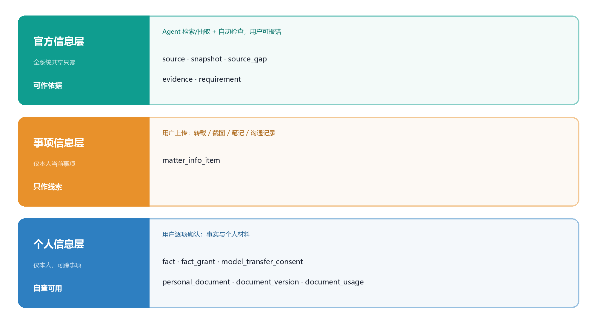

*图 2-1  三层信息及其数据落点*

分层不是文档里的口号，而是三组结构约束：

- **官方信息层**只有 source、snapshot、source_gap、evidence、requirement 五张表，用户对其只读，写入者是检索与自动检查流程；
- **事项信息层**只有 matter_info_item 一张表，且**没有任何外键指向 requirement**，结构上就阻断了“拿转载当依据”；
- **个人信息层**以 fact 与 personal_document 为核心，授权（fact_grant）与模型传输同意（model_transfer_consent）是可撤回的旁路记录。


### 2.5 模式划分

32 张表按“谁在什么节奏下改动”划为三个模式，而不是按功能模块划分。

**表 2-2  模式划分**

| 模式 | 名称 | 表数 | 职责 | 变更节奏 |
|---|---|---|---|---|
| core | 业务主数据 | 22 | 账号、工作区、事项、要求、评估、计划、任务、个人资料、材料 | 随用户操作，秒级 |
| ops | 来源、证据与审计 | 4 | 来源、快照、缺口、证据、审计 | 随检索与操作，分钟级 |
| kb | 领域知识 | 2 | 规则包与规则 | 随规则发布，周级 |


为什么把 audit_log 放在 ops 而不是 core：它记录“系统做了什么”，不参与业务判断；审计可以整体归档，业务表不能。规则包放 kb 则是因为它被模板版本与要求引用，需要独立导出给评阅或后续维护。


### 2.6 命名规范

**表 2-3  命名规范**

| 对象 | 规则 | 示例 |
|---|---|---|
| 模式 | 小写单词，表示数据归属 | core、ops、kb |
| 表 | 单数 snake_case，与类名可对照 | matter、document_version |
| 字段 | 单数 snake_case；外键以 _id 结尾 | matter_id、snapshot_id |
| 主键 | 统一为 id | id |
| 外键约束 | fk_<表>_<列> | fk_evidence_snapshot_id |
| 唯一约束 | uq_<表>_<语义> | uq_workspace_owner |
| 检查约束 | ck_<表>_<语义> | ck_eval_conclusion |
| 索引 | ix_<表>_<语义> | ix_matter_workspace |
| 枚举类型 | 语义化单数名 | conclusion、plan_status |


### 2.7 通用字段

**表 2-4  通用字段约定**

| 字段 | 类型 | 约定 | 适用范围 |
|---|---|---|---|
| id | uuid | 主键，应用层生成 UUIDv7，库默认 gen_random_uuid() 兜底 | 全部表 |
| created_at | timestamptz | 写入时间，默认 now() | 全部表 |
| updated_at | timestamptz | 最后修改时间，由触发器维护 | 可变业务表 |
| status | 枚举或受控 varchar | 生命周期状态，取值见 §5.1.2 | 有状态机的表 |
| *_hash | char(64) | 内容摘要，十六进制小写 | 快照、证据、材料版本 |
| *_object_key | varchar(512) | 对象存储键，不以 URL 保存 | snapshot、material_version |
| *_version | varchar / integer | 版本号，语义化或自增 | 模板、规则包、材料 |


时间一律 timestamptz 以 UTC 存储，展示时换算东八区。原因：有效期与截止日期常来自不同时区的表述，无时区时间会带来一天误差，而 AC06 要求“依据变化旧确认失效”必须精确到日。


### 2.8 字符集、时区与排序

UTF8 建库，排序规则采用 ICU 中文规则；比较以二进制序，避免大小写与重音干扰。会话时区 UTC，展示层转 Asia/Shanghai。全文检索首版只用于快照正文与来源发布主体，使用 simple 配置配合 zhparser；若环境无法安装扩展，退化为 pg_trgm 模糊匹配（§5.5）。


### 2.9 规模与增长

按首版试点规模（50 并发会话、单事项 ≤ 30 任务、DOCX ≤ 20 MB）估算，一年内：工作区 2000、事项 1 万、要求 30 万、评估 60 万、快照 5 万、材料版本 8 万、审计 200 万。最大的是审计与评估，两者决定了索引与归档策略；业务主数据在百万级以内，单机 PostgreSQL 足够。


## 3. 概念数据模型


### 3.1 建模方法

概念模型只回答“有哪些事物、它们如何相关”，不涉及类型与索引。建模按四步推进：

1. **取源**：以 SSD D 表 4“关键数据结构”的 32 个对象为主干，以 SSD D 图 4-5、4-6 的类属性为细化依据；
2. **定界**：按“官方 / 事项 / 个人”三层与生命周期分组，得到六个数据域；
3. **定键**：为每个实体确定业务标识与代理键，明确关系基数与参与度；
4. **对账**：与类图逐条比对，能一一对应的直接映射，需要拆分或合并的写明理由（§4.6）。

判断一个名词是否独立建表的判据有三条：有独立生命周期、被两条以上规则引用、需要独立授权或版本。三者缺一的降级为属性或 JSONB。例如“阶段定义”没有独立生命周期，它随模板版本冻结，因此存在 template_version.stage_defs 里，而不是一张阶段定义表。


### 3.2 实体识别

表 3-1 给出 32 个实体及其在 SSD D 中的出处。编号即第四章的表序，便于交叉引用。

**表 3-1  概念实体清单**

| # | 实体 | 英文 / 表名 | 域 | 标识（自然键） | SDD 出处 |
|---|---|---|---|---|---|
| 1 | 用户 | app_user | 工作区 | email | 图 4-5 User |
| 2 | 个人工作区 | workspace | 工作区 | owner_id（1:1） | 表 4 Workspace |
| 3 | 事项类型 | matter_type | 工作区 | type_code | 表 4 MatterType |
| 4 | 事项模板 | template | 工作区 | type_code + name | 表 4 Template |
| 5 | 模板版本 | template_version | 工作区 | template_id + version_no | D-11 |
| 6 | 事项 | matter | 事项 | workspace_id + goal + year | 表 4 Matter |
| 7 | 阶段 | stage | 事项 | matter_id + seq | 表 4 Stage |
| 8 | 事项决定 | matter_decision | 事项 | matter_id + type + time | 表 4 MatterDecision |
| 9 | 来源 | source | 来源 | url | 表 4 Source |
| 10 | 快照 | snapshot | 来源 | source_id + version_no | 表 4 Snapshot |
| 11 | 来源缺口 | source_gap | 来源 | matter_id + type | 表 4 SourceGap |
| 12 | 证据 | evidence | 来源 | 快照 + 目标 + 定位 | 表 4、D-10 |
| 13 | 要求 | requirement | 要求 | matter_id + field_key | 表 4 Requirement |
| 14 | 四态评估 | evaluation | 要求 | requirement_id + 规则版本 | 表 4 Evaluation |
| 15 | 导师联系判断 | mentor_contact_rule | 要求 | matter_id + project_scope | 表 4 MentorContactRule |
| 16 | 规则包 | rule_pack | 知识 | code（RP-年度-序号） | 表 4 KnowledgePack |
| 17 | 规则 | rule | 知识 | rule_pack_id + rule_code | 表 4 Rule |
| 18 | 候选计划 | candidate_plan | 计划 | matter_id + version_no / op_id | 表 4 CandidatePlan |
| 19 | 任务 | task | 计划 | matter_id + title | 表 4 Task |
| 20 | 收件箱项 | inbox_item | 计划 | user_id + type + object | 表 4 InboxItem |
| 21 | 事实 | fact | 个人资料 | owner_id + fact_type + version | 表 4 Fact |
| 22 | 事实授权 | fact_grant | 个人资料 | fact_id + target + purpose | 表 4 FactGrant |
| 23 | 模型传输同意 | model_transfer_consent | 个人资料 | user_id + provider + scope | 表 4 |
| 24 | 个人材料 | personal_document | 个人资料 | user_id + category + title | 表 4 PersonalDocument |
| 25 | 个人材料版本 | document_version | 个人资料 | doc_id + version_no | 表 4 DocumentVersion |
| 26 | 材料引用 | document_usage | 个人资料 | version_id + matter_id + requirement_id | 表 4 DocumentUsage |
| 27 | 事项信息 | matter_info_item | 材料 | matter_id + type + time | 表 4 MatterInfoItem |
| 28 | 事项材料 | material | 材料 | matter_id + material_type | 表 4 Material |
| 29 | 材料版本 | material_version | 材料 | material_id + version_no | 表 4 MaterialVersion |
| 30 | 提交证据 | submission_evidence | 材料 | matter_id + kind + time | 表 4 SubmissionEvidence |
| 31 | 官方结果 | official_result | 材料 | matter_id + result_type | 表 4 OfficialResult |
| 32 | 审计日志 | audit_log | 运维 | actor + action + object + time | 表 4 AuditLog |


### 3.3 数据域划分

32 个实体聚为六组（图 3-1）。分组的目的是控制外键方向：外键只能从“更易变”指向“更稳定”，例如要求引用快照，快照不引用要求；材料版本引用要求，要求不引用材料版本。这条约束让删除顺序与归档顺序都是确定的。

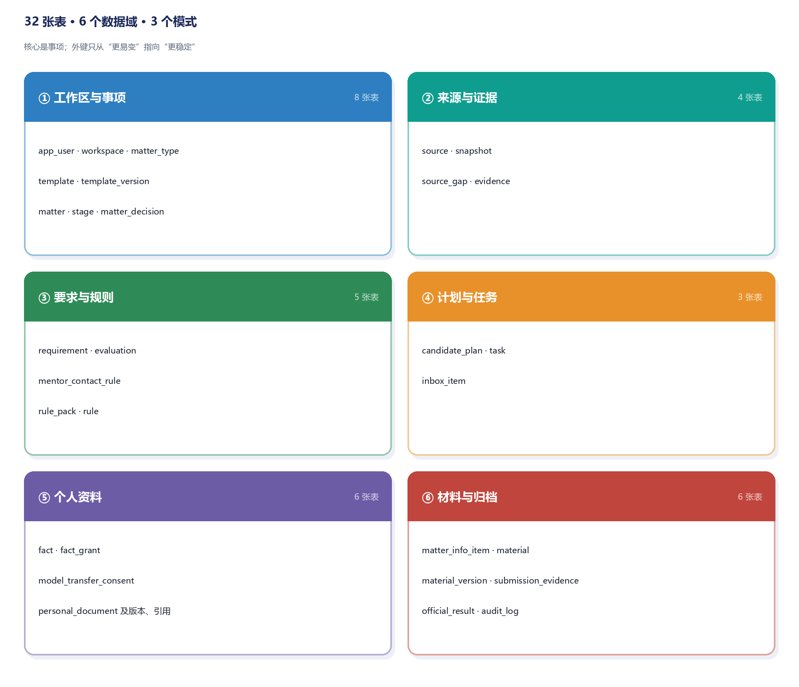

*图 3-1  数据域划分（3 个模式、32 张表）*


### 3.4 工作区与事项域

该域回答“谁在为哪件事做准备”。四个设计取舍值得说明。

**事项是聚合根，类型特有字段进 JSONB。**院校、学院、项目、批次、学位路径在推免里是四个维度，在竞赛里则变成赛项与赛道。若为每种类型建表，新增类型就要改库；因此 matter 只保留通用列，类型特有字段全部落在 scope_attrs，由模板声明字段名（D-27）。

**模板与模板版本分开。**事项引用的是 template_version 而不是 template：模板后续调整阶段或要求骨架时，已建事项的时间线不会被静默改写（D-04、D-11）。

**阶段随事项实例化。**stage 有自己的状态与完成时间，是任务推进的骨架；模板里的 stage_defs 只是定义，二者不能共用一张表。

**归档不单独建表。**归档是 1:0..1 关系，且归档后事项不再接受写入。因此把 archived_at、submitted_version_ids、archive_result、retrospective 并入 matter，用 archived_at 是否为空判断状态，省去一张只有少量列的表。

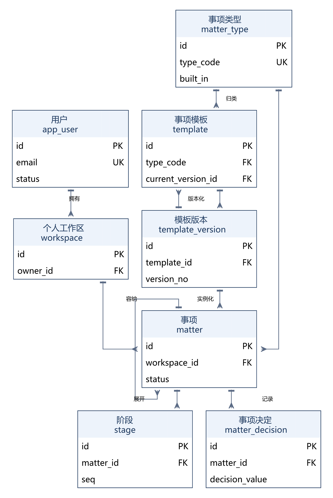

*图 3-2  工作区与事项域 ER 图*

图中未画出 matter.parent_matter_id 的自引用：外校两个批次拆成子事项时使用，子事项独立维护自己的适用范围（AC21）。自引用在实现上只是一列外键，不改变聚合边界。


### 3.5 来源与证据域

该域是“官方信息层”，也是全库唯一能作为判断依据的数据来源。三个取舍：

**来源与快照分离。**来源是稳定身份（URL、发布主体、有效期），快照是版本。内容变化只新增快照，来源主记录不变；转载、过期、范围不明记在 source.roi_status，使“这份材料不能当依据”成为可查询的状态而不是口头说明（AC14）。

**证据独立建表并采用多态挂载。**SSD D 的四元组是 {source_id, snapshot_id, locator, fetched_at}，但证据要同时服务于要求、评估结论与材料改写理由三类对象。若分别建三张证据表，四元组会被复制三份；因此用 target_type + target_id 表达多态，唯一约束落在 (snapshot_id, target_type, target_id, locator) 上，同一处不重复登记。

**缺口显式化。**source_gap 记录“官方入口未知、仅转载、需登录、页面删除、附件缺失、非公开”六类缺口。受影响的要求标 to_review，其余部分可继续推进，对应“不猜不补”的设计原则（AC02）。

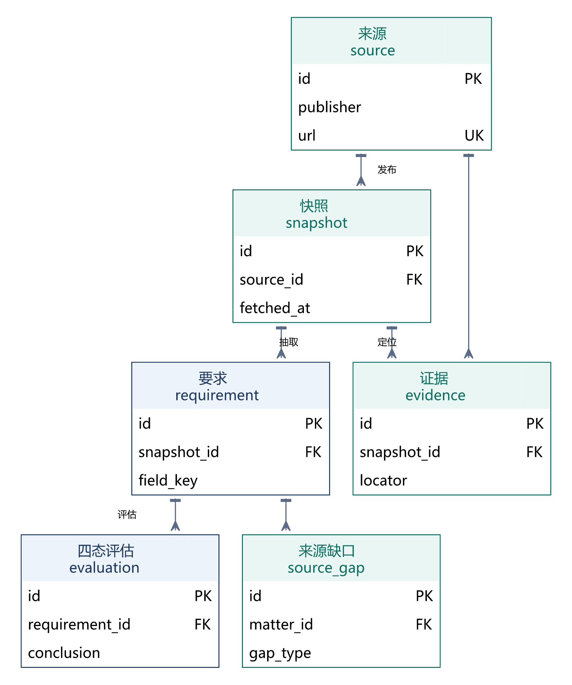

*图 3-3  来源、快照、要求与评估域 ER 图*

图中 source_gap 只画到“所属事项”一层：它的 affected_requirement_id 允许为空，缺口常常先于要求被发现，此时不应为了挂靠而虚构一条要求。


### 3.6 要求与规则域

该域决定“什么算符合”。四个要点：

**义务性质独立于结论。**required / advised / optional / to_verify 是要求的属性，四态是评估的结论，两者不能互相编码（D-14）。例如“官方建议”的事项即使不满足，结论仍是 non_compliant，而不是第五种状态。

**四态是闭集。**evaluation.conclusion 只有四个取值，数据库层用枚举关死，不产生“部分符合”之类的第五态（D-13、AC15）。

**结论带版本。**每条评估固定记录 rule_version 与 fact_version：规则口径变了、事实版本变了，旧结论自动失效而不是被覆盖（AC06）。

**导师联系判断单列。**“是否要求联系导师”与“导师同意证明是否必交”是两个问题，合并成一列会导致“要求联系但不必交证明”无法表达（AC04）。

规则包与规则拆成两张表：规则包是版本容器（RP-年度-序号），规则是逐条可引用的判定。模板版本引用规则包，保证“同一份通知在不同年度用不同口径”可解释。


### 3.7 个人资料域

该域是“个人信息层”，也是隐私设计最集中的地方。

**事实版本化。**fact 每次修改新增版本号，部分唯一索引保证同一类型只有一条已确认值；历史版本保留，使旧评估仍可解释（AC25）。

**授权与同意是两类旁路。**fact_grant 控制“某条事实能给谁、用于什么”，model_transfer_consent 控制“哪些字段可以发给哪个模型服务商”。前者服务内部使用，后者服务外部传输，撤回后都立即停止后续使用（D-18、D-30）。

**材料版本只增不改。**document_version 记录签发日、有效期、形式与覆盖范围；过期只改状态不删记录，引用方据此判定“缺有效证明”，而不是“资料库里有旧版本就算满足”。

**引用独立成表。**document_usage 记录“哪个事项、哪条要求引用了哪个版本”，frozen 标记提交时冻结。没有这张表，就无法回答“撤回授权会影响哪些材料”，而这是 AC26 的判定依据。

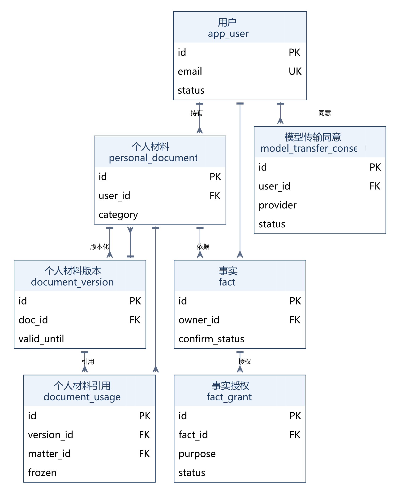

*图 3-4  个人材料、事实与授权 ER 图*

模型传输同意只与用户关联，不与具体事实或材料绑定：调用前由服务层按“服务商 + 字段范围 + 用途”三元组匹配，命中已授权且未撤回的记录才允许传输。


### 3.8 材料与归档域

该域负责“产出一份能交的材料”，并记录外部结果。

**事项材料与个人材料分表。**material 是“我要写的东西”，personal_document 是“我能证明的东西”。前者随事项删除，后者属于用户资产；混为一表会让删除策略无法自洽。

**材料版本保存差异与接受记录。**diff 与 accepted_patches 存为 JSONB，因为区块数不定、结构随 DOCX 而变；用关系表存补丁会让一次起草产生几十行记录，而查询只需要“这个版本接受了哪些改动”（AC08）。

**提交证据与官方结果分开。**本人确认与官方回执是两类证据，official_result 只记录校内选拔、报名成功、获奖、录取四种外部结果，且不由模型生成（AC12）。未取得结果时保持 pending。

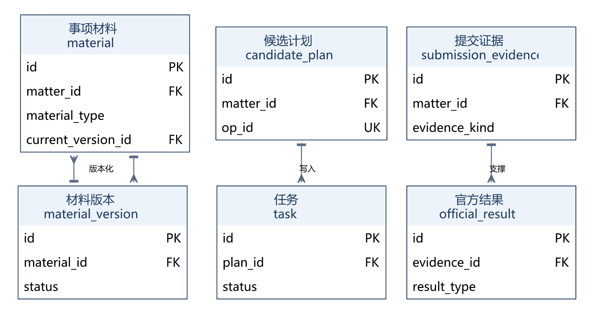

*图 3-5  事项材料、提交证据与官方结果 ER 图*

三条链都通过事项关联：材料—版本、候选计划—任务、提交证据—官方结果；它们分列左右并不影响一致性，删除事项时按 §7.3 的策略一并清理。


### 3.9 关系清单

**表 3-2  主要关系与基数**

| 关系 | 父实体 | 子实体 | 基数 | 参与度 | 说明 |
|---|---|---|---|---|---|
| 拥有 | 用户 | 工作区 | 1 : 1 | 全参与 | 唯一索引保证一一对应 |
| 容纳 | 工作区 | 事项 | 1 : N | 全参与 | 删除工作区级联清理事项 |
| 归类 | 事项类型 | 模板 | 1 : N | 全参与 | 类型注册后不可改名 |
| 版本化 | 模板 | 模板版本 | 1 : N | 部分参与 | 至多一个当前版本 |
| 实例化 | 模板版本 | 事项 | 1 : N | 全参与 | 事项固定引用一个版本 |
| 展开 | 事项 | 阶段 | 1 : N | 全参与 | 顺序唯一 |
| 记录 | 事项 | 事项决定 | 1 : N | 部分参与 | 采纳/稍后/跳过 |
| 发布 | 来源 | 快照 | 1 : N | 全参与 | 首次获取即 v1 |
| 定位 | 快照 | 证据 | 1 : N | 部分参与 | 证据可挂要求、评估或材料版本 |
| 抽取 | 快照 | 要求 | 1 : N | 全参与 | 要求必须绑定快照 |
| 评估 | 要求 | 四态评估 | 1 : N | 部分参与 | 一条要求可多次评估 |
| 专项 | 事项 | 导师联系判断 | 1 : N | 部分参与 | 推免模板下必有 |
| 绑定 | 规则包 | 模板版本 | 1 : N | 部分参与 | 模板可暂无规则包 |
| 包含 | 规则包 | 规则 | 1 : N | 全参与 | 规则随包版本 |
| 生成 | 事项 | 候选计划 | 1 : N | 部分参与 | 每次生成一个新版本 |
| 写入 | 候选计划 | 任务 | 1 : N | 部分参与 | 确认后才产生 |
| 归属 | 用户 | 事实 | 1 : N | 全参与 | 每人每类至多一条已确认 |
| 授权 | 事实 | 事实授权 | 1 : N | 部分参与 | 按用途授权 |
| 持有 | 用户 | 个人材料 | 1 : N | 全参与 | 跨事项复用 |
| 版本化 | 个人材料 | 材料版本 | 1 : N | 全参与 | 只增不改 |
| 引用 | 材料版本 | 材料引用 | 1 : N | 部分参与 | 引用具体版本，提交冻结 |
| 归属 | 事项 | 事项信息 | 1 : N | 部分参与 | 默认不跨事项 |
| 产出 | 事项 | 事项材料 | 1 : N | 部分参与 | 材料与要求多对多 |
| 版本化 | 事项材料 | 材料版本 | 1 : N | 全参与 | 含差异与接受记录 |
| 登记 | 事项 | 提交证据 | 1 : N | 部分参与 | 两类证据分开 |
| 确认 | 提交证据 | 官方结果 | 1 : N | 部分参与 | 结果需证据支撑 |
| 留痕 | 用户 | 审计日志 | 1 : N | 部分参与 | 系统动作可为空 |


### 3.10 关键业务约束

**表 3-3  关键业务约束**

| 编号 | 约束 | 来源 | 实现位置 | 强度 |
|---|---|---|---|---|
| C-01 | 要求必须绑定快照与所属事项 | D-10、AC01 | 两列 NOT NULL + 外键 | 数据库 |
| C-02 | 证据四元组完整且快照属于同一来源 | D-10 | 外键 + 触发器 | 数据库 |
| C-03 | 评估结论只有四态 | D-13、AC15 | 枚举 conclusion | 数据库 |
| C-04 | 同一用户每类事实至多一条已确认值 | D-17、AC25 | 部分唯一索引 uq_fact_current | 数据库 |
| C-05 | 候选计划确认后才产生任务 | D-05、AC05 | 应用层事务 + plan_id 可空 | 事务内 |
| C-06 | 同一 opId 只写入一次 | D-16、AC06 | 唯一索引 uq_plan_op | 数据库 |
| C-07 | 同一来源相同内容不新建快照 | AC01 | 唯一索引 uq_snapshot_hash | 数据库 |
| C-08 | 同一来源仅一个当前快照 | NFR-05 | 部分唯一索引 ix_snapshot_current | 数据库 |
| C-09 | 材料定稿需贡献已确认 | AC24 | 检查约束 ck_mv_final | 数据库 |
| C-10 | 完成的任务必须有完成证据 | F06 | 检查约束 ck_task_done | 数据库 |
| C-11 | 事实确认时间与状态一致 | AC25 | 检查约束 ck_fact_confirm | 数据库 |
| C-12 | 同意撤回必须记录撤回时间 | D-30 | 检查约束 ck_consent_revoke | 数据库 |
| C-13 | 归档事项必须冻结提交版本集合 | AC29 | 检查约束 ck_matter_archive | 数据库 |
| C-14 | 工作区与用户一一对应 | D-26 | 唯一索引 uq_workspace_owner | 数据库 |
| C-15 | 用户只能访问本人工作区数据 | AC19 | RLS 策略 + 服务层校验 | 数据库 |


## 4. 逻辑数据模型


### 4.1 关系模式总览

32 张表的完整清单见表 4-1。表中“外键数”可直接对照附录 B 的 53 条外键，用于评估删除一个聚合根会波及多少张表。

**表 4-1  数据表总览（32 张）**

| # | 模式 | 表名 | 中文名 | 外键数 |
|---|---|---|---|---|
| 1 | core | app_user | 用户 | 0 |
| 2 | core | workspace | 个人工作区 | 1 |
| 3 | core | matter_type | 事项类型 | 0 |
| 4 | kb | rule_pack | 规则包 | 1 |
| 5 | kb | rule | 规则 | 1 |
| 6 | core | template | 事项模板 | 2 |
| 7 | core | template_version | 模板版本 | 2 |
| 8 | core | matter | 事项 | 4 |
| 9 | core | stage | 阶段 | 1 |
| 10 | core | matter_decision | 事项决定 | 1 |
| 11 | ops | source | 来源 | 1 |
| 12 | ops | snapshot | 快照 | 1 |
| 13 | core | requirement | 要求 | 2 |
| 14 | ops | source_gap | 来源缺口 | 2 |
| 15 | ops | evidence | 证据 | 2 |
| 16 | core | evaluation | 四态评估 | 1 |
| 17 | core | mentor_contact_rule | 导师联系判断 | 3 |
| 18 | core | personal_document | 个人材料 | 2 |
| 19 | core | document_version | 个人材料版本 | 1 |
| 20 | core | document_usage | 个人材料引用 | 4 |
| 21 | core | fact | 事实 | 2 |
| 22 | core | fact_grant | 事实授权 | 1 |
| 23 | core | model_transfer_consent | 模型传输同意 | 1 |
| 24 | core | matter_info_item | 事项信息 | 2 |
| 25 | core | material | 事项材料 | 3 |
| 26 | core | material_version | 材料版本 | 1 |
| 27 | core | candidate_plan | 候选计划 | 2 |
| 28 | core | task | 任务 | 3 |
| 29 | core | inbox_item | 收件箱项 | 1 |
| 30 | core | submission_evidence | 提交证据 | 2 |
| 31 | core | official_result | 官方结果 | 2 |
| 32 | ops | audit_log | 审计日志 | 1 |


从分布看，core 模式 22 张表承担了绝大部分写入；ops 只有 4 张，但其中 audit_log 是唯一持续增长的流水表；kb 仅 2 张，却决定了所有评估的口径。这一分布与 §2.5 的划分依据一致：变更越频繁越靠近 core，变更越少、被引用越多越靠近 kb。


### 4.2 关系模式的形式化描述

关系模式写作 R(U, F)。为便于阅读，下文以“关系名(属性…) + 键声明 + 规则”的形式书写，箭头表示外键指向，AK 为候选键，RULE 为需要事务或触发器保障的规则。完整字段见第 5 章。

```text
MATTER( id, workspace_id→WORKSPACE.id, type_code→MATTER_TYPE.type_code,
        template_version_id→TEMPLATE_VERSION.id, goal, status,
        scope_year, scope_attrs, parent_matter_id→MATTER.id,
        archived_at, submitted_version_ids, archive_result, retrospective,
        created_at, updated_at )
    KEY  : id
    FD   : id → 其余全部属性
    RULE : parent_matter_id ≠ id；archived_at 非空即拒绝写入

CANDIDATE_PLAN( id, matter_id→MATTER.id, version_no, status, basis_version,
                generated_at, confirmed_at, confirmed_by→APP_USER.id, op_id )
    KEY  : id
    AK   : (matter_id, version_no)、(op_id)
    FD   : id → 其余全部属性
    RULE : status = 'confirmed' ⇔ confirmed_at IS NOT NULL；确认在同一事务内写入 TASK

TASK( id, matter_id→MATTER.id, plan_id→CANDIDATE_PLAN.id, executor_id→APP_USER.id,
      title, due_at, status, completion_evidence, depends_on uuid[], created_at )
    KEY  : id
    FD   : id → 其余全部属性
    RULE : status = 'done' ⇔ completion_evidence IS NOT NULL；就绪由 depends_on 判定
```

```text
SNAPSHOT( id, source_id→SOURCE.id, version_no, object_key, content_hash,
          html_version, text_version, extraction, fetched_at, is_current )
    KEY  : id
    AK   : (source_id, version_no)、(source_id, content_hash)
    FD   : id → 其余全部属性

EVIDENCE( id, source_id→SOURCE.id, snapshot_id→SNAPSHOT.id,
          target_type, target_id, locator_kind, locator, quote, quote_hash, fetched_at )
    KEY  : id
    AK   : (snapshot_id, target_type, target_id, locator)
    RULE : target_type='requirement' ⇒ 存在 REQUIREMENT(target_id) 且其 snapshot_id = snapshot_id
    RULE : fetched_at = SNAPSHOT(fetched_at)（同一份证据的时间必须与快照一致）

EVALUATION( id, requirement_id→REQUIREMENT.id, conclusion, basis, rule_version, fact_version, created_at )
    KEY  : id
    FD   : id → 其余全部属性
    RULE : conclusion ∈ {compliant, non_compliant, missing_info, to_review}
```

把 RULE 与函数依赖写在一起，是为了让实现者在建表时就看到全部约束，而不是等到联调阶段才发现“同一条要求有两条有效评估”这类问题。


### 4.3 范式与合并取舍

全部表满足第三范式：非主属性完全依赖候选键，不存在传递依赖。四类受控冗余见表 4-2，均为查询路径或并发控制所必需。

**表 4-2  受控冗余与合并**

| 位置 | 冗余 / 合并 | 原因 |
|---|---|---|
| matter.type_code | 冗余 matter_type_id 的编码 | 类型编码是模板与来源的连接键，避免三次连接 |
| requirement.snapshot_id | 与 evidence.snapshot_id 重复 | 允许“要求已入库、证据待补”的中间态 |
| evaluation.fact_version | 汇总而非单列事实外键 | 一条结论可能引用多条事实，逐条外键会让评估表膨胀 |
| audit_log.detail | 承载检索查询与工具执行信息 | 合并 retrieval_run / tool_run，避免为每类动作建流水表 |
| task.depends_on | 数组替代依赖表 | 依赖数通常小于 5，环路校验在应用层一次遍历即可 |
| matter.*archive* | 归档字段并入事项 | 1:0..1 关系，单列判定比连接一张空表更直接 |


合并的判断标准是“这张表是否会被单独查询、单独授权、单独归档”。三点皆否的，合并进主表；只要有一点成立，就保留为独立表。TaskDependency 与 Archive 都属于三点皆否，因此合并；而 document_usage 虽然字段少，却需要单独授权校验与影响面查询，因此保留。


### 4.4 视图与查询接口

**表 4-3  视图清单**

| 视图 | 用途 | 关键条件 |
|---|---|---|
| v_matter_overview | 事项列表：类型、阶段进度、任务完成率 | status <> 'cancelled' |
| v_requirement_checked | 只暴露通过自动检查的要求及其证据数 | extract_status = 'checked' |
| v_evaluation_current | 取每条要求的最新评估 | 按 created_at 取首行 |
| v_document_expiring | 即将过期与已过期的个人材料 | valid_until <= current_date + 30 |
| v_inbox_open | 收件箱：待处理项与等待时长 | status = 'open' |
| v_usage_impact | 撤回/删除前的影响面：哪些事项引用了该版本 | 按 version_id 聚合 |


视图不承载写操作，所有写入走基表。v_usage_impact 是 AC26 的实现基础：撤回授权或删除材料前，服务层先查该视图列出受影响事项，再执行撤回。


### 4.5 实体类与数据库表的映射

SDD 图 4-5、4-6、4-7 共定义 30 余个类。表 4-4 给出逐类映射，“映射方式”一列标出直接映射、一拆二、并入或补字段的情形，未列出的类均为一对一直接映射。

**表 4-4  类与数据库表映射**

| SSD D 类 / 对象 | 对应表 | 属性映射要点 | 映射方式 | 说明 |
|---|---|---|---|---|
| User | core.app_user | userId→id、displayName→display_name、accountType→account_type | 删去团队角色 | D-26 取消协作，只保留 applicant |
| Workspace | core.workspace | workspaceId、ownerId 同名映射 | 直接映射 | 与用户 1:1 由唯一索引保证 |
| MatterType | core.matter_type | typeCode→type_code、builtIn→built_in | 直接映射 | 类型注册表 |
| Template | core.template + core.template_version | 版本内容拆到版本表，主表保留 current_version_id | 一拆二 | D-11 版本化要求 |
| Matter | core.matter | matterId、workspaceId、typeCode、status、scopeYear、scopeAttrs 同名 | 吸收归档 | Archive 为 1:0..1，合并进本表 |
| Stage | core.stage | stageId、order→seq、status 同名 | 直接映射 | 阶段随事项实例化 |
| MatterDecision | core.matter_decision | decisionType、decisionValue、timeAt→decided_at | 直接映射 | — |
| Source | ops.source | publisher、url、scope、scopeYear、status 同名；新增 roi_status | 直接映射 | 转载/过期需显式标注（AC14） |
| Snapshot | ops.snapshot | objectKey、fetchedAt、htmlVersion、textVersion 同名 | 直接映射 | 只增不改 |
| Evidence | ops.evidence | 四元组原样落库；新增 target_type/target_id 支持多态挂载 | 多态扩展 | 要求、结论、材料改写理由共用一张证据表 |
| SourceGap | ops.source_gap | gapType、status、affectedRequirement 同名 | 直接映射 | — |
| Requirement | core.requirement | obligationNature、extractStatus、scope 同名；删除 evidenceLocator | 定位下沉 | 定位拆到 evidence 表，支持多条证据 |
| Evaluation | core.evaluation | conclusion、basis、ruleVersion、factVersion 同名 | 直接映射 | 四态为闭集 |
| MentorContactRule | core.mentor_contact_rule | contactStatus、proofRequired 同名 | 直接映射 | 两件事分开存（AC04） |
| KnowledgePack | kb.rule_pack + kb.rule | 包与规则拆表，规则以包版本为版本 | 一拆二 | 规则需要逐条回归与引用 |
| CandidatePlan | core.candidate_plan | planId、version、status、basisVersion 同名；新增 opId | 补幂等 | D-16 唯一操作标识 |
| Task | core.task | taskId、dueAt、status、completionEvidence 同名；依赖改为数组 | 合并依赖 | TaskDependency 表并入 depends_on |
| TaskDependency | core.task.depends_on | dependsOnTaskId → uuid[] | 并入 | 环路校验在应用层 |
| InboxItem | core.inbox_item | itemId、type、objectId、status 同名 | 直接映射 | — |
| Fact | core.fact | factId、ownerId、factType、value、trust、confirmStatus、version 同名 | 直接映射 | 部分唯一索引保证当前有效值唯一 |
| FactGrant | core.fact_grant | grantId、factId、grantedTo、purpose、status 同名 | 直接映射 | — |
| ModelTransferConsent | core.model_transfer_consent | consentId、provider、fieldScope、purpose 同名 | 直接映射 | D-30 传输前置 |
| PersonalDocument | core.personal_document | docId、category、sensitivityLevel、currentVersionId 同名 | 直接映射 | — |
| DocumentVersion | core.document_version | versionId、objectKey、hash、issuedAt、validUntil、form 同名 | 直接映射 | — |
| DocumentUsage | core.document_usage | usageId、docId、versionId、matterId、frozen 同名 | 直接映射 | 引用具体版本 |
| MatterInfoItem | core.matter_info_item | infoId、matterId、type、trust、status 同名 | 直接映射 | 不可作为依据 |
| Material | core.material | materialId、type→material_type、currentVersionId 同名 | 直接映射 | — |
| MaterialVersion | core.material_version | docxObjectKey、diff、acceptedPatches、authors 同名 | 直接映射 | 差异存 JSONB |
| ReviewRecord | ops.audit_log | objectType、objectVersion、result 复用审计字段 | 并入 | 确认状态落在各对象上，事件入审计 |
| SubmissionEvidence | core.submission_evidence | evidenceId、type→evidence_kind、fileRef 同名 | 直接映射 | 两类证据分开 |
| OfficialResult | core.official_result | resultId、type、status、source、evidenceId 同名 | 直接映射 | 不由模型生成 |
| Archive | core.matter | archiveId 去掉，归档字段并入事项 | 并入 | 1:0..1 关系 |
| ToolRun | ops.audit_log | mode、tool、authLevel 记入 detail | 并入 | 工具执行属操作留痕 |
| AuditLog | ops.audit_log | logId、action、objectId、actorId、timeAt 同名；新增 detail | 直接映射 | 检索记录也记于此 |
| RetrievalRun | ops.audit_log | 查询与命中记入 action='source.retrieve' 的 detail | 并入 | 检索留痕合并 |


映射遵循三条规则：类名转 snake_case 即表名；类中的值对象（阶段定义、要求骨架、差异）映射为 JSONB 而非子表；类中的布尔标记若带时间语义，升级为时间戳。第三条的原因与旧版一致：privacy 类字段一旦需要回答“何时同意”，布尔量就不够用。


### 4.6 与系统设计说明的差异

表结构不应与 SDD 存在无法解释的差异。表 4-5 列出全部差异及理由，评审时应逐条确认。

**表 4-5  与 SSD D 的差异**

| SDD 对象 | 本文档 | 差异 | 理由 |
|---|---|---|---|
| Template | template + template_version | 一拆二 | D-11 要求版本化；事项引用具体版本，模板调整不影响已建事项 |
| KnowledgePack | kb.rule_pack + kb.rule | 一拆二 | 规则需逐条引用与回归，合并成 JSONB 会失去可查询性 |
| Evidence | ops.evidence | 多态扩展 | 四元组挂到要求、评估、材料改写理由三类对象，避免三张证据表 |
| Requirement.evidenceLocator | evidence.locator | 定位下沉 | 一条要求可能有多处依据，单字段无法表达 |
| TaskDependency | task.depends_on | 并入 | 依赖数少，图校验在应用层完成 |
| Archive | matter 归档字段 | 并入 | 1:0..1 关系，单独建表收益低 |
| ReviewRecord | audit_log + 各对象确认列 | 并入 | 确认状态落在对象上，事件写审计，避免两处记录不一致 |
| RetrievalRun / ToolRun | audit_log.detail | 并入 | 二者都是操作留痕，不参与业务判断 |
| Source.roiStatus | source.roi_status | 补列 | AC14 要求转载/过期可标注，SDD 类图未列 |
| DocumentVersion.form | document_version.doc_form | 补列 | 一致性与形式检查（AC08）需要形式字段 |


差异的共同点是“把版本与留痕从主对象中剥离”。这与 SSD D §4.1.2.3 的三条结构约束一致：要求可追溯到原文快照、任务可追溯到要求与确认记录、材料版本可追溯到事实版本与接受记录。三条都需要“可比较的版本标识”，而版本标识只能落在独立表或独立列上。


### 4.7 派生数据与生命周期

派生数据指可由其他数据重算的结果，如阶段进度、任务完成率、评估结论、影响面清单。派生数据必须明确“何时失效、由谁重算”。

- **评估结论**：由要求、规则版本与事实版本派生。规则或事实变化时旧结论失效（status 置 expired 或重新评估），而不是原地覆盖；
- **材料版本**：由用户接受补丁产生，接受记录永久保留；原件不因新版本而改变；
- **任务状态**：由确认、完成证据与依赖共同决定；外部结果不自动回写任务状态（AC11）；
- **影响面视图**：实时计算，不落表，避免与引用关系不同步。

> **说明**：判据：被用户确认过的派生数据具有独立价值，不能因源数据变化而消失。这条判据解释了为什么评估、材料版本、官方结果都保留历史，而任务完成率可以实时计算。


## 5. 物理数据库设计


### 5.1 物理设计约定


#### 5.1.1 数据类型选型

**表 5-1  数据类型选型**

| 类型 | 用途 | 选型理由 | 注意事项 |
|---|---|---|---|
| uuid | 全部主键 | 跨环境合并、对前端不泄露量级 | 应用层生成 UUIDv7 |
| varchar(n) | 有上限的业务字符串 | 长度上限本身是契约 | 按实测最长 1.5 倍取值 |
| text | 正文、引文、说明 | 与 varchar 性能相同，无需限长 | 超长内容放对象存储 |
| timestamptz | 全部时间点 | 带时区，避免跨时区出错 | 统一 UTC 存储 |
| date | 签发日、有效期 | 只到日的语义不应虚构时刻 | 展示不做时区换算 |
| jsonb | 阶段定义、要求骨架、差异、细节 | 结构随类型或版本变化 | 禁止存原文与证件号 |
| uuid[] | 任务依赖、归档版本集合 | 元素少、以包含判断为主 | 超过 50 个元素应拆表 |
| char(64) | 内容摘要 | 定长、可直接比较 | 写入前转小写 |
| numeric(4,3) | 置信度 | 精确小数，避免浮点误差 | 检查 0—1 |
| smallint | 年度、顺序号 | 范围足够且省空间 | 年度检查 2020—2100 |
| text[] | 无 | 本版未使用 | — |


#### 5.1.2 枚举类型

本版使用 18 个原生枚举。判据与旧版一致：**取值由状态机决定、不随领域知识变化**的用原生枚举；**取值随规则或模板演进**的用受控 varchar 加检查约束。前者如 matter_status、conclusion，后者如 source.roi_status、task.depends_on 等。

**表 5-2  枚举类型定义**

| 类型名 | 取值 | 用途说明 |
|---|---|---|
| account_status | pending / active / disabled | 账号状态 |
| matter_status | draft / active / paused / archived / cancelled | 事项状态 |
| stage_status | pending / in_progress / done / skipped | 阶段状态 |
| obligation_nature | required / advised / optional / to_verify | 义务性质 |
| extract_status | extracted / checked / to_review / rejected | 提取状态 |
| conclusion | compliant / non_compliant / missing_info / to_review | 四态结论 |
| plan_status | draft / pending / confirmed / rejected / expired | 候选计划状态 |
| task_status | pending / ready / in_progress / blocked / done / cancelled | 任务状态 |
| inbox_status | open / read / resolved / ignored | 收件箱状态 |
| fact_status | draft / confirmed / revoked | 事实状态 |
| doc_status | draft / valid / expiring / expired / frozen / revoked | 材料状态 |
| grant_status | active / revoked / expired | 授权状态 |
| consent_status | granted / revoked | 同意状态 |
| source_status | active / withdrawn / invalid | 来源状态 |
| check_result | pending / passed / failed / conflict | 自动检查结果 |
| gap_status | open / filled / unverifiable | 来源缺口状态 |
| pack_status | draft / published / retired | 规则包状态 |
| severity | block / warn / info | 规则严重级 |


> **注意**：枚举兼容性：PostgreSQL 的 ALTER TYPE … ADD VALUE 不能在事务块中回滚，新增状态值须在独立迁移脚本中执行，且旧版本应用要能容忍未知值。这条约定写入 §10.1 的迁移规范。


### 5.2 表结构定义

本节按六个数据组给出 32 张表的字段定义（表 5-3 至表 5-34）。每张表后依次给出约束与索引摘要、用途与设计说明。字段描述中的“默认”指数据库默认值。


#### 5.2.1 工作区与事项（M1，8 张表）

这一组是聚合的骨架：用户持有工作区，工作区容纳事项，事项按模板版本展开阶段，所有类型特有字段落在 scope_attrs。四张表（模板、模板版本、事项、工作区）之间的引用方向是单向的。

### 用户（`core.app_user`）

**表 5-3  用户（core.app_user）**

| 字段名 | 数据类型 | 可空 | 键 | 说明 |
|---|---|---|---|---|
| id | uuid | 否 | PK | 用户主键 |
| email | varchar(160) | 否 | UQ | 登录邮箱，统一小写后唯一 |
| display_name | varchar(60) | 否 |  | 展示名，对应类图 User.displayName |
| password_hash | varchar(255) | 否 |  | Argon2id 哈希，不可逆 |
| account_type | varchar(16) | 否 |  | 账号类型，首版仅 applicant |
| status | account_status | 否 |  | pending / active / disabled |
| created_at | timestamptz | 否 |  | 注册时间 |
| updated_at | timestamptz | 否 |  | 更新时间 |
| deleted_at | timestamptz | 是 |  | 注销标记，注销后保留占位 |

- 唯一约束：uq_app_user_email
- 检查约束：ck_app_user_type
- 索引：ix_app_user_status
- 删除策略：注销时置 deleted_at；个人数据由清理任务按保留策略处理。

**用途**：登录主体。首版只有“申请者本人”一种账号类型，团队协作已取消（D-26），因此不存在协作者、审核人等运行期角色。

**说明**：没有 admin / reviewer 角色，避免与“数据归用户所有”的设计前提冲突。

### 个人工作区（`core.workspace`）

**表 5-4  个人工作区（core.workspace）**

| 字段名 | 数据类型 | 可空 | 键 | 说明 |
|---|---|---|---|---|
| id | uuid | 否 | PK | 工作区主键 |
| owner_id | uuid | 否 | FK | 所有者，与用户 1:1，唯一 |
| created_at | timestamptz | 否 |  | 创建时间 |
| updated_at | timestamptz | 否 |  | 更新时间 |

- 外键：owner_id → core.app_user
- 唯一约束：uq_workspace_owner
- 索引：ix_workspace_owner
- 删除策略：随用户删除级联，并级联清理其下事项与材料。

**用途**：用户级容器，与用户一一对应。事项、待办与材料都挂在工作区之下，删除工作区时级联清理（对应 SDD 表 4 的“删除时级联清理事项、待办与材料”）。

**说明**：工作区不共享、不邀请，是“个人数据归用户”在结构上的落点。

### 事项类型（`core.matter_type`）

**表 5-5  事项类型（core.matter_type）**

| 字段名 | 数据类型 | 可空 | 键 | 说明 |
|---|---|---|---|---|
| id | uuid | 否 | PK | 类型主键 |
| type_code | varchar(32) | 否 | UQ | 类型编码，如 pre_recommend / competition |
| name | varchar(60) | 否 |  | 类型名称 |
| built_in | boolean | 否 |  | 是否随系统内置 |
| enabled | boolean | 否 |  | 是否启用；停用后不可新建事项 |
| created_at | timestamptz | 否 |  | 创建时间 |

- 唯一约束：uq_matter_type_code
- 索引：ix_matter_type_enabled
- 删除策略：被事项或模板引用时 RESTRICT。

**用途**：事项类型的注册表。首版内置推免与竞赛两类，新增类型只注册数据、不改代码（D-27）。

**说明**：type_code 是模板、来源、事项之间的连接键，一旦发布不再改名。

### 事项模板（`core.template`）

**表 5-6  事项模板（core.template）**

| 字段名 | 数据类型 | 可空 | 键 | 说明 |
|---|---|---|---|---|
| id | uuid | 否 | PK | 模板主键 |
| type_code | varchar(32) | 否 | FK | 所属事项类型，引用 matter_type.type_code |
| name | varchar(80) | 否 |  | 模板名称 |
| current_version_id | uuid | 是 | FK | 当前生效版本，引用 template_version |
| status | varchar(16) | 否 |  | draft / published / retired |
| created_at | timestamptz | 否 |  | 创建时间 |

- 外键：type_code → core.matter_type、current_version_id → core.template_version
- 唯一约束：uq_template_type_name
- 检查约束：ck_template_status
- 索引：ix_template_type
- 删除策略：版本为可延迟外键；模板退役时保留版本供历史事项解释。

**用途**：模板身份。模板决定阶段、要求骨架与材料类型，是“类型特有字段”的唯一来源（D-04、D-27）。

**说明**：模板与版本分表，保证“已实例化事项”引用的是具体版本而不是一个可变的模板。

### 模板版本（`core.template_version`）

**表 5-7  模板版本（core.template_version）**

| 字段名 | 数据类型 | 可空 | 键 | 说明 |
|---|---|---|---|---|
| id | uuid | 否 | PK | 版本主键 |
| template_id | uuid | 否 | FK | 所属模板 |
| version_no | varchar(32) | 否 |  | 版本号 TP-<类型>-<序号> |
| stage_defs | jsonb | 否 |  | 阶段定义数组：名称、顺序、是否必经 |
| requirement_skeleton | jsonb | 否 |  | 要求骨架：字段键、义务性质、适用范围 |
| material_types | jsonb | 否 |  | 材料类型与命名、格式约定 |
| rule_pack_id | uuid | 是 | FK | 绑定的规则包版本 |
| status | pack_status | 否 |  | draft / published / retired |
| regression_result | jsonb | 是 |  | 回归结果摘要（字段正确率、引用可达率） |
| published_at | timestamptz | 是 |  | 发布时间 |
| created_at | timestamptz | 否 |  | 创建时间 |

- 外键：template_id → core.template、rule_pack_id → kb.rule_pack
- 唯一约束：uq_template_version_no
- 检查约束：ck_tv_publish
- 索引：ix_tv_template
- 删除策略：随模板级联；被事项引用时 RESTRICT（事项必须能解释自己用哪一版）。

**用途**：模板的一次发布。阶段定义、要求骨架、材料类型与规则包在此冻结，版本号形如 TP-pre-01（SDD §3.8）。

**说明**：发布后内容冻结；后续调整必须新建版本，否则已建事项的阶段与要求会被静默改写。

### 事项（`core.matter`）

**表 5-8  事项（core.matter）**

| 字段名 | 数据类型 | 可空 | 键 | 说明 |
|---|---|---|---|---|
| id | uuid | 否 | PK | 事项主键 |
| workspace_id | uuid | 否 | FK | 所属工作区 |
| type_code | varchar(32) | 否 | FK | 事项类型，引用 matter_type.type_code |
| template_version_id | uuid | 否 | FK | 实例化所用的模板版本 |
| goal | varchar(200) | 否 |  | 事项目标，用户原文 |
| status | matter_status | 否 |  | draft 探索草稿 / active / paused / archived / cancelled |
| scope_year | smallint | 是 |  | 适用年度 |
| scope_attrs | jsonb | 是 |  | 类型特有字段：院校/学院/项目/批次/学位路径、赛项/赛道等 |
| parent_matter_id | uuid | 是 | FK | 父事项，用于外校批次拆分（F14） |
| archived_at | timestamptz | 是 |  | 归档时间；为空表示未归档 |
| submitted_version_ids | uuid[] | 是 |  | 归档时冻结的材料版本集合 |
| archive_result | varchar(200) | 是 |  | 归档结果摘要，仅来自用户确认或官方回执 |
| retrospective | text | 是 |  | 复盘记录 |
| created_at | timestamptz | 否 |  | 创建时间 |
| updated_at | timestamptz | 否 |  | 更新时间 |

- 外键：workspace_id → core.workspace、type_code → core.matter_type、template_version_id → core.template_version、parent_matter_id → core.matter
- 检查约束：ck_matter_archive、ck_matter_year
- 索引：ix_matter_workspace、ix_matter_type_year、ix_matter_parent
- 删除策略：随工作区级联；有阶段、要求、任务、材料时一并清理；归档后拒绝写入由应用层保证。

**用途**：核心聚合根。一次申请、一场竞赛、一个项目申报都是一个事项，类型特有字段全部落在 scope_attrs。归档信息也在此表（1:0..1 合并）。

**说明**：归档为 1:0..1 关系，合并进本表；archived_at 非空即“归档且不再接受写入”。

### 阶段（`core.stage`）

**表 5-9  阶段（core.stage）**

| 字段名 | 数据类型 | 可空 | 键 | 说明 |
|---|---|---|---|---|
| id | uuid | 否 | PK | 阶段主键 |
| matter_id | uuid | 否 | FK | 所属事项 |
| name | varchar(60) | 否 |  | 阶段名称，如 报名、材料提交、考核 |
| seq | smallint | 否 |  | 顺序号，决定时间线展示 |
| status | stage_status | 否 |  | pending / in_progress / done / skipped |
| is_required | boolean | 否 |  | 是否必经；跳过需显式告知（AC17） |
| started_at | timestamptz | 是 |  | 开始时间 |
| completed_at | timestamptz | 是 |  | 完成时间 |

- 外键：matter_id → core.matter
- 唯一约束：uq_stage_seq
- 检查约束：ck_stage_seq
- 索引：ix_stage_matter
- 删除策略：随事项级联。

**用途**：事项按模板展开的执行阶段。未在官方资料中确认的节点不自动成为必经步骤（D-04）。

**说明**：阶段实例随事项生成，不在事项间共享；模板调整不影响已建事项。

### 事项决定（`core.matter_decision`）

**表 5-10  事项决定（core.matter_decision）**

| 字段名 | 数据类型 | 可空 | 键 | 说明 |
|---|---|---|---|---|
| id | uuid | 否 | PK | 决定主键 |
| matter_id | uuid | 否 | FK | 所属事项 |
| decision_type | varchar(24) | 否 |  | invest / optional_task / plan |
| decision_value | varchar(24) | 否 |  | adopt / later / skip |
| reason | text | 是 |  | 理由，跳过时记录影响告知内容 |
| decided_at | timestamptz | 否 |  | 决定时间 |

- 外键：matter_id → core.matter
- 检查约束：ck_decision_type、ck_decision_value
- 索引：ix_decision_matter
- 删除策略：随事项级联。

**用途**：用户对“是否投入、是否采用可选任务、是否确认计划”的决定记录。决策可回溯，跳过官方必需项时必须留痕（AC17）。

**说明**：“稍后决定”与“跳过”分开记录，不合并成布尔量。


#### 5.2.2 来源与证据（M2，4 张表）

官方信息层的全部落点。来源登记入口，快照保存版本，缺口显式化“没拿到什么”，证据以四元组挂在要求、评估或材料版本上。

### 来源（`ops.source`）

**表 5-11  来源（ops.source）**

| 字段名 | 数据类型 | 可空 | 键 | 说明 |
|---|---|---|---|---|
| id | uuid | 否 | PK | 来源主键 |
| publisher | varchar(160) | 否 |  | 发布主体，如某校研究生院 |
| url | varchar(500) | 否 | UQ | 官方地址 |
| matter_type_id | uuid | 是 | FK | 事项类型，引用 matter_type |
| scope | varchar(200) | 是 |  | 适用范围原文：院校/学院/项目/赛项 |
| scope_year | smallint | 是 |  | 适用年度 |
| valid_from | date | 是 |  | 有效期起 |
| valid_to | date | 是 |  | 有效期止 |
| status | source_status | 否 |  | active / withdrawn / invalid |
| auto_check_status | check_result | 否 |  | 自动检查状态 |
| roi_status | varchar(16) | 否 |  | original / reposted / expired / ambiguous |
| last_fetched_at | timestamptz | 是 |  | 最近获取时间，失败时保留旧值 |
| created_at | timestamptz | 否 |  | 登记时间 |

- 外键：matter_type_id → core.matter_type
- 唯一约束：uq_source_url
- 检查约束：ck_source_roi、ck_source_range
- 索引：ix_source_type_year、ix_source_status
- 删除策略：被快照引用时 RESTRICT；撤回不改删除，置 withdrawn。

**用途**：官方信息层的入口登记。一个来源是一份可被引用为依据的官方发布位置，系统内共享只读（D-29）。

**说明**：roi_status 显式区分转载、过期与范围不明，避免把转载当依据（AC14）。

### 快照（`ops.snapshot`）

**表 5-12  快照（ops.snapshot）**

| 字段名 | 数据类型 | 可空 | 键 | 说明 |
|---|---|---|---|---|
| id | uuid | 否 | PK | 快照主键 |
| source_id | uuid | 否 | FK | 所属来源 |
| version_no | integer | 否 |  | 同一来源的版本序号 |
| object_key | varchar(512) | 否 |  | 原文对象在对象存储中的键 |
| content_hash | char(64) | 否 |  | 正文与附件清单的联合摘要 |
| html_version | varchar(32) | 是 |  | 解析器/抓取器版本 |
| text_version | varchar(32) | 是 |  | 文本规范化规则版本 |
| extraction | jsonb | 是 |  | 抽取结果摘要：字段、片段、失败原因 |
| fetched_at | timestamptz | 否 |  | 获取时间，证据四元组的第四个元素 |
| is_current | boolean | 否 |  | 是否当前版本 |

- 外键：source_id → ops.source
- 唯一约束：uq_snapshot_version、uq_snapshot_hash
- 检查约束：ck_snapshot_version
- 索引：ix_snapshot_current、ix_snapshot_fetched
- 删除策略：随来源级联；正文对象由对象存储负责保留。

**用途**：来源在某一时刻的完整留存，是证据四元组的锚点。只增不改（D-10）。

**说明**：内容摘要相同不入库，重复检索不产生新版本；旧快照永久保留。

### 来源缺口（`ops.source_gap`）

**表 5-13  来源缺口（ops.source_gap）**

| 字段名 | 数据类型 | 可空 | 键 | 说明 |
|---|---|---|---|---|
| id | uuid | 否 | PK | 缺口主键 |
| matter_id | uuid | 否 | FK | 所属事项 |
| gap_type | varchar(32) | 否 |  | official_entry_unknown / repost_only / login_required / page_removed / attachment_missing / non_public |
| affected_requirement_id | uuid | 是 | FK | 受影响的要求，可为空 |
| status | gap_status | 否 |  | open / filled / unverifiable |
| note | text | 是 |  | 缺失范围与补充建议 |
| created_at | timestamptz | 否 |  | 记录时间 |

- 外键：matter_id → core.matter、affected_requirement_id → core.requirement
- 检查约束：ck_gap_type
- 索引：ix_gap_matter
- 删除策略：随事项级联；要求删除时置空。

**用途**：记录“没拿到什么、为什么没拿到”。缺口显式化，受影响判断标待用户核对，其余部分可继续推进（AC02、AC14）。

**说明**：“不猜不补”是这条表的设计原则：缺口只记录事实，不自动生成结论。

### 证据（`ops.evidence`）

**表 5-14  证据（ops.evidence）**

| 字段名 | 数据类型 | 可空 | 键 | 说明 |
|---|---|---|---|---|
| id | uuid | 否 | PK | 证据主键 |
| source_id | uuid | 否 | FK | 四元组①：来源 |
| snapshot_id | uuid | 否 | FK | 四元组②：快照版本 |
| target_type | varchar(24) | 否 |  | requirement / evaluation / material_version |
| target_id | uuid | 否 |  | 被支持的对象主键 |
| locator_kind | varchar(16) | 否 |  | text_span / page / table_row / section |
| locator | varchar(300) | 否 |  | 四元组③：定位串，如“第 3 段”“附件 1 第 2 页” |
| quote | text | 是 |  | 原文片段，逐字保留 |
| quote_hash | char(64) | 是 |  | 片段摘要，用于发现快照与证据不一致 |
| fetched_at | timestamptz | 否 |  | 四元组④：获取时间，与快照一致 |

- 外键：source_id → ops.source、snapshot_id → ops.snapshot
- 唯一约束：uq_evidence_quad
- 检查约束：ck_evidence_target、ck_evidence_locator
- 索引：ix_evidence_target、ix_evidence_snapshot
- 删除策略：随快照级联；来源被引用时 RESTRICT。

**用途**：证据四元组 {source_id, snapshot_id, locator, fetched_at} 的落库形式，通过 target_type / target_id 挂到要求、评估结论或材料改写理由上（D-10）。

**说明**：target 用“类型 + 主键”表达多态，不建三张证据表；证据必须能回答“在哪一版的哪一处”。


#### 5.2.3 要求与规则（M3，5 张表）

判定口径的来源。要求绑定快照，评估给出四态并记录规则与事实版本，导师联系判断单列，规则包与规则提供版本化口径。

### 要求（`core.requirement`）

**表 5-15  要求（core.requirement）**

| 字段名 | 数据类型 | 可空 | 键 | 说明 |
|---|---|---|---|---|
| id | uuid | 否 | PK | 要求主键 |
| matter_id | uuid | 否 | FK | 所属事项 |
| snapshot_id | uuid | 否 | FK | 依据的快照版本 |
| field_key | varchar(64) | 否 |  | 字段键，对应模板要求骨架 |
| label | varchar(120) | 否 |  | 要求名称 |
| obligation_nature | obligation_nature | 否 |  | required 官方必需 / advised 建议 / optional 可选 / to_verify 待核实 |
| extract_status | extract_status | 否 |  | extracted / checked / to_review / rejected |
| scope | varchar(200) | 是 |  | 适用范围的原文表述 |
| value_text | text | 是 |  | 要求内容的规范化文本 |
| value_type | varchar(16) | 否 |  | text / date / number / boolean / enum |
| confidence | numeric(4,3) | 是 |  | 抽取置信度，仅用于排序 |
| checked_at | timestamptz | 是 |  | 通过自动检查的时间 |
| created_at | timestamptz | 否 |  | 创建时间 |
| updated_at | timestamptz | 否 |  | 更新时间 |

- 外键：matter_id → core.matter、snapshot_id → ops.snapshot
- 检查约束：ck_req_confidence、ck_req_checked
- 索引：ix_req_matter、ix_req_snapshot、ix_req_status
- 删除策略：随事项级联；快照被引用时 RESTRICT，避免要求失去出处。

**用途**：从事项来源中抽取出的结构化要求。只有基于官方信息才能作为依据；提取状态与原文定位一并保存（D-05、D-29）。

**说明**：义务性质独立成列，不编码进四态结论（D-14）。

### 四态评估（`core.evaluation`）

**表 5-16  四态评估（core.evaluation）**

| 字段名 | 数据类型 | 可空 | 键 | 说明 |
|---|---|---|---|---|
| id | uuid | 否 | PK | 评估主键 |
| requirement_id | uuid | 否 | FK | 被评估的要求 |
| conclusion | conclusion | 否 |  | compliant / non_compliant / missing_info / to_review |
| basis | text | 是 |  | 判定依据说明，引用规则与事实 |
| rule_version | varchar(32) | 否 |  | 规则包版本，构成结论的解释前提 |
| fact_version | varchar(32) | 是 |  | 所用事实版本集合的摘要 |
| created_at | timestamptz | 否 |  | 评估时间 |

- 外键：requirement_id → core.requirement
- 索引：ix_eval_requirement、ix_eval_conclusion
- 删除策略：随要求级联。

**用途**：规则对照的结论，只允许四种取值（D-13）。每条结论固定记录规则版本与事实版本，保证事后可解释。

**说明**：四态是闭集：不新增第五种；局部条件通过不等于整体符合。

### 导师联系判断（`core.mentor_contact_rule`）

**表 5-17  导师联系判断（core.mentor_contact_rule）**

| 字段名 | 数据类型 | 可空 | 键 | 说明 |
|---|---|---|---|---|
| id | uuid | 否 | PK | 判断主键 |
| matter_id | uuid | 否 | FK | 所属事项 |
| project_scope | varchar(120) | 否 |  | 项目与学位路径范围，如“计算机 学硕/直博” |
| contact_status | varchar(24) | 否 |  | required / advised / not_mentioned / inconsistent |
| proof_required | boolean | 否 |  | 导师同意证明是否必交 |
| source_id | uuid | 是 | FK | 依据来源 |
| snapshot_id | uuid | 是 | FK | 依据快照 |

- 外键：matter_id → core.matter、source_id → ops.source、snapshot_id → ops.snapshot
- 检查约束：ck_mentor_status
- 索引：ix_mentor_matter
- 删除策略：随事项级联。

**用途**：推免模板下的专项判断：是否要求联系导师、以及导师同意证明是否必交，两件事分开存（F04、AC04）。

**说明**：来源不全时只能记 inconsistent，不得写 not_mentioned。

### 规则包（`kb.rule_pack`）

**表 5-18  规则包（kb.rule_pack）**

| 字段名 | 数据类型 | 可空 | 键 | 说明 |
|---|---|---|---|---|
| id | uuid | 否 | PK | 规则包主键 |
| code | varchar(48) | 否 | UQ | 版本标识 RP-<年度>-<序号> |
| name | varchar(120) | 否 |  | 名称 |
| matter_type_id | uuid | 是 | FK | 适用的事项类型，为空表示通用 |
| status | pack_status | 否 |  | draft / published / retired |
| regression_result | jsonb | 是 |  | 固定案例回归结果摘要 |
| published_at | timestamptz | 是 |  | 发布时间 |
| created_at | timestamptz | 否 |  | 创建时间 |

- 外键：matter_type_id → core.matter_type
- 唯一约束：uq_rule_pack_code
- 检查约束：ck_pack_publish
- 索引：ix_pack_type_status
- 删除策略：被模板版本或要求引用时 RESTRICT。

**用途**：领域知识资产的版本化容器：规则、阈值、案例与模板引用。发布前须通过回归（D-11）。

**说明**：规则包不作为“官方信息可用”的前置，只用于判断口径与回归质量。

### 规则（`kb.rule`）

**表 5-19  规则（kb.rule）**

| 字段名 | 数据类型 | 可空 | 键 | 说明 |
|---|---|---|---|---|
| id | uuid | 否 | PK | 规则主键 |
| rule_pack_id | uuid | 否 | FK | 所属规则包 |
| rule_code | varchar(48) | 否 |  | 规则编号，如 DYH-R01 |
| rule_type | varchar(24) | 否 |  | schema / expression / mapping / consistency |
| condition_expr | text | 是 |  | 适用条件表达式 |
| formula | text | 是 |  | 计算公式或比较式 |
| scope | varchar(200) | 是 |  | 适用范围，超出范围先过滤 |
| severity | severity | 否 |  | block / warn / info |
| message | varchar(300) | 是 |  | 不通过时展示的说明 |

- 外键：rule_pack_id → kb.rule_pack
- 唯一约束：uq_rule_code
- 检查约束：ck_rule_type
- 索引：ix_rule_pack
- 删除策略：随规则包级联（已发布包禁止删除）。

**用途**：规则包内的一条判定规则：适用条件、公式与适用范围。版本由所属规则包固定。

**说明**：规则由程序执行、不调用模型，是相对智能体的独立判定方。


#### 5.2.4 计划与任务（M4，3 张表）

候选到正式的通道。候选计划确认后在同一事务内写入任务，opId 保证幂等；收件箱汇总新通知、待答、阻塞、待批准与失败恢复。

### 候选计划（`core.candidate_plan`）

**表 5-20  候选计划（core.candidate_plan）**

| 字段名 | 数据类型 | 可空 | 键 | 说明 |
|---|---|---|---|---|
| id | uuid | 否 | PK | 计划主键 |
| matter_id | uuid | 否 | FK | 所属事项 |
| version_no | integer | 否 |  | 计划版本号 |
| status | plan_status | 否 |  | draft / pending / confirmed / rejected / expired |
| basis_version | varchar(64) | 否 |  | 生成依据的摘要：要求版本 + 规则包版本 + 事实版本 |
| generated_at | timestamptz | 否 |  | 生成时间 |
| confirmed_at | timestamptz | 是 |  | 确认时间 |
| confirmed_by | uuid | 是 | FK | 确认人 |
| op_id | uuid | 是 | UQ | 唯一操作标识，重复提交返回同次结果 |

- 外键：matter_id → core.matter、confirmed_by → core.app_user
- 唯一约束：uq_plan_version、uq_plan_op
- 检查约束：ck_plan_confirm
- 索引：ix_plan_matter、ix_plan_pending
- 删除策略：随事项级联；已确认计划不被删除，改为 expired。

**用途**：由要求与事实生成的候选任务集合。确认前不产生正式任务；依据变化即失效（AC05、AC06）。

**说明**：op_id 唯一索引是幂等的实现位置，重复确认不会二次写入任务。

### 任务（`core.task`）

**表 5-21  任务（core.task）**

| 字段名 | 数据类型 | 可空 | 键 | 说明 |
|---|---|---|---|---|
| id | uuid | 否 | PK | 任务主键 |
| matter_id | uuid | 否 | FK | 所属事项 |
| plan_id | uuid | 是 | FK | 来源候选计划 |
| executor_id | uuid | 否 | FK | 执行人，首版恒为用户本人 |
| title | varchar(160) | 否 |  | 任务标题 |
| due_at | timestamptz | 是 |  | 期限 |
| status | task_status | 否 |  | pending / ready / in_progress / blocked / done / cancelled |
| completion_evidence | text | 是 |  | 完成证据说明，不以导出代替完成 |
| depends_on | uuid[] | 是 |  | 前置任务主键数组，替代独立的依赖表 |
| created_at | timestamptz | 否 |  | 创建时间 |
| updated_at | timestamptz | 否 |  | 更新时间 |

- 外键：matter_id → core.matter、plan_id → core.candidate_plan、executor_id → core.app_user
- 检查约束：ck_task_done
- 索引：ix_task_matter、ix_task_due、ix_task_depends
- 删除策略：随事项级联；计划删除时置空，任务保留。

**用途**：用户确认后写入的正式任务。依赖关系存为数组，就绪判定与环路校验在应用层完成。

**说明**：依赖用数组而非关联表，环路校验在应用层一次遍历完成；AC07 的阻塞说明由就绪判定给出。

### 收件箱项（`core.inbox_item`）

**表 5-22  收件箱项（core.inbox_item）**

| 字段名 | 数据类型 | 可空 | 键 | 说明 |
|---|---|---|---|---|
| id | uuid | 否 | PK | 条目主键 |
| user_id | uuid | 否 | FK | 接收用户 |
| item_type | varchar(24) | 否 |  | notice 新通知 / question 待答 / blocked 阻塞 / approval 待批准 / failure 失败恢复 |
| object_type | varchar(32) | 是 |  | 关联对象类型 |
| object_id | uuid | 是 |  | 关联对象主键 |
| title | varchar(200) | 否 |  | 标题 |
| status | inbox_status | 否 |  | open / read / resolved / ignored |
| created_at | timestamptz | 否 |  | 创建时间 |
| resolved_at | timestamptz | 是 |  | 处理时间 |

- 外键：user_id → core.app_user
- 检查约束：ck_inbox_type、ck_inbox_resolved
- 索引：ix_inbox_user、ix_inbox_open
- 删除策略：随用户级联；对象删除时置空，保留历史提示。

**用途**：聚合新通知、待答、阻塞、待批准与失败恢复。收件箱是失败显式化的用户可见出口（D-25）。

**说明**：失败、拒绝、暂缓都进收件箱，不允许静默消失。


#### 5.2.5 个人资料（M5，6 张表）

个人信息层。事实、授权、模型传输同意、个人材料及其版本与引用，共同支撑“可确认、可授权、可撤回、可删除”。

### 事实（`core.fact`）

**表 5-23  事实（core.fact）**

| 字段名 | 数据类型 | 可空 | 键 | 说明 |
|---|---|---|---|---|
| id | uuid | 否 | PK | 事实主键 |
| owner_id | uuid | 否 | FK | 所有者 |
| fact_type | varchar(48) | 否 |  | 事实类型，如 gpa / rank / english |
| value_text | text | 否 |  | 事实值，规范化后的文本 |
| source_document_id | uuid | 是 | FK | 依据的个人材料，可为空 |
| valid_from | date | 是 |  | 事实生效日期 |
| trust_level | varchar(16) | 否 |  | self / verified |
| confirm_status | fact_status | 否 |  | draft / confirmed / revoked |
| version_no | integer | 否 |  | 事实版本号 |
| confirmed_at | timestamptz | 是 |  | 确认时间 |
| created_at | timestamptz | 否 |  | 创建时间 |

- 外键：owner_id → core.app_user、source_document_id → core.personal_document
- 唯一约束：uq_fact_type_version、uq_fact_current
- 检查约束：ck_fact_confirm
- 索引：ix_fact_owner、ix_fact_status
- 删除策略：随用户级联；被授权或评估引用时由应用层提示影响面。

**用途**：个人信息层的事实档案，如 GPA、排名、英语成绩。每条由用户逐项确认，草稿不进入长期档案（D-17）。

**说明**：部分唯一索引保证每个事实类型只有一条有效确认值，历史版本仍可查。

### 事实授权（`core.fact_grant`）

**表 5-24  事实授权（core.fact_grant）**

| 字段名 | 数据类型 | 可空 | 键 | 说明 |
|---|---|---|---|---|
| id | uuid | 否 | PK | 授权主键 |
| fact_id | uuid | 否 | FK | 被授权的事实 |
| granted_to | varchar(32) | 否 |  | 接受方：matter / agent / export |
| purpose | varchar(64) | 否 |  | 用途，如“四态自查”“材料起草” |
| status | grant_status | 否 |  | active / revoked / expired |
| expires_at | timestamptz | 是 |  | 到期时间 |
| created_at | timestamptz | 否 |  | 授权时间 |

- 外键：fact_id → core.fact
- 检查约束：ck_grant_target
- 索引：ix_grant_fact、ix_grant_expire
- 删除策略：随事实级联；撤回置 revoked 并记录时间。

**用途**：事实的用途授权。撤回后停止使用，并列出受影响判断（AC26、D-18）。

**说明**：授权带用途，不含“全部用途”的笼统授权。

### 模型传输同意（`core.model_transfer_consent`）

**表 5-25  模型传输同意（core.model_transfer_consent）**

| 字段名 | 数据类型 | 可空 | 键 | 说明 |
|---|---|---|---|---|
| id | uuid | 否 | PK | 同意主键 |
| user_id | uuid | 否 | FK | 授权用户 |
| provider | varchar(64) | 否 |  | 模型服务商标识 |
| field_scope | varchar(200) | 否 |  | 允许传输的字段类别 |
| purpose | varchar(64) | 否 |  | 传输用途，如“要求抽取” |
| status | consent_status | 否 |  | granted / revoked |
| granted_at | timestamptz | 否 |  | 同意时间 |
| revoked_at | timestamptz | 是 |  | 撤回时间 |

- 外键：user_id → core.app_user
- 检查约束：ck_consent_revoke
- 索引：ix_consent_user
- 删除策略：随用户级联。

**用途**：向外部模型传输事实或材料前的前置同意：服务商、字段范围与用途三项必须明确（D-30）。

**说明**：未同意时走“不调用模型”的替代路径：手工录入要求、纯文本整理、模板化导出。

### 个人材料（`core.personal_document`）

**表 5-26  个人材料（core.personal_document）**

| 字段名 | 数据类型 | 可空 | 键 | 说明 |
|---|---|---|---|---|
| id | uuid | 否 | PK | 材料主键 |
| user_id | uuid | 否 | FK | 所有者 |
| category | varchar(32) | 否 |  | 类别：student_id / enrollment / transcript / award / language … |
| title | varchar(120) | 否 |  | 标题，用户可改 |
| sensitivity_level | varchar(16) | 否 |  | normal / sensitive / high：决定掩码与模型边界 |
| trust_level | varchar(16) | 否 |  | self 本人担保 / verified 已核验 |
| current_version_id | uuid | 是 | FK | 当前版本，引用 document_version |
| status | doc_status | 否 |  | draft / valid / expiring / expired / revoked |
| created_at | timestamptz | 否 |  | 创建时间 |

- 外键：user_id → core.app_user、current_version_id → core.document_version
- 检查约束：ck_doc_sensitivity
- 索引：ix_doc_user
- 删除策略：随用户级联；被事项引用时只标记 frozen，不删记录。

**用途**：个人材料库中的一份材料，如学籍证明、成绩单。属于个人信息层，跨事项复用，事项删除不连带删除。

**说明**：高敏材料（身份证、学号）不进入模型上下文，由 sensitivity_level 控制。

### 个人材料版本（`core.document_version`）

**表 5-27  个人材料版本（core.document_version）**

| 字段名 | 数据类型 | 可空 | 键 | 说明 |
|---|---|---|---|---|
| id | uuid | 否 | PK | 版本主键 |
| doc_id | uuid | 否 | FK | 所属材料 |
| version_no | integer | 否 |  | 版本号，自 1 递增 |
| object_key | varchar(512) | 否 |  | 对象存储键 |
| file_hash | char(64) | 否 |  | 文件摘要，去重与完整性校验 |
| issued_at | date | 是 |  | 签发日期 |
| valid_until | date | 是 |  | 有效期止；为空表示长期有效 |
| doc_form | varchar(24) | 否 |  | original 原件 / copy 复印件 / stamped 盖章 / electronic 电子版 |
| coverage | varchar(200) | 是 |  | 覆盖范围，如“本科前三年成绩” |
| trust_level | varchar(16) | 否 |  | self / verified |
| status | doc_status | 否 |  | draft / valid / expiring / expired / frozen / revoked |
| created_at | timestamptz | 否 |  | 上传时间 |

- 外键：doc_id → core.personal_document
- 唯一约束：uq_doc_version_no
- 检查约束：ck_dv_form、ck_dv_range
- 索引：ix_dv_doc、ix_dv_expire
- 删除策略：随个人材料级联；被 document_usage 引用时 RESTRICT。

**用途**：材料的一次提交。版本只增不改；有效期与形式决定它能否支撑某条要求（D-28）。

**说明**：过期不自动删除，只改状态；引用方据 valid_until 判定“缺有效证明”。

### 个人材料引用（`core.document_usage`）

**表 5-28  个人材料引用（core.document_usage）**

| 字段名 | 数据类型 | 可空 | 键 | 说明 |
|---|---|---|---|---|
| id | uuid | 否 | PK | 引用主键 |
| doc_id | uuid | 否 | FK | 被引用材料 |
| version_id | uuid | 否 | FK | 被引用版本 |
| matter_id | uuid | 否 | FK | 引用的目标事项 |
| requirement_id | uuid | 是 | FK | 对应的要求，可为空 |
| frozen | boolean | 否 |  | 提交时冻结，此后资料库更新不影响本引用 |
| used_at | timestamptz | 否 |  | 引用时间 |

- 外键：doc_id → core.personal_document、version_id → core.document_version、matter_id → core.matter、requirement_id → core.requirement
- 唯一约束：uq_doc_usage
- 索引：ix_usage_matter、ix_usage_version
- 删除策略：随材料与事项级联；版本受 RESTRICT 保护，防止引用悬空。

**用途**：事项或要求对某个材料版本的引用。引用具体版本，资料库更新不静默替换；提交时冻结（D-28）。

**说明**：引用关系独立成表，才能回答“撤回授权/删除材料会影响哪些事项”。


#### 5.2.6 材料与归档（M6，6 张表）

产出与结果。事项信息只作线索，事项材料与版本记录产出过程，提交证据与官方结果记录外部事实，审计日志承载操作留痕。

### 事项信息（`core.matter_info_item`）

**表 5-29  事项信息（core.matter_info_item）**

| 字段名 | 数据类型 | 可空 | 键 | 说明 |
|---|---|---|---|---|
| id | uuid | 否 | PK | 条目主键 |
| matter_id | uuid | 否 | FK | 所属事项 |
| user_id | uuid | 否 | FK | 上传人 |
| item_type | varchar(24) | 否 |  | repost / screenshot / note / communication |
| title | varchar(160) | 否 |  | 标题 |
| content_ref | varchar(512) | 是 |  | 正文或对象的存储键 |
| source_url | varchar(500) | 是 |  | 来源链接，可为空 |
| trust_level | varchar(16) | 否 |  | unverified 未核实 / self 本人担保 |
| status | varchar(16) | 否 |  | active / archived / deleted |
| created_at | timestamptz | 否 |  | 上传时间 |

- 外键：matter_id → core.matter、user_id → core.app_user
- 检查约束：ck_info_type
- 索引：ix_info_matter
- 删除策略：随事项级联；升级为个人信息时复制到 personal_document，原条目保留来源引用。

**用途**：事项信息层：转载、截图、笔记、沟通记录。只能作线索，不能单独支撑可作依据的判断；默认不跨事项（D-29）。

**说明**：这张表的存在本身就是边界：它不能进入 requirement，也不能作为评估依据。

### 事项材料（`core.material`）

**表 5-30  事项材料（core.material）**

| 字段名 | 数据类型 | 可空 | 键 | 说明 |
|---|---|---|---|---|
| id | uuid | 否 | PK | 材料主键 |
| matter_id | uuid | 否 | FK | 所属事项 |
| requirement_id | uuid | 是 | FK | 关联的要求，可为空 |
| material_type | varchar(48) | 否 |  | 材料类型，由模板声明 |
| current_version_id | uuid | 是 | FK | 当前版本，引用 material_version |
| created_at | timestamptz | 否 |  | 创建时间 |

- 外键：matter_id → core.matter、requirement_id → core.requirement、current_version_id → core.material_version
- 索引：ix_material_matter
- 删除策略：随事项级联；个人材料（personal_document）不受影响。

**用途**：某个事项要产出的一份材料，如个人陈述、推荐信。与要求多对多映射（F07）。

**说明**：事项材料与个人材料分表：前者是“我要写的文件”，后者是“我能证明的材料”。

### 材料版本（`core.material_version`）

**表 5-31  材料版本（core.material_version）**

| 字段名 | 数据类型 | 可空 | 键 | 说明 |
|---|---|---|---|---|
| id | uuid | 否 | PK | 版本主键 |
| material_id | uuid | 否 | FK | 所属材料 |
| version_no | integer | 否 |  | 版本号，自 1 递增 |
| docx_object_key | varchar(512) | 否 |  | 导出的 DOCX 对象键 |
| diff | jsonb | 是 |  | 区块级差异：原文、候选、理由 |
| accepted_patches | jsonb | 是 |  | 已接受的补丁与接受时间 |
| authors | text | 是 |  | 作者，文本记录，不创建账号 |
| contributors | text | 是 |  | 贡献者，文本记录 |
| contribution_confirmed | boolean | 否 |  | 贡献是否已确认（AC24） |
| status | varchar(16) | 否 |  | draft / final / frozen |
| created_at | timestamptz | 否 |  | 生成时间 |

- 外键：material_id → core.material
- 唯一约束：uq_material_version_no
- 检查约束：ck_mv_final
- 索引：ix_mv_material
- 删除策略：随材料级联；被事项归档引用时以版本号冻结。

**用途**：材料的一次生成与接受结果：DOCX 对象、区块差异、接受记录与贡献确认。原件不变，差异可回溯（AC08）。

**说明**：未定稿版本可导出，但状态必须为 draft，导出文件带“未定稿”标记。

### 提交证据（`core.submission_evidence`）

**表 5-32  提交证据（core.submission_evidence）**

| 字段名 | 数据类型 | 可空 | 键 | 说明 |
|---|---|---|---|---|
| id | uuid | 否 | PK | 证据主键 |
| matter_id | uuid | 否 | FK | 所属事项 |
| evidence_kind | varchar(24) | 否 |  | self_confirm 本人确认 / official_receipt 官方回执 |
| operator_id | uuid | 是 | FK | 登记人 |
| occurred_at | timestamptz | 否 |  | 发生时间 |
| file_ref | varchar(512) | 是 |  | 附件对象键 |
| note | text | 是 |  | 备注 |

- 外键：matter_id → core.matter、operator_id → core.app_user
- 检查约束：ck_submit_kind
- 索引：ix_submit_matter
- 删除策略：随事项级联。

**用途**：本人确认与官方回执两类证据分开登记，不互相冒充（AC11、AC12）。

**说明**：登记证据不等于提交成功；对外提交由用户自行完成。

### 官方结果（`core.official_result`）

**表 5-33  官方结果（core.official_result）**

| 字段名 | 数据类型 | 可空 | 键 | 说明 |
|---|---|---|---|---|
| id | uuid | 否 | PK | 结果主键 |
| matter_id | uuid | 否 | FK | 所属事项 |
| result_type | varchar(24) | 否 |  | selection 校内选拔 / registration 报名成功 / award 获奖 / admission 录取 |
| status | varchar(16) | 否 |  | pending 待确认 / confirmed 已确认 |
| source_text | varchar(200) | 是 |  | 结果来源说明 |
| evidence_id | uuid | 是 | FK | 支撑该结果的提交证据 |
| occurred_at | timestamptz | 是 |  | 结果时间 |

- 外键：matter_id → core.matter、evidence_id → core.submission_evidence
- 唯一约束：uq_result_type
- 检查约束：ck_result_type、ck_result_status
- 索引：ix_result_matter、ix_result_pending
- 删除策略：随事项级联；证据删除时置空。

**用途**：校内选拔、报名成功、获奖、录取等外部结果，与内部任务状态分离，不由模型生成（AC12）。

**说明**：未取得结果时保持 pending，不预填、不推断。

### 审计日志（`ops.audit_log`）

**表 5-34  审计日志（ops.audit_log）**

| 字段名 | 数据类型 | 可空 | 键 | 说明 |
|---|---|---|---|---|
| id | uuid | 否 | PK | 日志主键 |
| actor_id | uuid | 是 | FK | 操作者；系统动作或未登录事件为空 |
| action | varchar(64) | 否 |  | 动作编码：source.retrieve / tool.run / plan.confirm / fact.revoke … |
| object_type | varchar(32) | 否 |  | 对象类型 |
| object_id | uuid | 是 |  | 对象主键 |
| object_version | varchar(64) | 是 |  | 对象版本，如材料版本号或事实版本 |
| rule_version | varchar(32) | 是 |  | 当时生效的规则包版本 |
| result | varchar(16) | 否 |  | success / failure / denied |
| detail | jsonb | 是 |  | 动作细节：检索查询、工具与授权等级、差异摘要等 |
| created_at | timestamptz | 否 |  | 发生时间 |

- 外键：actor_id → core.app_user
- 检查约束：ck_audit_result
- 索引：ix_audit_object、ix_audit_actor、ix_audit_created_brin
- 删除策略：用户注销后 actor_id 置空，日志保留至保留期结束。

**用途**：操作留痕：谁、对什么对象、哪个版本、依据哪版规则、结果如何。检索（IF-03）、工具执行与确认动作也记在这里，避免为每类动作单独建表。

**说明**：检索记录、工具执行与用户确认合并在此表，用 action 与 detail 区分；写入后禁止修改。


### 5.3 索引设计

索引按“查询形状”设计。首版六类查询形状与对应策略见表 5-35。

**表 5-35  索引策略与查询形状**

| 查询形状 | 典型场景 | 索引策略 | 示例 |
|---|---|---|---|
| 按归属列取列表 | 我的事项、事项下的要求与任务 | 复合索引，归属列在前、时间列在后 | ix_matter_workspace (workspace_id, status) |
| 取当前版本 | 当前快照、当前材料版本、已确认事实 | 部分唯一索引 + 谓词 | uq_fact_current WHERE confirm_status = 'confirmed' |
| 取待办队列 | 待确认计划、未处理收件箱、待核对要求 | 部分索引，只索引活跃状态 | ix_inbox_open WHERE status = 'open' |
| 精确匹配业务键 | 按 URL 找来源、按编码找规则包 | 唯一索引 | uq_source_url、uq_rule_pack_code |
| 数组包含 | 按前置任务反查下游任务 | GIN | ix_task_depends (depends_on) |
| 时间范围扫描 | 审计导出、积压统计 | BRIN 或分区裁剪 | ix_audit_created_brin |


索引总数控制在每表 2 个以内（多数表只有 1—2 个）。写入密集的表不加低选择度索引：例如 audit_log 只在 (object_type, object_id, created_at) 与 (actor_id, created_at) 上建索引，created_at 用 BRIN 而非 B-tree。

**表 5-36  索引清单**

| 表 | 索引名 | 列 | 类型 | 条件 |
|---|---|---|---|---|
| app_user | ix_app_user_status | status | 普通 | — |
| workspace | ix_workspace_owner | owner_id | 唯一 | — |
| matter_type | ix_matter_type_enabled | enabled | 部分 | enabled |
| rule_pack | ix_pack_type_status | matter_type_id, status | 普通 | — |
| rule | ix_rule_pack | rule_pack_id, severity | 普通 | — |
| template | ix_template_type | type_code | 普通 | — |
| template_version | ix_tv_template | template_id, status | 普通 | — |
| matter | ix_matter_workspace | workspace_id, status | 普通 | — |
| matter | ix_matter_type_year | type_code, scope_year | 普通 | — |
| matter | ix_matter_parent | parent_matter_id | 普通 | — |
| stage | ix_stage_matter | matter_id, seq | 普通 | — |
| matter_decision | ix_decision_matter | matter_id, decided_at | 普通 | — |
| source | ix_source_type_year | matter_type_id, scope_year | 普通 | — |
| source | ix_source_status | status, auto_check_status | 普通 | — |
| snapshot | ix_snapshot_current | source_id | 唯一部分 | is_current |
| snapshot | ix_snapshot_fetched | fetched_at | 普通 | — |
| requirement | ix_req_matter | matter_id, field_key | 普通 | — |
| requirement | ix_req_snapshot | snapshot_id | 普通 | — |
| requirement | ix_req_status | extract_status | 部分 | extract_status = 'to_review' |
| source_gap | ix_gap_matter | matter_id, status | 普通 | — |
| evidence | ix_evidence_target | target_type, target_id | 普通 | — |
| evidence | ix_evidence_snapshot | snapshot_id | 普通 | — |
| evaluation | ix_eval_requirement | requirement_id, created_at | 普通 | — |
| evaluation | ix_eval_conclusion | conclusion | 部分 | conclusion <> 'compliant' |
| mentor_contact_rule | ix_mentor_matter | matter_id | 普通 | — |
| personal_document | ix_doc_user | user_id, category, status | 普通 | — |
| document_version | ix_dv_doc | doc_id, version_no | 普通 | — |
| document_version | ix_dv_expire | valid_until | 部分 | status IN ('valid','expiring') |
| document_usage | ix_usage_matter | matter_id | 普通 | — |
| document_usage | ix_usage_version | version_id | 普通 | — |
| fact | ix_fact_owner | owner_id, fact_type | 普通 | — |
| fact | ix_fact_status | confirm_status | 部分 | confirm_status = 'draft' |
| fact_grant | ix_grant_fact | fact_id, status | 普通 | — |
| fact_grant | ix_grant_expire | expires_at | 部分 | status = 'active' |
| model_transfer_consent | ix_consent_user | user_id, status, provider | 普通 | — |
| matter_info_item | ix_info_matter | matter_id, item_type | 普通 | — |
| material | ix_material_matter | matter_id, material_type | 普通 | — |
| material_version | ix_mv_material | material_id, version_no | 普通 | — |
| candidate_plan | ix_plan_matter | matter_id, status | 普通 | — |
| candidate_plan | ix_plan_pending | generated_at | 部分 | status = 'pending' |
| task | ix_task_matter | matter_id, status | 普通 | — |
| task | ix_task_due | due_at | 部分 | status <> 'done' |
| task | ix_task_depends | depends_on | GIN | — |
| inbox_item | ix_inbox_user | user_id, status, created_at | 普通 | — |
| inbox_item | ix_inbox_open | created_at | 部分 | status = 'open' |
| submission_evidence | ix_submit_matter | matter_id, evidence_kind | 普通 | — |
| official_result | ix_result_matter | matter_id | 普通 | — |
| official_result | ix_result_pending | status | 部分 | status = 'pending' |
| audit_log | ix_audit_object | object_type, object_id, created_at | 普通 | — |
| audit_log | ix_audit_actor | actor_id, created_at | 普通 | — |
| audit_log | ix_audit_created_brin | created_at | BRIN | — |


### 5.4 分区与归档

只有 ops.audit_log 需要分区。它以 created_at 按月做 RANGE 分区，由调度任务提前创建未来三个月分区。收益是归档从 DELETE 变为 DETACH：过期月份整体迁到归档库，主表不做全表扫描。

代价是唯一约束必须包含分区键。审计日志本身不要求跨月唯一，因此这一代价可以接受；其余 31 张表数据量在百万级以内，不分区。

```text
CREATE TABLE ops.audit_log (
    id             uuid        NOT NULL DEFAULT gen_random_uuid(),
    actor_id       uuid,
    action         varchar(64) NOT NULL,
    object_type    varchar(32) NOT NULL,
    object_id      uuid,
    object_version varchar(64),
    rule_version   varchar(32),
    result         varchar(16) NOT NULL DEFAULT 'success',
    detail         jsonb,
    created_at     timestamptz NOT NULL DEFAULT now(),
    PRIMARY KEY (id, created_at)
) PARTITION BY RANGE (created_at);

CREATE TABLE ops.audit_log_2026_11 PARTITION OF ops.audit_log
    FOR VALUES FROM ('2026-11-01') TO ('2026-12-01');

-- 保留 24 个月；到期先 DETACH，再迁移至归档库
-- ALTER TABLE ops.audit_log DETACH PARTITION ops.audit_log_2024_11;
```


### 5.5 检索与匹配

首版检索需求有三处：按发布主体查来源、按正文片段查快照、按对象取证据。前两者用全文或模糊匹配，后者不用检索——证据已由 locator 精确定位。

- **发布主体与来源**：pg_trgm 三元组索引，支持任意位置匹配与拼写容错；
- **快照正文**：在 object_key 对应的正文上建 tsvector 生成列，配 GIN 索引；中文依赖 zhparser，缺失时退化为 trigram；
- **证据定位**：不做检索，直接按 snapshot_id + locator 读取，避免分词边界导致高亮错位。

```text
CREATE INDEX ix_source_publisher_trgm ON ops.source
    USING GIN (publisher gin_trgm_ops);

-- 正文检索列（若使用 zhparser）
ALTER TABLE ops.snapshot
    ADD COLUMN body_tsv tsvector
    GENERATED ALWAYS AS (to_tsvector('simple', coalesce(extraction->>'text', ''))) STORED;
CREATE INDEX ix_snapshot_tsv ON ops.snapshot USING GIN (body_tsv);
```


### 5.6 触发器与约束实现

声明式约束优先；只有跨表条件、不可变性两类规则才写触发器。首版共 5 个触发器函数，全部是轻量校验，不含业务编排——编排留在服务层，避免数据库变成难测试的黑盒。

**表 5-37  触发器清单**

| 触发器 | 作用 | 时机 | 失败后果 |
|---|---|---|---|
| trg_touch_updated_at | 维护 updated_at | BEFORE UPDATE | 语句回滚 |
| trg_evidence_snapshot | 校验证据快照与被指向对象的快照一致 | BEFORE INSERT/UPDATE | 拒绝写入 |
| trg_evidence_fetched | 校验证据获取时间等于快照时间 | BEFORE INSERT/UPDATE | 拒绝写入 |
| trg_snapshot_current | 切换当前快照时清除同源旧标记 | BEFORE UPDATE | 保证唯一当前版 |
| trg_audit_immutable | 禁止对审计表 UPDATE/DELETE | BEFORE UPDATE/DELETE | 抛出异常 |


```text
CREATE OR REPLACE FUNCTION ops.check_evidence_snapshot()
RETURNS trigger LANGUAGE plpgsql AS $$
DECLARE target_snapshot uuid;
BEGIN
    IF NEW.target_type = 'requirement' THEN
        SELECT snapshot_id INTO target_snapshot
          FROM core.requirement WHERE id = NEW.target_id;
        IF target_snapshot IS DISTINCT FROM NEW.snapshot_id THEN
            RAISE EXCEPTION '证据快照 % 与要求快照 % 不一致',
                NEW.snapshot_id, target_snapshot USING ERRCODE = '23514';
        END IF;
    END IF;
    RETURN NEW;
END $$;

CREATE TRIGGER trg_evidence_snapshot
    BEFORE INSERT OR UPDATE ON ops.evidence
    FOR EACH ROW EXECUTE FUNCTION ops.check_evidence_snapshot();
```


### 5.7 调度任务

数据库侧定时作业共四类，均设计为可重入：重复执行不产生重复数据，中断后可继续。

- **按需检索后的刷新**：由用户打开事项触发，不做定时全量抓取；P1 才启用定期巡检（D-24）；
- **有效期扫描**：每日扫描 document_version.valid_until，把即将过期与已过期的材料改状态并发收件箱；
- **归档清理**：分离过期审计分区，回收对象存储中未被引用的对象；
- **健康巡检**：统计失败收件箱积压、确认超时、快照重复率，超阈值时写审计告警。

## 6. 关键数据的管理方式

本章回答“存进去之后怎么管”，对应 SSD D 反复强调的三条链路：官方信息怎么变成判断依据、用户怎么确认、外部结果怎么记录。这三条链路决定了这套库与普通增删改查的区别。


### 6.1 三层信息的管理

三层信息不是文档里的分类，而是三组结构约束（§2.4）。管理方式可以概括为一句话：**写入者不同、可见范围不同、能否作为依据不同**。

**表 6-1  三层信息的写入与使用**

| 层 | 写入者 | 可见范围 | 能否作依据 | 关键表 |
|---|---|---|---|---|
| 官方信息 | 检索与自动检查流程 | 全系统共享只读 | 官方原文可以；机器摘要不可单独作为依据 | source、snapshot、evidence、requirement |
| 事项信息 | 用户上传 | 仅本人当前事项 | 不可以，只作线索 | matter_info_item |
| 个人信息 | 用户逐项确认 | 仅本人，跨本人事项 | 可用于自查、计划与材料 | fact、personal_document |


“机器摘要不可单独作为依据”在数据层的体现是：requirement 必须绑定 snapshot_id，而 snapshot 只有官方来源才有；matter_info_item 没有指向 requirement 的外键，因此用户上传的截图与笔记在结构上就无法成为评估输入。

跨层升级必须显式：事项信息要变成个人信息，需要用户“存入个人资料”，服务层复制到 personal_document 并保留原事项引用；个人信息进入事项，通过 document_usage 记录引用的具体版本。两处都不做静默搬运。


### 6.2 证据与四态评估的管理

证据是这套库最关键的连接件。它把“机器说了什么”与“原文在哪”绑在一起，没有它，所有结论都不可复核。

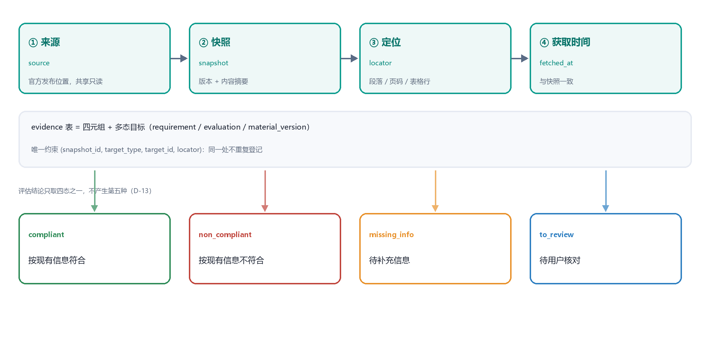

*图 6-1  证据四元组与四态评估的数据链路*

写入规则有四条：

1. **先快照后证据**：证据的 fetched_at 必须等于快照的 fetched_at，触发器保证；
2. **同处不重登**：唯一约束 (snapshot_id, target_type, target_id, locator) 阻止同一处重复登记；
3. **多态但可校验**：target_type 为 requirement 时，触发器校验证据快照与要求的快照一致；
4. **不可悬挂**：target_id 对应的对象删除时，证据随之级联或置空，不留无主证据。

四态评估的写入规则是“只增不改”：同一要求在不同规则版本或事实版本下会产生多条评估，视图 v_evaluation_current 取最新一条。这样“规则升级后结论变了”可以被解释，而不是把旧结论覆盖掉。


### 6.3 版本与归档

需要版本化的对象有四类，各有不同的冻结时机：

**表 6-2  版本化对象与冻结时机**

| 对象 | 版本载体 | 冻结时机 | 冻结后行为 |
|---|---|---|---|
| 来源内容 | snapshot | 获取即冻结 | 只增不改；is_current 唯一 |
| 模板 | template_version | 发布即冻结 | 已建事项仍引用旧版本 |
| 规则口径 | rule_pack | 发布即冻结 | 旧评估仍可按旧版本解释 |
| 个人材料 | document_version | 提交时冻结 | 资料库更新不替换已引用版本 |


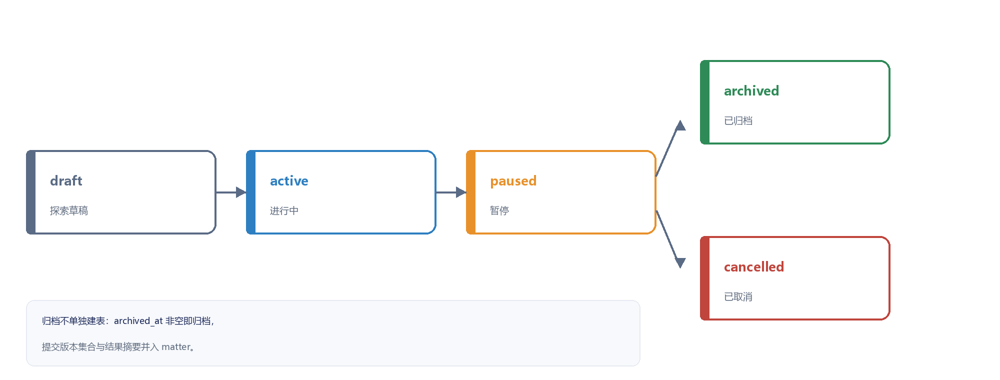

*图 6-2  事项生命周期与归档*

归档是生命周期的终点而非另一张表：archived_at 非空后，服务层拒绝一切写入（阶段、任务、材料）。归档时冻结 submitted_version_ids，后续资料库更新不影响已归档事项（AC29）。

复用不复制：新建子事项时只复制授权的版本引用（document_usage），不连带复制上一次事项的材料文件；范围、时效与授权需重新核对。


### 6.4 授权、同意与撤回

隐私相关的三个对象分工明确：

- **fact_grant**：某条事实能给谁（matter / agent / export）、用于什么用途、何时到期；
- **model_transfer_consent**：哪些字段类别可以发给哪个模型服务商、用于什么目的；
- **document_usage**：哪个事项引用了哪个材料版本，是否已冻结。

撤回的执行顺序是固定的：先把状态置为 revoked → 停止后续读取与传输 → 查 v_usage_impact 列出受影响事项与判断 → 写审计 → 通知用户。顺序不能颠倒，否则用户会看到“已撤回但仍被使用”。

模型调用前的校验是三元组匹配：服务商、字段范围、用途必须在某条 granted 的同意记录内，且未撤回。未匹配时走替代路径（手工录入要求、纯文本整理、模板化导出），而不是报错中断。


### 6.5 保留与删除

**表 6-3  保留策略**

| 数据 | 保留期 | 到期处理 | 依据 |
|---|---|---|---|
| 来源与快照 | 长期（≥ 5 年） | 不删除；冷数据转低频存储 | 结论需可复核 |
| 要求、证据、评估 | 长期 | 跟随快照保留 | NFR-01 |
| 事项与任务 | 归档后 3 年 | 物理删除并级联 | 用户可申请删除 |
| 事实与个人材料 | 删除后 30 天 | 引用归零后清理对象 | D-22 |
| 材料版本与提交证据 | 归档后 3 年 | 随事项删除 | AC29 |
| 审计日志 | 24 个月 | 分区归档至冷库 | 合规追溯 |


> **注意**：删除与追溯的冲突：用户要求删除事实时，事实副本与授权记录清理，但审计日志中的 object_id 保留并注明“已删除”，以满足“操作可追溯”。这一处理需在隐私页明示，避免“删除”被理解为抹去全部历史。


### 6.6 领域知识、用户交互记录与任务执行结果的存储

这三类数据在评审时最常被追问“到底存在哪”，因为它们既不是业务主数据，也不是纯粹的日志。本版按“能否独立演化、是否被规则引用”分为三组存放，表 6-4 给出载体与生命周期。

**表 6-4  三类数据与存储载体**

| 类别 | 载体 | 关键字段 | 写入者 | 生命周期 |
|---|---|---|---|---|
| 领域知识 | kb.rule_pack、kb.rule、core.template、core.template_version、core.matter_type | code、rule_code、condition_expr、formula、stage_defs、requirement_skeleton | 规则与模板维护（交付期） | 发布即冻结，新版本追加 |
| 用户交互记录 | core.inbox_item、core.matter_decision、ops.audit_log | item_type、status、decision_type、decision_value、action、detail | 用户操作与系统事件 | 收件箱可归档；审计保留 24 个月 |
| 任务执行结果 | core.task、core.material_version、core.official_result、ops.audit_log | completion_evidence、status、diff、accepted_patches、result_type、evidence_id | 用户确认与工具执行 | 随事项保留，归档后冻结 |


三条边界说明：

- **交互的“待办”与“已发生”分开存**：待用户处理的内容进 inbox_item，用户做过的动作进 audit_log（action 形如 plan.confirm、fact.revoke）。这样收件箱可以清空，而历史动作不会被删掉；
- **执行结果不只是一个状态位**：task 记完成证据、material_version 记产出物与接受记录、official_result 记外部结果，三者不能互相替代（AC11、AC12）；
- **工具执行并入审计**：编码为 tool.run，detail 记录模式、工具名与 L0—L3 授权等级，避免为每次模型调用单独建一张流水表。

> **约定**：为什么不单独建 interaction_event 与 tool_run 两张表：二者都只被审计查询引用、不被业务规则引用，合并后少两张表与一套归档脚本；代价是查询时需按 action 过滤，因此 audit_log 的 (object_type, object_id, created_at) 索引必须保留。


## 7. 数据完整性


### 7.1 完整性层次

**表 7-1  完整性层次**

| 层次 | 表达能力 | 典型规则 | 失败表现 |
|---|---|---|---|
| 列约束 | 单行单列取值与格式 | 枚举、置信度 0—1、年份范围 | 写入被拒绝（23514） |
| 表约束 | 单表多列或跨行唯一 | 部分唯一索引、复合检查 | 写入被拒绝 |
| 参照约束 | 跨表引用与删除动作 | 外键、CASCADE / RESTRICT / SET NULL | 写入或删除被拒绝 |
| 触发器 | 跨表条件与不可变性 | 证据同快照、审计不可改 | 抛异常并回滚 |
| 事务内校验 | 跨聚合的业务规则 | 候选确认后才写任务 | 整体回滚 |


### 7.2 实体完整性

全部表使用 uuid 代理主键，业务唯一性单独用唯一约束表达（如 uq_source_url、uq_rule_pack_code）。主键由应用层生成 UUIDv7：高位含时间戳，索引插入集中；不泄露业务规模；便于离线预生成。数据库的 gen_random_uuid() 仅作兜底。

两张表使用复合主键或复合唯一键：audit_log 因分区要求主键包含 created_at；evidence 的业务唯一键是四元组加目标，避免同一处重复登记。


### 7.3 参照完整性与删除策略

删除动作只有三种，选择依据是“子对象能否独立存在”。

**表 7-2  聚合删除策略**

| 被删除对象 | 级联清理 | 保留 | 说明 |
|---|---|---|---|
| 事项 matter | 阶段、决定、要求、评估、任务、材料及版本、提交证据、官方结果、引用 | 个人材料、事实、审计 | 事项删除不连带用户资产 |
| 工作区 workspace | 其下全部事项及派生数据 | 用户与审计 | 工作区与用户一一对应，随用户删除 |
| 个人材料 personal_document | 版本与引用 | 对象存储字节（引用归零后回收） | 版本随材料存亡 |
| 来源 source | 快照、证据 | 要求（快照删除时 RESTRICT） | 有要求的来源不得物理删除 |
| 规则包 rule_pack | 规则 | 模板版本（RESTRICT 保护生效版本） | 已发布包禁止删除 |
| 用户 app_user | 工作区、事项、事实、材料、授权与同意 | 审计（actor_id 置空） | 注销不等于抹去历史 |


两条硬约束来自 SSD D：删除事项时不得连带删除个人材料（材料属于用户资产）；删除用户时审计日志保留但操作者置空。二者都在表 7-2 中以“保留”一列写明。

软删除与硬删除的分界：面向用户的聚合（事项、材料、事实）先软删除（状态置位），30 天后物理删除；流水与派生数据直接物理删除，保留已删除流水只会干扰审计统计。


### 7.4 状态机校验

六张表有状态机，数据库负责“非法取值不可写入”，服务层负责“非法迁移不可发生”。

**表 7-3  状态机与校验位置**

| 对象 | 取值 | 数据库保证 | 服务层保证 |
|---|---|---|---|
| 事项 | draft / active / paused / archived / cancelled | 枚举 + 归档检查约束 | 归档后拒绝写入；取消不可恢复 |
| 候选计划 | draft / pending / confirmed / rejected / expired | 枚举 + 确认时间检查 | 确认时复查 basis_version；opId 幂等 |
| 任务 | pending / ready / in_progress / blocked / done / cancelled | 枚举 + 完成证据检查 | 依赖未满足不得置 ready |
| 材料版本 | draft / final / frozen | 检查 ck_mv_final | 定稿前关键字段与贡献已确认 |
| 个人材料版本 | draft / valid / expiring / expired / frozen / revoked | 枚举 | 过期由扫描改状态，不删除 |
| 四态评估 | 四值闭集 | 枚举 conclusion | 不产生第五态；旧结论保留 |


### 7.5 事务边界与并发

写操作以“聚合”为单位提交：一次请求只修改一个聚合根及其直接子对象。跨聚合协作通过事务性发件箱异步完成（首版用同一库内的 outbox 语义：在 audit_log 中写 pending 事件，由任务消费者补偿），避免跨聚合长事务。

并发控制两级：**乐观锁**用于用户可感知的编辑（材料版本、候选计划），更新时带 expectedVersion，冲突返回 409 并列出差异；**咨询锁**用于后台任务（检索、材料生成），按 matter_id 加锁，任务结束自动释放。

隔离级别使用 READ COMMITTED。首版没有需要 SERIALIZABLE 的场景：跨行一致性由唯一约束与咨询锁保证，快照写入是纯追加，不存在幻读问题。


### 7.6 幂等与唯一写入

幂等出现在五个位置，各用不同机制：

**表 7-4  幂等实现位置**

| 场景 | 重复来源 | 机制 | 结果 |
|---|---|---|---|
| 快照入库 | 同一页面被多次获取 | UNIQUE(source_id, content_hash) | 不新建快照 |
| 计划确认 | 用户连点或网络重发 | UNIQUE(op_id) | 返回同次结果 |
| 任务生成 | 同一计划被重复确认 | 唯一计划版本 + 幂等键 | 不产生第二批任务 |
| 收件箱提示 | 同一事件重复触发 | 同一对象同类提示合并 | 只保留一条 open |
| 证据登记 | 同一片段重复引用 | 四元组唯一约束 | 不重复记账 |


要点是把唯一性放在数据库而不是应用判断：应用层“先查后插”在并发下必然失效，唯一索引是原子判定，配合 ON CONFLICT 即可实现“写入或忽略”。


## 8. 安全与权限


### 8.1 账号与可见性

系统只有一种账号（申请者本人），没有管理员、复核人与协作者（D-26）。因此权限模型不是角色模型，而是“归属模型”：数据属于某个工作区或某个用户。

**表 8-1  数据可见性矩阵**

| 数据 | 归属 | 可见范围 | 写入限制 |
|---|---|---|---|
| 工作区、事项、任务、材料 | workspace.owner_id | 本人 | 本人 |
| 事实、个人材料、授权、同意 | user_id / owner_id | 本人，跨本人事项 | 本人确认 |
| 来源、快照、证据、要求 | 系统共享 | 全体只读 | 检索与自动检查流程 |
| 审计日志 | 系统 | 仅本人相关记录 | 只追加 |
| 事项信息 | matter_id | 本人当前事项 | 本人 |


### 8.2 行级安全策略

工作区隔离用 RLS 实现，策略以会话变量 app.current_workspace_id 为条件，由连接池在取连接时设置；未设置时不匹配任何行，即默认拒绝。

```text
ALTER TABLE core.matter ENABLE ROW LEVEL SECURITY;

CREATE POLICY matter_owner ON core.matter
    USING (workspace_id = current_setting('app.current_workspace_id', true)::uuid)
    WITH CHECK (workspace_id = current_setting('app.current_workspace_id', true)::uuid);

ALTER TABLE core.task ENABLE ROW LEVEL SECURITY;

CREATE POLICY task_by_matter ON core.task
    USING (EXISTS (SELECT 1 FROM core.matter m
                    WHERE m.id = matter_id
                      AND m.workspace_id = current_setting('app.current_workspace_id', true)::uuid));

-- 官方信息层：全体只读
ALTER TABLE ops.snapshot ENABLE ROW LEVEL SECURITY;
CREATE POLICY snapshot_read ON ops.snapshot FOR SELECT USING (true);
```

RLS 不替代服务层校验：后台任务与自动检查使用特权角色，不受 RLS 约束；对象存储的下载地址也在数据库之外签发。因此服务层仍须按 owner 校验一次，形成双防线（C-15）。


### 8.3 敏感数据与模型边界

- **不采集**：身份证号、家庭住址与银行卡不落库；高敏材料只存对象键，不解析证件内容；
- **敏感级别**：personal_document.sensitivity_level 决定页面掩码、下载校验与是否允许进入模型；
- **口令**：Argon2id 哈希，重置用一次性令牌（只存哈希）；
- **传输**：数据库连接强制 TLS；对象存储服务端加密；备份加密后异地保存；
- **模型边界**：调用前校验 model_transfer_consent，高敏材料与证件原件永不进入模型上下文。


### 8.4 审计

审计覆盖六类动作：登录与失败登录、事实确认与撤回、授权与同意变更、计划与材料确认、证据登记、删除请求。每条记录含 object_version 与 rule_version，使“当时依据哪一版规则、哪一版对象”可回答。

“不可抵赖”靠三重约束：数据库禁止修改（触发器 + 权限）、应用不提供删除接口、运维每日对审计表做摘要快照并异地保存。


### 8.5 备份与恢复

全量每周一次、增量每日一次、WAL 持续归档以支持时间点恢复，目标 RPO ≤ 15 分钟、RTO ≤ 4 小时。对象存储与数据库分开备份，但恢复时以库中的 object_key 为准，缺失对象从归档桶回取；任何迁移前自动创建快照。


### 8.6 共享官方信息与个人分析的权限边界

系统只有一种账号，权限不是角色模型而是归属模型。共享官方信息与个人分析的边界落在三处：归属列、可见性策略与写入者。表 8-2 逐维度对照。

**表 8-2  共享官方信息与个人分析的边界**

| 维度 | 共享官方信息 | 个人分析 |
|---|---|---|
| 归属 | 系统（source、snapshot） | 用户（workspace、fact、personal_document） |
| 可见范围 | 全体登录用户只读 | 仅本人；可跨本人事项复用 |
| 写入者 | 检索与自动检查流程 | 用户逐项确认 |
| 他人可否引用 | 可以，作为公共依据 | 不可以，需 fact_grant / document_usage 授权 |
| 删除与撤回 | 不物理删除，置 withdrawn | 可撤回、可删除，撤回后停止使用 |
| 进入模型的范围 | 仅公开原文 | 需 model_transfer_consent 按服务商 + 字段 + 用途匹配 |
| 证据方式 | evidence 四元组（来源/快照/定位/时间） | 版本号 + 确认时间 + 授权记录 |


两条硬约束保证边界不是口号：source 与 snapshot 上没有任何指向用户数据的列；fact、personal_document 等个人表的行级策略只匹配当前工作区。越权请求在数据库层就取不到行，服务层再校验一次，形成双防线（C-15）。

> **注意**：与系统设计 v2.0 的对齐：D-19（最小权限）落在本节可见性规则，D-29（三层信息）落在 §2.4 的分层表清单。系统设计若调整 D-29 的分层，本节与 §2.4 必须同步修改，否则会出现“文档说共享只读、库里却能写”的不一致。


## 9. 性能与容量


### 9.1 关键访问路径

按调用频次与数据量，首版有六条关键路径，共同特征是“以归属列过滤 + 按时间排序”。

- **事项列表**：按 workspace_id 取事项，连接阶段进度与任务完成率；
- **事项详情**：按 matter_id 取要求、评估、阶段，再取最新证据计数；
- **自查页**：按 matter_id 取已检查要求，连接最新评估与事实版本；
- **材料工作室**：按 material_id 取当前版本与差异，回读个人材料版本；
- **收件箱**：按 user_id 取 open 项，按时间倒序；
- **审计追溯**：按 object_type + object_id 取历史。


### 9.2 容量估算

按 §2.9 的规模假设推算，估算口径为“年增量 × 平均行宽”，并预留 40% 索引与膨胀空间。

**表 9-1  首年容量估算**

| 表 | 年增量行数 | 平均行宽 | 年增数据量 | 备注 |
|---|---|---|---|---|
| core.requirement | 30 万 | 1.2 KB | 0.36 GB | 含规范化文本 |
| core.evaluation | 60 万 | 0.8 KB | 0.48 GB | 含依据说明 |
| ops.snapshot | 5 万 | 1.0 KB | 50 MB | 正文在对象存储 |
| core.material_version | 8 万 | 3 KB | 0.24 GB | 含 diff 与补丁 |
| core.document_version | 3 万 | 0.6 KB | 18 MB | 字节在对象存储 |
| ops.audit_log | 200 万 | 0.5 KB | 1.0 GB | 按月分区 |
| 其余 26 张表 | — | — | 0.8 GB | 主数据量小 |
| **合计** | — | — | **约 3 GB** | 含索引预留 |


3 GB 的年增量意味着单机可支撑三年以上；真正的压力来自模型调用的时延，而不是数据库。因此表设计的重点是“少扫描”，而不是“分库分表”。


### 9.3 缓存与读写分离

缓存只用于“读多写少且允许短暂陈旧”的数据：事项类型与模板版本、已发布的规则包、来源列表首屏。缓存键含版本号，避免旧口径覆盖新规则。用户私有数据（事实、材料、任务）不做共享缓存，因为失效条件复杂，收益低于一致性风险。


### 9.4 监控指标

**表 9-2  监控指标与阈值**

| 指标 | 口径 | 阈值 | 处置 |
|---|---|---|---|
| 慢查询比例 | > 500 ms 的语句占比 | > 1% | 查执行计划与索引 |
| 连接使用率 | 活跃连接 / 上限 | > 80% | 扩容或查泄漏 |
| 表膨胀率 | 死元组占比 | > 20% | 触发 VACUUM |
| 索引命中率 | idx_scan / (idx_scan + seq_scan) | < 90% | 评估缺失索引 |
| 锁等待 | 等待 > 3 s 的会话 | > 3 | 定位长事务 |
| 确认冲突率 | 409 响应占比 | > 5% | 检查客户端版本号传递 |
| 过期材料占比 | expired / 全部有效材料 | > 30% | 提醒用户更新 |


## 10. 实施与运维


### 10.1 版本化迁移

结构变更全部通过迁移脚本管理，编号连续、只追加、不修改已执行文件，执行记录写入 schema_version。

**表 10-1  首版迁移脚本**

| 编号 | 内容 | 可回滚 | 依赖 |
|---|---|---|---|
| V1_0__schemas_enums | 三个模式与 18 个枚举 | 是 | — |
| V1_1__core_basic | app_user、workspace、matter_type、matter、stage | 是 | V1_0 |
| V1_2__kb | rule_pack、rule | 是 | V1_0 |
| V1_3__template | template、template_version（含环状外键） | 是 | V1_1、V1_2 |
| V1_4__source_evidence | source、snapshot、source_gap、evidence（含分区） | 是 | V1_1 |
| V1_5__requirement | requirement、evaluation、mentor_contact_rule | 是 | V1_4 |
| V1_6__plan_task | candidate_plan、task、inbox_item | 是 | V1_1 |
| V1_7__personal | fact、fact_grant、consent、document 三表 | 是 | V1_1 |
| V1_8__material | matter_info_item、material、material_version、证据与结果 | 是 | V1_1、V1_7 |
| V1_9__audit_rls | audit_log、RLS 策略与角色授权 | 是 | 全部 |


顺序不可调换：枚举先于表，表先于外键，外键先于触发器，触发器先于视图与 RLS。环状外键（template.current_version_id ↔ template_version.template_id 等三处）必须在两表建好后补充，因此单独放在 V1_3、V1_7、V1_8 的末尾。


### 10.2 初始化与种子数据

- **事项类型**：内置 pre_recommend 与 competition 两条，built_in = true；
- **模板版本**：每个类型一个 TP-xxx-01，含阶段定义与要求骨架；
- **规则包**：一个 RP-2026-01，含日期校验、字段必填、范围过滤三类规则；
- **演示账号与样例事项**：仅用于验收，使用虚构事实与脱敏材料（AC19）。


### 10.3 发布与回滚

结构发布遵循“先兼容、后清理”：第一次只新增列与表，代码兼容新旧；确认无回滚需求后再删旧列。这样任何一次发布都能通过回退代码完成，不必回退数据库。

迁移脚本必须幂等、有超时保护、失败时状态可判定。大表重写分批（每批 5000 行）并在批间提交，避免长事务阻塞写入。


### 10.4 运维检查清单

- 每日：备份完成、复制延迟、慢查询 Top 10、失败收件箱积压；
- 每周：表与索引膨胀、死元组、未使用索引、分区是否提前创建；
- 每月：恢复演练、权限复核、审计摘要比对、过期材料统计；
- 每季度：容量趋势、索引收益复核、归档分区清理；
- 每次发布前：迁移评审、备份确认、回滚脚本、灰度环境验证。


## 11. 可追溯性


### 11.1 功能到数据

表 11-1 把 SSD D 的 16 项 P0 功能与 6 条继承的非功能约束逐条映射到数据对象。映射原则是“一个主责表 + 一个留痕表”，任何一条功能被质疑时都能指出证据在哪。

**表 11-1  功能、非功能约束与数据对象的对应关系**

| 编号 | 功能 / 约束 | 主要数据对象 | 覆盖方式 |
|---|---|---|---|
| F01 来源与版本 | source、snapshot、source_gap、evidence | 来源登记、版本链、缺口与四元组证据 |
| F02 提取要求并回原文 | requirement、evidence、audit_log | 要求绑定快照，证据定位到片段 |
| F03 四态条件与缺口 | evaluation、fact、checklist 无对应表 | 四态为闭集，依据规则与事实版本 |
| F04 导师联系与证明分离 | mentor_contact_rule | 联系状态与证明必交两列独立 |
| F05 候选计划确认写入 | candidate_plan、task | opId 唯一，确认后才生成任务 |
| F06 依赖阻塞与完成证据 | task.depends_on、task.completion_evidence | 就绪判定与完成证据 |
| F07 材料与要求映射 | material、requirement | 材料挂要求，可多对多 |
| F08 局部起草与 DOCX | material_version、evidence | 差异与接受记录、改写理由引用 |
| F09 版本失效与变化 | snapshot、source_gap、inbox_item | P0 失效提示；P1 条款对比 |
| F10 停止取消撤销恢复 | inbox_item、audit_log、candidate_plan.status | 动作留痕，状态可回放 |
| F11 发现机会与建事项 | matter、matter_type、template_version | 模板实例化 |
| F12 可选投入解释 | matter_decision | 采纳/稍后/跳过分别记录 |
| F14 校内节点与外校子事项 | stage、matter.parent_matter_id | 子事项独立适用范围 |
| F15 竞赛阶段与成果 | matter_type、stage、official_result | 同一机制扩展类型 |
| F16 提交前复核与归档 | submission_evidence、official_result、matter.archived_at | 两类证据与归档字段 |
| F17 个人资料确认撤回删除 | fact、fact_grant、personal_document、document_version | 确认状态、授权与引用影响面 |
| NFR-01 可追溯性 | evidence、requirement、evaluation.fact_version | 三级指针：快照→片段→版本 |
| NFR-02 权限与隐私 | workspace、RLS 策略、document_usage | 工作区隔离 + 引用校验 |
| NFR-03 可靠性 | audit_log.result、inbox_item(type=failure) | 失败显式化，不静默 |
| NFR-04 可用性 | inbox_item、各 status 枚举 | 四态与失败态可区分 |
| NFR-05 版本管理 | snapshot、template_version、rule_pack、document_version | 四类版本只增不改 |
| NFR-06 操作边界 | audit_log、official_result | 不提供提交类写接口，来源可查 |


### 11.2 验收条款到校验点

表 11-2 把 SSD D §9.3 的验收条款转写为可执行的数据校验：“校验点”一列是可以直接在测试中断言的字段或约束，而不是主观描述。

**表 11-2  验收条款与数据校验点**

| 条款 | 要求（摘录） | 数据校验点 | 位置 |
|---|---|---|---|
| AC01 | 要求回原文、来源版本可查 | 证据四元组完整；要求快照 = 证据快照 | §5.2.2、§7.4 |
| AC02 | 附件缺失/冲突转待核对 | source_gap.status='open'；要求 to_review | §5.2.2 |
| AC03 | 缺事实给字段与用途 | evaluation.conclusion='missing_info' | §6.2 |
| AC04 | 硕士/直博分别匹配 | mentor_contact_rule.project_scope 分组 | §5.2.3 |
| AC05 | 拒绝不产生正式任务 | plan.status='rejected' 且无关联 task | §7.4 |
| AC06 | 依据变化旧确认失效、重复确认同结果 | basis_version 比对；op_id 唯一 | §7.6 |
| AC07 | 阻塞与环路说明 | depends_on 未满足 → status='blocked' | §5.2.4 |
| AC08 | 局部接受、原件不变 | material_version.diff / accepted_patches | §5.2.6 |
| AC09 | 失败返回实际状态与恢复入口 | inbox_item(failure) + audit.result='failure' | §7.4 |
| AC11 | 导出不自动完成提交 | official_result.status 保持 pending | §6.3 |
| AC12 | 两类证据分开 | submission_evidence.evidence_kind | §5.2.6 |
| AC15 | 仅四种结论用语 | evaluation.conclusion 枚举 | §5.1.2 |
| AC19 | 提取不代用户确认 | fact.confirm_status='confirmed' 才进长期档案 | §8.2 |
| AC25 | 草稿逐项确认 | fact / document_version 的确认时间 | §6.4 |
| AC26 | 撤回删除列出影响 | fact_grant.revoked + v_usage_impact | §6.4 |
| AC28 | 未确认只出未定稿 | material_version.status='draft' | §7.4 |


### 11.3 未覆盖项与已知限制

- **条款级差异对比（P1）**：首版只做版本失效提示，snapshot 之间不做逐条 diff，因此没有条款对比表；
- **定期巡检（P1）**：首版按需检索，无巡检任务表；调度器相关字段留待 P1；
- **多类型扩展**：新增事项类型只注册数据，不改表结构；但模板中声明的 scope_attrs 字段没有数据库级校验；
- **中文分词**：依赖 zhparser，缺失时退化为 trigram，召回率下降但功能可用。


## 12. 结论

本文档给出 OfferPilot 首版的完整数据设计：以 3 个模式、32 张表承载 SSD D 的 32 个数据对象，用 53 条外键、35 条检查约束与 51 个索引把“候选优先、证据强制、三层隔离、失败可见”四条原则固化为可执行的结构。设计的重点不在表多，而在三件事是否成立。

**第一，结论有出处。**要求绑定快照，证据以四元组挂在要求、评估与材料改写理由上，规则版本与事实版本随结论一起保存。三者合起来，使“系统为什么这么说”可以被回答。

**第二，候选不越权。**候选计划、候选稿、机器提取结果都有独立状态，未确认不进入正式任务与定稿；官方信息经自动检查后登记为共享只读，不冒充“官方核实”。

**第三，用户可撤回。**事实、授权、模型传输同意都可撤回，撤回后停止使用并列出受影响对象；材料与事项的删除策略保证用户资产不被误删。

与上一版相比，本次设计主动做了减法：合并了检索记录、工具执行、审核记录与归档四类对象，把 36 项压到 32 张表。减法的依据是“是否会被单独查询、单独授权、单独归档”，而不是“是否出现在文档里”。这样做的结果是结构更少、删除路径更短、答辩时更容易讲清楚。


## 附录 A. 数据库建表脚本

本附录给出可执行的 PostgreSQL 建表脚本，与第 5 章逐字段对应。脚本按“模式 → 枚举 → 表 → 索引 → 环状外键”组织，整体包裹在一个事务中；任一语句失败则全部回滚，不留半成品结构。

执行前需确认：PostgreSQL 16 及以上、已创建 pg_trgm 扩展、执行账号具备建表与建类型权限。

**代码 A-1  模式与枚举类型**

```sql
-- OfferPilot 数据库建表脚本（PostgreSQL 16，V2.0 事项为中心）
-- 与《数据库设计说明书》§5.2 逐字段对应
BEGIN;

CREATE SCHEMA IF NOT EXISTS core;
CREATE SCHEMA IF NOT EXISTS ops;
CREATE SCHEMA IF NOT EXISTS kb;

```

**代码 A-2  模式与枚举类型（续 2）**

```sql
-- ============ 枚举类型 ============
CREATE TYPE account_status AS ENUM ('pending', 'active', 'disabled');
CREATE TYPE matter_status AS ENUM (
    'draft', 'active', 'paused', 'archived', 'cancelled'
);
CREATE TYPE stage_status AS ENUM ('pending', 'in_progress', 'done', 'skipped');
CREATE TYPE obligation_nature AS ENUM (
    'required', 'advised', 'optional', 'to_verify'
);
CREATE TYPE extract_status AS ENUM (
    'extracted', 'checked', 'to_review', 'rejected'
);
CREATE TYPE conclusion AS ENUM (
    'compliant', 'non_compliant', 'missing_info', 'to_review'
);
CREATE TYPE plan_status AS ENUM (
    'draft', 'pending', 'confirmed', 'rejected', 'expired'
);
CREATE TYPE task_status AS ENUM (
    'pending', 'ready', 'in_progress', 'blocked', 'done', 'cancelled'
);
CREATE TYPE inbox_status AS ENUM ('open', 'read', 'resolved', 'ignored');
CREATE TYPE fact_status AS ENUM ('draft', 'confirmed', 'revoked');
CREATE TYPE doc_status AS ENUM (
    'draft', 'valid', 'expiring', 'expired', 'frozen', 'revoked'
);
CREATE TYPE grant_status AS ENUM ('active', 'revoked', 'expired');
CREATE TYPE consent_status AS ENUM ('granted', 'revoked');
CREATE TYPE source_status AS ENUM ('active', 'withdrawn', 'invalid');
CREATE TYPE check_result AS ENUM ('pending', 'passed', 'failed', 'conflict');
CREATE TYPE gap_status AS ENUM ('open', 'filled', 'unverifiable');
CREATE TYPE pack_status AS ENUM ('draft', 'published', 'retired');
CREATE TYPE severity AS ENUM ('block', 'warn', 'info');


```

**代码 A-3  core 业务主数据**

```sql
-- ============ core 模式：业务主数据 ============

CREATE TABLE core.app_user (
    id uuid DEFAULT gen_random_uuid() PRIMARY KEY,
    email varchar(160) NOT NULL,
    display_name varchar(60) NOT NULL,
    password_hash varchar(255) NOT NULL,
    account_type varchar(16) DEFAULT 'applicant' NOT NULL,
    status account_status DEFAULT 'pending' NOT NULL,
    created_at timestamptz DEFAULT now() NOT NULL,
    updated_at timestamptz DEFAULT now() NOT NULL,
    deleted_at timestamptz,
    CONSTRAINT uq_app_user_email UNIQUE (email),
    CONSTRAINT ck_app_user_type CHECK (account_type IN ('applicant'))
);
CREATE INDEX ix_app_user_status ON core.app_user (status);

CREATE TABLE core.workspace (
    id uuid DEFAULT gen_random_uuid() PRIMARY KEY,
    owner_id uuid NOT NULL,
    created_at timestamptz DEFAULT now() NOT NULL,
    updated_at timestamptz DEFAULT now() NOT NULL,
    CONSTRAINT uq_workspace_owner UNIQUE (owner_id),
    CONSTRAINT fk_workspace_owner_id FOREIGN KEY (owner_id),
        REFERENCES core.app_user (id) ON DELETE CASCADE
);
CREATE UNIQUE INDEX ix_workspace_owner ON core.workspace (owner_id);

CREATE TABLE core.matter_type (
    id uuid DEFAULT gen_random_uuid() PRIMARY KEY,
    type_code varchar(32) NOT NULL,
    name varchar(60) NOT NULL,
    built_in boolean DEFAULT false NOT NULL,
    enabled boolean DEFAULT true NOT NULL,
    created_at timestamptz DEFAULT now() NOT NULL,
    CONSTRAINT uq_matter_type_code UNIQUE (type_code)
);
CREATE INDEX ix_matter_type_enabled ON core.matter_type (enabled) WHERE enabled;

```

**代码 A-4  kb 规则包**

```sql
-- ============ kb 模式：领域知识（规则包） ============

CREATE TABLE kb.rule_pack (
    id uuid DEFAULT gen_random_uuid() PRIMARY KEY,
    code varchar(48) NOT NULL,
    name varchar(120) NOT NULL,
    matter_type_id uuid,
    status pack_status DEFAULT 'draft' NOT NULL,
    regression_result jsonb,
    published_at timestamptz,
    created_at timestamptz DEFAULT now() NOT NULL,
    CONSTRAINT uq_rule_pack_code UNIQUE (code),
CONSTRAINT ck_pack_publish CHECK (status <> 'published' OR published_at IS NOT
        NULL),
    CONSTRAINT fk_rule_pack_matter_type_id FOREIGN KEY (matter_type_id),
        REFERENCES core.matter_type (id) ON DELETE SET NULL
);
CREATE INDEX ix_pack_type_status ON kb.rule_pack (matter_type_id, status);

CREATE TABLE kb.rule (
    id uuid DEFAULT gen_random_uuid() PRIMARY KEY,
    rule_pack_id uuid NOT NULL,
    rule_code varchar(48) NOT NULL,
    rule_type varchar(24) NOT NULL,
    condition_expr text,
    formula text,
    scope varchar(200),
    severity severity DEFAULT 'warn' NOT NULL,
    message varchar(300),
    CONSTRAINT uq_rule_code UNIQUE (rule_pack_id, rule_code),
CONSTRAINT ck_rule_type CHECK (rule_type IN
        ('schema','expression','mapping','consistency')),
    CONSTRAINT fk_rule_rule_pack_id FOREIGN KEY (rule_pack_id),
        REFERENCES kb.rule_pack (id) ON DELETE CASCADE
);
CREATE INDEX ix_rule_pack ON kb.rule (rule_pack_id, severity);

```

**代码 A-5  core 业务主数据（续 2）**

```sql
-- ============ core 模式：业务主数据 ============

CREATE TABLE core.template (
    id uuid DEFAULT gen_random_uuid() PRIMARY KEY,
    type_code varchar(32) NOT NULL,
    name varchar(80) NOT NULL,
    current_version_id uuid,
    status varchar(16) DEFAULT 'draft' NOT NULL,
    created_at timestamptz DEFAULT now() NOT NULL,
    CONSTRAINT uq_template_type_name UNIQUE (type_code, name),
    CONSTRAINT ck_template_status CHECK (status IN ('draft','published','retired')),
    CONSTRAINT fk_template_type_code FOREIGN KEY (type_code),
        REFERENCES core.matter_type (type_code) ON DELETE RESTRICT
);
CREATE INDEX ix_template_type ON core.template (type_code);

CREATE TABLE core.template_version (
    id uuid DEFAULT gen_random_uuid() PRIMARY KEY,
    template_id uuid NOT NULL,
    version_no varchar(32) NOT NULL,
    stage_defs jsonb NOT NULL,
    requirement_skeleton jsonb NOT NULL,
    material_types jsonb NOT NULL,
    rule_pack_id uuid,
    status pack_status DEFAULT 'draft' NOT NULL,
    regression_result jsonb,
    published_at timestamptz,
    created_at timestamptz DEFAULT now() NOT NULL,
    CONSTRAINT uq_template_version_no UNIQUE (template_id, version_no),
CONSTRAINT ck_tv_publish CHECK (status <> 'published' OR published_at IS NOT NULL),
    CONSTRAINT fk_template_version_template_id FOREIGN KEY (template_id),
        REFERENCES core.template (id) ON DELETE CASCADE,
    CONSTRAINT fk_template_version_rule_pack_id FOREIGN KEY (rule_pack_id),
        REFERENCES kb.rule_pack (id) ON DELETE SET NULL
);
CREATE INDEX ix_tv_template ON core.template_version (template_id, status);

CREATE TABLE core.matter (
    id uuid DEFAULT gen_random_uuid() PRIMARY KEY,
    workspace_id uuid NOT NULL,
    type_code varchar(32) NOT NULL,
    template_version_id uuid NOT NULL,
    goal varchar(200) NOT NULL,
    status matter_status DEFAULT 'draft' NOT NULL,
    scope_year smallint,
    scope_attrs jsonb,
    parent_matter_id uuid,
    archived_at timestamptz,
    submitted_version_ids uuid[],
    archive_result varchar(200),
    retrospective text,
    created_at timestamptz DEFAULT now() NOT NULL,
    updated_at timestamptz DEFAULT now() NOT NULL,
CONSTRAINT ck_matter_archive CHECK ((archived_at IS NULL) = (submitted_version_ids
        IS NULL)),
CONSTRAINT ck_matter_year CHECK (scope_year IS NULL OR scope_year BETWEEN 2020 AND
        2100),
    CONSTRAINT fk_matter_workspace_id FOREIGN KEY (workspace_id),
        REFERENCES core.workspace (id) ON DELETE CASCADE,
    CONSTRAINT fk_matter_type_code FOREIGN KEY (type_code),
        REFERENCES core.matter_type (type_code) ON DELETE RESTRICT,
    CONSTRAINT fk_matter_template_version_id FOREIGN KEY (template_version_id),
        REFERENCES core.template_version (id) ON DELETE RESTRICT,
    CONSTRAINT fk_matter_parent_matter_id FOREIGN KEY (parent_matter_id),
        REFERENCES core.matter (id) ON DELETE SET NULL
);
```

**代码 A-6  core 业务主数据（续）**

```sql
CREATE INDEX ix_matter_workspace ON core.matter (workspace_id, status);
CREATE INDEX ix_matter_type_year ON core.matter (type_code, scope_year);
CREATE INDEX ix_matter_parent ON core.matter (parent_matter_id);

CREATE TABLE core.stage (
    id uuid DEFAULT gen_random_uuid() PRIMARY KEY,
    matter_id uuid NOT NULL,
    name varchar(60) NOT NULL,
    seq smallint NOT NULL,
    status stage_status DEFAULT 'pending' NOT NULL,
    is_required boolean DEFAULT true NOT NULL,
    started_at timestamptz,
    completed_at timestamptz,
    CONSTRAINT uq_stage_seq UNIQUE (matter_id, seq),
    CONSTRAINT ck_stage_seq CHECK (seq >= 0),
    CONSTRAINT fk_stage_matter_id FOREIGN KEY (matter_id),
        REFERENCES core.matter (id) ON DELETE CASCADE
);
CREATE INDEX ix_stage_matter ON core.stage (matter_id, seq);

CREATE TABLE core.matter_decision (
    id uuid DEFAULT gen_random_uuid() PRIMARY KEY,
    matter_id uuid NOT NULL,
    decision_type varchar(24) NOT NULL,
    decision_value varchar(24) NOT NULL,
    reason text,
    decided_at timestamptz DEFAULT now() NOT NULL,
CONSTRAINT ck_decision_type CHECK (decision_type IN
        ('invest','optional_task','plan')),
    CONSTRAINT ck_decision_value CHECK (decision_value IN ('adopt','later','skip')),
    CONSTRAINT fk_matter_decision_matter_id FOREIGN KEY (matter_id),
        REFERENCES core.matter (id) ON DELETE CASCADE
);
CREATE INDEX ix_decision_matter ON core.matter_decision (matter_id, decided_at);

```

**代码 A-7  ops 来源、证据与审计**

```sql
-- ============ ops 模式：来源、证据与审计 ============

CREATE TABLE ops.source (
    id uuid DEFAULT gen_random_uuid() PRIMARY KEY,
    publisher varchar(160) NOT NULL,
    url varchar(500) NOT NULL,
    matter_type_id uuid,
    scope varchar(200),
    scope_year smallint,
    valid_from date,
    valid_to date,
    status source_status DEFAULT 'active' NOT NULL,
    auto_check_status check_result DEFAULT 'pending' NOT NULL,
    roi_status varchar(16) DEFAULT 'original' NOT NULL,
    last_fetched_at timestamptz,
    created_at timestamptz DEFAULT now() NOT NULL,
    CONSTRAINT uq_source_url UNIQUE (url),
CONSTRAINT ck_source_roi CHECK (roi_status IN
        ('original','reposted','expired','ambiguous')),
CONSTRAINT ck_source_range CHECK (valid_to IS NULL OR valid_from IS NULL OR
        valid_to >= valid_from),
    CONSTRAINT fk_source_matter_type_id FOREIGN KEY (matter_type_id),
        REFERENCES core.matter_type (id) ON DELETE SET NULL
);
CREATE INDEX ix_source_type_year ON ops.source (matter_type_id, scope_year);
CREATE INDEX ix_source_status ON ops.source (status, auto_check_status);

CREATE TABLE ops.snapshot (
    id uuid DEFAULT gen_random_uuid() PRIMARY KEY,
    source_id uuid NOT NULL,
    version_no integer NOT NULL,
    object_key varchar(512) NOT NULL,
    content_hash char(64) NOT NULL,
    html_version varchar(32),
    text_version varchar(32),
    extraction jsonb,
    fetched_at timestamptz NOT NULL,
    is_current boolean DEFAULT false NOT NULL,
    CONSTRAINT uq_snapshot_version UNIQUE (source_id, version_no),
    CONSTRAINT uq_snapshot_hash UNIQUE (source_id, content_hash),
    CONSTRAINT ck_snapshot_version CHECK (version_no > 0),
    CONSTRAINT fk_snapshot_source_id FOREIGN KEY (source_id),
        REFERENCES ops.source (id) ON DELETE CASCADE
);
CREATE INDEX ix_snapshot_current ON ops.snapshot (source_id) WHERE is_current;
CREATE INDEX ix_snapshot_fetched ON ops.snapshot (fetched_at);

```

**代码 A-8  core 业务主数据（续 3）**

```sql
-- ============ core 模式：业务主数据 ============

CREATE TABLE core.requirement (
    id uuid DEFAULT gen_random_uuid() PRIMARY KEY,
    matter_id uuid NOT NULL,
    snapshot_id uuid NOT NULL,
    field_key varchar(64) NOT NULL,
    label varchar(120) NOT NULL,
    obligation_nature obligation_nature DEFAULT 'required' NOT NULL,
    extract_status extract_status DEFAULT 'extracted' NOT NULL,
    scope varchar(200),
    value_text text,
    value_type varchar(16) DEFAULT 'text' NOT NULL,
    confidence numeric(4,3),
    checked_at timestamptz,
    created_at timestamptz DEFAULT now() NOT NULL,
    updated_at timestamptz DEFAULT now() NOT NULL,
CONSTRAINT ck_req_confidence CHECK (confidence IS NULL OR (confidence >= 0 AND
        confidence <= 1)),
CONSTRAINT ck_req_checked CHECK (extract_status <> 'checked' OR checked_at IS NOT
        NULL),
    CONSTRAINT fk_requirement_matter_id FOREIGN KEY (matter_id),
        REFERENCES core.matter (id) ON DELETE CASCADE,
    CONSTRAINT fk_requirement_snapshot_id FOREIGN KEY (snapshot_id),
        REFERENCES ops.snapshot (id) ON DELETE RESTRICT
);
CREATE INDEX ix_req_matter ON core.requirement (matter_id, field_key);
CREATE INDEX ix_req_snapshot ON core.requirement (snapshot_id);
CREATE INDEX ix_req_status ON core.requirement (extract_status) WHERE
    extract_status = 'to_review';

```

**代码 A-9  ops 来源、证据与审计（续 2）**

```sql
-- ============ ops 模式：来源、证据与审计 ============

CREATE TABLE ops.source_gap (
    id uuid DEFAULT gen_random_uuid() PRIMARY KEY,
    matter_id uuid NOT NULL,
    gap_type varchar(32) NOT NULL,
    affected_requirement_id uuid,
    status gap_status DEFAULT 'open' NOT NULL,
    note text,
    created_at timestamptz DEFAULT now() NOT NULL,
CONSTRAINT ck_gap_type CHECK (gap_type IN
        ('official_entry_unknown','repost_only','login_required',
        'page_removed','attachment_missing','non_public')),
    CONSTRAINT fk_source_gap_matter_id FOREIGN KEY (matter_id),
        REFERENCES core.matter (id) ON DELETE CASCADE,
CONSTRAINT fk_source_gap_affected_requirement_id FOREIGN KEY
        (affected_requirement_id),
        REFERENCES core.requirement (id) ON DELETE SET NULL
);
CREATE INDEX ix_gap_matter ON ops.source_gap (matter_id, status);

CREATE TABLE ops.evidence (
    id uuid DEFAULT gen_random_uuid() PRIMARY KEY,
    source_id uuid NOT NULL,
    snapshot_id uuid NOT NULL,
    target_type varchar(24) NOT NULL,
    target_id uuid NOT NULL,
    locator_kind varchar(16) NOT NULL,
    locator varchar(300) NOT NULL,
    quote text,
    quote_hash char(64),
    fetched_at timestamptz NOT NULL,
CONSTRAINT uq_evidence_quad UNIQUE (snapshot_id, target_type, target_id, locator),
CONSTRAINT ck_evidence_target CHECK (target_type IN
        ('requirement','evaluation','material_version')),
CONSTRAINT ck_evidence_locator CHECK (locator_kind IN
        ('text_span','page','table_row','section')),
    CONSTRAINT fk_evidence_source_id FOREIGN KEY (source_id),
        REFERENCES ops.source (id) ON DELETE RESTRICT,
    CONSTRAINT fk_evidence_snapshot_id FOREIGN KEY (snapshot_id),
        REFERENCES ops.snapshot (id) ON DELETE CASCADE
);
CREATE INDEX ix_evidence_target ON ops.evidence (target_type, target_id);
CREATE INDEX ix_evidence_snapshot ON ops.evidence (snapshot_id);

```

**代码 A-10  core 业务主数据（续 4）**

```sql
-- ============ core 模式：业务主数据 ============

CREATE TABLE core.evaluation (
    id uuid DEFAULT gen_random_uuid() PRIMARY KEY,
    requirement_id uuid NOT NULL,
    conclusion conclusion NOT NULL,
    basis text,
    rule_version varchar(32) NOT NULL,
    fact_version varchar(32),
    created_at timestamptz DEFAULT now() NOT NULL,
    CONSTRAINT fk_evaluation_requirement_id FOREIGN KEY (requirement_id),
        REFERENCES core.requirement (id) ON DELETE CASCADE
);
CREATE INDEX ix_eval_requirement ON core.evaluation (requirement_id, created_at);
CREATE INDEX ix_eval_conclusion ON core.evaluation (conclusion) WHERE conclusion <>
    'compliant';

CREATE TABLE core.mentor_contact_rule (
    id uuid DEFAULT gen_random_uuid() PRIMARY KEY,
    matter_id uuid NOT NULL,
    project_scope varchar(120) NOT NULL,
    contact_status varchar(24) NOT NULL,
    proof_required boolean DEFAULT false NOT NULL,
    source_id uuid,
    snapshot_id uuid,
CONSTRAINT ck_mentor_status CHECK (contact_status IN
        ('required','advised','not_mentioned','inconsistent')),
    CONSTRAINT fk_mentor_contact_rule_matter_id FOREIGN KEY (matter_id),
        REFERENCES core.matter (id) ON DELETE CASCADE,
    CONSTRAINT fk_mentor_contact_rule_source_id FOREIGN KEY (source_id),
        REFERENCES ops.source (id) ON DELETE SET NULL,
    CONSTRAINT fk_mentor_contact_rule_snapshot_id FOREIGN KEY (snapshot_id),
        REFERENCES ops.snapshot (id) ON DELETE SET NULL
);
CREATE INDEX ix_mentor_matter ON core.mentor_contact_rule (matter_id);

CREATE TABLE core.personal_document (
    id uuid DEFAULT gen_random_uuid() PRIMARY KEY,
    user_id uuid NOT NULL,
    category varchar(32) NOT NULL,
    title varchar(120) NOT NULL,
    sensitivity_level varchar(16) DEFAULT 'normal' NOT NULL,
    trust_level varchar(16) DEFAULT 'self' NOT NULL,
    current_version_id uuid,
    status doc_status DEFAULT 'draft' NOT NULL,
    created_at timestamptz DEFAULT now() NOT NULL,
CONSTRAINT ck_doc_sensitivity CHECK (sensitivity_level IN
        ('normal','sensitive','high')),
    CONSTRAINT fk_personal_document_user_id FOREIGN KEY (user_id),
        REFERENCES core.app_user (id) ON DELETE CASCADE
);
CREATE INDEX ix_doc_user ON core.personal_document (user_id, category, status);

```

**代码 A-11  core 业务主数据（续）**

```sql
    CONSTRAINT uq_doc_version_no UNIQUE (doc_id, version_no),
CONSTRAINT ck_dv_form CHECK (doc_form IN
        ('original','copy','stamped','electronic')),
CONSTRAINT ck_dv_range CHECK (valid_until IS NULL OR issued_at IS NULL OR
        valid_until >= issued_at),
    CONSTRAINT fk_document_version_doc_id FOREIGN KEY (doc_id),
        REFERENCES core.personal_document (id) ON DELETE CASCADE
);
CREATE INDEX ix_dv_doc ON core.document_version (doc_id, version_no);
CREATE INDEX ix_dv_expire ON core.document_version (valid_until) WHERE status IN
    ('valid','expiring');

CREATE TABLE core.document_usage (
    id uuid DEFAULT gen_random_uuid() PRIMARY KEY,
    doc_id uuid NOT NULL,
    version_id uuid NOT NULL,
    matter_id uuid NOT NULL,
    requirement_id uuid,
    frozen boolean DEFAULT false NOT NULL,
    used_at timestamptz DEFAULT now() NOT NULL,
    CONSTRAINT uq_doc_usage UNIQUE (version_id, matter_id, requirement_id),
    CONSTRAINT fk_document_usage_doc_id FOREIGN KEY (doc_id),
        REFERENCES core.personal_document (id) ON DELETE CASCADE,
    CONSTRAINT fk_document_usage_version_id FOREIGN KEY (version_id),
        REFERENCES core.document_version (id) ON DELETE RESTRICT,
    CONSTRAINT fk_document_usage_matter_id FOREIGN KEY (matter_id),
        REFERENCES core.matter (id) ON DELETE CASCADE,
    CONSTRAINT fk_document_usage_requirement_id FOREIGN KEY (requirement_id),
        REFERENCES core.requirement (id) ON DELETE SET NULL
);
CREATE INDEX ix_usage_matter ON core.document_usage (matter_id);
CREATE INDEX ix_usage_version ON core.document_usage (version_id);

CREATE TABLE core.fact (
    id uuid DEFAULT gen_random_uuid() PRIMARY KEY,
    owner_id uuid NOT NULL,
    fact_type varchar(48) NOT NULL,
    value_text text NOT NULL,
    source_document_id uuid,
    valid_from date,
    trust_level varchar(16) DEFAULT 'self' NOT NULL,
    confirm_status fact_status DEFAULT 'draft' NOT NULL,
    version_no integer DEFAULT 1 NOT NULL,
    confirmed_at timestamptz,
    created_at timestamptz DEFAULT now() NOT NULL,
    CONSTRAINT uq_fact_type_version UNIQUE (owner_id, fact_type, version_no),
CONSTRAINT ck_fact_confirm CHECK ((confirm_status = 'confirmed') = (confirmed_at IS
        NOT NULL)),
    CONSTRAINT fk_fact_owner_id FOREIGN KEY (owner_id),
        REFERENCES core.app_user (id) ON DELETE CASCADE,
    CONSTRAINT fk_fact_source_document_id FOREIGN KEY (source_document_id),
        REFERENCES core.personal_document (id) ON DELETE SET NULL
);
CREATE UNIQUE INDEX uq_fact_current ON core.fact (owner_id, fact_type) WHERE
    confirm_status = 'confirmed';
CREATE INDEX ix_fact_owner ON core.fact (owner_id, fact_type);
CREATE INDEX ix_fact_status ON core.fact (confirm_status) WHERE confirm_status =
    'draft';

```

**代码 A-12  core 业务主数据（续）**

```sql
    created_at timestamptz DEFAULT now() NOT NULL,
    CONSTRAINT ck_grant_target CHECK (granted_to IN ('matter','agent','export')),
    CONSTRAINT fk_fact_grant_fact_id FOREIGN KEY (fact_id),
        REFERENCES core.fact (id) ON DELETE CASCADE
);
CREATE INDEX ix_grant_fact ON core.fact_grant (fact_id, status);
CREATE INDEX ix_grant_expire ON core.fact_grant (expires_at) WHERE status =
    'active';

CREATE TABLE core.model_transfer_consent (
    id uuid DEFAULT gen_random_uuid() PRIMARY KEY,
    user_id uuid NOT NULL,
    provider varchar(64) NOT NULL,
    field_scope varchar(200) NOT NULL,
    purpose varchar(64) NOT NULL,
    status consent_status DEFAULT 'granted' NOT NULL,
    granted_at timestamptz DEFAULT now() NOT NULL,
    revoked_at timestamptz,
CONSTRAINT ck_consent_revoke CHECK ((status = 'revoked') = (revoked_at IS NOT
        NULL)),
    CONSTRAINT fk_model_transfer_consent_user_id FOREIGN KEY (user_id),
        REFERENCES core.app_user (id) ON DELETE CASCADE
);
CREATE INDEX ix_consent_user ON core.model_transfer_consent (user_id, status,
    provider);

CREATE TABLE core.matter_info_item (
    id uuid DEFAULT gen_random_uuid() PRIMARY KEY,
    matter_id uuid NOT NULL,
    user_id uuid NOT NULL,
    item_type varchar(24) NOT NULL,
    title varchar(160) NOT NULL,
    content_ref varchar(512),
    source_url varchar(500),
    trust_level varchar(16) DEFAULT 'unverified' NOT NULL,
    status varchar(16) DEFAULT 'active' NOT NULL,
    created_at timestamptz DEFAULT now() NOT NULL,
CONSTRAINT ck_info_type CHECK (item_type IN
        ('repost','screenshot','note','communication')),
    CONSTRAINT fk_matter_info_item_matter_id FOREIGN KEY (matter_id),
        REFERENCES core.matter (id) ON DELETE CASCADE,
    CONSTRAINT fk_matter_info_item_user_id FOREIGN KEY (user_id),
        REFERENCES core.app_user (id) ON DELETE CASCADE
);
CREATE INDEX ix_info_matter ON core.matter_info_item (matter_id, item_type);

CREATE TABLE core.material (
    id uuid DEFAULT gen_random_uuid() PRIMARY KEY,
    matter_id uuid NOT NULL,
    requirement_id uuid,
    material_type varchar(48) NOT NULL,
    current_version_id uuid,
    created_at timestamptz DEFAULT now() NOT NULL,
    CONSTRAINT fk_material_matter_id FOREIGN KEY (matter_id),
        REFERENCES core.matter (id) ON DELETE CASCADE,
    CONSTRAINT fk_material_requirement_id FOREIGN KEY (requirement_id),
        REFERENCES core.requirement (id) ON DELETE SET NULL
);
CREATE INDEX ix_material_matter ON core.material (matter_id, material_type);

```

**代码 A-13  core 业务主数据（续）**

```sql
    accepted_patches jsonb,
    authors text,
    contributors text,
    contribution_confirmed boolean DEFAULT false NOT NULL,
    status varchar(16) DEFAULT 'draft' NOT NULL,
    created_at timestamptz DEFAULT now() NOT NULL,
    CONSTRAINT uq_material_version_no UNIQUE (material_id, version_no),
CONSTRAINT ck_mv_final CHECK (status <> 'final' OR contribution_confirmed = true),
    CONSTRAINT fk_material_version_material_id FOREIGN KEY (material_id),
        REFERENCES core.material (id) ON DELETE CASCADE
);
CREATE INDEX ix_mv_material ON core.material_version (material_id, version_no);

CREATE TABLE core.candidate_plan (
    id uuid DEFAULT gen_random_uuid() PRIMARY KEY,
    matter_id uuid NOT NULL,
    version_no integer NOT NULL,
    status plan_status DEFAULT 'draft' NOT NULL,
    basis_version varchar(64) NOT NULL,
    generated_at timestamptz DEFAULT now() NOT NULL,
    confirmed_at timestamptz,
    confirmed_by uuid,
    op_id uuid,
    CONSTRAINT uq_plan_version UNIQUE (matter_id, version_no),
    CONSTRAINT uq_plan_op UNIQUE (op_id),
CONSTRAINT ck_plan_confirm CHECK ((status = 'confirmed') = (confirmed_at IS NOT
        NULL)),
    CONSTRAINT fk_candidate_plan_matter_id FOREIGN KEY (matter_id),
        REFERENCES core.matter (id) ON DELETE CASCADE,
    CONSTRAINT fk_candidate_plan_confirmed_by FOREIGN KEY (confirmed_by),
        REFERENCES core.app_user (id) ON DELETE SET NULL
);
CREATE INDEX ix_plan_matter ON core.candidate_plan (matter_id, status);
CREATE INDEX ix_plan_pending ON core.candidate_plan (generated_at) WHERE status =
    'pending';

CREATE TABLE core.task (
    id uuid DEFAULT gen_random_uuid() PRIMARY KEY,
    matter_id uuid NOT NULL,
    plan_id uuid,
    executor_id uuid NOT NULL,
    title varchar(160) NOT NULL,
    due_at timestamptz,
    status task_status DEFAULT 'pending' NOT NULL,
    completion_evidence text,
    depends_on uuid[],
    created_at timestamptz DEFAULT now() NOT NULL,
    updated_at timestamptz DEFAULT now() NOT NULL,
CONSTRAINT ck_task_done CHECK ((status = 'done') = (completion_evidence IS NOT
        NULL)),
    CONSTRAINT fk_task_matter_id FOREIGN KEY (matter_id),
        REFERENCES core.matter (id) ON DELETE CASCADE,
    CONSTRAINT fk_task_plan_id FOREIGN KEY (plan_id),
        REFERENCES core.candidate_plan (id) ON DELETE SET NULL,
    CONSTRAINT fk_task_executor_id FOREIGN KEY (executor_id),
        REFERENCES core.app_user (id) ON DELETE RESTRICT
);
CREATE INDEX ix_task_matter ON core.task (matter_id, status);
CREATE INDEX ix_task_due ON core.task (due_at) WHERE status <> 'done';
CREATE INDEX ix_task_depends ON core.task USING GIN (depends_on);

```

**代码 A-14  core 业务主数据（续）**

```sql
    object_id uuid,
    title varchar(200) NOT NULL,
    status inbox_status DEFAULT 'open' NOT NULL,
    created_at timestamptz DEFAULT now() NOT NULL,
    resolved_at timestamptz,
CONSTRAINT ck_inbox_type CHECK (item_type IN
        ('notice','question','blocked','approval','failure')),
CONSTRAINT ck_inbox_resolved CHECK ((status IN ('resolved','ignored')) =
        (resolved_at IS NOT NULL)),
    CONSTRAINT fk_inbox_item_user_id FOREIGN KEY (user_id),
        REFERENCES core.app_user (id) ON DELETE CASCADE
);
CREATE INDEX ix_inbox_user ON core.inbox_item (user_id, status, created_at);
CREATE INDEX ix_inbox_open ON core.inbox_item (created_at) WHERE status = 'open';

CREATE TABLE core.submission_evidence (
    id uuid DEFAULT gen_random_uuid() PRIMARY KEY,
    matter_id uuid NOT NULL,
    evidence_kind varchar(24) NOT NULL,
    operator_id uuid,
    occurred_at timestamptz NOT NULL,
    file_ref varchar(512),
    note text,
CONSTRAINT ck_submit_kind CHECK (evidence_kind IN
        ('self_confirm','official_receipt')),
    CONSTRAINT fk_submission_evidence_matter_id FOREIGN KEY (matter_id),
        REFERENCES core.matter (id) ON DELETE CASCADE,
    CONSTRAINT fk_submission_evidence_operator_id FOREIGN KEY (operator_id),
        REFERENCES core.app_user (id) ON DELETE SET NULL
);
CREATE INDEX ix_submit_matter ON core.submission_evidence (matter_id,
    evidence_kind);

CREATE TABLE core.official_result (
    id uuid DEFAULT gen_random_uuid() PRIMARY KEY,
    matter_id uuid NOT NULL,
    result_type varchar(24) NOT NULL,
    status varchar(16) DEFAULT 'pending' NOT NULL,
    source_text varchar(200),
    evidence_id uuid,
    occurred_at timestamptz,
    CONSTRAINT uq_result_type UNIQUE (matter_id, result_type),
CONSTRAINT ck_result_type CHECK (result_type IN
        ('selection','registration','award','admission')),
    CONSTRAINT ck_result_status CHECK (status IN ('pending','confirmed')),
    CONSTRAINT fk_official_result_matter_id FOREIGN KEY (matter_id),
        REFERENCES core.matter (id) ON DELETE CASCADE,
    CONSTRAINT fk_official_result_evidence_id FOREIGN KEY (evidence_id),
        REFERENCES core.submission_evidence (id) ON DELETE SET NULL
);
CREATE INDEX ix_result_matter ON core.official_result (matter_id);
CREATE INDEX ix_result_pending ON core.official_result (status) WHERE status =
    'pending';

```

**代码 A-15  ops 来源、证据与审计（续 3）**

```sql
-- ============ ops 模式：来源、证据与审计 ============

CREATE TABLE ops.audit_log (
    id uuid DEFAULT gen_random_uuid() PRIMARY KEY,
    actor_id uuid,
    action varchar(64) NOT NULL,
    object_type varchar(32) NOT NULL,
    object_id uuid,
    object_version varchar(64),
    rule_version varchar(32),
    result varchar(16) DEFAULT 'success' NOT NULL,
    detail jsonb,
    created_at timestamptz DEFAULT now() NOT NULL,
    CONSTRAINT ck_audit_result CHECK (result IN ('success','failure','denied')),
    CONSTRAINT fk_audit_log_actor_id FOREIGN KEY (actor_id),
        REFERENCES core.app_user (id) ON DELETE SET NULL
);
CREATE INDEX ix_audit_object ON ops.audit_log (object_type, object_id, created_at);
CREATE INDEX ix_audit_actor ON ops.audit_log (actor_id, created_at);
CREATE INDEX ix_audit_created_brin ON ops.audit_log USING BRIN (created_at);

```

**代码 A-16  环状外键与收尾**

```sql
-- ============ 环状外键（建表后补充） ============
ALTER TABLE core.template ADD CONSTRAINT fk_template_current_version_id
    FOREIGN KEY (current_version_id) REFERENCES core.template_version (id)
    ON DELETE SET NULL DEFERRABLE INITIALLY DEFERRED;
ALTER TABLE core.personal_document ADD CONSTRAINT
    fk_personal_document_current_version_id
    FOREIGN KEY (current_version_id) REFERENCES core.document_version (id)
    ON DELETE SET NULL DEFERRABLE INITIALLY DEFERRED;
ALTER TABLE core.material ADD CONSTRAINT fk_material_current_version_id
    FOREIGN KEY (current_version_id) REFERENCES core.material_version (id)
    ON DELETE SET NULL DEFERRABLE INITIALLY DEFERRED;

COMMIT;
```


## 附录 B. 外键与参照动作

本附录列出全部 53 条外键及其删除动作，用于核对 §7.3 的删除策略是否完整。“删除动作”一列省略 ON DELETE 前缀：CASCADE 随父表删除，RESTRICT 有引用时禁止删除，SET NULL 删除父表后置空。

**表 B-1  外键与参照动作（共 53 条）**

| 子表 | 外键列 | 父表 | 删除动作 |
|---|---|---|---|
| core.workspace | owner_id | core.app_user | CASCADE |
| kb.rule_pack | matter_type_id | core.matter_type | SET NULL |
| kb.rule | rule_pack_id | kb.rule_pack | CASCADE |
| core.template | type_code | core.matter_type | RESTRICT |
| core.template | current_version_id | core.template_version | SET NULL |
| core.template_version | template_id | core.template | CASCADE |
| core.template_version | rule_pack_id | kb.rule_pack | SET NULL |
| core.matter | workspace_id | core.workspace | CASCADE |
| core.matter | type_code | core.matter_type | RESTRICT |
| core.matter | template_version_id | core.template_version | RESTRICT |
| core.matter | parent_matter_id | core.matter | SET NULL |
| core.stage | matter_id | core.matter | CASCADE |
| core.matter_decision | matter_id | core.matter | CASCADE |
| ops.source | matter_type_id | core.matter_type | SET NULL |
| ops.snapshot | source_id | ops.source | CASCADE |
| core.requirement | matter_id | core.matter | CASCADE |
| core.requirement | snapshot_id | ops.snapshot | RESTRICT |
| ops.source_gap | matter_id | core.matter | CASCADE |
| ops.source_gap | affected_requirement_id | core.requirement | SET NULL |
| ops.evidence | source_id | ops.source | RESTRICT |
| ops.evidence | snapshot_id | ops.snapshot | CASCADE |
| core.evaluation | requirement_id | core.requirement | CASCADE |
| core.mentor_contact_rule | matter_id | core.matter | CASCADE |
| core.mentor_contact_rule | source_id | ops.source | SET NULL |
| core.mentor_contact_rule | snapshot_id | ops.snapshot | SET NULL |
| core.personal_document | user_id | core.app_user | CASCADE |
| core.personal_document | current_version_id | core.document_version | SET NULL |
| core.document_version | doc_id | core.personal_document | CASCADE |
| core.document_usage | doc_id | core.personal_document | CASCADE |
| core.document_usage | version_id | core.document_version | RESTRICT |
| core.document_usage | matter_id | core.matter | CASCADE |
| core.document_usage | requirement_id | core.requirement | SET NULL |
| core.fact | owner_id | core.app_user | CASCADE |
| core.fact | source_document_id | core.personal_document | SET NULL |
| core.fact_grant | fact_id | core.fact | CASCADE |
| core.model_transfer_consent | user_id | core.app_user | CASCADE |
| core.matter_info_item | matter_id | core.matter | CASCADE |
| core.matter_info_item | user_id | core.app_user | CASCADE |
| core.material | matter_id | core.matter | CASCADE |
| core.material | requirement_id | core.requirement | SET NULL |
| core.material | current_version_id | core.material_version | SET NULL |
| core.material_version | material_id | core.material | CASCADE |
| core.candidate_plan | matter_id | core.matter | CASCADE |
| core.candidate_plan | confirmed_by | core.app_user | SET NULL |
| core.task | matter_id | core.matter | CASCADE |
| core.task | plan_id | core.candidate_plan | SET NULL |
| core.task | executor_id | core.app_user | RESTRICT |
| core.inbox_item | user_id | core.app_user | CASCADE |
| core.submission_evidence | matter_id | core.matter | CASCADE |
| core.submission_evidence | operator_id | core.app_user | SET NULL |
| core.official_result | matter_id | core.matter | CASCADE |
| core.official_result | evidence_id | core.submission_evidence | SET NULL |
| ops.audit_log | actor_id | core.app_user | SET NULL |


> **说明**：核对提示：子表若全部外键均为 SET NULL，说明它与父表是“可选引用”，删除父表后可能留下无归属数据。首版只有 personal_document.current_version_id 与material.current_version_id 属于此类，且均由“当前版本”语义保证不会悬空。


## 附录 C. ER 图源码（Graphviz DOT）

本附录给出四张 ER 图的 DOT 源码。正文的图由这些源码经 Graphviz 渲染生成，改字段或改关系后重跑一次即可得到新图，不必手工重画。DOT 是 Graphviz 的图描述语言，在 VS Code（Graphviz 插件）、Gephi、Edotor 等工具中均可直接预览。

附录中的源码省略了 HTML 表格标签（实体框的排版细节），只保留节点、结构与关系；生成正文插图所用的完整源码随文档一并交付（er-diagrams 目录）。重绘命令：dot -Tpng er_matter.dot -o er_matter.png（或用 viz-js 的 WASM 版本，无需安装）。图与正文的分域编号一一对应：C-1 对应图 3-2，C-2 对应图 3-3，C-3 对应图 3-4，C-4 对应图 3-5。

维护约定：字段调整先改第 5 章的表 5-3—5-34，再同步本附录的实体块；关系变化时同时更新附录 B 的外键清单。三者不一致时以表结构为准。

**代码 C-1  工作区与事项域**

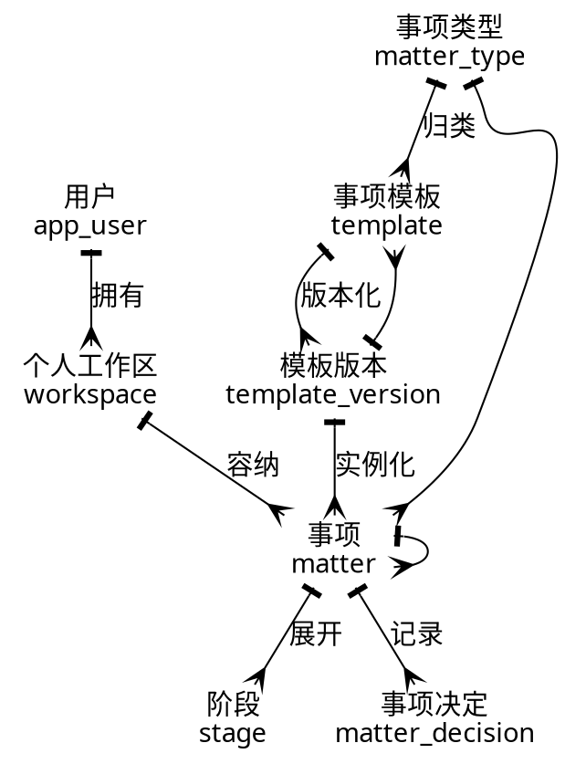

**代码 C-2  来源、快照、要求与证据**

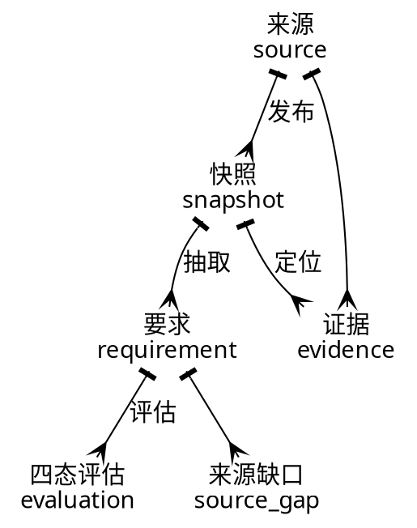

**代码 C-3  个人材料、事实与授权**

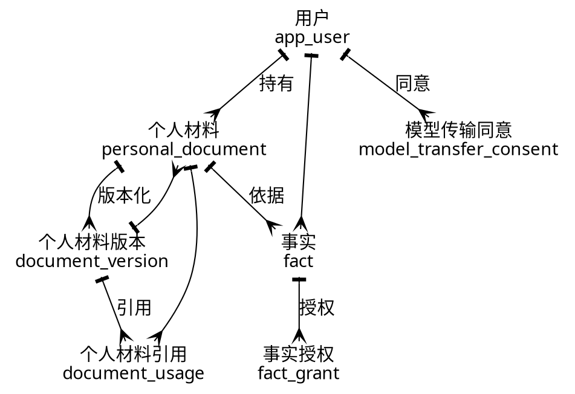

**代码 C-4  事项材料、提交证据与官方结果**

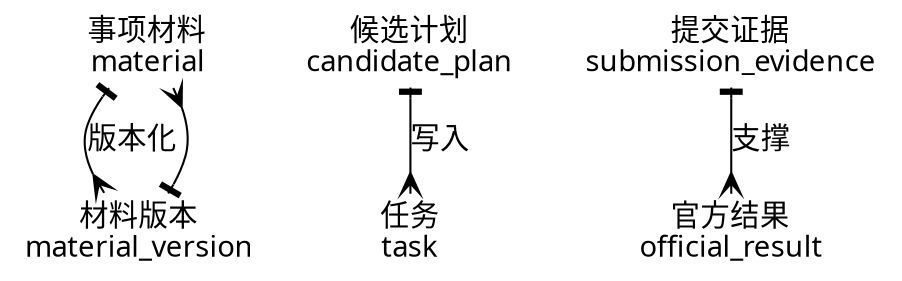
