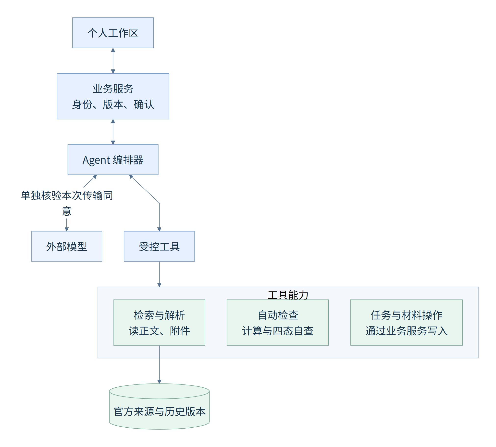
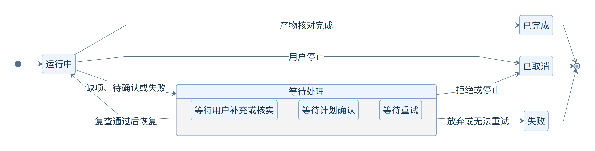
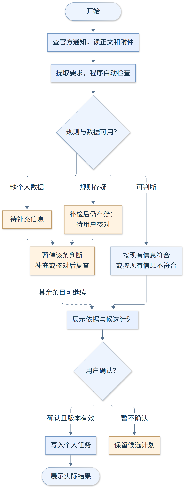
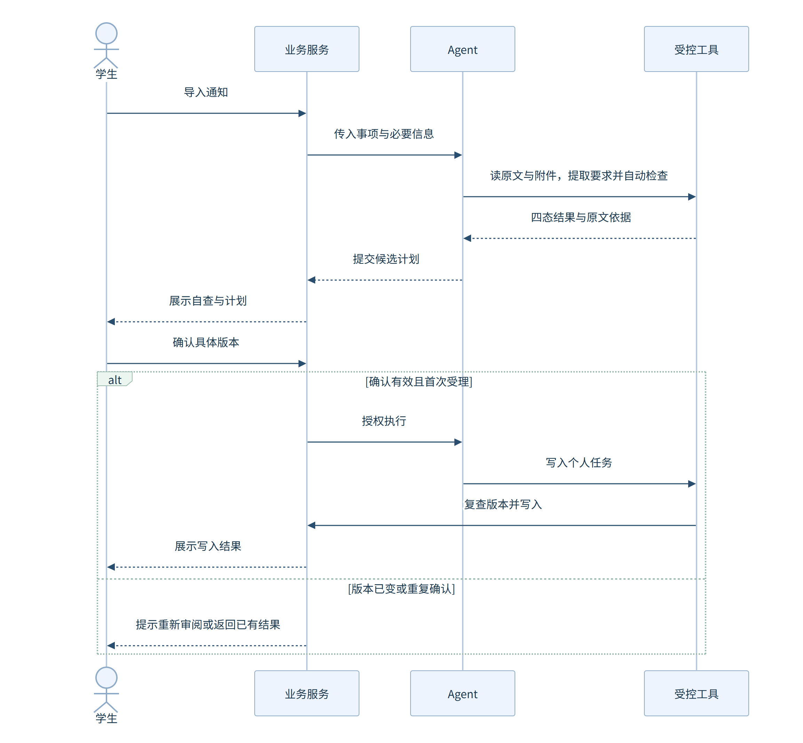
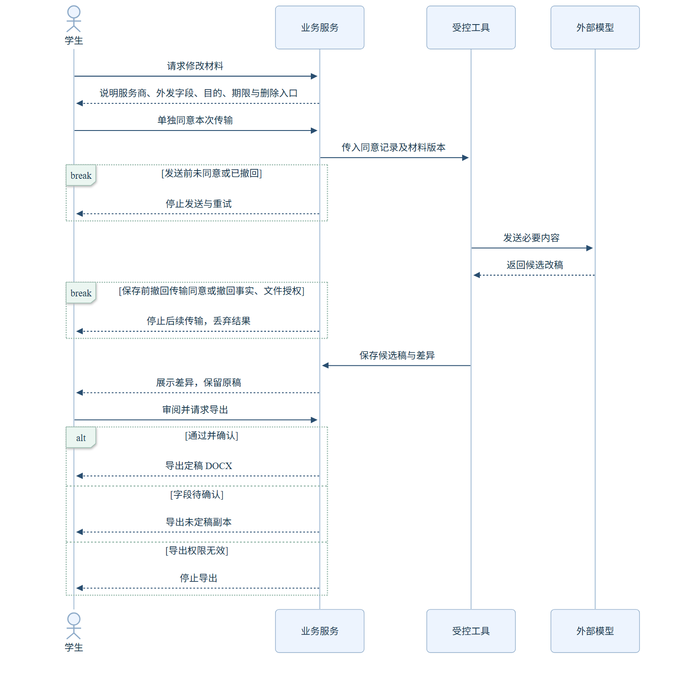

# OfferPilot 领域 Agent 与软件系统集成设计

鹦伟达团队 第二次团队作业

编写人：王智钦（102401609）、庄凯堃（102401310）

版本：1.2　日期：2026年11月8日

本稿说明领域 Agent 如何接入 OfferPilot 软件系统，以及领域知识、工具调用和任务流程在系统中的作用。功能范围以何慧渊《OfferPilot 需求流程说明》为基线，引用其中的用例 HHY-UC、功能 HHY-F 与验收 HHY-AC；领域约束引用杜玉鹤《OfferPilot 领域规则依据》中的 DYH-R01 至 DYH-R38。

## 1 设计目标与范围

OfferPilot 是面向大学生的机会与事项 Agent 工作台，以个人事项工作区为基本单元，组织官方通知、适用条件、个人任务、材料文件和执行记录。领域 Agent 结合当前事项的规则与个人情况，协助用户完成信息理解、条件自查、计划制定、材料准备和提交前检查。

首版采用 PC Web，覆盖推免模板和一个试点竞赛模板；其他竞赛、科研项目及评优模板在首版闭环稳定后再接入，复用本稿的集成机制。系统只提供个人工作区：竞赛或科研项目即使具有团队背景，也只管理当前用户承担的任务与材料，不包含成员邀请、他人任务分派或团队审核流程（HHY-UC09、UC11，DYH-R20、R27）。

集成设计遵循三条分工：

| 参与方 | 职责 | 不承担的职责 |
| --- | --- | --- |
| Agent（编排器与模型） | 理解资料、提取要求、形成候选计划与候选改稿、解释依据 | 直接写数据库、计算明确公式、认定资格 |
| 程序（业务服务、工具、网关） | 校验权限与版本、计算公式和日期、维护状态、写入数据、导出文件 | 替用户作决定 |
| 用户 | 确认事实、接受或拒绝候选、授权外部模型处理、在官方渠道提交 | — |

## 2 Agent 与软件系统的集成方式

### 2.1 总体架构



图1展示逻辑模块及调用关系，各模块不要求独立部署。前端只与业务服务通信；Agent 子系统位于业务服务之后。检索工具按事项获取官方通知和附件，可查询知识库中的来源与历史版本。写入工具通过业务服务接口保存正式变更。上下文组装、输出校验和运行检查点是编排器的内部组件。

| 模块 | 职责 |
| --- | --- |
| 个人事项工作区 | 用户输入目标、导入通知、补充事实、审阅候选与查看结果的唯一入口 |
| 业务服务 API | 身份校验、事项归属、任务状态、材料版本；向 Agent 提供裁剪后的上下文 |
| 授权与确认服务 | 维护产品内操作授权、确认记录及数据版本，另行记录本次模型传输同意 |
| Agent 编排器 | 组织“检索—分析—规划—执行—复核”步骤，选择工具，处理缺失与失败，汇总结果 |
| 上下文组装 | 按当前步骤选取官方原文、提取结果、事项状态和必要个人事实。向外部模型发送个人信息前检查本次授权 |
| 输出校验 | 对模型输出做 JSON Schema 校验和领域约束检查，未通过的输出不进入后续步骤 |
| 运行检查点 | 运行等待用户确认时保存中间状态与绑定的版本，确认后从检查点恢复 |
| 工具调用网关 | 检查参数、访问权限、授权等级、输入版本和操作标识，再分派到具体工具 |
| 领域知识库 | 保存官方来源、原文及版本、已提取条目和事项模板，供 Agent 按需检索和复用 |
| 业务数据 | 保存事项、任务、个人事实、材料版本，以及记录来源版本、用户确认、工具状态、产物和失败原因的执行记录 |

用户看到一个统一的 Agent 入口。信息侦察、规则分析、计划、材料与复核作为编排器内部的专项步骤按需调用，由同一个运行分阶段完成。

### 2.2 业务服务与 Agent 的接口

业务服务以“运行”（Run）为单位调用 Agent。一次运行对应用户在某个事项中发起的一次处理，运行结果通过事件流推送到前端。

| 接口 | 调用方 | 作用 |
| --- | --- | --- |
| 创建运行 | 业务服务 → 编排器 | 传入用户 ID、事项 ID、目标、工作区版本，返回运行 ID |
| 运行事件流 | 编排器 → 业务服务 → 前端 | 以 SSE 推送步骤进度、追问、候选结果与最终摘要 |
| 提交确认 | 业务服务 → 编排器 | 原子消费待确认候选，绑定唯一写入标识、候选版本与用户决定，恢复等待中的运行 |
| 取消运行 | 业务服务 → 编排器 | 停止后续工具调用；若有正在执行的写入，等待其返回结果并如实报告后再进入已取消状态 |
| 读取上下文 | 编排器 → 业务服务 | 按字段请求事项状态与个人事实，业务服务执行与网关一致的授权、版本及审计检查 |

运行状态如图2所示。等待确认时编排器释放计算资源，只保留检查点；用户确认后由业务服务先完成版本复查，再恢复运行。



### 2.3 模型接入与输出约束

模型服务承担文本理解、要求提取、计划建议和材料草稿生成。编排器向模型提供工具声明及参数结构。模型返回候选结果或工具调用请求，后者由网关校验并交给程序执行。编排器对候选结果执行两层校验：

1. JSON Schema 校验字段类型、枚举值和必填项。条件对照结果只允许四种状态，义务性质只允许四种分类。
2. 领域约束校验。检查每项官方结论是否关联来源版本与原文位置（DYH-R03），区分官方期限与建议准备日（DYH-R11），检查改稿是否关联已确认事实（DYH-R17）。引用能否支撑结论、规则是否存在歧义，需要结合原文核对。

以下为虚构的候选计划结构示例，日期和来源仅用于演示字段。

```json
{
  "candidate_id": "plan-20261106-001",
  "workspace_version": 12,
  "candidate_version": 1,
  "input_snapshot_id": "snapshot-demo-001",
  "tasks": [
    {
      "task_id": "task-demo-001",
      "title": "准备个人陈述",
      "basis": [{"source_version_id": "src-demo-v2", "locator": "第三条第2款"}],
      "obligation": "官方必需",
      "official_deadline": "2027-06-10T17:00:00+08:00",
      "suggested_date": "2027-06-03",
      "depends_on": [],
      "evidence_required": "导出的 DOCX 副本"
    }
  ]
}
```

真实个人事实或个人材料交给外部模型前，业务服务按模型服务商、传输字段范围、处理目的与方式、保留期限和删除入口向用户说明，取得绑定本次传输请求的同意记录（同意记录与具体传输标识绑定，不可跨次复用）。撤回操作与“复查同意并发送或保存”串行互斥执行：每次发送、分块或重试前以及保存返回结果前均复查本次传输同意及事实、文件访问授权。未取得同意或发送前已撤回时不发送并取消排队重试。发送后、保存前撤回传输同意或撤回事实与文件访问授权时，停止后续传输与重试，尽可能中止在途请求，并丢弃返回结果（HHY-UC09、UC13，DYH-R20、R31、R34）。

### 2.4 工具调用网关

网关是 Agent 调用业务工具的统一通道，每次调用依次检查：

1. 参数是否符合工具声明。
2. 当前用户对事项、文件和动作是否有权限。
3. 检查产品内操作的授权等级。L0 为读取资料与自动检查，L1 为用户确认候选计划后写入个人任务，L2 为授权范围内的可撤销操作（如生成材料副本），L3 仅覆盖删除档案、覆盖已确认信息、批量修改任务状态等高影响的产品内操作，执行前须单独明确确认（DYH-R32）。对外操作不在任何授权等级内。
   
   联系导师、报名和正式提交始终由用户自行完成。向外部模型传输个人事实或材料时，系统单独核验绑定本次传输请求的同意记录。L0 至 L3 的操作授权和计划确认均不能替代传输同意。
4. 输入版本是否与确认时一致；写入接口在业务服务数据库事务内原子复查期望版本。
5. 写入类调用是否携带操作标识；同一标识重复调用时返回首次执行结果（DYH-R21）。

网关把每次调用的输入版本、授权、结果和错误写入执行记录（DYH-R22）。

## 3 领域知识在系统中的作用

### 3.1 知识构成

| 知识或上下文 | 主要内容 | 存放位置 | 在系统中的作用 |
| --- | --- | --- | --- |
| 官方来源 | 学校和学院办法、招生通知、竞赛章程及附件；发布主体、链接、年度、版本、正文、附件和来源核验状态 | 领域知识库 | 为每项结论提供可回溯的原文依据 |
| 规则条目 | 按需从正文和附件提取的条件、材料、期限与依赖，记录来源版本和原文位置 | 领域知识库 | 确定适用对象、条件、材料、日期和正式流程 |
| 事项模板 | 推免与试点竞赛的默认阶段和常见材料类型 | 领域知识库 | 提供工作区组织结构；节点须经对应资料确认才成为必经步骤（DYH-R23） |
| 个人事实 | 用户确认的成绩、经历、职责、成果与时间安排 | 业务数据 | 支持条件自查、个性化计划和材料写作，按事项授权读取 |
| 事项状态 | 已完成任务、材料版本、待补信息和用户决定 | 业务数据 | 支持连续处理，避免重复询问和重复执行 |

公共规则与个人事实分库管理。Agent 读取个人事实必须经业务服务的授权检查，撤权后立即停止读取（DYH-R31）。

### 3.2 检索方式

Agent 根据当前事项按需检索官方来源。推免按学校、学院、专业、年级、年度、阶段和学位路径匹配，竞赛按主办方、赛项、届次、赛道和阶段匹配（DYH-R01）。已有规则条目可作为检索线索。复用时需要确认来源版本、适用范围和时效。

找到适用通知后，Agent 读取正文和相关附件，提取条件、材料、日期和计算口径，并保留来源链接、版本、页码或条款位置。系统核对来源身份、适用范围、关键附件完整性和正文与附件是否一致。仅有转载、规则过期或缺失关键附件时，Agent 先补充检索官方来源与附件；补检后仍无法核验来源或存在冲突时，受影响条款标为“待用户核对”（DYH-R02、R04）。

当规则明确且个人数据齐全时，程序完成可确定的比较或计算，返回“按现有信息符合”或“按现有信息不符合”，并展示依据。缺少必要个人数据时返回“待补充信息”。经补充检索后仍存在规则过期、关键附件缺失、来源冲突或公式含义不明确时返回“待用户核对”，暂停受影响的判断并交由当前用户对照原文核对。与缺项无关的检查可以继续，日常自查按本节自动检查流程执行。

### 3.3 领域约束的落实位置

状态枚举、权限、版本、必填字段与依赖关系由程序校验。涉及条款解释和事实忠实性的内容，结合原文、事实关联及当前用户核对处理。

| 约束 | 落实位置 | 依据 |
| --- | --- | --- |
| 条件对照只用四种状态：按现有信息符合、按现有信息不符合、待补充信息、待用户核对 | 输出 Schema 枚举 | DYH-R06 |
| 自查结果不等于学校认定，不输出录取概率 | 输出校验与界面文案 | DYH-R07 |
| 导师联系区分明确要求、官方建议、通知未提及、待用户核对；同意证明是否必交单独判断 | 输出 Schema 与条件校验工具 | DYH-R09 |
| 义务性质区分官方必需、官方建议、自主可选、待核实 | 输出 Schema 枚举 | DYH-R10 |
| 依赖无环，前置未满足时阻塞 | 条件与日期校验工具 | DYH-R15 |
| 未确认事实不进入定稿 | 材料检查与导出工具 | DYH-R08、R37 |
| 首版不提供自动联系、官方登录、报名和提交能力 | 网关工具白名单 | DYH-R32 |

## 4 工具调用在系统中的作用

工具把 Agent 的建议落实为具体操作，并返回可核验的结果。

| 工具 | 主要输入 | 输出及作用 | 授权等级 | 对应功能 |
| --- | --- | --- | --- | --- |
| 官方资料检索 | 事项类型及学校、学院、年度、批次或赛项、赛道 | 官方链接、发布单位、适用范围、版本和附件入口 | L0 | HHY-F01、F11 |
| 通知与附件解析 | 官方链接、正文、附件及来源版本 | 条件、材料、期限、依赖、原文位置和未读范围 | L0 | HHY-F02 |
| 条件与日期校验 | 有明确原文依据且适用的规则、已确认个人数据、候选计划 | 公式计算过程、四态结果、缺项、依赖环路与日期冲突 | L0 | HHY-F03、F06 |
| 个人任务写入 | 用户确认的计划版本与操作标识 | 本人任务、依赖及材料清单 | L1 | HHY-F05 |
| 材料诊断与改写 | 官方要求、原稿版本、已确认事实、本次模型传输同意与操作标识 | 差距诊断、局部改稿、修改差异与理由；原稿只读 | L2 | HHY-F07、F08 |
| 材料检查与 DOCX 导出 | 用户接受的材料版本与操作标识 | 一致性检查结果、新 DOCX 副本、文本预览与待补清单 | L2 | HHY-F08、F16 |

涉及扫描件或复杂版式时，解析工具返回已识别范围和无法识别的部分，未读到的内容不视为没有要求。工具超时后，编排器先按操作标识查询执行状态，再决定是否重试。

## 5 任务流程与活动设计



图3展示自动检查和计划确认。四态按条目显示，待补充信息或待用户核对的条目暂停判断，其余条目可以继续检查并用于生成候选计划。异常处理与恢复见第7节。“本次处理结束”表示本次运行结束，不表示整个申请已经完成。

1. **提出目标。** 用户输入目标或导入通知。目标含混或同时涉及多个事项时，Agent 先追问或拆分（HHY-UC07）。
2. **检索并解析规则。** Agent 按需检索官方通知，读取正文和相关附件，提取适用条件、材料、期限及原文位置，检查来源年度、附件完整性及条款一致性（HHY-UC01）。
3. **处理缺失与冲突。** 缺个人信息时标为待补充信息并指明字段；来源冲突、过期或缺页时先补充检索官方修订通知与附件，补检后仍未解决的标为待用户核对并展示原文。用户补充或核对后重新分析，也可以暂缓（保存探索草稿）或停止。
4. **自动检查。** 提取要求后，程序逐条对照可核实的规则和已确认个人数据，自动执行可确定的比较或计算，并返回“按现有信息符合”“按现有信息不符合”“待补充信息”或“待用户核对”。Agent 展示原文依据、计算过程和待解决项（HHY-UC02）。
5. **生成候选计划。** 将要求拆解为有前置依赖的个人任务，标注义务性质，官方期限与建议准备日分别显示（HHY-UC04）。可选事项说明目标关联、时间成本、现有负荷、依据和不确定性，由用户采纳、稍后决定或跳过；跳过官方必需项时明确告知影响（HHY-UC08，DYH-R24）。
6. **审阅与确认。** 用户可以调整、拒绝或确认。修改后重新校验并生成新候选版本。确认绑定具体候选版本；确认时授权、来源或事实版本已变化，旧候选失效并重新生成（DYH-R14）。
7. **执行与校验。** 经网关执行获准工具并核对实际产物。失败或超时时保留已完成步骤和错误信息，由用户选择重试或放弃；用户取消时停止后续调用并说明已完成的动作。
8. **展示与记录。** 展示产物、来源、未完成项及下一步，保存执行记录。用户后续补充信息时，在已有进度上继续处理。

## 6 典型场景的时序设计

### 6.1 根据夏令营通知整理个人申请任务



图4展示推免场景中从导入通知到写入个人任务的过程，对应 HHY-UC01、UC02、UC04。

业务服务校验身份及事项归属后创建运行。编排器经网关按需检索官方通知，读取正文与相关附件，提取要求和原文位置。程序自动逐条检查，返回四态结果及原文依据。模型据此生成结构化候选计划，再由程序校验引用字段、任务依赖和日期。候选计划提交给业务服务后，运行保存检查点并进入等待确认，此时不创建正式任务。

用户逐项接受或修改后确认。业务服务原子消费待确认候选，复查权限、确认范围、来源与事实版本：版本已变化则旧候选失效；版本未变化则绑定唯一操作标识并恢复运行。编排器携带确认记录、期望版本和操作标识调用任务写入工具，业务服务在写入事务内校验版本并创建本人任务和材料清单，实际写入结果沿调用链返回并展示给用户。

### 6.2 材料局部改写与导出



图5展示由业务服务协调受控工具完成的材料改写与导出，图中省略内部编排接口。对应 HHY-UC05、UC13。

编排器只读取本次改写所需的已确认事实。业务服务说明模型服务商、外发字段、处理目的与方式、保留期限和删除入口，并单独取得本次传输同意。撤回操作与发送、保存串行互斥执行：工具在每次发送、分块或重试前复查传输同意及事实、文件访问授权，未同意或已撤回则停止发送并取消重试。发送后至保存前撤回传输同意或撤回事实与文件访问授权时，停止后续传输与重试，尽可能中止在途请求，并丢弃返回结果。保存前复查通过后，工具以副本保存候选稿、差异和修改理由，原稿保持只读（DYH-R18）。用户逐项接受或拒绝并确认关键字段后，导出工具执行跨材料一致性检查：必要事实、关键字段与必填项检查通过，并由用户确认后，生成定稿 DOCX、文本预览与检查清单。存在未确认关键字段时，在权限允许的情况下只能导出明显标注“未定稿”的副本，保留待补标记。撤回模型传输同意后停止后续传输。涉及材料读取或导出的动作另行检查对应产品内权限和版本。

联系导师、报名和正式提交始终由用户在相应渠道自行完成。系统根据用户登记记录提交时间、材料版本及回执（HHY-UC12）。试点竞赛复用上述机制，按赛项章程配置阶段；竞赛通知中的组队条件作为资格要求解析，系统不据此管理其他成员（HHY-UC11）。

## 7 异常处理与结果追溯

| 情况 | 处理方式 | 验收 |
| --- | --- | --- |
| 缺少个人数据 | 标为待补充信息，继续处理不依赖该数据的任务 | HHY-AC03 |
| 来源过期、缺页或冲突 | 展示问题与原文，暂停相关确定性判断 | HHY-AC02、AC14 |
| 拒绝候选计划或关闭页面 | 不新增正式任务，保留决定或草稿 | HHY-AC05 |
| 确认前依据变化 | 旧候选失效，重新分析并展示新版本 | HHY-AC06 |
| 重复确认 | 查询并返回已有执行状态或结果，避免重复写入 | HHY-AC06 |
| 确认后规则或事实改变 | 标记受影响计划待复核并提示用户；自动差异与完整影响分析属于 P1 | HHY-AC10 |
| 工具失败、超时或执行中取消 | 按操作标识查询状态，保留已完成步骤与恢复入口 | HHY-AC09 |
| 材料包含未确认事实 | 留空或标为待补，阻止定稿导出 | HHY-AC25、AC28 |
| 撤回本次模型传输同意 | 发送或重试前停止发送并取消排队重试。发送后停止后续传输与重试，尽可能中止请求，并在保存前丢弃返回结果 | HHY-AC19、AC26 |
| 撤回事实或文件访问授权 | 停止使用相应事实或文件的读取、外发、候选保存及导出，丢弃在途未保存结果并列出受影响对象 | HHY-AC19、AC26 |

执行记录保存实际采用的来源与规则版本、输入版本、用户确认、工具状态、产物和失败原因，用户可查看摘要与修改差异。材料检查通过、个人任务完成和正式提交分别记录，互不替代（DYH-R16）。

## 8 能力与需求对应

| Agent 能力 | 用例 | 领域规则 | 验收 |
| --- | --- | --- | --- |
| 识别事项并建立工作区 | HHY-UC07 | DYH-R01 R02 R23 R36 | HHY-AC13 AC14 |
| 检索与解析官方要求 | HHY-UC01 | DYH-R01 至 R05 | HHY-AC01 AC02 AC30 |
| 条件对照与解释 | HHY-UC02 HHY-UC10 | DYH-R06 R07 R08 R26 | HHY-AC03 AC15 AC20 |
| 导师联系判断 | HHY-UC03 | DYH-R09 R10 | HHY-AC04 |
| 可选事项建议 | HHY-UC08 | DYH-R10 R24 R38 | HHY-AC16 AC17 |
| 候选计划与确认写入 | HHY-UC04 | DYH-R11 至 R16 R21 R32 | HHY-AC05 至 AC07 AC11 |
| 竞赛个人任务推进 | HHY-UC11 | DYH-R23 R27 至 R30 R36 | HHY-AC22 至 AC24 |
| 材料诊断、改写与导出 | HHY-UC05 HHY-UC13 | DYH-R08 R13 R17 R18 R37 | HHY-AC08 AC09 AC27 AC28 |
| 个人事项范围、授权与外部模型处理 | HHY-UC09 | DYH-R20 R31 R34 | HHY-AC18 AC19 AC26 |
| 提交前复核与归档 | HHY-UC12 | DYH-R16 R30 R31 | HHY-AC12 AC29 |

## 9 编制依据

依据《OfferPilot_产品方案（新版策划稿）》、何慧渊《OfferPilot 需求流程说明》1.4 版和杜玉鹤《OfferPilot 领域规则依据》编制。图源保存在 `diagrams/` 目录，使用 Mermaid 编写。
