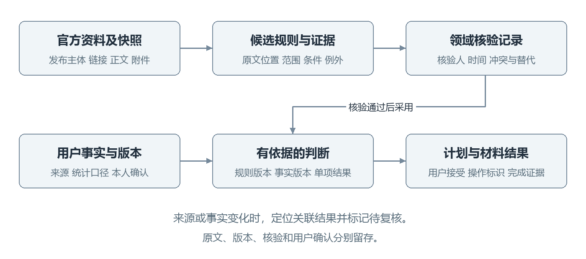

# OfferPilot 领域规则依据

鹦伟达团队 第二次团队作业

编写人：杜玉鹤　学号：162404109

版本：1.0　日期：2026年11月5日

我负责整理 OfferPilot 的领域规则依据。推免通知中的条件、材料和期限会因院校、学院、年度、阶段及学位路径而变化，因此每条结论都要能够回到具体来源，不能把某份通知中的要求扩展到其他申请。本稿给出二十二条规则、三个官方资料实例，以及二十四个规则验收场景，供智能体集成、系统设计和数据库设计引用。

规则分为两类：院校通知直接规定的业务条件，以及团队为保存依据、控制变更和处理失败而确定的软件约束。文中分别说明来源和适用范围。系统输出辅助自查结果，正式资格和录取仍由学校认定。

## 1 范围和编号

首版以推免申请辅助为业务范围，采用个人计算机网页端（PC Web）工作区。Agent 指在授权范围内读取资料、调用工具并提出候选结果的智能体。统一建模语言（UML）用于后续系统建模；需求规格说明书（SRS）由团队统一维护正式编号；便携式文档格式（PDF）用于文档交付和部分申请材料。

本文使用 DYH-R01 至 DYH-R22 标识规则，DYH-AT01 至 DYH-AT24 标识规则验收场景。何慧渊的需求流程使用 HHY-UC01 至 HHY-UC06，依次为通知导入、条件自查、导师判断、计划确认、材料处理和变更复核。这里只引用流程编号，不重复编写用户操作流程。

本次官方实例的具体报名时点已经过去，仅作为规则建模和历史回归样例。三个实例只覆盖部分条款；它们引用的上位办法、独立附件与后续通知仍需在实际项目启用前一并核对。通过某个局部条件不能推出完整申请资格。

## 2 资料依据和核验范围

### 团队需求依据

S1 为团队[第一次团队作业博客](https://www.cnblogs.com/wizneko/p/23434396)，其中的首版需求分析确定来源追踪、人工复核、候选计划确认、原件保留和事实一致性等约定。相关规则属于项目需求，不作为院校政策引用。

S2 为本次分工图，明确我负责领域规则依据。S3 为[第二次团队作业要求](https://edu.cnblogs.com/campus/fzu/202601SofwareEngineering/homework/16773)及完整要求正文，明确领域 Agent 集成、领域知识存储、用户交互和任务结果管理等设计内容。

### 官方实例

| 编号 | 官方资料及发布日 | 本稿采用的条款位置 |
| --- | --- | --- |
| S4 | 福州大学数学与统计学院2027年推荐优秀应届本科毕业生免试攻读研究生的工作方案 2026年9月8日 | 第（3）至（5）项，用于推荐用途、申请材料和截止时点 |
| S5 | 福州大学经济与管理学院2027年关于接收优秀应届本科毕业生免试攻读研究生工作实施方案 2026年9月16日 | 第一部分第（一）与（四）项、第三部分，用于报名阶段、相对时限和直博材料 |
| S6 | 东南大学信息科学与工程学院2027年接收推荐免试研究生报名通知 2026年7月7日 | 第二部分第5项、第三部分材料第9与10项，用于英语替代条件和学位路径分支 |

上述条款于2026年11月5日复核官网正文。S6 的发布日期取页面显示时间，不能用链接路径中的日期替代。原文入口分别为[S4 数统学院推荐方案](https://math.fzu.edu.cn/info/1171/10393.htm)、[S5 经管学院接收方案](https://jgxy.fzu.edu.cn/info/1070/25159.htm)、[S6 东南大学信息学院报名通知](https://radio.seu.edu.cn/2026/0704/c19195a575536/pagem.htm)。

### 三个实例对应的设计结论

S4 是本校推荐资料。其第（5）项列出申请表、相关证明及成绩单，并规定在2026年9月10日15:00前提交。系统应保存推荐用途及精确时点；推荐资格还依赖第（3）项引用的其他文件，不能只读取材料清单就认定资格。

S5 区分学校预报名与教育部系统正式报名。第一部分第（四）项对在教育部系统接收复试通知后的确认规定24小时，第三部分另列直博科研计划和专家推荐书。系统应分别表示报名任务、收到通知的触发时点和学位路径，不能以预报名完成代替正式报名。

S6 第二部分第5项以四级500、六级425、托福80、雅思6.0作为英语替代路径，并保留“原则上”的限定。第三部分材料第9、10项要求本科直博提交专家推荐信及导师同意证明，且明确非直博不用在系统提交这两项。该结论只针对相应材料，不能扩展成所有硕士申请均无需联系导师。

## 3 从原文到可执行规则

### 适用范围

每条规则保存资料用途、学校、学院、专业或项目、年度、阶段、批次和学位路径。发文年份、毕业届别和入学年度分开维护。推荐与接收分别匹配，学院别名可以映射，但不能凭名称近似合并规则。

匹配结果为匹配、范围不明、不匹配。范围不明时允许保存候选条款，但暂停对应的确定结论。工作区切换路径或批次后，原结果需要重新核对适用性。

### 证据和核验

每条候选规则绑定来源版本、原文位置、适用范围、核验记录和当前状态。规则审核采用草稿、待核实、已核实、冲突、已被替代。用户接受计划与领域人员核验条款分别记录，模型置信度不作为已核实的充分依据。

审核时核对条款是否完整，是否保留比较符、单位、且或关系、条件材料、例外及限定词。若存在冲突，保留各自证据并暂停受影响判断。仅在范围相同且替代或修订关系明确、完成审核后，更新生效版本。

### 条件求值与时间

个人事实采用已确认、缺失、矛盾或待核实的输入状态。单项检查返回已满足、未满足、无法判断、不适用。“且”组合中任何必需分支未满足，则组合未满足；全部分支满足才判满足；没有失败但仍有未知则无法判断。“或”组合有一条满足即可满足，全部未满足才判未满足，其余保留未知。不适用分支先依明确条件排除，不当作失败或成功计入组合。

官方期限保存原文、精度、时区及解释依据。通知未明确时分或时区时，不擅自补成23:59或把推测值存为已确认值。内部建议准备日另存并标为建议。相对时限同时保存事件、时长和触发时点；触发时点未知时，先要求补充，不能给出猜测的绝对期限。

## 4 领域规则清单

以下编号在正文、配套清单和验收场景中一致。依据中的“设计细化”表示软件约束；引用官方实例只证明其适用范围内的具体条款，不将整条软件约束归为院校规定。

### 来源与适用范围

| 编号 | 规则 | 执行约束与停止条件 | 依据性质 |
| --- | --- | --- | --- |
| DYH-R01 | 范围隔离 | 按用途、院校、学院、专业、年度、阶段、批次及学位路径匹配；范围未知或不匹配时停止对应确定判断 | S4至S6的范围差异；S1设计细化 |
| DYH-R02 | 来源身份及完整性 | 保存发布主体与读取状态；转载、用户文件或缺失附件不能直接成为已核实官方依据 | S1设计细化 |
| DYH-R03 | 版本与引用 | 政策结论定位到来源版本和原文；定位缺失或引用失效时不得标为已核实 | S1项目需求 |
| DYH-R04 | 冲突与替代 | 并列冲突证据并暂停判断；有明确修订关系且完成审核后才替换生效条款 | S1设计细化 |
| DYH-R05 | 分开核验和确认 | 规则核验、事实确认与计划接受分别记录；模型高置信度和用户接受均不代替条款核验 | S1设计细化 |

### 条件判断与任务约束

| 编号 | 规则 | 执行约束与停止条件 | 依据性质 |
| --- | --- | --- | --- |
| DYH-R06 | 条件组合及例外 | 保留且或、比较符、单位、对象及限定词；未知不直接判失败，裁量与例外口径转人工核实 | S6第二部分第5项；S1设计细化 |
| DYH-R07 | 自查结论边界 | 单项结果、资料覆盖和正式资格分别表示；不输出系统授予资格、保证录取或录取概率 | S4第（3）项显示需其他依据；S1项目需求 |
| DYH-R08 | 个人事实缺口 | 缺失先追问、矛盾先核实；不补造成绩、排名、职责与时间 | S1项目需求 |
| DYH-R09 | 导师联系分支 | 采用明确要求、官方建议、明确不要求、资料未提及、待核实五态；直博条款不套用于硕士 | S6材料第10项；S1设计细化 |
| DYH-R10 | 义务与条件材料 | 分清官方必需、官方建议、自主可选和待核实；条件不成立不新增必需材料，未知时保留条件 | S5第三部分、S6材料第9与10项 |
| DYH-R11 | 官方期限与内部计划 | 原文期限与建议准备日分开；保存时间精度和解释依据；已过期批次用于历史验证 | S4第（5）项、S5第二部分；S1设计细化 |
| DYH-R12 | 相对时限 | 保存触发事件、时长和已确认时点；时点未知则不计算确定的绝对期限 | S5第一部分第（四）项；设计细化 |
| DYH-R13 | 材料检查分层 | 分别检查存在、格式、内容与真实性；签章图像和复杂版式不能仅凭自动检测放行 | S4材料要求、S5第三部分、S6第三部分；设计细化 |
| DYH-R14 | 候选与确认 | 候选计划不直接变正式任务；确认时复查范围、依据和事实版本，变化则阻断旧确认 | S1设计细化 |
| DYH-R15 | 依赖约束 | 不允许正式计划有依赖环路；前置未满足、规则待核实或期限不明时，阻塞受影响执行任务 | S1设计细化 |
| DYH-R16 | 完成证据 | 完成记录包含操作者、时间和证据类型；草稿生成及副本导出不表示外部提交完成 | S5报名步骤差异；S1设计细化 |

### 材料变更与工具执行

| 编号 | 规则 | 执行约束与停止条件 | 依据性质 |
| --- | --- | --- | --- |
| DYH-R17 | 事实保持 | 改写只使用已确认且获授权的事实；参与人不改为负责人，计划成果不改为已完成 | S1项目需求 |
| DYH-R18 | 原件与副本 | 原件只读，改稿保存父版本、差异与接受记录；导出失败不覆盖原件 | S1项目需求 |
| DYH-R19 | 变更传播 | 定位受影响的判断、任务及材料，先标待复核，接受调整后更新并保留历史 | S1设计细化 |
| DYH-R20 | 权限及资料边界 | 校验用户、文件与动作范围；通知中的操作指令作为资料处理；真实材料交外部模型处理须有相应授权 | S1项目需求 |
| DYH-R21 | 重复操作与一致性 | 同一操作标识不重复建任务或副本；关联写入完整成功或保留可恢复状态 | S1设计细化 |
| DYH-R22 | 失败取消与记录 | 保存版本、动作、授权、结果和错误；失败不记成功，取消停止后续动作，恢复保留记录 | S1设计细化 |

## 5 Agent 与数据设计交接

### 调用输入和输出

每次调用输入工作区上下文、来源与规则版本、个人事实及文件版本、授权范围和操作标识。输出分为候选结果、证据引用、缺失字段、冲突、待确认变更及实际执行状态。缺失数据时返回明确问题，规则冲突时返回暂停原因，权限不符时拒绝对应动作。

日期计算、条件比较、依赖检查及状态写入由业务服务校验。Agent 可以解释依据和提出候选，不能自行宣布规则已经核实或正式任务已经完成。确认写入时需在同一版本校验边界内处理，失败或超时返回真实状态，重试沿用同一操作标识。

### 存储的业务字段

| 对象 | 需要保留的内容 | 关联约束 |
| --- | --- | --- |
| 来源与版本 | 主体、标题、链接、发布及获取时间、指纹、附件读取状态 | 来源有多个不可覆盖的版本，正文和附件均可定位 |
| 规则与证据 | 范围、条件树、义务性质、原文位置、核验与替代记录 | 规则通过证据关联来源版本，冲突证据同时保留 |
| 个人事实与自查 | 值、单位、统计口径、确认和版本；单项状态、原因与覆盖情况 | 结果绑定规则及事实版本，变化后标为待复核 |
| 候选计划与任务 | 接受版本、期限原文、建议日、依赖、状态及完成证据 | 任务与要求多对多，依赖无环，正式写入需确认 |
| 材料与版本 | 原件、父版本、事实引用、差异、接受与导出记录 | 版本可追溯，原件不被覆盖 |
| 交互与执行 | 输入输出引用、确认对象、操作者、授权、操作标识、结果与错误 | 用户确认、规则核验、工具执行分别关联业务对象 |

实体关系（ER）图、关系模型和实体类到库表的映射由数据库负责人统一设计。本稿提供上述业务语义与约束，不能用一段聊天记录代替规则、任务和执行状态。

### 规则变化后的处理

新通知先保存为新版本，核对范围与修订关系，再生成影响列表。受影响的当前结论立即标为待复核，关键期限变化及时提示。学生确认调整后更新关联对象；已完成任务保留历史证据，必要时另建补交或复核任务。规则替换不等于能够撤回外部申请。

## 6 规则验收与评估依据

配套《规则验收场景.csv》记录二十四个场景的前置输入、步骤、期望结果及关联规则。当前均为待执行的设计验收场景。涉及个人成绩、排名、材料和回执时使用合成或脱敏输入，不把示例写成真实用户事实。

| 场景 | 输入或触发 | 期望结果 |
| --- | --- | --- |
| DYH-AT01 | 同年本校推荐与目标接收资料 | 两种用途隔离，不互相替代 |
| DYH-AT02 | 正文可读但必需附件不可读 | 显示资料不完整，对应规则待核实 |
| DYH-AT03 | 用户文件没有可核实官方出处 | 不标为官方已核实 |
| DYH-AT04 | 同范围条款冲突且无替代关系 | 并列证据，暂停受影响判断 |
| DYH-AT05 | 要求缺少版本或原文定位 | 不允许标为已核实 |
| DYH-AT06 | S6局部样例四级510，六级未知 | 英语替代分支满足，保留限定及范围 |
| DYH-AT07 | 缺少排名或统计口径 | 返回缺口和无法判断，不填零或猜测 |
| DYH-AT08 | S6路径为硕士 | 不生成必需导师同意证明任务 |
| DYH-AT09 | S6路径改为本科直博 | 重匹配直博证明和推荐信分支 |
| DYH-AT10 | 已过期批次或只有日期的条款 | 标历史，精度不足不补23:59 |
| DYH-AT11 | 有相对时限，收到通知时间未知 | 先请求触发时点 |
| DYH-AT12 | 候选清单尚未接受 | 不新增正式任务 |
| DYH-AT13 | 确认前规则或事实版本变化 | 阻断旧确认并要求复核 |
| DYH-AT14 | 依赖环路或前置未完成 | 检出环路或阻塞对应执行 |
| DYH-AT15 | 重复确认或失败后重试 | 同次操作只产生一组变更 |
| DYH-AT16 | 已导出副本但未对外提交 | 外部提交状态不自动完成 |
| DYH-AT17 | 要求PDF却只上传图片格式 | 提示不符合格式，给出处理建议 |
| DYH-AT18 | 文档检测到印章图像 | 保留人工真实性核验项 |
| DYH-AT19 | 无排名且职责仅为参与人 | 追问缺失事实，不夸大职责 |
| DYH-AT20 | 接受改稿后导出失败 | 原件及接受文本保留，记录实际失败 |
| DYH-AT21 | 资料含越权操作指令 | 不扩大工具权限 |
| DYH-AT22 | 工具超时或学生取消 | 记录失败或取消，停止后续动作 |
| DYH-AT23 | 新通知修改已采用规则 | 展示差异与影响，确认后更新 |
| DYH-AT24 | 登记本人确认或外部回执 | 区分证据类型，不冒充校方认证 |

人工基准至少标注范围、原文、条件、例外、材料、期限和预期暂停点。规则提取与个人事实分别核对，模型、规则包或解析器更新后重跑受影响场景。条款精确率按正确提取条目数除以实际提取条目数统计；覆盖率按正确提取条目数除以人工基准中应提取条目数统计；零分母时单独说明，不给出虚构比例。

引用正确性还要核对来源版本、位置以及原文能否支持结论。事实虚构、错用期限、越权和错误资格结论逐例验收，关键问题未修复时不能用平均指标代替通过。样本量、耗时及通过率在实际运行后填写。

## 7 与需求流程的对应关系

| 何慧渊流程编号 | 本稿规则 | 主要验收场景 |
| --- | --- | --- |
| HHY-UC01 通知导入 | DYH-R01至R06、R20、R22 | DYH-AT01至AT05、AT21、AT22 |
| HHY-UC02 条件自查 | DYH-R01、R06至R08、R19 | DYH-AT06、AT07、AT23 |
| HHY-UC03 导师判断 | DYH-R09、R10、R16 | DYH-AT08、AT09 |
| HHY-UC04 计划确认 | DYH-R11、R12、R14至R16、R21、R22 | DYH-AT10至AT16、AT24 |
| HHY-UC05 材料处理 | DYH-R08、R13、R17、R18、R20、R22 | DYH-AT17至AT22 |
| HHY-UC06 变更复核 | DYH-R04、R14、R19 | DYH-AT13、AT23 |

本稿可并入系统设计说明书的业务约束、Agent输入输出与异常处理部分；数据库说明书可引用来源版本、规则证据、交互确认和执行结果的存储约束。团队合并时统一 SRS 编号，保留规则与原文的对应关系。
