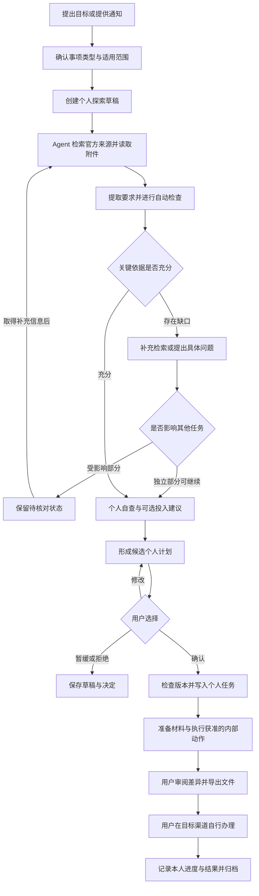

# OfferPilot 产品方案

> 面向大学生的个人事项智能体（Agent）工作站

| 文档信息 | 内容 |
| :--- | :--- |
| 团队 | 鹦伟达 |
| 产品负责人 | 魏之皓，项目经理（PM）、调研策划 |
| 文档状态 | 团队评审稿，所述功能为产品要求，完成情况以实现和验收记录为准 |
| 更新日期 | 2026 年 11 月 8 日 |
| 交付终端 | 个人计算机网页端（PC Web） |
| 首版场景 | 推免个人准备与申请、一个具体竞赛事项；试点院系和赛项待团队确认 |
| 文档用途 | 明确产品定位、功能范围、用户流程、Agent 行动边界及产品验收要求 |

本方案作为原型、需求和概要设计的产品依据，所列功能与验收条款描述预期行为，不代表开发或测试已经完成。四周进度、里程碑和逐人成员职责由配套文件《鹦伟达_开发计划与成员分工》说明，其中每周计划和逐人分工应纳入本次团队博客正文。

## 一、产品定位与目标

OfferPilot 帮助大学生将一件需要查通知、核对条件、准备材料并按时办理的事务，组织成可以持续推进的个人工作区。用户提出目标后，Agent 主动查找官方来源，整理适用条件、办理步骤和材料要求，结合本人信息生成计划，并协助完成文件整理、材料起草、局部改写和提交前自查。

产品从推免申请切入，逐步适配竞赛、科研或创新项目、奖学金和评优等校园事项。这些事项具有相似的组织需求，但适用条件、阶段和材料要求分别依据对应官方文件确定。用户可以同时管理多个个人事项，复用本人确认的经历和证明材料。

产品需要实现四项目标：

1. **减少信息整理负担。**将分散在官网、附件和补充通知中的要求整理为可回到原文的清单。
2. **明确个人下一步。**将规则转为有期限、有依赖、有完成依据的个人任务，指出影响推进的具体缺口。
3. **交付可使用的材料。**依据用户提供的事实和目标要求完成草稿、修改及文件导出，保留原件和修改记录。
4. **支持持续办理。**保留事项状态、资料版本、用户决定和 Agent 执行结果，用户补充信息后能够接着处理。

产品内的“完成”须对应实际结果：建立了任务、保存了用户接受的改稿、生成了可打开的文件，或记录了用户自行办理后的状态。界面中的建议和处理进度应分别标识。

## 二、需求来源与场景扩展

### 2.1 初始切入点

团队最初关注大学生在推免准备和申请中的信息收集困难：本校推荐资格、学院细则、外校接收要求、导师联系条件及材料模板分散，学生需要自行判断哪些要求适用于自己，再安排准备工作。

初期调研围绕推免信息获取与申请准备展开，产品首先聚焦官方信息整理、条件自查和材料准备。功能优先级仍需结合试点用户的实际办理流程与可核查的调研证据确定。问卷结论应附完整题干、题目结果、有效回答数、调查对象范围及证据链接，其适用范围限于对应样本。

### 2.2 从推免扩展到个人校园事项

经过老师指导和团队讨论，产品将校内资格自查、导师联系判断纳入推免流程，并进一步关注其他具有相似办理结构的事项。竞赛、项目和评优也常涉及分散通知、多阶段任务、截止日期和材料准备，因此可以复用个人工作区、计划和材料工具。

推免问卷只支撑推免场景的需求分析。其他事项仍须通过对应用户访谈和真实办理流程核对，确认哪些功能确实可复用、哪些需要独立配置。首版通过推免与一个竞赛验证共用能力，其他模板列入后续扩展。

### 2.3 主要痛点与对应能力

| 用户痛点 | 典型表现 | 产品响应 | 用户得到的结果 |
| :--- | :--- | :--- | :--- |
| 官方信息分散 | 正文、附件和补充通知分别发布 | Agent 检索并读取关联来源 | 带出处、适用范围和时间的要求清单 |
| 不知道是否适用 | 年度、专业、批次、学位路径混用 | 匹配范围，分项进行个人条件自查 | 逐项结果、计算过程及缺口 |
| 不知道先做什么 | 材料之间有依赖，多个日期容易混淆 | 生成个人计划和前置关系 | 可确认、调整和执行的任务列表 |
| 难以判断可选投入 | 不清楚是否值得提前联系、参赛或补充材料 | 结合目标、时间和现有负荷解释取舍 | 采纳、暂缓或跳过的依据 |
| 有经历但不会写 | 素材零散，不熟悉简历或申请书表达 | 追问事实、组织结构、局部起草 | 可逐段审阅的候选稿与新文件 |
| 文件反复改、版本易错 | 同一材料用于不同项目，修改互相覆盖 | 原件只读、版本记录、要求映射 | 明确的使用版本和差异记录 |
| 办理过程难以持续追踪 | 处理一次后需重新解释背景 | 保存事项、任务和已确认信息 | 能从原进度继续的个人工作区 |

## 三、目标用户与适用边界

### 3.1 目标用户

| 用户类型 | 当前目标 | 使用重点 |
| :--- | :--- | :--- |
| 机会探索者 | 了解是否符合条件、是否值得准备 | 信息检索、条件初查、投入建议、探索草稿 |
| 个人事项执行者 | 已决定申请或参与，需要推进办理 | 任务计划、材料准备、截止日期与状态记录 |
| 长期准备者 | 尚未进入申报阶段，希望逐步准备 | 个人档案、缺口整理、自主可选的准备建议 |

年级、学校或专业用于限定规则范围，不能直接代替资格判断。长期准备建议须说明所用政策年度；尚未发布当年通知时，历史要求仅供参考。

### 3.2 个人工作站边界

- 每个事项只属于当前用户，所有任务、私人记录和材料按本人权限管理。
- 用户级个人工作站统一管理本人的多个事项；每个事项独立保存目标、阶段、任务与材料，事项页面使用“事项工作区”作为界面名称。
- 竞赛或项目可以具有团队背景，系统只管理用户本人承担的部分；不设置成员邀请、共享工作区、他人任务分派或多人审核。
- 官方报名、导师联系、材料提交和异议办理均由用户在目标渠道自行完成，软件提供准备资料和个人办理记录。
- 校内推荐资格、录取、获奖、证明效力等正式结果由有权机构确定。个人自查不构成正式认定。
- 用户对自己提供的事实和材料的真实性、完整性及可用性负责；Agent 协助检查字段、格式与一致性。
- 日常官方信息获取和整理由 Agent 承担，不设置人工整理、双人复核后发布的运行流程。
- 不提供将用户上传材料交给后台审阅后转为公共资料的分享入口。Agent 可以依据用户提供的线索独立检索公开官方原文，并另建来源记录；用户上传件继续保持私有。

## 四、首版功能与后续范围

### 4.1 首版必须完成的功能

| 功能 | 主要内容 | 可检查的交付结果 |
| :--- | :--- | :--- |
| 个人事项工作区 | 自然语言建事项、模板选择、探索草稿、阶段与资料关联 | 用户可创建并继续处理自己的事项 |
| 双场景模板 | 推免与一个试点竞赛；按真实通知配置阶段和要求 | 两类事项均可完成从规则整理到材料归档的个人流程 |
| Agent 官方信息检索与整理 | 搜索官方入口、读取正文及附件、提取要求、保存出处与自动检查状态 | 关键要求可定位到原文，缺失和冲突明确可见 |
| 三层信息与访问控制 | 官方公开来源、当前事项私有线索、本人跨事项档案 | 用户和事项范围隔离，派生内容保留来源属性 |
| 推免个人条件自查 | 区分校内推荐与外校接收，按适用规则核对本人信息 | 分项结论、计算过程、待补材料及用户记录的校内进度 |
| 导师联系判断 | 区分明确要求、官方建议、通知未提及、来源不完整或冲突 | 原文依据、联系准备任务及供本人使用的草稿 |
| 个人计划与执行 | 候选计划、日期、依赖、用户确认、停止及失败恢复 | 用户确认后生成任务，重复请求不重复写入 |
| 可选事项建议 | 比较目标关联、投入、负荷和不确定性 | 理由与权衡清楚，用户可采纳、暂缓或跳过 |
| 材料写作与修改 | 基于确认事实诊断、起草、局部改写、差异审阅与 Office Open XML 文字文档（DOCX）导出 | 原件保留，可接受或拒绝修改，导出副本可打开 |
| 个人材料与事实档案 | 事实确认、文件版本、本人选择复用、编辑与删除 | 草稿和已确认信息分开，复用对象明确 |
| 用户确认与个人归档 | 提交前自查、导出、办理状态及结果记录 | 内部完成与用户自行对外办理分开，归档可追溯 |

来源、事实或授权变化后，首版应标记直接关联的结果需要重新检查。按需重新获取关键来源并检查已知依赖属于首版；完整的条款差异和跨事项影响分析属于后续增强。

### 4.2 后续增强

| 方向 | 增强内容 |
| :--- | :--- |
| 官方信息变化 | 授权后的定期检查、详细条款对比、跨事项影响列表及调整建议 |
| 日期与提醒 | 用户自选提醒、日历导出和更丰富的个人时间安排 |
| 文件处理 | 更多格式与复杂版式、材料有效期及形式要求的扩展检查 |
| 场景扩展 | 科研或创新项目、奖学金和评优等独立模板 |

首版不提供全国院校和赛事的完整即时覆盖、录取概率预测、官方账号托管、自动报名或对外提交。

## 五、信息组织与数据使用规则

### 5.1 三层信息

| 信息层 | 内容 | 获取或写入方式 | 可见和使用范围 | 依据属性 |
| :--- | :--- | :--- | :--- | :--- |
| 官方信息 | 官网通知、章程、规则、官方问答、公示及附件 | Agent 按需检索、读取和整理；用户可提供官方链接 | 公开原文及可复用的公开规则内容可系统内共享只读；用户检索记录、个人条件映射、事项关联和自查结论仅本人可见 | 原文可作为规则依据；机器提取结果保留来源和处理状态，不标“官方核实” |
| 事项信息 | 转载、截图、学长经验、私人笔记和沟通记录 | 用户添加，Agent 辅助归类 | 仅本人当前事项，不自动检索本人其他事项中的线索 | 本人担保或未核实，仅作线索和参考 |
| 个人信息 | 已确认的成绩、经历、职责、学生证、证明、成绩单及简历素材 | 用户提供并确认，Agent 辅助提取 | 仅本人，可选择字段及版本跨本人事项使用 | 本人确认或担保，可用于自查、计划和材料 |

系统可共享缓存公开官方原文及不含用户数据的规则提取结果，以减少重复检索；此类内容必须保留原始出处、适用范围、获取时间和机器处理状态。凡带有用户身份、个人条件、私有附件、具体事项关联或个人判断的检索记录、要求映射、证据关联和材料引用，均只在本人权限范围内保存和使用。引用同一份公开通知不意味着用户之间能够读取彼此的工作区。

### 5.2 信息流转

1. 用户上传的通知截图保存在本人事项中。Agent 找到对应官网原文后，新建独立的官方来源引用，原截图继续保持私有。
2. 用户认可某条经验，只改变其本人确认状态，不能使经验成为官方规定。
3. 从材料提取的成绩、经历和职责先作为候选事实展示，经用户确认后才进入长期个人档案。
4. 在另一事项使用个人档案时明确所选字段、版本和用途；不连带读取原事项的私人笔记或沟通记录。
5. 材料改稿不自动覆盖个人档案。用户接受表达修改与确认新的事实是两个独立动作。
6. 摘要、改写和导出继续保留来源类别；缺失内容不能因生成完整文档而变成已确认事实。

### 5.3 私有信息处理

权限由业务服务按用户、事项和文件范围检查，模型提示词不承担最终访问控制。外部检索仅使用学校、项目、年度等必要公开描述，不附带姓名、成绩、证件或私人沟通。外部模型处理真实个人信息前，须说明服务商、字段、用途及数据处理方式并获得明确同意。用户拒绝时，提供手动录入、原文查看和已支持的模板导出等方式；需要模型的步骤显示不可执行原因。

用户可以撤回使用授权或删除本人资料。业务服务按授权对象和版本重新检查后续读取、导出与模型处理，撤回时列出受影响的个人结果。外部模型请求统一经过出站网关；同一用户下授权范围有交集的撤回操作与请求发送，在网关采用同一串行化机制：

1. **发送前。**网关在实际开始写入请求内容的临界区内，核对本人访问权、服务商、用途、字段、资料版本及授权版本，并记录请求标识。排队任务与先前取得的许可都不能绕过本次检查；校验和开始发送之间不得释放该串行化控制。正文以有限大小的数据块交给传输层，每块写入前均在同一控制机制下重新检查授权版本；控制机制不覆盖等待服务商响应的时段。
2. **撤回生效。**撤回与发送使用同一控制机制更新授权版本并关闭该范围的发送许可。撤回先完成时，请求不得开始发送；发送已先开始时，登记为已开始的在途请求。用户界面应在网关确认许可失效后显示撤回生效，无法确认时显示处理中并禁止新请求进入。
3. **在途处理。**撤回时取消排队请求，停止新请求、后续重试和新的分块写入，并尽力中止在途连接；撤回后的模型返回结果不得写入候选稿、事实或后续上下文。已发出或进入网络缓冲区的内容可能继续到达服务商，无法保证远端撤回或删除。记录服务商、字段类别、授权版本、发送开始和撤回时间、已知发送范围及中止结果；发送范围无法确定时明确标为未知，不以“丢弃响应”表示资料从未发出。

重新授权只适用于用户再次明确同意的处理范围，旧请求不得自动恢复。审计记录不保存额外的敏感正文。数据保留期限、第三方保留与删除机制，以及已发送内容的处理方式须在隐私说明中明确。

## 六、页面结构与日常操作

| 页面或区域 | 核心内容 | 主要操作 |
| :--- | :--- | :--- |
| 首页 | 新建事项入口、按需机会查询、我的事项、近期节点及需处理提示 | 输入目标、进入事项、查看今日待办 |
| 事项概览 | 目标、范围、阶段、关键日期、规则缺口及完成情况 | 补充目标、查看阶段、发起 Agent 处理 |
| 来源与要求 | 官方原文、附件、适用范围、机器提取状态及缺口 | 查看引用、补充链接、重新获取、标记疑点 |
| 条件自查 | 逐条要求、所用个人数据、结果与解释 | 补充数据、查看计算、核对争议 |
| 个人计划 | 候选任务、义务性质、日期、依赖、正式任务状态 | 接受或调整计划、开始任务、记录完成 |
| 材料写作台 | 要求清单、原稿、候选稿、修改差异、待补项 | 诊断、局部修改、接受或拒绝、导出 |
| 个人资料 | 确认事实、证明文件及版本、使用记录 | 确认、编辑、选择复用、撤回和删除 |
| Agent 收件箱 | 待回答问题、阻塞任务、待批准动作及失败恢复 | 回答、暂缓、停止、重试、跳转相关事项 |
| 个人归档 | 用户记录的办理状态、采用版本、结果及复盘 | 记录结果、归档、选择材料用于新事项 |

Agent 的对话与执行状态跟随当前事项。用户可从来源、任务或文件直接发起处理，无需重复粘贴所有背景。界面应区分加载、空内容、执行中、等待用户、成功和失败，明确本次已经生成的产物及尚未完成的部分。

## 七、个人事项的完整工作流程

### 7.1 建立事项

用户可以输入目标、提供官方链接或上传通知。Agent 识别类型并询问必要的学校、学院、年度、赛道或批次等信息；多个目标分别建事项。探索草稿允许存在缺项，创建草稿不代表用户已经决定参加。

### 7.2 获取要求并进行自查

Agent 先获取原文和附件，再提取对象、条件、材料、日期及阶段。每项要求保留原文位置。用户选择或补充本人信息后，程序处理明确的公式与日期，Agent 解释结果和缺口。影响某项判断的缺失只阻塞该部分，其他独立任务可以继续。

### 7.3 生成并确认计划

候选计划列出任务、期限、依赖、义务性质、预计准备投入及完成依据。官方期限与个人建议准备日分列；官方只写日期时不擅自补成确定时刻。用户可接受、调整或拒绝，确认后才写入正式任务。写入前检查来源、个人数据和候选版本，重复点击返回同次结果。

### 7.4 执行与材料准备

Agent 在授权范围内整理文件副本、生成草稿、进行局部修改和检查。状态显示本次读取了哪些信息、执行了哪些动作、生成了什么文件，以及仍需用户补充的内容。失败保留实际完成结果，支持从能够恢复的步骤继续；停止后不再发起后续动作。

### 7.5 自行办理与归档

用户审阅后导出文件，在官方系统、邮箱或其他目标渠道自行办理，再按需要登记版本、时间、本人确认或所获回执。文件导出、任务完成、用户记录已提交和正式结果分别保存。结果未知时保持待确认，不能生成成功、获奖或录取记录。

## 八、场景功能细节

### 8.1 推免：校内推荐与外校接收分别处理

**校内资格初步自查。**Agent 查询校级办法和适用学院细则，整理成绩口径、排名范围、其他资格条件、证明材料与公开办理节点。用户提供本人数据后，系统逐项对照，并列出缺失的统计口径和材料。需要学校裁量、规则未公开或范围无法确定的部分显示待用户核对。

校内初审、公示、异议及最终推荐结果按照本校实际通知展示。用户自行办理并维护个人记录，软件不读取校内审批状态，也不向学院传送材料。

**外校接收。**按目标院校、学院、项目、批次和学位路径建立子事项，分别维护夏令营、预推免和正式接收要求。某一批次通过、校内取得资格、在官方系统完成确认等状态独立记录。某目标院校的要求不直接成为另一院校的默认规则。

**导师联系。**针对具体项目查阅招生通知、官方问答和要求附件，区分：

| 判断 | 依据与操作 |
| :--- | :--- |
| 明确要求提前联系 | 引用原文，列入必需任务并说明时间要求 |
| 官方建议联系 | 引用建议，用户选择是否执行 |
| 通知未提及 | 已读取相关通知和附件，但未发现要求；保留检索范围说明 |
| 来源不完整或存在冲突 | 显示缺失附件或冲突条款，继续检索后仍不清楚再请用户核对 |

“导师同意证明是否必交”单独作为材料条件。免交证明不能直接推导为无需联系导师；也不预设所有推免项目都必须先找导师。用户选择联系后，Agent 可整理真实经历、相关研究方向和问题清单并生成草稿，邮件由用户自行发送。

### 8.2 竞赛：管理本人承担的准备工作

竞赛事项先明确名称、届次、赛道、主办方及适用校内通知。Agent 检索参赛对象、人数、组队限制、报名时间、作品要求和评审方式，只将有原文依据的节点加入流程。

存在组队要求时，系统展示规则并记录用户自述的参赛背景；成员分工在软件外完成。Agent 只为当前用户安排本人报名准备、承担部分的作品或报告、附件和答辩准备。未要求答辩、中期或校内选拔的赛项，不强加相关节点。成果写作只使用用户确认的实际贡献和结果。

### 8.3 可选事项的投入建议

用户可询问“是否值得参加”“这份非必交材料是否需要准备”等问题。Agent 结合目标关联、截止时间、前置条件、用户提供的可用时间及可能成本，说明建议和不确定性。

其他事项的时间冲突仅使用用户主动提供或明确选用的本人日程摘要，不自动读取其他事项的私有线索。预计耗时为建议估计，允许用户调整；缺少收益依据时不以“含金量高”或精确成功率作为推荐理由。

用户选择采纳、暂缓或跳过；跳过官方必需项时说明直接影响。自主可选任务不计入官方资格缺口，也不因未完成而把事项显示为违规或失败。

## 九、材料写作与修改

### 9.1 支持范围

首版覆盖推免简历或个人陈述，以及竞赛试点对应的一种申请或成果材料；联系邮件提供文本草稿。主要编辑与导出格式为 Office Open XML 文字文档（DOCX），便携式文档格式（PDF）可作为原稿和要求参考。扫描件、复杂表格、公式或特殊版式无法可靠读取或保留时，显示受支持范围并提供可审阅文本。

### 9.2 处理步骤

| 步骤 | Agent 工作 | 用户操作与产物 |
| :--- | :--- | :--- |
| 确定用途 | 关联目标事项、官方栏目、字数和格式 | 确认材料用途与使用要求 |
| 诊断缺口 | 对照原稿及事实，区分信息缺失、表达和格式问题 | 选择需要处理的区块 |
| 整理事实 | 提取成绩、经历、时间、职责和成果，标出冲突 | 核对并确认事实底稿 |
| 补充询问 | 只追问影响该段写作的缺项 | 回答或保留待补状态 |
| 起草和改写 | 按目标栏目组织内容，保留事实与要求引用 | 查看原文、候选稿和差异 |
| 接受修改 | 按选择形成新的材料版本 | 逐项接受、拒绝或撤销 |
| 检查并导出 | 检查字段一致性、必填项、字数和文件可用性 | 确认关键字段，下载新副本 |

用户可以仅提供零散信息，由 Agent 帮助组织第一份草稿。材料中的事实必须来自用户确认，不把参与者改为负责人，不把在做项目写成已获成果，不补造论文、获奖、排名、职责或导师意向。

### 9.3 定稿与文件规则

- 原件只读；候选改稿、接受后的版本和导出文件分别保存。
- 姓名、学号、成绩、日期、职责、论文状态、成果数量等关键字段在导出定稿前确认，未变化的已确认字段不反复追问。
- 同一事实在简历、陈述等材料中不一致时，列出差异请用户选择；不擅自改动事实档案。
- 缺少关键事实时，可查看或导出清楚标记的未定稿副本，不能生成“检查通过”的定稿。
- 导出文件名包含材料名称和版本；同时展示文本预览、待补项及检查结果。
- 生成 DOCX 不代表满足通知要求的 PDF 格式、签章或正式提交条件；这些要求在清单中分别显示。

## 十、Agent 工作方式与执行控制

### 10.1 自动检索与检查

Agent 按目标生成检索任务，定位官方发布入口，读取正文、附件和补充通知。来源检查同时考虑发布单位、官网入口和链接关系，搜索排名、标题或域名后缀不单独作为依据。搜索摘要只用于发现线索，关键要求须读取原文。

模型负责语义理解、条款提取、计划和草稿；程序负责字段类型、明确公式、日期、依赖、权限及版本检查。再次读取原文可辅助发现遗漏和提取差异；模型检查与程序检查分别记录。多次模型回答一致不等于规则正确。

关键来源无法获取时，Agent 先尝试补充检索、关联附件或后续通知，再集中提出当前用户能够解决的具体问题。没有依据的部分保留缺口，不要求用户替系统逐条维护资料库。用户补充后，Agent 沿当前进度继续处理。

### 10.2 任务模式与内部工具

用户面对统一的 Agent 入口，内部根据任务调用检索、要求解析、条件计算、计划、材料和一致性检查等能力。专项能力可以由同一编排器分步骤执行，不要求独立部署多个智能体。

| 能力 | 主要输入 | 实际产物 |
| :--- | :--- | :--- |
| 事项识别 | 目标、对象、年度、已有信息 | 事项草稿、类型及必要追问 |
| 官方来源检索 | 公开的事项范围与关键词 | 原文、附件、获取时间及缺口 |
| 要求提取与对照 | 官方原文、适用范围、选用的个人事实 | 条件、日期、材料清单及个人自查结果 |
| 个人计划 | 要求、前置关系、本人时间与负荷 | 候选任务、理由和建议安排 |
| 计划写入 | 用户接受的版本及操作标识 | 正式个人任务和关联清单 |
| 材料处理 | 目标要求、本人确认事实、原稿与修改指令 | 候选稿、差异、接受记录和新文件 |
| 结项整理 | 本人办理记录、采用版本与结果 | 个人归档及可选择复用的信息 |

工具输入输出须有明确结构，写入前由业务服务检查所有者、事项范围、授权和版本。网页与附件中的文字属于待处理数据，不能改变工具权限或要求系统外发用户资料。

### 10.3 授权等级

| 等级 | 操作范围 | 执行方式 |
| :--- | :--- | :--- |
| L0 阅读与解释 | 检索公开资料、摘要、定位、检查 | 在当前请求及数据权限范围内执行并展示引用 |
| L1 规划与建议 | 形成候选计划、可选投入建议 | 用户确认采用的内容后写入任务 |
| L2 内部可撤销操作 | 生成材料副本、分类、局部改写 | 用户给定用途和范围内执行，记录结果并提供撤销 |
| L3 高影响产品内操作 | 删除档案、覆盖已确认信息、批量修改状态 | 展示对象和影响，逐次明确确认，尽可能支持恢复 |

联系导师、公开发布、正式报名和对外提交均由用户自行完成，不属于任何授权等级。外部模型的数据传输同意单独校验，不能由一般文件处理授权替代。

## 十一、统一状态与异常处理

### 11.1 状态分别记录

| 对象 | 状态 | 说明 |
| :--- | :--- | :--- |
| 个人条件自查 | 按现有信息符合、按现有信息不符合、待补充信息、待用户核对 | 逐条显示依据；范围匹配情况另列；不构成正式资格认定 |
| 要求的义务性质 | 官方必需、官方建议、自主可选、待核实 | 与自查结果独立 |
| 官方要求提取 | 机器提取、程序校验完成、待核实 | 分别显示提取状态、已执行的校验项和未解决缺口，不将校验完成表述为内容正确或官方核实 |
| 候选计划 | 草稿、待确认、已确认、已拒绝、已失效 | 确认前不生成正式任务 |
| 正式任务 | 就绪、阻塞、进行中、已完成、已取消 | 完成须有对应结果或用户记录，不能以草稿代替 |
| Agent 运行 | 执行中、等待用户、成功、失败、已取消 | 显示实际完成步骤和恢复入口 |
| 个人事实 | 待用户确认、本人已确认、已撤回 | 仅本人确认的事实可进入长期档案和定稿 |
| 办理及正式结果记录 | 按该事项通知配置，由用户登记 | 本人记录、回执和官方公开结果的来源分别显示 |

### 11.2 异常处理

| 情况 | 系统处理 | 继续条件 |
| :--- | :--- | :--- |
| 只有转载或截图 | 保留事项线索，补充查找官方原文 | 找到适用原文后单独建立引用 |
| 官网无法访问或附件缺失 | 显示缺口和最后获取时间，不标当前最新 | 用户补充或来源恢复；独立任务可继续 |
| 条款冲突 | 并列原文、范围与版本，不仅凭发布日期裁定 | 找到明确修订或适用关系；仍不清楚则待用户核对 |
| 本人信息不足 | 指出字段和用途，保留待补充信息 | 用户补充并确认，未依赖该字段的部分继续 |
| 确认时依据已变化 | 旧候选失效，重新生成受影响部分 | 用户确认新版本 |
| 工具超时或重复请求 | 按操作标识查询真实状态，避免重复写入 | 确认失败后重试或从已完成步骤恢复 |
| 文件版式无法可靠处理 | 说明受影响区块，保留原件，展示可用文本 | 用户接受受支持的处理方式或更换文件 |
| 用户停止或撤回授权 | 关闭发送许可，取消排队与重试，尽力中止在途请求；区分未发送、已开始和发送范围未知，不保存撤回后的模型结果 | 用户重新授权并发起新请求，或选择其他处理方式 |

## 十二、首版产品验收

以下为产品层检查项，编号前缀 OP-AC 表示 OfferPilot 产品验收条款（Acceptance Criteria）。需求流程文档以作者何慧渊的姓名缩写 HHY 标识条目，领域规则文档以作者杜玉鹤的姓名缩写 DYH 标识条目。各表保留既有编号，通过 §12.2 关联；实际测试结果另行记录。

### 12.1 产品检查项

| 编号 | 检查场景 | 通过条件 |
| :--- | :--- | :--- |
| OP-AC01 | 输入明确目标或上传通知 | 可创建本人事项草稿，展示范围和缺项，未自动表示参加 |
| OP-AC02 | 成功读取官方通知及可访问附件 | 已读取的关键条件、材料和期限可定位到原文；未能读取的内容显示缺口，不以空结果代替 |
| OP-AC03 | 输入往年政策、相近项目或不适用专业 | 明确范围差异，不将不匹配规则用于当前确定性判断 |
| OP-AC04 | 只有转载、缺失关键附件或条款冲突 | 自动补充检索；未解决项标缺口，独立任务仍可继续 |
| OP-AC05 | 个人条件自查 | 仅使用四种结果，显示所用数据和可复算过程，缺项不填零 |
| OP-AC06 | 推免校内与外校要求 | 分开记录规则和结果，校内自查通过不自动等于取得资格或被接收 |
| OP-AC07 | 判断导师联系 | 分项目和路径引用；免交证明不直接推导无需联系；附件不全不称未提及 |
| OP-AC08 | 用户拒绝或暂缓候选计划 | 不写入正式任务，保留决定与草稿 |
| OP-AC09 | 接受计划、重复确认、确认前版本变化 | 一次写入；重复返回同次结果；依据变化使旧候选失效 |
| OP-AC10 | 任务依赖或日期冲突 | 拒绝不合理写入并指出具体对象；建议准备日与官方期限分开 |
| OP-AC11 | 可选投入建议 | 解释收益依据、成本、负荷与不确定性，跳过必需项时说明影响 |
| OP-AC12 | 用户上传截图、确认可信或要求公开 | 仍为本人事项线索，不升级为官方规则，不进入分享审阅队列；Agent 独立找到官网原文时另建公开来源记录 |
| OP-AC13 | 跨用户或跨本人事项检索 | 拒绝其他用户资料；其他事项私有线索不自动进入上下文；仅选用的本人档案可复用 |
| OP-AC14 | 调用外部搜索和模型 | 搜索请求不夹带私有字段；真实资料传给外部模型前，用户已明确同意对应服务商、字段和用途；发送许可与撤回按 §5.3 串行化，撤回后的新请求与重试均被拒绝 |
| OP-AC15 | 零散经历起草和局部改稿 | 缺事实先追问或留待补，不夸大职责和成果；用户可逐项接受或拒绝 |
| OP-AC16 | 文件导出与一致性 | 原件不变；确认字段有记录；未确认关键内容只出未定稿副本；导出文件可打开 |
| OP-AC17 | 工具失败、取消或重试 | 显示实际产物和失败位置，不记假成功，不重复建任务或副本 |
| OP-AC18 | 导出文件后用户尚未办理 | 不自动标为已报名、已提交或成功；由用户另行记录办理状态 |
| OP-AC19 | 归档和本人复用 | 采用版本可追溯；复用检查范围和时效，不携带原事项其他私有内容 |
| OP-AC20 | 打开事项或请求重新检查来源 | 保存本次检查与版本；无法确认最新时说明时间和缺口；已知关联结果标记需重查 |
| OP-AC21 | 授权检查、发送与撤回并发 | 分别在排队、预检查后但首次写入前、发送开始后及自动重试前触发撤回；撤回先完成的请求不发出，已开始请求记录已知范围与中止结果，后续分块与重试被阻止，撤回后的响应不进入业务数据 |
| OP-AC22 | 自动规则处理与异常恢复 | Agent 检索原文并执行已定义的自动检查；不进入运行期人工发布或双人复核队列；缺口经补充检索仍未解决时仅请当前用户核对，四种自查结果与 §11.1 一致 |
| OP-AC23 | 请求高影响操作或对外办理 | L3 仅在明确确认后处理限定的产品内对象；即使用户同意，也不提供代发邮件、公开发布、报名或提交工具；外部模型传输另查数据同意 |

### 12.2 验收追踪关系

需求流程的 [HHY 验收场景](../requirements/he-huiyuan/流程验收场景.csv)与领域规则的 [DYH 验收场景](../domain-rules/du-yuhe/规则验收场景.csv)保留各自编号。下表的“细化”表示明确已有场景的产品通过条件；“补充”表示增加该场景未覆盖的分支；“新增”表示需要独立用例；“替代”表示关联编号应采用本方案规定的验收目标。编号关联不代表已经执行或通过，也不表示一个场景能够替代所关联条目的全部检查。

| 产品条款 | 需求流程条款 | 领域规则场景 | 关系与覆盖范围 |
| :--- | :--- | :--- | :--- |
| OP-AC01 | HHY-AC13、HHY-AC22 | DYH-AT34 | 细化：目标澄清、探索草稿和缺项；不覆盖竞赛全部资格检查 |
| OP-AC02 | HHY-AC01 | DYH-AT05、DYH-AT57 | 细化原文定位，补充来源身份与已读范围检查 |
| OP-AC03 | HHY-AC14、HHY-AC21 | DYH-AT01、DYH-AT10、DYH-AT25、DYH-AT33 | 细化年度、用途、类型及批次隔离 |
| OP-AC04 | HHY-AC02、HHY-AC14 | DYH-AT02、DYH-AT03、DYH-AT04、DYH-AT58 | 细化缺口与冲突处理，补充独立任务继续执行 |
| OP-AC05 | HHY-AC03、HHY-AC15 | DYH-AT06、DYH-AT07 | 细化四态、缺数据及计算依据；状态用语采用 §11.1 |
| OP-AC06 | HHY-AC20、HHY-AC21 | DYH-AT01、DYH-AT31、DYH-AT32、DYH-AT59 | 细化本校与目标接收分离，补充自查与正式结果区分 |
| OP-AC07 | HHY-AC04 | DYH-AT08、DYH-AT09 | 细化学位路径与证明条件，补充来源不完整的判断 |
| OP-AC08 | HHY-AC05 | DYH-AT12 | 细化拒绝、暂缓与候选保留 |
| OP-AC09 | HHY-AC06 | DYH-AT13、DYH-AT15 | 细化版本失效与幂等确认 |
| OP-AC10 | HHY-AC07 | DYH-AT11、DYH-AT14、DYH-AT36 | 细化依赖检查，补充相对期限与准备日分离 |
| OP-AC11 | HHY-AC16、HHY-AC17 | DYH-AT26、DYH-AT27 | 细化建议依据、负荷与跳过必需项的影响 |
| OP-AC12 | — | DYH-AT03、DYH-AT49、DYH-AT50、DYH-AT53 | 细化三层信息与独立官网来源；新增“请求公开上传件”负向检查 |
| OP-AC13 | HHY-AC18、HHY-AC29 | DYH-AT28、DYH-AT45、DYH-AT51 | 补充跨用户访问、本人事项线索隔离与选定档案复用 |
| OP-AC14 | HHY-AC19、HHY-AC26 | DYH-AT47、DYH-AT52、DYH-AT60 | 补充搜索最小化、外部模型同意与替代路径；并发撤回另由 OP-AC21 检查 |
| OP-AC15 | HHY-AC08、HHY-AC24、HHY-AC27 | DYH-AT19、DYH-AT37、DYH-AT38 | 细化忠实起草与逐项接受，补充缺事实时的追问 |
| OP-AC16 | HHY-AC08、HHY-AC28 | DYH-AT17、DYH-AT20、DYH-AT39、DYH-AT54 | 细化原件、确认、格式与可用文件，补充未定稿和来源属性检查 |
| OP-AC17 | HHY-AC09 | DYH-AT15、DYH-AT20、DYH-AT22、DYH-AT43 | 细化真实执行状态、取消及重试恢复 |
| OP-AC18 | HHY-AC11、HHY-AC12 | DYH-AT16、DYH-AT24 | 细化导出与外部办理状态分离，不代表完成正式提交 |
| OP-AC19 | HHY-AC29 | DYH-AT33、DYH-AT44、DYH-AT45 | 细化采用版本、适用范围及档案复用 |
| OP-AC20 | HHY-AC10 | DYH-AT23、DYH-AT56 | 补充 P0 按需检查与失效提示；HHY-AC10 的详细差异与影响检查属于 P1，仍须单独执行 |
| OP-AC21 | HHY-AC19、HHY-AC26 | DYH-AT30、DYH-AT40、DYH-AT47 | 新增并发时序用例，补充既有撤回检查，不以普通撤回场景代替 |
| OP-AC22 | HHY-AC30 | DYH-AT04、DYH-AT05、DYH-AT46、DYH-AT57 | 替代 HHY-AC30 的运行期独立复核前提；细化 Agent 自动检查、机器状态及当前用户异常核对 |
| OP-AC23 | — | DYH-AT42、DYH-AT55 | 细化产品内 L3 与对外行为边界；新增通用授权不能代替模型传输同意的检查 |

产品、需求流程、Agent 与系统设计应统一采用以下约束：用户上传件保持本人私有，公开官网来源由 Agent 独立获取；日常来源处理由 Agent 与程序自动检查；自查只使用 §11.1 的四态；L3 只包含高影响产品内操作；撤回与出站发送遵循 §5.3 的顺序。原型状态、需求验收、工具契约、数据库约束及说明书导出件均须与这些约束一致后，才能完成设计验收。

产品评审同时使用一条推免流程和一条选定竞赛流程，覆盖正常操作、缺失信息、用户拒绝、执行失败与恢复。开发评测采用官方公开文件和虚构或脱敏个人样本，人工整理仅用于构建对照基准，不作为产品日常运行岗位。效率与可靠性报告必须同时记录产物质量、耗时、错误和用户接管情况。

## 十三、试点选择与岗位交接

### 13.1 试点需要确定的内容

| 试点 | 必要资料 | 当前状态 | 确定条件 |
| :--- | :--- | :--- | :--- |
| 推免 | 一套校级及试点院系推荐规则；至少一个外校项目和批次的接收通知、附件及联系要求 | 仓库中有历史局部样例，具体试点范围待确认 | 原文可取得，范围和版本明确，可以走通条件自查、任务及材料准备 |
| 竞赛 | 具体名称、年度、赛道、章程、补充通知及适用的校内通知 | 具体赛项与关键配置待确认 | 规则、材料与期限可定位，有个人准备任务及可验证的材料产物 |

试点选择由 PM 组织相关岗位确认。具体官方规则由 Agent 按需获取，团队提供试点范围和开发评测样本，不建立运行期人工内容发布流程。

### 13.2 岗位交接内容

以下按工作方向说明交接，不新增岗位或调整现有成员安排。

| 工作方向 | 主要工作 | 交接产物 |
| :--- | :--- | :--- |
| PM 与调研策划 | 明确目标用户与问题证据，确定首版范围、试点和验收口径；核对调研来源；协调需求、领域规则、原型与技术文档的功能和状态定义 | 产品方案、调研证据及其限制、待团队确认的试点清单、功能边界与验收条款 |
| 领域资料与需求流程 | 将真实办理要求映射到个人流程；维护规则约束、异常样例和用例对应；区分政策内容与产品要求 | 用例、规则及验收场景，公开来源样本 |
| UI 与原型 | 展示事项、来源、自查、计划、材料、用户确认及失败恢复；走通双场景 | 页面原型、交互和状态说明 |
| 前端 | 实现页面操作、Agent 事件展示、候选确认、差异审阅与文件下载 | 可操作页面和前后端交互结果 |
| 后端与数据 | 实现本人权限、事项和文件版本、确认写入、执行状态、数据隔离及导出接口 | 数据与接口契约、业务服务和迁移文件 |
| Agent 与模型应用 | 实现检索、解析、规划、工具调用、结果检查及恢复；按来源和权限组装上下文 | 可调用的处理流程、工具结构和运行产物 |
| 质量与效果评估 | 使用公开及合成样本执行关键流程和边界检查，记录结果和失败案例 | 实测记录、问题及验收依据 |
| 博客与展示材料 | 汇总各方向的真实成果、原型或运行截图、设计说明和演示 | 课程博客、汇报材料与演示内容 |

需求、领域规则、原型、Agent 集成、系统与数据库设计应采用一致的功能范围、状态和授权定义，并通过既有需求及规则编号建立对应关系。公开来源及公共规则与用户个性化派生结果分开保存；个人授权属于产品必要能力。开发评测中的人工标注与产品运行中的 Agent 自动处理分别描述，不设置个人材料分享审核流程。

## 十四、评审确认项

| 待确认事项 | 确认结果应包含 | 影响范围 |
| :--- | :--- | :--- |
| 具体推免试点 | 本校院系、年度、目标院校项目和批次、对应公开来源 | 原型、自查规则、样本及演示 |
| 具体竞赛试点 | 赛项、届次、赛道、官方通知和个人材料类型 | 第二模板、阶段及材料处理 |
| 模型服务与数据处理 | 服务商、所用模型、同意范围、保留和删除方式、不可调用时的替代步骤 | Agent、后端、前端及隐私说明 |
| 文档编辑支持 | 首版两类材料模板、支持区块、版式限制及导出工具 | 材料功能、文件样本和验收 |
| 性能及用量 | 预期试点用户规模、文件大小、单次处理限额和可接受等待时间 | 技术选型、费用与运行反馈 |
| 需求与设计对应 | 本方案功能与既有需求、领域规则编号及接口、数据对象的映射；统一个人权限、机器处理状态和内部授权定义 | 各专业文档及验收一致性 |

## 十五、团队愿景

我们希望通过团队协作，完成从需求分析、产品设计到软件开发的实践，打造便于学生实际使用的个人事项工作站，让 Agent 持续完成信息整理、任务推进和材料准备，在具体校园事务中提供更有针对性的支持。
