## 原型设计展示

### 1.原型工具与在线展示

本次 OfferPilot 原型采用 **Figma** 制作，围绕“个人事项工作区”设计学生用户端与必要的后台管理端，通过画板、组件和页面跳转呈现主要操作及状态。

- **在线交互原型：**[OfferPilot 原型演示](https://www.figma.com/proto/VY1sWwkYE55AESpwZwter6/OfferPilot?node-id=27-2)
- **完整设计文件：**[OfferPilot 用户端与后台原型](https://www.figma.com/design/VY1sWwkYE55AESpwZwter6/OfferPilot?node-id=0-1&t=J7Nb84R5PSadxAAW-1)

本次展示采用合成学校、学生信息和示例通知。页面中的日期、条件阈值、任务数量及后台统计均用于说明交互，不代表真实政策、正式资格结论或已测得的系统性能。

### 2.设计思路：以具体事项组织信息与行动

OfferPilot 面向大学生推免、竞赛、科研创新项目、奖学金与评优等事项。我们将这些事务的共同处理过程整理为：**建立工作区 → 核对来源与条件 → 审阅计划 → 推进个人任务 → 准备与审阅材料 → 自行办理并记录结果**。

界面采用两层导航：左侧提供事项工作台、时间总览、个人事实库及本人工作区入口；工作区内通过顶部标签切换事项概览、来源与条件、阶段与任务、材料写作台、Agent 待处理和归档记录。用户可以先查看所有事项，再进入某一个事项处理具体问题。

这里的工作区属于单个学生。竞赛或科研事项也只管理本人承担的任务与材料，不提供成员邀请、团队分工或他人材料审批。

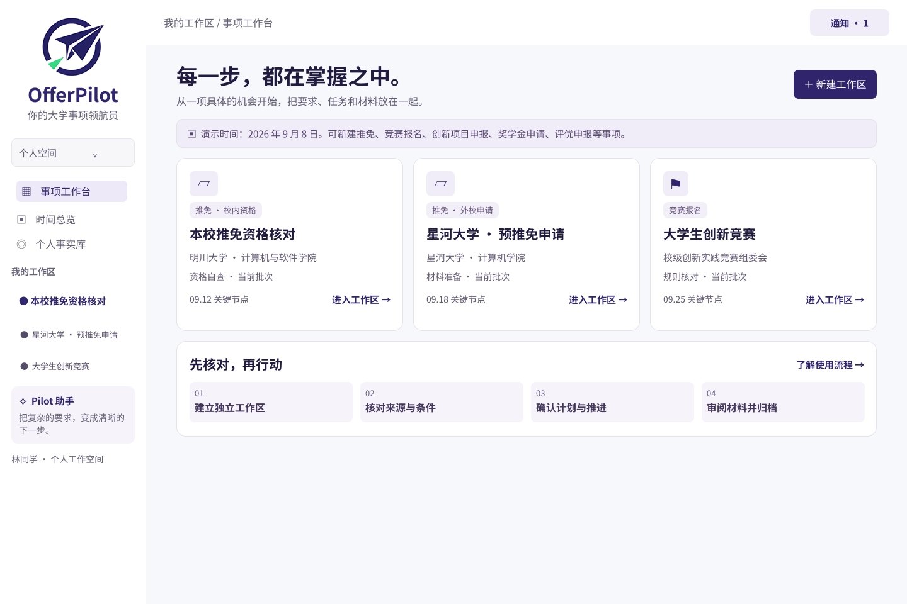

### 3.用户端主要页面与交互

#### （1）事项概览

进入工作区后，概览页集中展示当前问题、任务推进情况、材料准备情况和关键节点。例如，本校推免资格核对页面将“补充专业排名”作为突出提示，并说明缺少排名证明，当前核对尚未完成。用户可以据此进入补充信息流程，而不必先翻阅全部任务。

右侧的 Agent 状态卡展示已经完成的整理及仍需确认的事项；顶部通知条提供变更查看入口，使新通知与日常任务在同一个工作区内衔接。

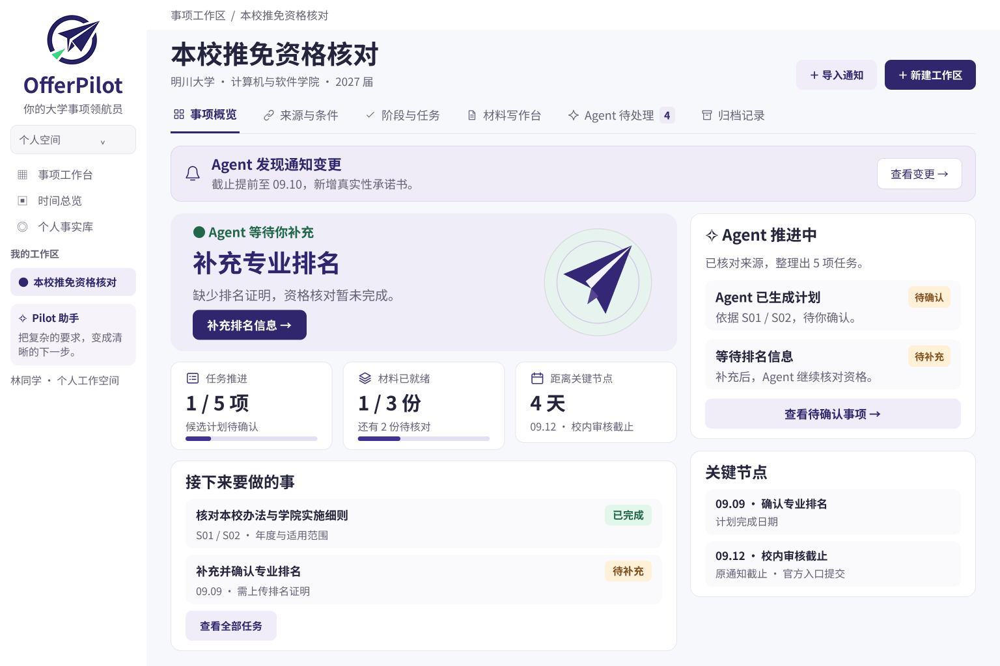

#### （2）来源与条件

“来源与条件”页采用左右对照布局：左侧列出校级办法、学院细则、补充通知及其版本，右侧展示适用对象、专业排名、纪律与学业记录等条件的辅助自查状态。

原型中专业排名尚未提供，因此该项显示“待补充”，总体结论保留“仍有条件待核实”。示例中的前 20% 仅是演示值，实际必须依据具体学校、学院、专业和年度的官方条款判断。

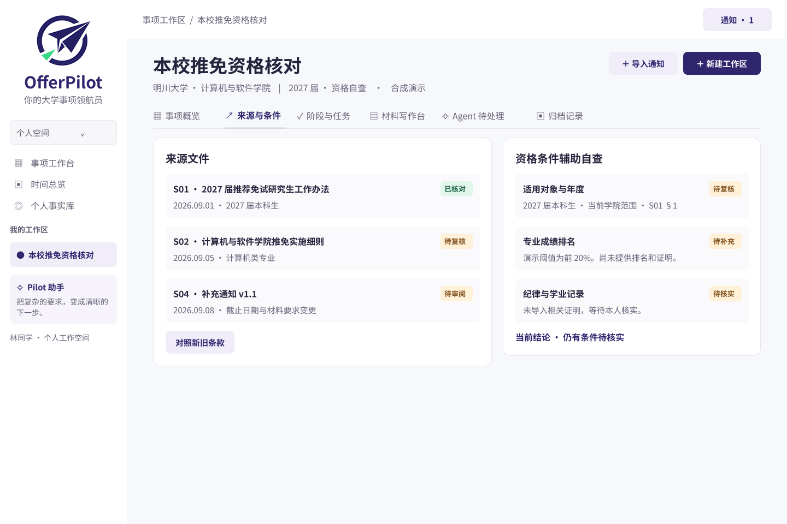

#### （3）阶段与任务

任务页提供“全部、已完成、未完成”筛选，并在任务卡片中显示日期、依据、状态和前置条件。示例中，“完成资格条件逐项自查”依赖排名与纪律记录的确认；“整理校内审核材料”又依赖自查完成。前置条件不足时，后续任务以“受阻”提示用户。

“审阅候选计划”进一步展示 Agent 整理的任务、来源、义务性质和作用范围。策划稿规定，候选计划应在用户确认后写入工作区，且计划完成日期与官方截止日期分别记录，避免把建议准备时间当成官方要求。

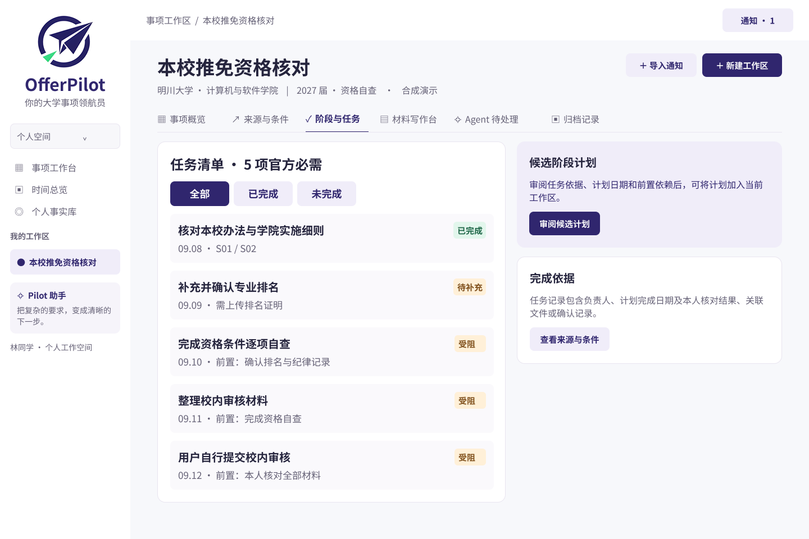

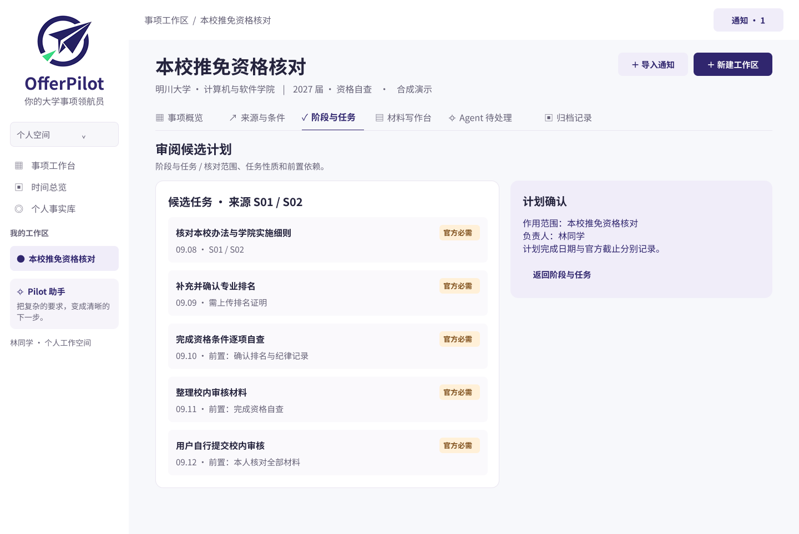

任务的义务性质与执行状态是两个维度。任务性质应区分“官方必需、官方建议、自主可选、待核实”，执行状态则描述是否完成、缺少信息或受到阻塞。当前推免演示主要展示官方必需任务，其他类型仍需在后续场景中补齐演示。

#### （4）材料写作台

材料写作台同时呈现材料清单、诊断问题以及原段落与建议段落。示例中的简历只写了“参与校园信息管理系统的开发”，尚未说明实际职责，因此 Agent 将职责标为待确认，并关联个人事实 F02 和材料要求 S02 §3。

用户可以进入对话补充实际工作，再审阅修改建议。依据策划稿，原件默认只读，用户可接受或拒绝修改，确认后导出新副本；Agent 不得将“参与”擅自改为“负责”，也不得补造排名、奖项或成果数据。

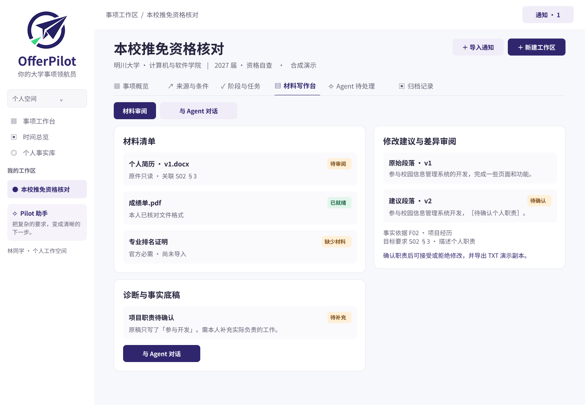

#### （5）Agent 待处理：集中处理确认与异常

Agent 待处理页将“需要用户确认”和“需要协助处理”的内容集中展示，包括排名证明缺失、候选计划待批准、通知变更待审阅，以及来源冲突、扫描件不清晰和解析超时等问题。

这一设计使任务中断有明确原因和恢复方向：缺信息时补充，来源冲突时核对适用通知，文件不清晰时提供清晰版本，超时时保留进度并重试。

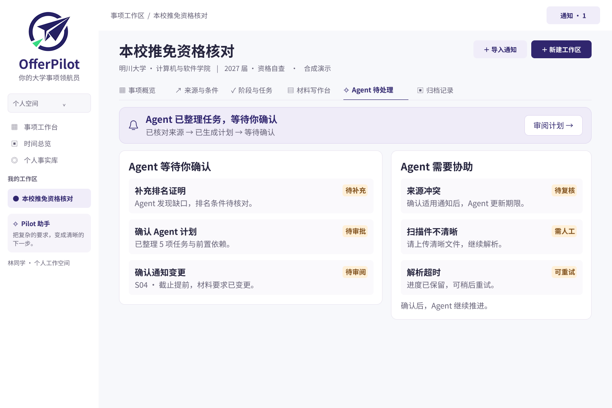

### 4.领域 Agent 的交互界面与主要任务流程

OfferPilot 在用户侧提供统一的 Pilot 助手入口，根据当前事项调用信息检索、规则分析、计划编排和材料处理等专项能力。Agent 的产出进入工作区的来源、条件、任务与材料页面，用户可以继续核对和操作。

#### （1）自然语言提出需求，结合当前工作区处理

材料写作台中的“与 Agent 对话”支持用户描述材料类型、用途、长度及希望突出的经历，并提供个人陈述、面试自我介绍、简历初稿和联系导师邮件等快捷入口。页面标明当前工作区，使用户知道本次请求围绕哪个事项展开。

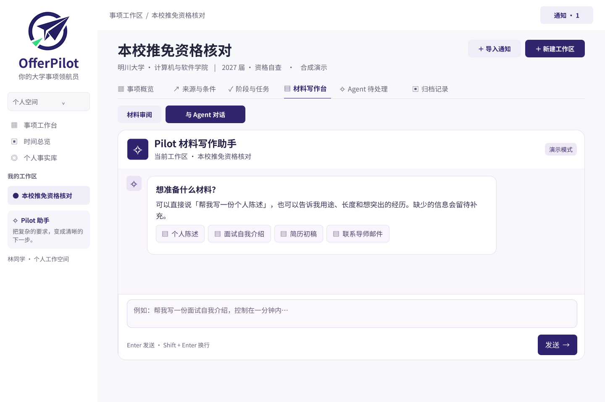

#### （2）发现缺失事实后追问，再更新草稿

以“帮我写一份个人陈述”为例，预期任务流程为：

1. 用户进入当前事项的材料写作台，选择个人陈述或输入需求。
2. Agent 读取当前事项要求和获准使用的个人事实，整理草稿框架。
3. 发现项目职责尚未确认时，明确提示缺口，保留待补内容。
4. 用户补充本人实际承担的模块和工作，Agent 据此更新草稿。
5. 用户将草稿加入材料审阅，对照事实和要求检查内容。
6. 用户确认后导出副本，自行在目标渠道办理或提交，并在工作区记录结果。

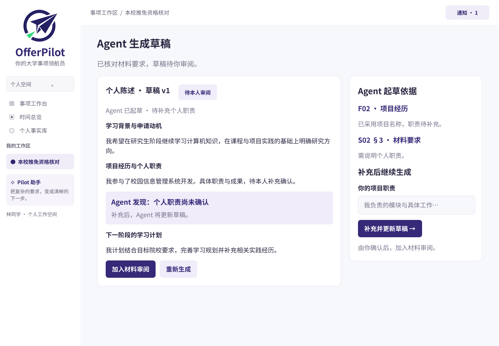

在这一流程中，材料 Agent 负责组织表达，一致性检查负责发现事实和要求之间的缺口，用户负责确认事实及最终使用内容。联系导师邮件也只生成供本人审阅的草稿，不自动发送；是否需要提前联系导师，必须依据具体项目的官方说明判断。

#### （3）通知变化后，解释对现有安排的影响

通知更新页并列展示原通知 v1.0 与补充通知 v1.1，并说明截止日期和材料要求的变化。示例中，截止日期由 9 月 12 日调整为 9 月 10 日，同时新增材料真实性承诺书，右侧对应提示时间调整和新增材料任务。

预期流程为：Agent 发现更新 → 对比新旧条款 → 定位受影响任务和材料 → 用户核对适用范围 → 确认调整并保留记录。这使规则变更能够落到具体行动上。日期冲突尚未解决时，旧信息不能继续被当作已确认的最新期限。

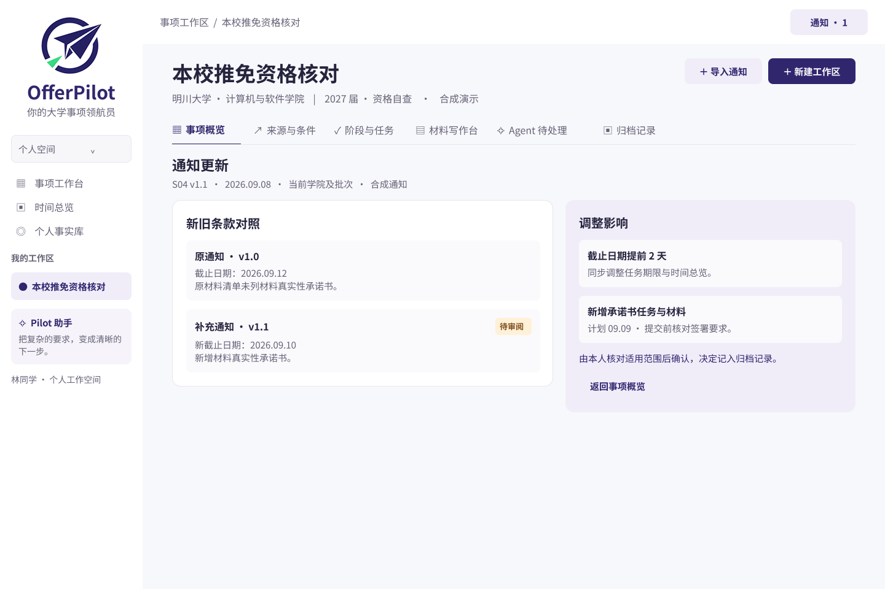

### 5.必要的后台管理原型

后台采用与用户端一致的品牌和视觉语言，以运行概览、知识与规则、Agent 任务三个页面呈现平台维护所需的信息。

#### （1）运行概览

运行概览集中展示用户与工作区统计、Agent 任务趋势、任务类型分布及待处理异常。管理者可以据此定位来源请求超时、扫描件读取困难等运行问题。

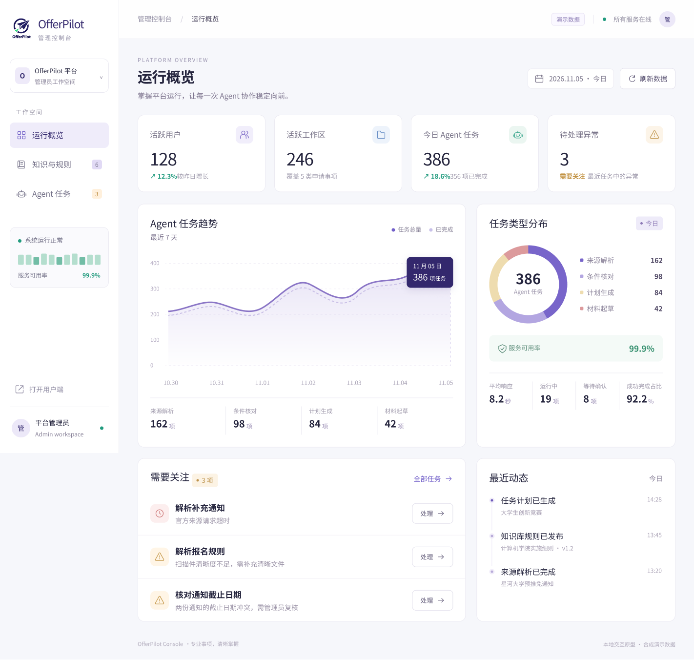

#### （2）知识与规则

该页以表格展示来源名称、规则类型、提取条目、版本、状态和操作入口，并提供搜索与类型筛选。其设计重点是保留来源和版本，使 Agent 使用过的依据能够被追踪。

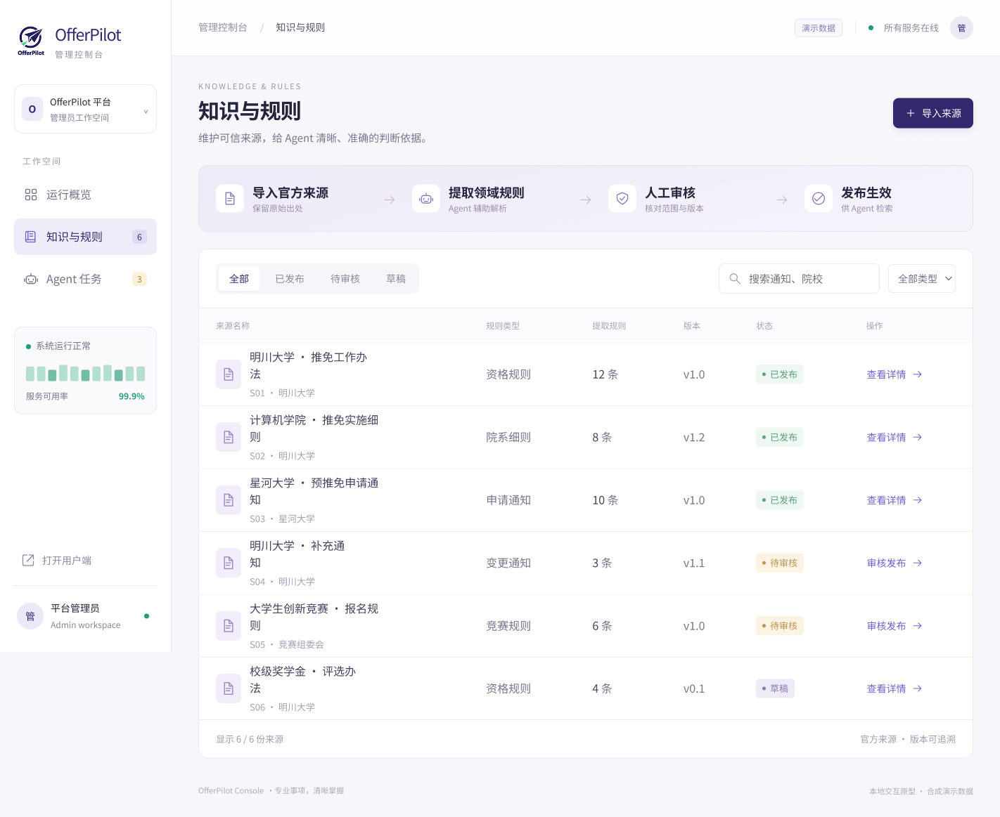

#### （3）Agent 任务

Agent 任务页展示来源解析、条件核对、计划生成和材料起草等任务，记录工作区、执行进度、状态、开始时间及耗时，并提供详情或异常入口。运行中、等待确认、失败和已完成等状态有助于区分处理故障与正常等待用户反馈。

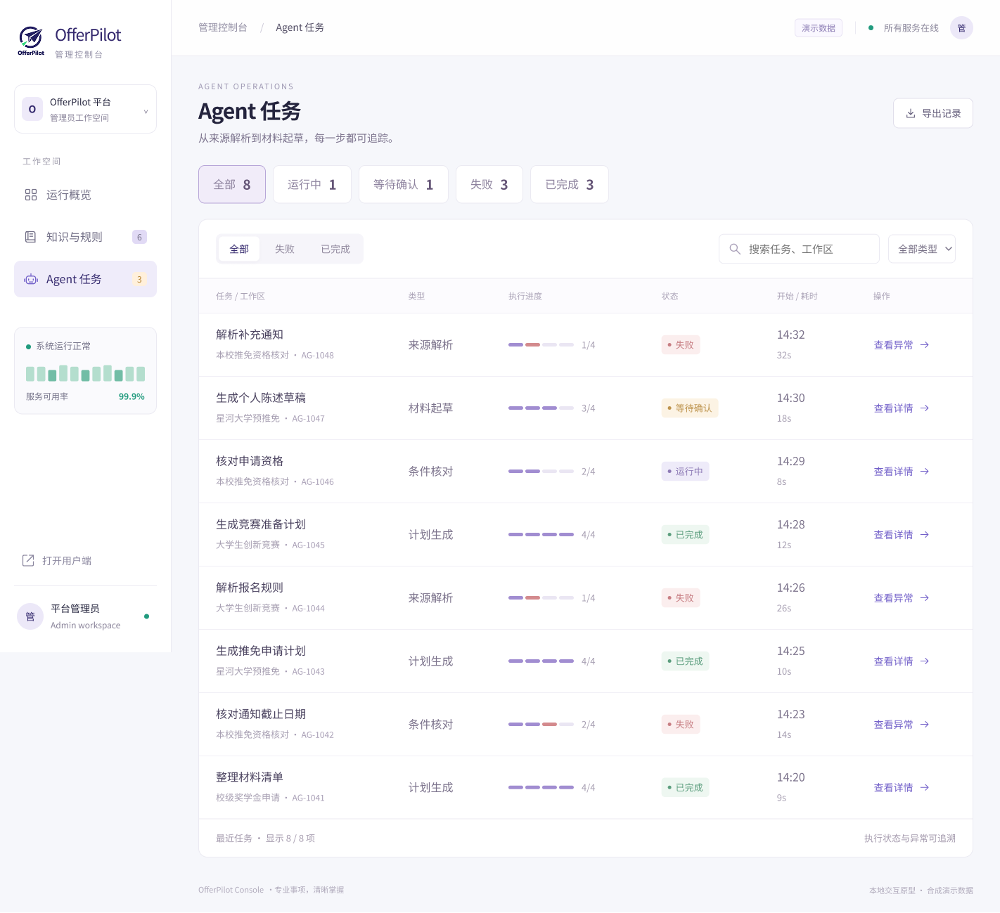

### 6.UI 设计与原型突出特点

**统一的视觉层次。** 用户端和后台均使用紫色作为品牌主色，以浅灰紫背景、白色卡片和圆角容器组织信息。深紫按钮突出主要操作，浅紫按钮承载次级入口；左侧选中项与顶部标签共同提示当前位置。

**状态同时使用文字与颜色。** 绿色用于完成或就绪，暖色用于待补充、待确认和受阻，后台以红色提示失败。状态标签保留文字，用户能够直接读出当前问题。

**规则、任务与材料可以相互对照。** 来源与条件页将文件和个人条件并列展示；材料页将原段落与建议段落并列展示；通知页将新旧版本与影响并列展示。这些布局将依据和处理结果放在相近位置，减少来回查找。

**Agent 的工作过程对用户可见。** 界面展示当前读取了什么依据、整理了哪些任务、缺少哪些信息，以及哪一步等待用户确认。其辅助能力通过任务清单、材料草稿和变更提示进入软件流程。

**关键决定保留给本人。** 候选计划先审阅，个人职责先补充确认，材料修改先对照，通知变化先核对适用范围。产品仅在个人工作区内协助整理、检查和准备，对外办理与最终提交由用户自行完成。
