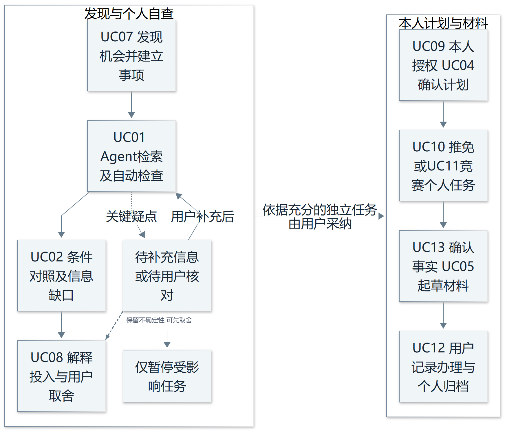
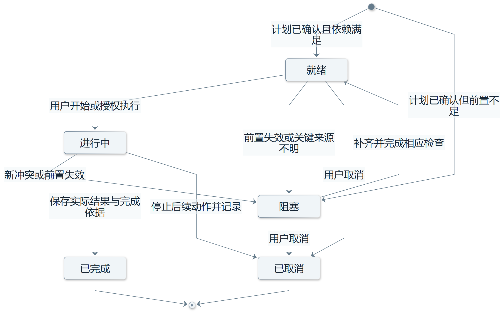

# OfferPilot 需求流程说明

鹦伟达团队 第二次团队作业

编写人：何慧渊　学号：102401135

版本：1.4　日期：2026年11月8日

我负责把产品方案中的用户任务转为可以用于原型和系统设计的流程。本稿以《OfferPilot 产品方案》（docs/design/product/OfferPilot_产品方案.md）为基线，覆盖推免和竞赛两类事项，从发现机会、核对条件、判断是否投入，到个人执行、材料写作、提交前复核与结项归档。两类事项共用工作区和 Agent 能力，各自采用独立的阶段与规则。

学生应能看清当前依据、缺少的信息、下一步操作及其影响。系统提出候选建议，学生决定是否采用；任务、材料、规则和外部正式结果分别记录。软件不代替学校认定资格，也不替学生完成官方系统报名或对外联系。

## 1 设计基线和首版范围

### 首版必须完成的内容

首版采用个人计算机网页端（PC Web），实现通用工作区、推免模板和一个竞赛模板。个人工作站与当前用户一一对应，包含多个独立事项。事项承载类型、目标、范围、阶段、个人任务和材料；事项工作区是单个事项的界面视图。其他竞赛、科研项目及评优模板在首版闭环稳定后再增加。

竞赛模板按选定赛项配置名称、年度、主办方、赛道及阶段。人数、资格、截止时间、材料格式和评审方式都由该赛项官方资料决定。未取得明确依据时可以建立探索草稿，相关判断显示待用户核对，不预设所有比赛都有答辩或校内选拔。

首版必须具备发现与建事项、规则核对、可选任务取舍、计划确认、两类个人事项执行、材料起草与改写、用户确认及归档。竞赛和科研项目即使由多人共同完成，软件也只跟踪当前用户自己的任务、材料和进度；来源失效或用户修改事实后，立即提示受影响结论需要复核。自动监测、细粒度新旧条款对比和完整影响分析属于后续增强。

### 编号和术语

Agent 是理解资料、提出计划并调用受控工具的智能体。统一建模语言（UML）用于系统图示；需求规格说明书（SRS）是项目正式需求基线。首版必需功能记为 P0，闭环稳定后的增强功能记为 P1。操作唯一标识记为opId，系统配置项前缀为SCI，设计决策前缀为D。Word 文档格式（DOCX）是首版主要编辑与导出格式，便携式文档格式（PDF）可作为要求或原稿参考。

业务用例使用 HHY-UC01 至 HHY-UC13。功能使用 HHY-F01 至 HHY-F17，流程验收使用 HHY-AC01 至 HHY-AC30；领域规则引用 DYH-R01 至 DYH-R43。所有编号合并时与项目 SRS 对应。

### 策划要求对应

| 策划要求 | 对应流程 | 规则及验证 |
| --- | --- | --- |
| 个人事项工作区引擎 | HHY-UC07 HHY-UC09 | DYH-R20 DYH-R23 DYH-R31；HHY-AC13 HHY-AC18 HHY-AC19 |
| 推免与竞赛双模板 | HHY-UC10 HHY-UC11 | DYH-R23 DYH-R26 DYH-R27 DYH-R36；HHY-AC20 HHY-AC21 HHY-AC22 HHY-AC23 |
| 官方信息按需检索 | HHY-UC07 HHY-UC01 | DYH-R01 DYH-R02 DYH-R03 DYH-R33；HHY-AC01 HHY-AC02 HHY-AC14 HHY-AC30 |
| 初步自查及校内节点 | HHY-UC02 HHY-UC10 | DYH-R06 DYH-R07 DYH-R26；HHY-AC03 HHY-AC15 HHY-AC20 |
| 导师联系判断 | HHY-UC03 | DYH-R09 DYH-R10；HHY-AC04 |
| 计划与个人任务执行 | HHY-UC04 | DYH-R14 DYH-R15 DYH-R21 DYH-R22 DYH-R32；HHY-AC05 HHY-AC06 HHY-AC07 HHY-AC09 |
| 可选事项建议 | HHY-UC08 | DYH-R10 DYH-R24 DYH-R38；HHY-AC16 HHY-AC17 |
| 材料起草改写与DOCX | HHY-UC13 HHY-UC05 | DYH-R08 DYH-R17 DYH-R18 DYH-R37；HHY-AC08 HHY-AC27 HHY-AC28 |
| 个人材料与成果区 | HHY-UC11 HHY-UC05 HHY-UC12 | DYH-R13 DYH-R17 DYH-R18 DYH-R29；HHY-AC08 HHY-AC24 HHY-AC29 |
| 用户确认与个人归档 | HHY-UC12 | DYH-R16 DYH-R30 DYH-R31；HHY-AC11 HHY-AC12 HHY-AC29 |

## 2 角色和工作区

| 角色 | 主要动作 | 权限边界 |
| --- | --- | --- |
| 当前学生用户 | 建立个人事项、确认事实及计划、审阅材料、导出与归档 | 仅访问本人资料；对外办理在目标渠道自行完成 |
| 官方公开网站及办理系统 | 提供公开通知、原文及正式办理渠道 | Agent只读取公开资料，软件不代用户登录、送审或提交 |

个人工作站是当前用户的唯一资源容器，多个事项及其子事项分别隔离。Agent、检查器和存储服务是系统内部能力；检索原文、程序检查和用户确认有不同的对象与状态。

官方信息保存Agent独立采集的公开原文、快照、定位及机器处理状态，可只读缓存。当前事项信息包括用户上传的截图、转载、笔记和沟通，只在该事项内作线索。个人档案中的已确认事实及证明可由本人选用字段、版本及确认状态，复用于其他本人事项；事项线索不自动跨事项。

用户担保其提供材料的真实性、完整性和可用性，系统保留文件与来源属性。上传截图仅提供查找线索；找到独立官网原文后另建官方引用，原上传件继续保持私有属性。个人检索记录、自查结果及材料分析始终归本人，不向其他用户或官方机构发送。

## 3 端到端流程

用户可以从官方机会入口、搜索结果、通知文件或自然语言目标发起事项。系统核对目标和来源后建立探索草稿；学生决定参加并确认计划后，才产生正式个人任务。推免和竞赛分别推进阶段，共用事实确认、材料写作与归档能力。

| 编号 | 用户需要及可见结果 | 用例 | 规则依据 |
| --- | --- | --- | --- |
| HHY-F01 | 保存独立官方来源与快照版本 P0 | UC01 | DYH-R01 DYH-R02 DYH-R03 DYH-R04 DYH-R39 DYH-R40 |
| HHY-F02 | Agent提取并程序检查，逐项定位原文 P0 | UC01 | DYH-R03 DYH-R05 DYH-R06 DYH-R33 DYH-R43 |
| HHY-F03 | 以四态显示条件和信息缺口 P0 | UC02 | DYH-R01 DYH-R06 DYH-R07 DYH-R08 |
| HHY-F04 | 分开显示导师联系和证明条件 P0 | UC03 | DYH-R09 DYH-R10 |
| HHY-F05 | 确认候选计划后一次写入 P0 | UC04 | DYH-R11 DYH-R12 DYH-R14 DYH-R15 DYH-R21 |
| HHY-F06 | 维护依赖、阻塞和完成证据 P0 | UC04 | DYH-R15 DYH-R16 |
| HHY-F07 | 检查材料与要求的映射 P0 | UC05 | DYH-R13 DYH-R17 DYH-R37 |
| HHY-F08 | 局部起草、接受差异并导出DOCX P0 | UC05 | DYH-R08 DYH-R18 DYH-R37 |
| HHY-F09 | 版本失效提示及后续变化分析 P0基础 P1增强 | UC06 | DYH-R04 DYH-R19 |
| HHY-F10 | 停止、取消、撤销及失败恢复 P0 | UC04 UC05 | DYH-R20 DYH-R21 DYH-R22 DYH-R32 |
| HHY-F11 | 发现机会并创建双模板工作区 P0 | UC07 | DYH-R01 DYH-R23 DYH-R36 |
| HHY-F12 | 解释可选投入并记录用户决定 P0 | UC08 | DYH-R10 DYH-R24 DYH-R38 |
| HHY-F13 | 管理本人事项范围、三层信息及模型传输同意 P0 | UC09 | DYH-R20 DYH-R25 DYH-R31 DYH-R34 DYH-R39 DYH-R41 DYH-R42 |
| HHY-F14 | 记录本人校内办理和外校子事项 P0 | UC10 | DYH-R01 DYH-R16 DYH-R23 DYH-R26 |
| HHY-F15 | 按章程推进个人竞赛任务和成果 P0 | UC11 | DYH-R23 DYH-R27 DYH-R28 DYH-R29 DYH-R36 |
| HHY-F16 | 提交前复核与结果归档复用 P0 | UC12 | DYH-R16 DYH-R30 DYH-R31 |
| HHY-F17 | 管理事实确认、撤权和删除 P0 | UC13 | DYH-R08 DYH-R20 DYH-R31 DYH-R34 |

### UC07 发现机会并建立事项

编号 HHY-UC07，P0。输入为用户目标、可投入时间、院校或主办方及已有资料。用户也可以先浏览官方机会，再决定是否建立事项。

1. Agent 识别事项类型；目标含混或同时涉及多个事项时，先追问并让用户选择或拆分。
2. 查找官方来源，展示发布主体、年度和适用对象。仅有转载时标为待用户核对。
3. 系统按个人事项套用模板并建立探索草稿。
4. 明确尚缺的规则和个人信息，转入通知核对或机会取舍，不把建草稿视为已决定参加。

对应规则 DYH-R01、R02、R23、R36；验收 HHY-AC13、AC14。

### UC01 导入通知并核对要求

编号 HHY-UC01，P0。用户提出事项、提供通知链接或上传文件后，Agent先检查当前用户及事项范围。上传件进入本人当前事项信息，Agent根据公开事项描述按需查找官方入口，读取正文和附件，保存发布主体、年度、范围、获取时间、快照版本及逐项原文定位。

Agent用日期解析、字段检查、公式计算及再次读取原文的步骤检查提取结果，显示机器提取与自动检查状态。仅有转载、关键附件不可读或来源冲突时先补充检索，仍无法明确的关键点显示待用户核对，只暂停受影响判断。多个模型输出一致不能代替原文证据；运行期不设置人工规则发布或放行岗位。

官方快照的当前版本单调前进，较晚返回的旧结果只存历史；要求登记及用户确认写入前复查当前版本。自动检查与用户事实确认分别保存，要求登记不会自动创建正式任务。

对应规则 DYH-R01至R06、R15、R19、R33、R39至R43；验收 HHY-AC01、AC02、AC14、AC30。

### UC02 条件初步自查

编号 HHY-UC02，P0。本校推荐、目标接收及个人竞赛条件分别匹配范围。页面展示原文要求、所需事实和统计口径，用户补充并确认后，由业务服务完成可明确计算的条件对照，Agent解释依据和下一步。

结果统一使用按现有信息符合、按现有信息不符合、待补充信息、待用户核对。缺个人数据时追问具体字段；规则疑点先补充官方检索，仍不明确则提示当前用户查阅原文或自行咨询。范围匹配另存，不增加第五种结果；局部条件符合仅说明该条件的个人自查。

对应规则 DYH-R01、R06至R08、R27、R28；验收 HHY-AC03、AC15。

### UC08 判断可选事项是否值得投入

编号 HHY-UC08，P0。系统先区分官方必需、官方建议、自主可选和待核实，再比较事项与用户目标、准备窗口、前置条件、时间费用和现有安排的关系。

Agent 展示建议理由、依据、不确定性、预计投入和推迟或跳过的影响。用户选择采纳、稍后决定或跳过；关键信息仍有缺口时，允许先记录稍后决定或跳过，不建立正式任务。跳过官方必需项时明确告知可能影响，不能把它当作普通可选项移除。偏好或负荷未知时先追问，不生成看似客观的总分或默认替用户参加。

对应规则 DYH-R10、R24、R38；验收 HHY-AC16、AC17。

### UC09 管理个人事项范围和文件授权

编号 HHY-UC09，P0。用户在个人工作站中选择当前事项、可用的本人事实和材料，以及具体用途。后端对每次读取、生成、导出和模型调用检查所有者与事项范围。其他用户的资料不可进入检索、对话或执行记录。

本人其他事项中的截图、笔记或沟通不自动带入当前上下文；长期个人档案由本人明确选用字段和版本。外部搜索只含学校、事项、年度等必要公开描述，不夹带姓名、成绩或私有材料。外部模型传输前说明服务商、字段、用途、处理和保留方式，并取得明确同意；未同意时保留手工录入、纯文本整理或模板导出等已支持的替代路径。

撤回授权后停止后续使用并标记受影响结果，保留已发生记录。用户材料与个人分析始终保持本人范围，个人审阅及授权确认不形成资料公开或官方送审。

对应规则 DYH-R20、R25、R31、R34、R39至R43；验收 HHY-AC18、AC19、AC29。

### UC04 确认计划并推进任务

编号 HHY-UC04，P0。Agent 根据有原文依据且完成自动检查的要求、用户负荷和材料现状形成候选任务，列明义务性质、期限、建议准备日、依赖和完成证据。业务服务检查重复项、环路及日期矛盾。

学生逐项接受、修改或拒绝。确认在短事务内按来源标识顺序锁定引用的Source行，再锁定本人Workspace守卫行；在锁内复查来源、事实、授权和候选版本，将任务、确认和审计同事务保存。刷新当前来源指针使用同一来源锁，事实与授权变更使用同一工作站守卫，锁保持至提交；版本不符整体回滚并重算候选。重复确认返回同次操作结果，失败保留恢复入口。任务只有前置条件满足后才能执行，外部提交状态不因内部文件生成成功而自动完成。

对应规则 DYH-R11至R16、R21、R22、R32；验收 HHY-AC05至AC07、AC11。

## 4 推免专用流程

### UC10 记录本人校内办理和外校子事项

编号 HHY-UC10，P0。Agent按试点院系当年公开通知整理规则自查、本人待补材料及初审、公示或异议等实际办理节点。办理进度由用户自行处理后手动记录，软件不连接校内审批或传送申请材料。没有明确依据的步骤显示需向学院确认，不默认每所学校流程相同。

学生登记补交、审核或正式通知结果，并附证据类型、取得时间及来源。软件自查结果与学校正式结果分开维护，公示名单不能由模型生成。进入外校申请时，按院校、学院、项目、批次和学位路径建立独立子事项，分别维护夏令营、预推免和正式接收要求；复用材料前检查授权和版本。

对应规则 DYH-R01、R16、R26、R30；验收 HHY-AC20、AC21。

### UC03 判断导师联系要求

编号 HHY-UC03，P0。先确定目标项目、年度、阶段和学位路径，核对通知、附件及官方问答；只有已读取相关通知及附件后，才可标为通知未提及。页面展示明确要求提前联系、官方建议联系、通知未提及、来源不完整或存在冲突四种情况。

导师同意证明是否必交是独立的材料条件。某通知免交证明，不据此推导所有硕士均无需联系导师。来源不全时不能写成通知未提及。用户选择联系后，系统可组织真实经历、问题清单、草稿和跟进提醒，由用户自行发送，不能编造导师意向或名额。

对应规则 DYH-R09、R10、R16；验收 HHY-AC04。

## 5 竞赛专用流程

### UC11 按赛项规则推进个人任务与成果

编号 HHY-UC11，P0。前置条件为选定赛项、年度和赛道，并取得相应章程、补充通知及需要的校内选拔依据。否则只保留探索草稿和信息缺口，不给出确定资格、具体人数要求或正式截止提醒。竞赛的组队条件和成员分工由用户在线下处理，软件只跟踪用户本人承担的部分。

1. 核对本人参赛条件、组队要求、同人多队限制、指导要求、报名方式和各层级期限，按已取得原文依据的值建立个人条件清单。
2. 用户确认参加后，按章程配置本人负责的报名、作品、报告、提交、答辩或结果等适用阶段。
3. 把成果要求关联到本人作品、申报书或附件，记录本人贡献、数据和版本；研究数据与结果由用户依据真实项目情况提供并确认。
4. 提交前检查本人材料、署名、版本及完成状态，由用户在官方系统提交，再登记真实回执和后续结果。

没有答辩或中期环节的赛项不强加该节点。校内选拔通过、主办方报名成功和获奖分别记录；阶段推进不能据此自动生成研究成果、比赛成绩或获奖证明。

对应规则 DYH-R23、R27至R30、R36；验收 HHY-AC22、AC23、AC24。

## 6 材料写作与结项

### UC13 管理可复用的事实档案

编号 HHY-UC13，P0。学生可以从零散经历开始，逐项确认成绩、课程、项目、职责、时间和成果；无需先提供完整原稿。草稿与未经确认的文字不能自动进入长期档案。

用户可编辑事实、撤回某事项的使用授权或发起删除。系统展示受影响材料和判断，停止后续使用被撤回内容，并按告知的保留策略处理明文、备份和必要审计引用。个人长期档案归用户及其个人工作站，Fact保存版本化事实值，PersonalDocument和DocumentVersion保存证明文件及独立版本。档案无需绑定某个事项；事项通过DocumentUsage引用具体文件版本，并在事实授权或使用记录中绑定具体fact_id与事实版本。更新文件不替换事实版本，更新事实不改写文件版本；已有引用保持原版本。删除事项仅清理该事项的引用，个人档案的删除由本人在资料管理入口单独确认。用户逐项确认后才能将事实存入长期档案。他人提供的资料保持线索属性，不自动成为本人事实。隐私页说明存储位置、模型服务是否接触材料、保留期限和删除入口；处理方式或授权不明确时停止外部传输。

对应规则 DYH-R08、R20、R31、R34；验收 HHY-AC25、AC26。

### UC05 起草修改并导出材料

编号 HHY-UC05，P0。输入为目标要求、已确认事实及可选原稿。首版覆盖推免简历或个人陈述，以及竞赛试点对应的一种申请或成果材料。原稿和官方模板可用 DOCX，PDF 作为参考；扫描件或无法可靠保持的版式显示限制，并提供当前用户可审阅的文本及手工整理路径。

1. 按官方栏目诊断缺项、格式和表达问题，缺事实先追问，用户可只选择一个区块处理。
2. 依据确认事实形成新草稿或局部改稿，展示原文、候选稿、差异及修改理由，要求逐条定位到材料字段或附件。
3. 用户逐项接受、拒绝或撤销；复查姓名、日期、职责、数量等跨材料一致性，导出前确认新增或变化的关键字段，未变化的已确认字段不反复追问。
4. 导出带材料名和版本的新 DOCX，附纯文本预览、待补清单和检查结果，保留原件及接受记录。

未确认事实不进入定稿；如果待补字段仍影响完整性，只能导出明确标记的未定稿副本。正式提交格式另按通知核对，DOCX 导出成功不表示已满足官方 PDF 提交要求。导出失败保留原件和已接受文本，可从失败步骤恢复。

对应规则 DYH-R13、R17、R18、R22、R37；验收 HHY-AC08、AC09、AC27、AC28。

### UC12 提交前复核与归档复用

编号 HHY-UC12，P0。系统检查必需任务、材料映射、版本、关键字段确认和仍未解决的问题，形成提交前清单。学生确认采用的具体版本后自行对外提交，再登记本人确认或官方回执；两种证据的可信类型分开显示。

事项结束后保存提交版本、本人承担部分、结果、时间、来源和复盘。结果尚未取得时保持待确认，不能生成获奖或录取记录。复用归档材料时复制到获授权的目标事项，重新核对适用范围、时效和事实授权，不连带原工作区的其他文件。

对应规则 DYH-R16、R30、R31；验收 HHY-AC12、AC29。

### 模型发送与撤回

外部模型的发送由统一出站网关控制。对同一用户下有交集的授权范围，发送与撤回使用同一串行化守卫；实际写入首字节前在临界区核对所有者、服务商、用途、字段、资料和授权版本，并记录请求标识，校验与开始发送之间不释放守卫。正文以有限数据块发送，每块写入前按同一守卫重查；等待服务商响应时释放发送守卫。撤回更新授权版本并关闭许可后才显示生效，未取得网关确认则显示处理中并拒绝新请求。

撤回先完成则请求不开始发送；已开始的请求记录在途状态，取消排队与重试、阻止后续数据块并尽力中止连接，返回结果不写入候选、事实或上下文。已发出或进入网络缓冲区的内容可能继续到达，不能保证远端撤回；发送范围未知时据实标记。仅记录服务商、字段类别、版本、时点、已知范围及中止结果，不额外保存敏感正文。重新授权后由用户发起新请求，旧请求不自动恢复。

## 7 状态与受控执行

### 个人条件自查状态

| 显示用语 | 触发条件 | 页面反馈 |
| --- | --- | --- |
| 按现有信息符合 | 适用规则明确，所需数据充分，判断可复核 | 显示规则、事实版本和计算过程，说明个人自查范围 |
| 按现有信息不符合 | 规则和数据明确，当前未达到该项要求 | 指明未满足条件及可核对的原因 |
| 待补充信息 | 缺少完成对照所需的个人数据或证明 | 明确追问字段和用途，不填零或猜测 |
| 待用户核对 | 歧义、冲突、范围不明或来源不完整 | 先补充官方检索，仍有疑点时提示当前用户核对 |

义务性质另列官方必需、官方建议、自主可选和待核实。计划决策另列采纳、稍后决定和跳过。事实确认、规则自动检查及用户接受计划分别记录。

### 任务和执行状态

候选计划采用草稿、待确认、已确认、已拒绝、已失效；正式任务采用就绪、阻塞、进行中、已完成、已取消。工具执行采用待确认、执行中、成功、失败、已取消。用户记录的官方办理或比赛结果另存，内部任务完成不替代正式状态。

授权分为 L0 阅读解释、L1 规划建议、L2 内部可撤销操作、L3 高影响产品内操作。L1 先展示候选再确认写入，L2 在获准范围内执行并留撤销记录。L3用于删除档案、覆盖确认信息或批量修改任务状态，先展示范围与影响，再逐次取得明确确认。对外发送、公开发布、报名与材料提交不属于任何可授权执行等级，均由用户自行办理。页面提供停止自动处理与撤销入口，取消不应掩盖已经发生的动作。

### Agent 收件箱

收件箱集中显示新通知、待回答问题、阻塞任务、待批准变更和失败恢复事项。每条记录可回到工作区、来源、受影响对象和执行结果。用户拒绝、暂缓或撤权后，待办状态与后续动作同步更新。

## 8 P1 来源变化与能力增强

### UC06 对比变化并复核影响

编号 HHY-UC06，P1。在 P0 已保存版本和失效提示的基础上，增加新旧条款对比、关联影响列表和调整建议；定期监测指定官方页面须另获授权。学生核对差异后决定是否采用调整，已完成历史保留，必要时新增复核或补交任务。

自选提醒、日历导出及更多格式也在 P1 扩展，不作为 P0 已实现能力。团队协作不属于产品范围，P1 不增加成员邀请、他人任务分派或团队材料审核。对应规则 DYH-R04、R19；验收 HHY-AC10。

## 9 UML 与验证交接

用例图只以当前用户表达个人业务，Agent 编排器和自动检查器属于系统内部。活动图按双场景分支表达流程，缺口、拒绝、暂停、取消和失败均有出口。类图表达用户、个人工作站、事项、官方快照、当前事项线索、个人档案及版本的关系；事实值与证明文件分开。

时序图表达自动检索与检查、候选返回、用户确认、授权及版本复查、同事务写入和真实结果。配套系统衔接稿给出D-29、D-31、SCI-05和SCI-11的最终文字及图源。配套图源02保留消息顺序，协作图沿用对象和编号。数据库设计应保留各次确认的对象与版本，不能仅用聊天文本代替结构化状态。

| 编号 | 操作或触发 | 期望结果 |
| --- | --- | --- |
| HHY-AC01 | 导入通知并查看要求 P0 | 关键要求回到独立官网原文、快照版本、定位及机器处理状态 |
| HHY-AC02 | 关键附件缺失或条款冲突 P0 | Agent先补充检索；仍不明确则待用户核对，仅暂停受影响判断 |
| HHY-AC03 | 缺少个人排名或证明 P0 | 待补充信息，明确字段与用途，不填零 |
| HHY-AC04 | 切换硕士与直博路径；通知附件不全；通知免交导师证明 P0 | 联系情况与证明必交条件分别重匹配；附件不全不写成通知未提及；免交证明不推导无需联系 |
| HHY-AC05 | 拒绝候选计划或关闭页面 P0 | 正式任务不增加，保留决定或草稿 |
| HHY-AC06 | 确认预检查后并发刷新来源、修改事实或撤回授权，再重复确认 P0 | 按相同来源及本人守卫锁串行复查；版本不符整体回滚重算；已完成操作返回原结果，不重复写任务确认审计 |
| HHY-AC07 | 前置未完成或依赖成环 P0 | 说明阻塞或环路，不错误执行 |
| HHY-AC08 | 局部修改只接受部分 P0 | 只采用接受内容，差异可追溯，原件不变 |
| HHY-AC09 | 导出失败或执行中取消 P0 | 返回实际状态，保留接受文本与恢复入口 |
| HHY-AC10 | 启用P1后导入修订通知 P1 | 展示差异和影响，确认后调整，完成历史保留 |
| HHY-AC11 | 只完成DOCX导出 P0 | 外部提交状态不自动完成 |
| HHY-AC12 | 登记本人确认或外部回执 P0 | 明确证据类型和操作者，不冒充官方认证 |
| HHY-AC13 | 目标含混或涉及两个事项 P0 | 先追问或拆分，不误套模板 |
| HHY-AC14 | 仅上传截图或找到转载、过期资料 P0 | 上传件限本人当前事项；Agent独立找官网原文后另建引用，保持来源层级 |
| HHY-AC15 | 分别输入条件符合、条件未达、缺事实、来源冲突 P0 | 只用按现有信息符合、按现有信息不符合、待补充信息、待用户核对 |
| HHY-AC16 | 可选任务与课程准备冲突 P0 | 展示收益依据、成本、负荷、不确定性和选择 |
| HHY-AC17 | 用户跳过官方必需材料 P0 | 告知影响，不静默当普通可选项删除 |
| HHY-AC18 | 用户请求读取他人材料或将上传件分享为官方资料 P0 | 跨用户读取拒绝；上传件保持私有，不建立共享或后台审阅流程 |
| HHY-AC19 | 撤回文件或外部模型传输同意 P0 | 停止后续读取和传输，重新检查所有者及范围；未同意时可选手工或模板路径 |
| HHY-AC20 | 校内流程没有明确公示或异议节点 P0 | 按通知配置，未知显示需向学院确认 |
| HHY-AC21 | 一个目标包含两个外校批次 P0 | 分建子事项，材料复用重新核对范围与授权 |
| HHY-AC22 | 赛项名称或章程尚缺 P0 | 保留探索草稿，停止确定人数资格和截止判断 |
| HHY-AC23 | 赛项章程未规定答辩或校内选拔 P0 | 不强加节点，分别保存存在的层级期限 |
| HHY-AC24 | 本人竞赛贡献或证明效力尚未确认 P0 | 保留待确认字段，由用户担保材料；不编造结果，不判断签章真伪 |
| HHY-AC25 | 未确认草稿请求进入事实档案 P0 | 先要求逐项确认，不自动长期保存 |
| HHY-AC26 | 撤回事实授权或申请删除 P0 | 停止后续使用，列出受影响对象与处理结果 |
| HHY-AC27 | 只给零散事实，没有完整原稿 P0 | 可按要求起草，缺失字段追问或保留待补 |
| HHY-AC28 | 关键字段未确认时要求定稿导出 P0 | 阻止定稿；仅允许明确未定稿副本，确认后新建DOCX |
| HHY-AC29 | 独立更新个人事实和证明文件，跨事项选用版本并删除原事项 P0 | 事实与文件历史独立，已有引用不替换；档案归用户工作站，删除事项仅清理其引用；其他事项截图笔记不自动带入 |
| HHY-AC30 | Agent按需获取原文、提取并程序检查，补检后仍有关键疑点 P0 | 记录机器提取、程序校验完成项与待核实缺口；无人工发布队列；未解决项仅请当前用户核对，独立任务继续；自查只用四种结果 |

验证时同时选取推免与选定的竞赛场景，记录输入、所用版本、页面反馈与对象变化。材料写作覆盖零散事实起草、局部接受、事实冲突、关键字段确认和 DOCX 可打开性；授权验证覆盖个人事项之间的数据隔离、外部材料来源和撤回后的停止使用。上述场景均为待执行的设计依据，运行记录另行填写。

### 产品验收关联

产品条款前缀OP-AC对应产品方案§12.1与§12.2。HHY-AC30关联OP-AC22，内容为Agent自动检索、程序检查及当前用户缺口核对。模型发送与撤回的独立并发时序见领域场景DYH-AT62；一般内部授权与模型传输同意分离见DYH-AT63。流程清单的产品验收列保留其余对应关系，全部场景仍待执行。

## 10 编制依据

依据《OfferPilot 产品方案》§3.2、§4至§12编制，配套《策划稿对齐表.csv》连接功能、规则和验收；产品方案见 docs/design/product/OfferPilot_产品方案.md，领域规则见 docs/design/domain-rules/du-yuhe/。交付范围依据[第二次团队作业要求](https://edu.cnblogs.com/campus/fzu/202601SofwareEngineering/homework/16773)的完整正文，历史需求及官方条款来源由领域规则稿统一维护。
