# OfferPilot 系统/子系统设计（结构设计）说明（SSDD）

## 1 引言

### 1.1 标识

- **系统名称**：OfferPilot——面向推免与竞赛事项的个人申请工作台。
- **系统标识号**：OfferPilot，当前版本 V2.1（依据策划稿校正）。
- **本文档**：系统/子系统设计（结构设计）说明（SSDD），编号 OfferPilot-SSDD-2026-V2.6。

### 1.2 系统概述

本系统是一款用于帮助用户准备推免的Agent交互系统，旨在解决准备过程中信息汇集难、提升方向惑、时间安排急等问题，提高效率。系统主要包括个人档案模块、要求分析模块、差异分析模块等功能模块，能够实现用户上传材料、与Agent交流并汇总得到建议和日程安排。系统具有操作简单、界面友好、功能完善、运行稳定等特点，能够满足用户的日常使用需求。

本系统根据实际业务需求进行设计与开发，经过需求分析、系统设计、编码实现和测试等阶段，逐步完成系统的开发工作。系统投入使用后，将根据用户反馈及实际业务需求进行功能优化、问题修复和日常维护，以保证系统的正常运行。

本系统计划运行于云服务商的 Linux 服务器。用户可通过浏览器访问和使用本系统。

与本系统相关的文档包括《系统需求分析说明书》《数据库设计说明书》和本《系统设计说明书》等。


### 1.3 文档概述

本文档旨在明确项目目标与需求，详细阐述系统架构设计、功能模块定义、技术选型与标准、性能与安全要求、运维与监控方案。文档通过全面规划，确保开发团队对Agent系统的整体设计有清晰理解，促进项目高效有序进行。同时，为运维人员、开发人员及用户提供必要的操作手册和文档支持，确保系统上线后能顺利运行并得到有效维护。本文档是项目成功实施的关键基石，为系统后续的开发、运维及扩展提供坚实基础。


本文档记录系统级设计决策（第 3 章）、总体设计与部件划分（第 4 章）、运行与出错处理（第 5—6 章）、维护设计（第 7 章），以及待决问题与需求追踪（第 8—9 章）。第 4 章以 UML 视图组织：用例图做需求分析，活动图描述通用事项流程（P0 以推免/竞赛为例），类图描述个人工作区/事项与材料域，时序图描述检索与自动检查、候选确认、四态判定、计划校验、材料导出等关键流程，协作图描述对象间的消息传递。

读者为开发方、测试与验收方、产品负责人与领域知识负责人。

根据相关要求，本文档应面向公众发布。

### 1.4 基线

本文档以《正式策划稿》《需求流程说明》《需求分析文档》为基线。

## 2 引用文件

| 编号 | 文档 | 版本/日期 |
| --- | --- | --- |
| 1 | GB/T 8567-2006《计算机软件文档编制规范》 | 2006 |
| 2 | GB/T 8566《信息技术 软件生存周期过程》 | — |
| 3 | GB/T 11457《信息技术 软件工程术语》 | — |
| 4 | 《OfferPilot 需求流程说明》（需求基线） | v1.4，2026-11-08 |
| 5 | 《OfferPilot 需求分析文档》（继承基线） | v2.0，2026-10-25 |
| 6 | 《OfferPilot 产品方案 正式策划稿》 | 2026-11-08 修订 |

## 3 系统级设计决策

本章从用户角度描述系统将怎样运转以满足需求，以及影响系统部件选择与设计的决策。

决策编号 D-01—D-32，括号内为需求出处；HHY 为主基线编号，NFR 为继承基线编号。

### 3.1 总体形态与部署

- **D-01 PC Web、B/S 架构**。首版只做个人计算机网页端，不做移动端与客户端（HHY §1）。
- **D-02 单站点集中部署**。应用、数据库、文件存储与后台任务同站；模型推理经外部网关（IF-04），DOCX 处理在本系统内完成（CSCI-MATERIAL），不经外部转换服务。

### 3.2 领域模型决策

- **D-03 事项为核心聚合根**。个人工作区与用户一一对应，是用户级容器；事项承载 type_code、目标、scope_attrs、模板、阶段与关联对象，是业务操作的核心聚合根。来源、规则、材料、任务都挂在事项上，而不是反过来（HHY §2、UC07）。
- **D-04 模板化事项、共用能力**。推免、竞赛、项目申报、评优/奖学金等由模板定义阶段、要求骨架、材料类型与规则包；个人工作区、事实、材料、确认、归档能力共用。P0 内置推免模板与一个竞赛模板，其他类型按同一机制扩展（HHY §1、UC10、UC11）。
- **D-05 候选优先**。Agent 只产出候选要求、候选计划、候选稿与建议；计划、事实与材料版本必须经用户确认后写入。官方信息不作为个人数据写入：Agent 检索、抽取并自动检查后登记为共享只读依据，保留机器处理状态与原文定位，异常标待用户核对（HHY §2、UC01、UC04、UC05；策划稿 §四、§八.1）。
- **D-06 内外状态分离**。内部任务完成、材料导出、自查通过都不自动等于外部正式结果；本人确认与官方回执分别记录（HHY §7、UC12、AC11、AC12）。

### 3.3 智能体行为决策

- **D-07 单执行体、多模式**。全部在线推理由一个执行体承担；意图识别、要求抽取、解释建议、计划生成、材料起草、变更对比是同一执行体的不同模式（HHY §9）。
- **D-08 模式化阶段序列**。每种模式按固定阶段执行：读取 → 检索来源/规则/事实 → 生成候选 → 确定性校验/自动检查 → 用户确认（官方信息为自动检查后登记）→ 写入；任一阶段失败即停，保留旧状态（HHY §7）。
- **D-09 业务计算、Agent 解释**。可明确比较的条件由业务服务计算；Agent 说明依据、不确定性与下一步，不代替计算，不输出无依据结论（HHY UC02、UC08）。
- **D-10 证据强制绑定**。要求、结论、材料改写理由必须能定位到来源快照、原文区间或事实版本（HHY F02、AC01）。
- **D-11 规则/模板版本化**。规则包、模板与提示词记录版本与回归结果；变更时重跑固定案例，劣化超阈值禁止发布。版本化是团队内部质量手段，不作为官方信息可用的前置，也不产出“官方核实”标签（DYH-R 基线、HHY §9；策划稿 §八.1、§九）。
- **D-12 授权分级**。Agent 动作分 L0 阅读解释（可自动执行并展示引用）、L1 规划建议（先展示，用户确认后写入）、L2 内部可撤销操作（授权范围内执行并记录）、L3 高影响产品内操作（删除个人档案、覆盖已确认信息、批量修改任务状态；默认不自动执行，先展示影响并逐次取得确认，尽量提供恢复方式）。对外发送、公开发布、正式报名与材料提交不属于可授权执行等级（策划稿 §八.6；HHY §7）。

### 3.4 状态与确认决策

- **D-13 四态结论**。规则对照统一为“按现有信息符合、按现有信息不符合、待补充信息、待用户核对”，不增加第五种结论状态（策划稿 §四；HHY UC02、AC15）；四态均属个人自查，局部条件通过只代表该条件的对照结果，不等于完整资格、正式认定或录取。
- **D-14 义务性质独立**。官方必需、官方建议、自主可选、待核实是独立维度，不编码进四态结论；跳过官方必需项必须显式告知影响（HHY §7、AC17）。
- **D-15 计划决策独立**。采纳、稍后决定、跳过单独记录；候选计划未确认前不产生正式任务（HHY UC04、AC05）。
- **D-16 唯一操作写入**。确认计划、提交复核、导出材料等写操作携带唯一操作标识；重复提交返回同次结果，依据变化则旧确认失效；审计记录与业务写入同库同事务提交，业务提交即审计完整；对账发现缺失审计按确认记录补录并标记，同 opId 重试先补录再返回（HHY UC04、AC06；2026-11-07 安全评审补充）。
- **D-17 事实仅来自用户**。事实档案的每条记录由用户逐项确认；草稿与未确认文字不进入长期档案；团队质量保障不能读取未授权事实（HHY UC13、AC25）。
- **D-18 事实授权可撤回**。事实按用途和对象授权；撤回或删除时停止后续使用，列出受影响材料与判断，按保留策略处理明文、备份与必要审计引用（HHY UC13、AC26）。

### 3.5 权限与隐私决策

- **D-19 最小权限访问**。个人数据归用户所有；团队质量保障仅在开发/评测期使用公开信息与虚构或脱敏样本，不访问真实个人事实与材料；每次读取、导出、修改重新校验（HHY AC19；策划稿 §十）。
- **D-20 自动检查优先**。关键条件、日期与公式由确定性程序检查（日期解析、公式复算、字段校验、二次读取原文比对），提取结果保留机器处理状态；开发期以固定案例抽检评估效果，不用同一人的重复操作冒充独立复核（HHY UC01、AC30；策划稿 §八.1 第 5 步、§九.3）。
- **D-21 提取不等于认定**。机器提取与自动检查只说明“原文可定位、字段可复核”，不替代用户对事实、材料与提交版本的确认，也不构成学校或主办方的正式认定（HHY §2、AC30；策划稿 §四）。
- **D-22 最小化与可删除**。只采集事项所需资料；隐私页说明存储位置、模型服务接触范围、保留期限与删除入口；处理方式不明确时停止外部传输（HHY UC13）。

### 3.6 边界与合规决策

- **D-23 不替代官方系统**。不自动报名、不代填表单、不对外联系；导出或勾选完成不等于正式提交成功（HHY §2、NFR-06）。
- **D-24 采集合规**。P0 支持按需检索与人工导入：只访问公开页面与附件，遵守访问控制与频率限制；检索请求只含公开事项描述（事项类型、学校/学院、年度、阶段），不携带姓名、成绩、证件或私人沟通记录；P1 定期巡检仅限已授权、已登记的公开页面，单次失败不判定撤回；服务端取回 URL（检索命中与用户提交一律同口径）仅允许 http/https，发送前解析并校验目标主机，拒绝环回、私有、链路本地与保留地址，跟随重定向时逐跳复验，任一跳校验失败即中止取回（2026-11-07 安全评审）（HHY §8、UC06；策划稿 §四、§八.1）。
- **D-25 失败显式化**。导入、模型、DOCX、存储失败时保留已有数据并展示失败状态，不把失败标为无变化或成功（HHY AC09、NFR-03）。
- **D-26 不做团队协作**。系统为个人工作台：不提供工作区共享、成员邀请、协作者角色与多人同时编辑；竞赛等团队事项的成员信息由用户自行记录，不作为系统账号或权限主体（需求方 2026-11-06 决定）。
- **D-27 事项类型可配置**。Matter 只保留通用字段（type_code、目标、年度、scope_attrs、模板）；院校/学院/项目/批次/学位路径、赛项/赛道、项目/奖项类别等类型特有字段由模板声明并存入 scope_attrs，不在代码中硬编码；新增类型不改领域模型（需求方 2026-11-06 决定）。
- **D-28 个人资料分层**。个人事实（值）与个人材料（证据）分开存放：事实存 Fact，材料存个人材料库；材料按版本、签发日、有效期、形式与敏感级别管理，由用户确认并明确选用后跨事项复用；事项引用具体版本，提交时冻结；质量保障与模型不接触证件原件（需求方 2026-11-06 决定）。
- **D-29 事项信息三层**。一个事项中的信息分为官方信息、事项信息、个人信息：官方信息由 Agent 按需检索、抽取并自动检查，自动检查只记录机器提取、程序校验及未解决的疑点，不代表规则正确或“官方核实”，Agent 补充检索后仍无法解决的关键问题交当前用户核对，官方原文全系统共享只读；事项信息由用户上传、只在本人当前事项内可见；个人信息仅限用户已确认并明确选用的个人事实、证明文件及其版本，在本人事项间流转，通知截图、私人笔记与沟通记录留在原事项，不随档案复用，也不能升级为官方规则。跨层引用必须显式确认；官方信息不可由用户直接写入，用户导入的链接与文件仅在本人授权范围内使用，不向其他用户或公共官方信息层流转，不设分享入口与后台审阅，用户可自行导出、撤回使用授权或删除，Agent 仅可据其线索独立检索官方原文并另建官方来源记录（需求方 2026-11-06 决定，2026-11-08 修订，见 D-31）。
- **D-30 模型传输同意与出站网关统一控制**。向外部模型服务传输材料或事实前，必须说明服务商、传输字段、用途与数据处理方式并取得用户明确同意；未同意不得传输，系统提供不调用模型的替代路径（手工录入要求、原文查看、纯文本整理、模板化导出），需要模型的步骤显示不可执行原因。全部模型请求统一经出站网关：发送前在临界区内核对本人访问权、服务商、用途、字段、资料版本与授权版本并记录请求标识，排队任务与先前取得的许可不能绕过本次检查，校验与开始发送之间不释放串行化控制；正文以有限大小的数据块写入传输层，每块写入前与每次重试发起前在同一机制下重新检查授权版本，控制机制不覆盖等待服务商响应的时段。同意可按用户/事项撤回，撤回与发送共用同一串行化机制：撤回先完成则请求不得开始发送，发送已开始则登记为在途请求；撤回取消排队请求，停止新请求、后续重试与新分块写入，并尽力中止在途连接；撤回后的模型返回结果不得写入候选稿、事实或后续上下文。已发出或进入网络缓冲区的内容可能继续到达服务商，无法保证远端撤回或删除；传输记录逐项登记服务商、字段类别、授权版本、发送开始与撤回时间、已知发送范围及中止结果，发送范围无法确定时明确标“未知”，不以“丢弃响应”表示内容未发出；在途与排队记录由当前持有该请求的进程持有租约并随分块检查与重试续期；进程中断后，出站网关在启动与定期对账中将租约失效的记录收敛为中止终态，未开始发送的标未发送，实际发送范围无法确定的标“未知”，失效许可一并作废，恢复经收件箱重新发起，对账动作留痕。重新授权只适用于用户再次明确同意的处理范围，旧请求不自动恢复（策划稿 §十、§九.5.3）。
- **D-31 导入件授权使用与线索独立检索**。用户导入的链接与文件仅存本人当前事项的事项信息层，对其他用户不可见，仅在本人授权范围内使用：不向其他用户或公共官方信息层流转，不提供分享入口、不经后台审阅、不转入官方信息层，也不随档案跨事项复用（D-29）；用户可自行导出导入件、撤回使用授权或删除，撤回与删除按对应规则处理；交给外部模型处理时，须单独取得用户明确同意（D-30）。Agent 可将导入件作线索构建检索查询（只含公开事项描述，不携带导入件中的姓名、成绩、证件或私人沟通记录），按需检索独立定位官方入口；命中后另建官方来源记录（来源方式为检索登记），经自动检查后作为共享只读依据，与原导入件相互独立，不改变导入件的使用范围；独立检索不达时按来源缺口处理，关键问题交当前用户核对。机器按需检索登记的官方信息以自动检查为准，不经人工审阅：自动检查只记录机器提取、程序校验及未解决的疑点，不代表规则正确或“官方核实”（需求方 2026-11-08 决定，见 D-29）。
- **D-32 来源版本序守卫**。同一来源的按需刷新、用户请求重新检查与 P1 定期巡检可能并发：快照只增不改，来源的“当前快照”按获取版本单调前进——后完成的旧快照仅存为历史，不触发抽取事件、不回退当前版本。要求登记为可用依据前复核来源当前快照版本：仅最新版本可登记；旧版本结果拒绝登记并标失效，保留为历史与失效比对，不覆盖新版本、不把旧记录标为最新；受影响结论按失效提示转待用户核对（2026-11-07 安全评审决定）。

### 3.7 运行方式

| 运行方式 | 触发者 | 主要负载 |
| --- | --- | --- |
| 个人工作 | 用户 | 建事项、按需检索、核对规则、自查、事实维护、材料起草与自审 |
| 质量保障（交付期，非运行期角色） | 团队质量保障 | 规则包/模板/提示词回归、固定案例抽检、脱敏样本评测 |
| P1 监测 | 调度器 | 来源定期巡检、条款对比、影响提示 |

### 3.8 设计约定

- 编码 UTF-8；时间 ISO 8601，时区 Asia/Shanghai；
- 数据库等价映射为 PostgreSQL；表结构与约束见《数据库设计说明》；
- 规则包版本形如 `RP-<年度>-<序号>`，模板版本形如 `TP-<类型>-<序号>`；
- 证据引用四元组 `{source_id, snapshot_id, locator, fetched_at}`；事实引用 `{fact_id, fact_version, confirmed_at}`；
- 主基线编号沿用 `HHY-UC/F/AC`，领域规则 `DYH-R`；本文新增设计决策 `D-x`、系统配置项 `SCI-xx`、接口 `IF-xx`。

## 4 系统体系结构设计

本章把系统组织为硬件配置项（HWCI）、计算机软件配置项（CSCI）与手工操作，并给出等价子系统视图。

### 4.1 系统总体设计

#### 4.1.1 概述

##### 4.1.1.1 功能描述

首版（P0）实现 17 项功能（HHY-F01—F17）：来源按需检索与版本、要求抽取与原文核验、四态条件与缺口、导师联系与证明分离、候选计划确认、依赖与完成证据、材料与要求映射、局部起草与 DOCX、版本失效提示、停止取消撤销、机会发现与模板化事项、可选投入解释、事项范围与三层信息及模型传输同意、校内节点与外校子事项、竞赛阶段与个人成果、提交前复核与归档复用、事实确认与撤回授权删除。其中 F09 的 P0 部分是来源失效/事实变更的受影响提示，条款级对比与完整影响列表为 P1。

P1 增强：定期巡检（按需检索属 P0）、条款级新旧对比、完整影响分析、自选提醒、日历导出与更多格式（HHY §8；原自动邀请、复杂审核流随团队协作取消）。

继承的非功能约束：NFR-01 可追溯、NFR-02 权限与隐私、NFR-03 可靠性、NFR-04 可用性、NFR-05 版本管理、NFR-06 操作边界。

以下为**设计目标**，仅供实现与内部测试参照，不构成验收基线：

| 设计目标 | 取值 |
| --- | --- |
| 页面交互响应（工作区/事项/清单） | ≤ 2 s |
| 四态自查（已通过自动检查的要求 + 已确认事实） | ≤ 5 s |
| 候选计划生成（单事项 ≤ 30 项任务） | ≤ 60 s |
| 材料局部改写（单区块） | ≤ 60 s |
| DOCX 导出（≤ 20 MB） | ≤ 30 s |
| 并发会话 | ≤ 50 |

##### 4.1.1.2 运行环境

- **服务端**：Linux 云主机（HWCI-1）；PostgreSQL 16；S3 兼容对象存储；任务队列；文档处理库；HTTPS 出网访问模型网关与授权来源。
- **客户端**：近两年版本 Chrome/Edge/Firefox；材料编辑以浏览器内区块编辑为主，DOCX 导入导出在服务端完成。
- **外部服务**：大模型服务（IF-04）；官方来源与办理系统（按需检索/只读导入或用户自行操作，IF-03）。

#### 4.1.2 设计思想

##### 4.1.2.1 系统构思

系统以**工作区**为容器、以**事项**为主线、以**候选—确认**为闸门：

1. 用户从目标或官方机会出发，系统识别事项类型，套用对应模板（P0 内置推免/竞赛），建立探索草稿；建草稿不等于决定参加（UC07）。
2. Agent 按需检索官方页面与附件；用户导入的通知/章程仅作本人事项内的线索，仅在本人授权范围内使用，Agent 借此尝试独立定位官方入口；抽取要求并绑定原文，经自动检查后即可用于判断；缺失、冲突或范围不明时标待用户核对（UC01）。
3. 业务服务按适用范围过滤规则，结合已确认事实给出四态结论；Agent 解释依据与缺口（UC02、UC08）。
4. 用户决定投入后，Agent 生成候选计划；业务服务检查重复、环路、日期与版本；用户逐项确认，才原子写入正式任务（UC04）。
5. 任务完成需要证据；事实与个人材料经用户确认后才能进入材料起草；材料以区块级候选稿和逐条差异呈现，用户接受后形成版本（UC05、UC13）。
6. 提交前复核检查必需任务、材料映射、版本与关键字段；用户自行对外提交并登记证据，事项归档，复用需重新核对范围、时效与授权（UC12）。

可信模型是“**系统给候选或机器提取结果、用户做关键决定、外部结果单独记录**”。Agent 不持有正式写入权，业务服务不替用户判断是否参加，软件不替学校认定资格。

##### 4.1.2.2 关键技术与算法

| 技术/算法 | 用途 | 决策 |
| --- | --- | --- |
| 事项类型与模板引擎 | 按 type_code 展开阶段、要求与任务骨架；类型特有字段由模板声明；未确认节点不成为必经步骤 | D-03、D-04、D-27 |
| 官方来源按需检索 | 由事项类型、学校/学院、年度与阶段生成查询；定位官方发布入口、读取正文与附件；按需刷新；查询不含私有字段；服务端取回 URL 经统一校验层（仅 http/https，发送前校验 host，拒绝环回、私有与保留地址，重定向逐跳复验） | D-24、D-31 |
| 模型传输出站网关 | 全部请求统一出口：发送前在临界区内核对访问权、服务商、用途、字段、资料版本与授权版本并登记请求标识；每块写入前与每次重试前重新校验授权版本；撤回经同一串行化机制生效，取消排队请求、阻止新请求、后续分块与重试；在途请求按实际结果如实记录；未同意走不调用模型的替代路径 | D-30 |
| 四态规则评估 | 适用范围过滤 → 事实完整性 → 明确比较 → 歧义转待用户核对；不产生第五态 | D-09、D-13 |
| 候选—确认写入 | 候选计划与材料稿经用户确认后原子写入，审计记录随同一事务提交；官方信息由自动检查后登记，不进入用户确认流；唯一操作标识保证幂等，重试发现缺审计先补录 | D-05、D-16 |
| 计划依赖图校验 | 重复项、依赖环路、日期矛盾、权限与版本复查 | D-08、D-16 |
| 事实授权与撤权 | 按用途/对象授权；撤回后停止使用并列出受影响对象 | D-17、D-18 |
| 材料块级 diff 与接受 | 原文/候选/差异三栏；逐条接受、拒绝、撤销；跨材料一致性检查 | D-05 |
| DOCX 处理 | 导入原稿与官方模板，导出带版本与未定稿标记的 DOCX | D-16 |
| 证据绑定与快照 | 要求、结论、改写理由定位到原文或事实版本 | D-10 |
| 个人材料库与有效期 | 材料按版本、签发日、有效期、形式与敏感级别管理；由用户确认并明确选用后跨事项复用；到期提示与提交冻结 | D-28 |
| 信息分层与流转 | 官方信息共享只读、事项信息按事项隔离、个人信息仅限已确认并明确选用的事实与证明文件版本跨事项复用；跨层引用需确认；用户导入件仅在本人授权范围内使用，仅作线索供独立检索，不转入官方信息层 | D-29、D-31 |
| Agent 多模式编排 | 识别/检索/抽取/解释/计划/起草/对比；L0—L3 授权与收件箱 | D-07、D-12 |
| 规则/模板回归 | 版本变更后重跑固定案例，劣化超阈值禁止发布 | D-11 |

##### 4.1.2.3 关键数据结构

| 对象 | 关键属性 | 关键约束/不变式 |
| --- | --- | --- |
| 工作区 Workspace | workspace_id、所有者（与用户 1:1）、创建时间 | 个人工作区不共享、不邀请；删除时级联清理事项、待办与材料 |
| 事项 Matter | matter_id、workspace_id、type_code、目标、状态、年度、scope_attrs（模板定义的院校/学院/项目/批次/学位路径、赛项/赛道、项目/奖项类别等）、parent_matter_id、template_id | 类型由模板定义；scope_attrs 只存该模板声明的字段；子事项独立维护适用范围 |
| 事项类型 MatterType | type_code、名称、是否内置、启用状态 | 类型由注册表定义，不在代码中硬编码；P0 内置推免/竞赛 |
| 模板 Template | template_id、type_code、名称、版本、阶段定义、要求骨架、材料类型、规则包、状态 | 类型特有字段与阶段的唯一来源；未被官方资料确认的节点不自动成为必经步骤 |
| 阶段 Stage | stage_id、matter_id、名称、顺序、状态 | 阶段顺序与适用范围绑定 |
| 来源 Source | source_id、发布主体、URL、事项类型、适用学校/学院/对象、年度、有效期（起/止）、状态、来源方式（检索登记）、当前快照（版本单调前进）、最近获取时间、自动检查状态 | 官方信息层，系统共享只读；转载、过期或范围不明须标注；仅由 Agent 按需检索登记，用户导入件不转入本层（D-31）；并发刷新按版本序守卫，旧快照不回退当前版本（D-32）；P0 按需检索/刷新，P1 定期巡检 |
| 检索记录 RetrievalRun | run_id、用户、事项、查询、命中来源、时间、结果状态 | 仅本人当前事项可见；查询只含公开事项描述，不含姓名、成绩、证件或私人沟通记录 |
| 来源缺口 SourceGap | gap_id、matter_id、缺口类型（官方入口未知/仅转载/登录或验证码不可取/页面删除/附件缺失/非公开）、影响的要求、状态（待补/已补/无法核实） | 不猜不补；受影响判断标待用户核对；其他已检查部分可继续推进 |
| 快照 Snapshot | snapshot_id、source_id、正文、附件、获取时间、版本、抽取状态 | 官方信息层，系统共享只读；只增不改；证据定位到快照版本；并发刷新下后完成的旧快照仅作历史，不触发登记（D-32） |
| 要求 Requirement | requirement_id、matter_id、snapshot_id、义务性质、适用范围、提取状态（机器提取/自动检查通过/待核实） | 只有基于官方信息才能作为依据；提取状态与原文定位一并保存；登记为可用前复核快照仍为来源当前版本，否则拒绝登记并标失效（D-32）；不得直接生成正式任务；异常转待用户核对 |
| 导师联系判断 MentorContactRule | rule_id、matter_id、项目/年度/阶段/学位路径、联系状态（明确要求/官方建议/未提及/来源不全或冲突）、证明必交、来源 | 联系状态与证明必交分开；来源不全不得写“未提及” |
| 事项决定 MatterDecision | decision_id、matter_id、类型（是否投入/可选任务/计划）、取值（采纳/稍后/跳过）、理由、时间 | 跳过官方必需项须记录影响告知；决策可回溯 |
| 规则 Rule | rule_id、规则包版本、适用条件、公式、适用范围 | 版本化；超出适用范围先过滤 |
| 评估结果 Evaluation | evaluation_id、requirement_id、四态、依据、规则/事实版本 | 四态唯一；依据可回溯 |
| 事实 Fact | fact_id、所有者、类型、值、来源材料、有效期、信任等级、确认状态、版本 | 个人信息层，仅本人可见；仅用户确认；草稿不进入长期档案 |
| 事实授权 FactGrant | grant_id、fact_id、对象、用途、状态、有效期 | 撤回后停止使用；质量保障不能借此读取其他事实 |
| 模型传输同意 ModelTransferConsent | consent_id、用户、事项、服务商、传输字段类别、用途、状态、授权版本、时间 | 未同意不得传输；可按用户/事项撤回；撤回与发送经出站网关同一串行化机制，撤回即时更新授权版本并关闭该范围发送许可；拒绝时走不调用模型的路径；重新授权只适用于再次明确同意的范围，旧请求不自动恢复 |
| 模型传输记录 ModelTransferRecord | record_id、请求标识、用户、事项、run_id、模式、服务商、用途、字段类别、资料版本、授权版本、状态（排队/在途/完成/中止/失败）、已知发送范围、分块进度、重试次数、持有租约（进程标识、到期时间）、发送开始时间、撤回时间、中止结果 | 出站网关在发送临界区内登记并同事务写入租约，租约随每次分块检查与重试续期；进程中断后由启动与定期对账将租约失效的排队/在途记录收敛为中止，实际发送范围无法确定时已知发送范围标“未知”；撤回后按实际结果更新，已发出内容按实际范围记录；不以“丢弃响应”表示内容未发出；不含敏感正文（D-30、策划稿 §九.5.3） |
| 个人材料 PersonalDocument | doc_id、用户、类别、标题、敏感级别、信任等级、当前版本、状态 | 个人信息层，用户唯一可见；跨事项复用仅限用户已确认并明确选用的证明文件及其版本；事项删除不连带删除 |
| 个人材料版本 DocumentVersion | version_id、doc_id、对象键、哈希、签发日、有效期、形式（原件/复印件/盖章/电子版）、覆盖范围、信任等级、状态 | 版本只增不改；过期不自动删除；提交时冻结 |
| 个人材料引用 DocumentUsage | usage_id、doc_id、version_id、matter_id、requirement_id、是否冻结、引用时间 | 引用具体版本；资料库更新不静默替换已引用版本 |
| 事项信息 MatterInfoItem | info_id、matter_id、用户、类型（转载/截图/笔记/沟通记录）、标题、内容或文件、来源 URL、信任等级、状态 | 事项信息层，仅本人当前事项可见；不随档案跨事项复用，也不能升级为官方规则；只能作线索，不能单独支撑可作依据的判断；用户导入的链接与文件落在本层，仅在本人授权范围内使用，不转入官方信息层，仅可作线索供 Agent 独立检索（D-31） |
| 候选计划 CandidatePlan | plan_id、matter_id、版本、状态、生成依据 | 确认前不产生正式任务；依据变化即失效 |
| 任务 Task | task_id、matter_id、plan_id、执行人（首版恒为用户）、期限、依赖、完成证据、状态 | 依赖满足才就绪；完成需证据；外部状态不自动完成；已确认/就绪/阻塞/进行中均可由用户取消，取消留痕（F10）；被依赖任务取消后下游收到无法就绪提示 |
| 材料 Material | material_id、matter_id、关联要求、类型、当前版本 | 事项材料，仅本人当前事项可见；材料与要求可多对多映射 |
| 材料版本 MaterialVersion | version_id、material_id、DOCX 对象、差异、接受记录、作者/贡献者（文本记录）、确认状态、状态 | 原件不变；定稿需关键字段与贡献确认；作者/贡献者不创建账号 |
| 自审记录 ReviewRecord | review_id、对象类型、对象版本、审阅人、结论、意见 | 记录用户对计划、事实、材料与提交版本的确认；不替代事实与提交确认 |
| 提交证据 SubmissionEvidence | evidence_id、matter_id、类型（本人确认/官方回执）、操作者、时间、附件 | 两类证据分开显示，不冒充官方认证 |
| 官方结果 OfficialResult | result_id、matter_id、类型（校内选拔/报名成功/获奖/录取）、状态（待确认/已确认）、来源、证据、时间 | 与内部任务/材料状态分离；未取得保持待确认；不由模型生成 |
| 归档 Archive | archive_id、matter_id、提交版本、参与者（用户自填）、结果、复盘 | 结果未取得保持待确认；复用需重新核对授权与时效 |
| 工具执行 ToolRun | run_id、模式、工具、授权等级、状态、输入输出摘要 | L3 需逐次确认；失败可恢复；记录操作者 |
| 收件箱项 InboxItem | item_id、类型（新通知/待答/阻塞/待批准/失败）、对象、状态 | 拒绝、暂缓、事实授权撤回后同步更新 |
| 知识/规则包 KnowledgePack | kp_id、版本、规则、模板、案例、状态 | 变更触发回归；不作为官方信息使用前置；不产出官方核实标签 |

三条结构约束：要求可追溯到原文快照；任务可追溯到要求与确认记录；材料版本可追溯到事实版本与接受记录。

个人材料库按类别管理学生证、学籍证明、成绩单、身份证、证件照、获奖证书、语言成绩等；同一材料可保留多个版本，事项引用具体版本，提交时冻结。敏感级别（普通/敏感/高敏）决定页面掩码、访问校验与模型边界；证件与成绩单原件不进入模型上下文。

##### 4.1.2.4 信息分层与流转

一个事项中的信息分为三层：

| 层 | 典型内容 | 可见范围 | 写入者 | 可信度 | 能否作为正式结论依据 |
| --- | --- | --- | --- | --- | --- |
| 官方信息 | 通知、章程、规则、官方问答、公示 | 系统内全体用户只读共享 | Agent 按需检索、抽取并自动检查 | 官方来源（机器提取/程序校验记录，不标官方核实，未解决疑点交当前用户核对） | 官方原文可以；Agent 摘要与提取结果不可单独作为正式依据 |
| 事项信息 | 转载、截图、学长经验、个人笔记、沟通记录 | 仅本人 + 当前事项；不随档案复用，也不能升级为官方规则 | 用户 | 本人担保/未核实 | 不可以；只作线索或参考 |
| 个人信息 | 事实、学生证、学籍证明、成绩单、简历素材 | 仅本人，跨本人事项 | 用户 | 本人确认并明确选用/担保 | 可用于自查、计划、材料；不标官方核实 |

流转规则：

1. **官方信息 → 事项**：只读引用；用户不可编辑，只能报错或标注疑点；报错触发重新检查，仍无法确认时标“待用户核对”；官方信息更新或撤回，影响所有引用它的事项。
2. **用户导入 → 官方信息（不流转）**：用户导入的链接与文件仅存事项信息层，仅本人当前事项可见，不经 URL 校验层不得取回（D-24）；仅在本人授权范围内使用，不向其他用户或公共官方信息层流转，不设分享入口与后台审阅；用户可自行导出、撤回使用授权或删除，撤回与删除按对应规则处理。Agent 只将其作线索构建检索查询（只含公开事项描述），独立定位官方入口；命中后另建官方来源记录并经自动检查登记，与原导入件相互独立，不改变导入件的使用范围；不达时按来源缺口处理（D-31）。
3. **事项信息 → 个人信息（不升级）**：通知截图、私人笔记与沟通记录等事项信息留在原事项，不升级为个人信息，不随档案复用，也不能升级为官方规则；个人事实、证明文件及其版本由用户在个人资料中逐项确认并明确选用后进入个人信息层。
4. **个人信息 → 事项**：按用途授权，引用具体版本；更新不静默替换已引用版本，提交时冻结。
5. **事项 ↔ 事项**：不直接流转；需经个人信息，并重新核对适用范围、时效与授权。
6. **检索与 Agent**：官方信息可全局检索；事项信息只检索当前事项；个人信息只在本人授权范围内读取；跨层读取必须带用途并留痕。
7. **删除**：官方信息按版本策略保留与失效处理；事项信息随事项归档或删除；个人信息删除前列出被引用事项。
8. **模型传输**：事实、材料与用户导入件仅在用户同意范围内发送外部模型；请求统一经出站网关，发送前在临界区内核对本人访问权、服务商、用途、字段、资料版本与授权版本并登记请求标识；撤回经同一串行化机制立即生效，取消排队请求，停止新请求、后续分块与重试，并尽力中止在途连接；已发出的在途请求按实际结果如实记录，发送范围无法确定时标“未知”；撤回后的模型返回结果不写入候选稿、事实或后续上下文；并列出受影响输出与可用的替代路径（D-30）。

多个用户各自拥有独立个人工作区：官方信息共享，事项信息按“用户 + 事项”隔离，个人信息按用户隔离。

#### 4.1.3 基本处理流程

##### 4.1.3.1 用例分析

系统用例与参与者如图 4-1。用户是个人工作台所有者，也是全部事项的唯一所有者，确认计划、事实、材料与提交版本，并可查看、报错或标注 Agent 提取的官方要求；官方来源与办理系统是外部参与者。Agent 编排器属于系统内部，不作为参与者。官方信息的提取质量由自动检查与回归保障，不设专人复核的公共资料库；团队质量保障属于交付期工作，不作为运行期参与者。UC09（管理个人事项范围和文件授权）由用户直接发起，承载 F13 的事项范围、三层信息与模型传输同意要求。

表 4-1 角色与职责

| 角色 | 性质 | 主要职责 | 权限边界 |
| --- | --- | --- | --- |
| 用户（申请者本人） | 前台主用户 | 建事项、核对规则、自查、确认计划/事实/材料/提交、归档 | 拥有个人工作区全部数据；保留最终确认权；可查看、报错或标注提取结果 |
| 官方来源/办理系统 | 外部 | 提供通知、章程与回执 | 检索只读；办理系统由用户自行操作 |

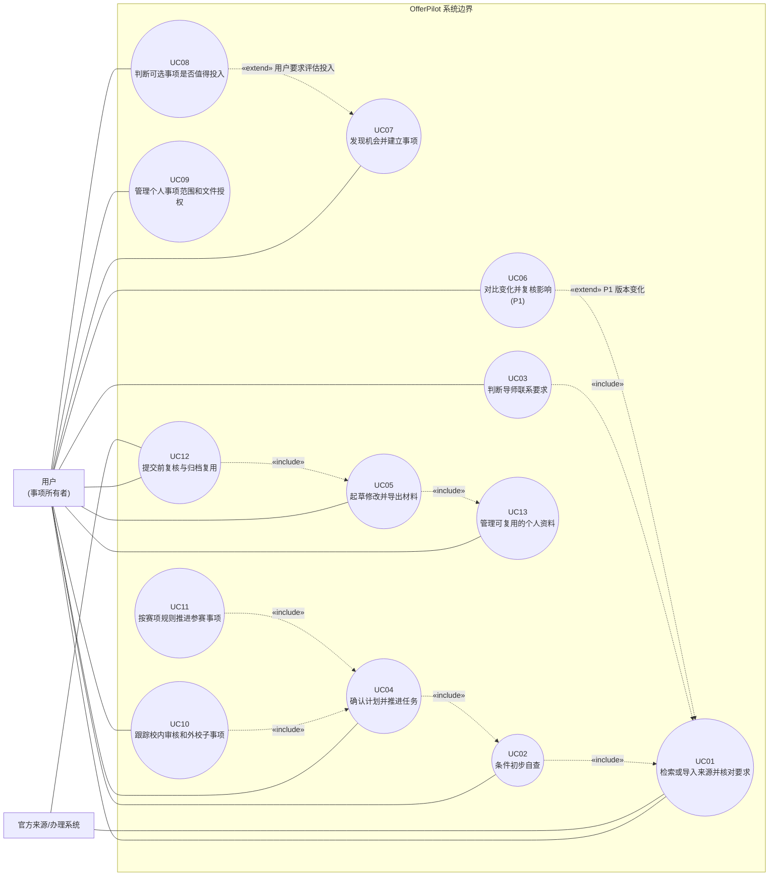

图 4-1 系统用例图

| 用例 | 名称 | 主参与者 | 目标 | 优先级 | 功能 |
| --- | --- | --- | --- | --- | --- |
| UC07 | 发现机会并建立事项 | 用户 | 识别事项类型，套用模板，建立探索草稿 | P0 | F11 |
| UC01 | 检索或导入来源并核对要求 | 用户、官方来源 | 按需检索/导入来源，抽取要求并自动检查 | P0 | F01、F02、F09 |
| UC02 | 条件初步自查 | 用户 | 四态显示条件与信息缺口，不填零 | P0 | F03 |
| UC03 | 判断导师联系要求 | 用户 | 分离“是否联系”与“证明是否必交” | P0 | F04 |
| UC04 | 确认计划并推进任务 | 用户 | 候选计划经确认后写入，推进依赖与完成证据 | P0 | F05、F06、F10 |
| UC05 | 起草修改并导出材料 | 用户 | 局部起草、逐条接受、导出 DOCX | P0 | F07、F08 |
| UC06 | 对比变化并复核影响 | 用户 | 条款对比、影响列表与调整建议 | P1 | F09 |
| UC08 | 判断可选事项是否值得投入 | 用户 | 解释收益、成本、负荷与跳过影响 | P0 | F12 |
| UC09 | 管理个人事项范围和文件授权 | 用户 | 选择当前事项与可用的本人事实、材料及用途；检查所有者与事项范围；管理模型传输同意与撤回 | P0 | F13 |
| UC10 | 跟踪校内审核和外校子事项 | 用户 | 记录校内节点，拆分子事项与批次 | P0 | F14 |
| UC11 | 按赛项规则推进参赛事项 | 用户 | 按章程建立条件、阶段、成果与真实结果；团队成员信息由用户自填 | P0 | F15 |
| UC12 | 提交前复核与归档复用 | 用户、官方系统 | 检查清单、登记证据、归档与复用 | P0 | F16 |
| UC13 | 管理可复用的个人资料 | 用户 | 确认事实、维护材料版本与有效期、授权、撤回与删除 | P0 | F17 |

注：UC 编号沿用主基线，不按表中顺序重排。

| 关系 | 源用例 | 目标用例 | 说明 |
| --- | --- | --- | --- |
| «include» | UC02 | UC01 | 自查基于已通过自动检查的要求 |
| «include» | UC03 | UC01 | 导师联系判断需通知与官方问答 |
| «include» | UC04 | UC02 | 计划基于四态自查结果 |
| «include» | UC05 | UC13 | 材料起草只使用已确认事实与个人材料版本 |
| «include» | UC10 | UC04 | 校内节点与外校子事项需任务推进 |
| «include» | UC11 | UC04 | 竞赛阶段需任务推进 |
| «include» | UC12 | UC05 | 提交复核需材料版本 |
| «extend» | UC08 | UC07 | 用户主动要求评估是否投入时扩展 |
| «extend» | UC06 | UC01 | P1 检测到版本变化时扩展 |

**覆盖检查。** 17 项 P0 功能均有用例承接；P1 的 UC06 单列。基线明确排除的自动报名、代填表单、对外联系不作为用例。官方信息的自动检查在 UC01 内表达；范围与授权检查由 UC09 表达，并在各用例的读取、生成、导出与模型调用中强制执行；团队质量保障属于交付期工作，不单列为用户用例。

##### 4.1.3.2 业务流程活动图

活动图给出通用事项主流程（P0 以推免/竞赛为例）、判定、拒绝、暂停、取消与失败出口（图 4-2）。不同类型在“按模板展开阶段”处按模板展开阶段，之后共用事实、计划、材料与归档能力。

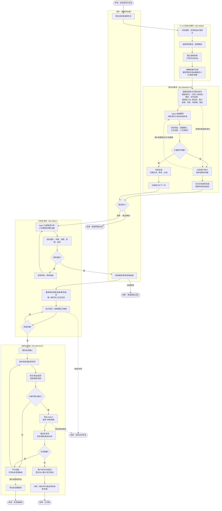

图 4-2 业务流程活动图（通用事项，P0 示例）

关键出口：类型含混先追问，不误套模板（AC13）；来源缺失或冲突暂停判断（AC02、AC14）；要求抽取经自动检查后方可用于判断（D-20）；跳过官方必需项需显式告知（AC17）；候选未确认不产生正式任务（AC05）；关键字段未确认只能导出未定稿副本（AC28）；DOCX 导出成功不改变外部提交状态（AC11）。

##### 4.1.3.3 数据流程图

数据通路如图 4-3。系统以事项为主线，把来源、规则、事实、计划、材料、提交证据串成一条可追溯链。

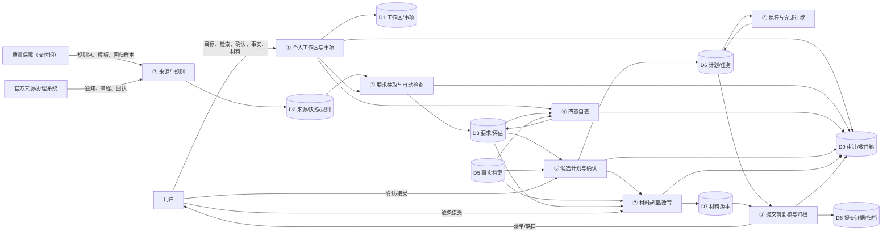

图 4-3 数据流程图

处理阶段：①工作区与事项；②来源与规则；③要求抽取与自动检查；④四态自查；⑤候选计划与确认；⑥任务执行与完成证据；⑦材料起草与版本；⑧提交前复核、证据登记与归档。全过程写入审计与收件箱（D9）。

#### 4.1.4 系统体系结构

##### 4.1.4.1 系统配置项

系统划分为 20 个系统配置项（SCI），标识符项目内唯一：

| 标识符 | 配置项 | 层次 | 功能 |
| --- | --- | --- | --- |
| SCI-01 | Web 前端应用 | 表现层 | 机会入口、我的事项、工作区、规则核对、自查、计划、任务、材料编辑、确认、归档与收件箱视图；区分加载/空/失败/待确认 |
| SCI-02 | API 网关、账户与会话 | 应用层 | REST/SSE 汇聚；登录/退出/会话；统一鉴权入口；审计入口 |
| SCI-03 | 个人工作区与访问控制 | 应用层 | 个人工作区；数据归用户；公开信息来源共享只读；访问重校验；跨用户与跨事项越界拒绝（F13、F17、AC18、AC19） |
| SCI-04 | 事项与模板引擎 | 应用层 | 事项类型注册、模板版本、阶段展开、子事项与适用范围；事项信息归属当前事项、不随档案复用，也不能升级为官方规则；P0 内置推免/竞赛（F11、F14、F15） |
| SCI-05 | 来源检索、登记与导入 | 采集层 | 官方信息层：按需检索官方页面与附件（取回经 URL 校验层）、来源登记、人工导入（仅本人授权范围内使用，仅作线索）、转载/过期标注、获取时间与自动检查状态；P1 定期巡检调度（F01、F09、D-24、D-31） |
| SCI-06 | 快照与证据版本 | 采集层 | 官方信息层：快照、版本、附件哈希、证据定位；系统共享只读（F01、F02） |
| SCI-07 | 规则与要求 | 应用层 | 规则包绑定、要求抽取、自动检查、四态评估、义务性质、导师联系（F02—F04） |
| SCI-08 | 计划与任务引擎 | 应用层 | 候选计划、确认写入、依赖与环路、阻塞、完成证据、任意非终态取消（已确认/就绪/阻塞/进行中）与取消留痕（F05、F06、F10） |
| SCI-09 | 个人资料与事实档案 | 应用层 | 个人信息层：事实确认、授权、撤回、删除；模型传输同意、撤回与出站网关统一控制；个人材料版本、有效期、复用与冻结（F13、F17、AC19/25/26、D-30） |
| SCI-10 | 材料工作室 | 应用层 | 材料—要求映射、区块起草/改写、差异接受、DOCX 导入导出与 PDF 参考导入（F07、F08） |
| SCI-11 | 确认与自审 | 应用层 | 用户确认计划/事实/材料、提交前确认；机器检索登记的官方信息不设人工放行（F16） |
| SCI-12 | 提交前检查与归档 | 应用层 | 必需任务/映射/版本检查、提交证据、归档与复用（F16） |
| SCI-13 | 变更与失效提示 | 应用层 | P0 版本失效提示；旧版本结果按 D-32 拒绝登记并提示重跑；P1 条款对比与影响列表（F09、D-32） |
| SCI-14 | 审计与操作记录 | 应用层 | 操作者、对象版本、规则/模板版本、结果、时间；审计与业务写入同事务提交，对账补录缺失审计并标记（继承基线审计要求、D-16） |
| SCI-15 | 智能体编排器 | 智能体层 | 单执行体、多模式（识别/检索/抽取/解释/计划/起草/对比）、停止与恢复（F02、F05、F08、F12） |
| SCI-16 | 知识与规则包 | 智能体层 | 规则、模板、案例、阈值版本化；发布前回归；不作为官方信息使用前置（D-11） |
| SCI-17 | 确定性校验 | 智能体层 | Schema、日期/公式、适用范围、映射完整性、跨材料一致性；不调用模型 |
| SCI-18 | Agent 收件箱与运行记录 | 智能体层 | 新通知、待答、阻塞、待批准、失败恢复；工具执行与授权等级留痕 |
| SCI-19 | 运行观测 | 支撑层 | 健康检查、任务观测、指标埋点（第 7 章） |
| SCI-20 | 数据与文件存储 | 数据层 | PostgreSQL 主库；对象存储（快照、材料、DOCX、归档） |

##### 4.1.4.2 系统层次结构

层次、层内模块与层间通信如图 4-4。图中只画层间关系：L2 将职责相近的配置项合并为 6 个模块（括注 SCI 编号），同层模块之间的调用不画，细节见 4.1.4.1 与 4.1.4.3。上层调用下层；智能体层只经业务服务（含来源服务）与授权代理访问数据，不直连用户会话，也不持有数据库凭据；L5 的运行观测旁路覆盖其余各层（图中不画反向连线），其余箭头为调用关系。

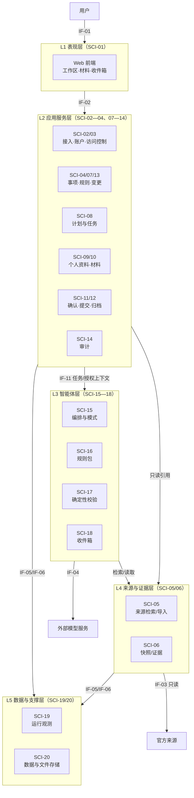

图 4-4 系统层次结构图

##### 4.1.4.3 静态结构类图

**工作区与事项域类图。** 图 4-5 给出聚合根、模板、要求、评估、候选计划与任务的关系。跨图引用的 `User`、`Workspace` 为简化占位。

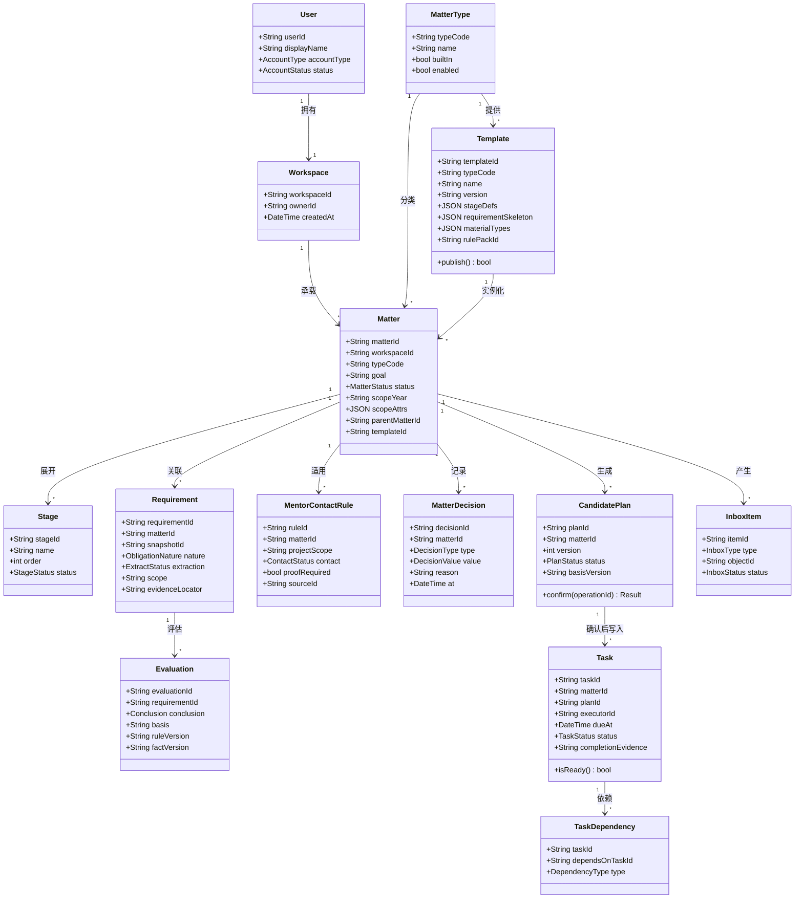

图 4-5 工作区与事项域类图

**事实、材料与归档域类图。** 图 4-6 给出事实授权、材料版本、提交证据与归档的关系。`User`、`Matter`、`Requirement` 为跨图占位。

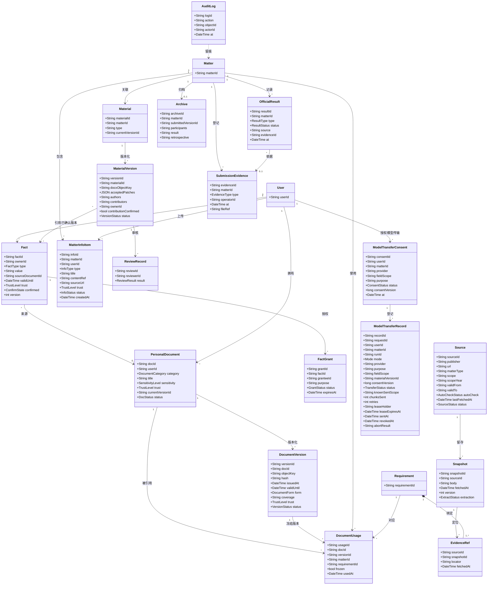

图 4-6 个人资料、材料与归档域类图

**智能体层类图。** 图 4-7 描述单执行体、多模式与受控工具的静态结构。编排器只产出候选；确认门槛与授权守卫在编排器之外。

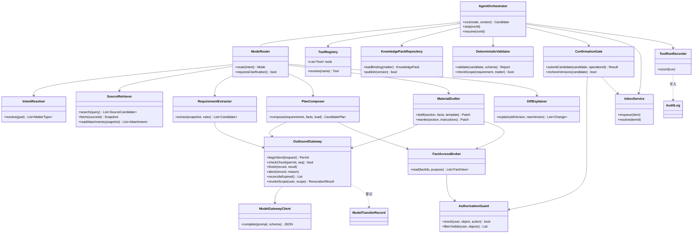

图 4-7 智能体层类图

类职责边界：`AgentOrchestrator` 不持有正式写入权；`ConfirmationGate` 负责版本复查、唯一操作与幂等，确认写入与审计记录同事务提交；`SourceRetriever` 只访问公开页面与附件，不携带用户私有字段；`RequirementExtractor`、`PlanComposer`、`MaterialDrafter` 等模型支撑类一律经 `OutboundGateway` 发送模型请求，由其统一控制全部模型传输：发送前在临界区内核对访问权、服务商、用途、字段、资料版本与授权版本并登记请求标识，排队任务与先前取得的许可不能绕过本次检查，校验与开始发送之间不释放串行化控制，每块写入前与每次重试前重新检查授权版本，撤回经同一机制生效并按实际结果登记传输记录；在途与排队记录由当前持有该请求的进程持有租约并随分块检查与重试续期，进程中断后由启动与定期对账将租约失效的记录收敛为中止终态，发送范围无法确定时标“未知”，失效许可一并作废；`FactAccessBroker` 只返回已授权事实视图；`AuthorizationGuard` 对读取、导出、修改分别校验；`DeterministicValidator` 不调用模型；`DiffExplainer` 只解释差异，不替用户接受。Agent 进程没有数据库凭据，也不读取用户会话；所有数据读取经 `FactAccessBroker` 或业务服务。

##### 4.1.4.4 系统配置项设计

- **SCI-01 Web 前端**：接收操作 → 组织机会入口/我的事项、工作区/事项/材料/收件箱视图与四类状态 → 经 IF-02 调用 API；Agent 运行进度、追问与候选经 IF-02 SSE 事件流推送，断线降级为轮询（4.4.2）。材料编辑提供原文/候选/差异三栏与逐条接受；收件箱提供停止、撤销与恢复入口。
- **SCI-02 API 与账户**：登录/退出、会话签发与校验 → 统一鉴权入口 → 路由业务模块 → 关键操作写审计（F17、NFR-02）。
- **SCI-03 个人工作区与访问控制**：个人工作区（与用户 1:1）、数据归用户 → 公开信息来源共享只读 → 每次读取、导出、修改重新校验；跨用户与跨事项越界立即拒绝（F13、F17、AC18、AC19）。
- **SCI-04 事项与模板**：注册事项类型与模板版本 → 按 type_code 应用 SCI-16 发布的模板，展开阶段、要求骨架与材料类型 → scope_attrs 保存院校/学院/项目/批次/学位路径、赛项/赛道、项目/奖项类别等类型特有字段 → 事项信息（转载/截图/笔记/沟通记录）归属当前事项，留在原事项，不随档案跨事项复用，也不能升级为官方规则 → 未确认节点不成为必经步骤；P0 内置推免与一个竞赛模板，其他类型按同一机制扩展（F11、F14、F15）。
- **SCI-05 来源检索、登记与导入**：官方信息层：由事项类型、学校/学院、年度与阶段生成查询（不含私有字段）→ 记录检索查询与命中 → 定位官方发布入口，读取正文与附件 → 记录来源缺口类型与缺失范围 → 登记发布主体、URL、事项类型、年度、有效期与状态 → 支持用户人工导入：链接与文件存事项信息层（仅本人当前事项可见），取回前经 URL 校验层（仅 http/https，发送前校验 host，拒绝环回、私有与保留地址，重定向逐跳复验，失败即中止并留痕）→ 导入件仅在本人授权范围内使用，仅作线索，用户可自行导出、撤回使用授权或删除；Agent 以其为线索独立检索官方入口，命中后另建官方来源记录（来源方式为检索登记）并经自动检查登记，不达按来源缺口处理 → 标注转载、过期与范围不明 → 打开事项或用户请求时按需刷新；并发刷新按来源版本序守卫（D-32）：后完成的旧快照仅存历史，登记前复核当前版本，旧版本结果标失效 → P1 才启用定期巡检；官方信息系统共享、用户只读（F01、AC14、D-24、D-31、D-32）。
- **SCI-06 快照与证据**：规范化、哈希、版本留存 → 为要求与结论提供四元组证据 → 只增不改（F01、F02）。
- **SCI-07 规则与要求**：绑定规则包 → 抽取要求 → 自动检查日期、公式、字段与二次读原文 → 四态评估与义务性质 → 推免模板下按项目/年度/阶段/学位路径输出导师联系状态（明确要求/官方建议/未提及/来源不全或冲突），导师同意证明是否必交作为独立条件（F02—F04）。
- **SCI-08 计划与任务**：生成候选计划 → 校验重复、环路、日期、权限、版本 → 用户逐项确认后原子写入 → 依赖/阻塞/完成证据 → 已确认、就绪、阻塞、进行中均可由用户取消：取消留痕且不可逆，被依赖任务取消后下游任务收到无法就绪提示，由用户重新规划或取消（F05、F06、F10）。
- **SCI-09 个人资料与事实档案**：个人信息层：事实录入与逐项确认 → 个人材料上传、版本、签发日/有效期、形式、敏感级别与信任等级 → 事实与材料关联 → 授权、撤回、删除 → 列出受影响材料与判断 → 模型传输同意（服务商、字段、用途、授权版本）与撤回——撤回与发送经出站网关同一串行化机制，撤回立即关闭该范围发送许可，取消排队请求，阻止新请求、后续分块与重试，尽力中止在途连接，在途请求按实际结果如实登记 → 隐私页说明存储位置、模型接触范围、保留期限、删除入口与不调用模型的替代路径（F13、F17、AC19/25/26、D-30）。
- **SCI-10 材料工作室**：首版覆盖推免简历、个人陈述与试点竞赛的一种材料 → 按官方栏目诊断缺项/格式/表达，支持单区块处理 → 材料—要求映射 → 区块起草/改写 → 差异逐条接受/拒绝 → DOCX 导入导出、PDF 参考只读导入、作者/贡献记录与未定稿标记（F07、F08、AC24）。
- **SCI-11 确认与自审**：用户确认计划、事实、材料与提交版本 → 提交前确认 → 自审记录留痕 → 机器检索登记的官方信息不设人工放行，提取结果只标机器处理状态（F16、AC30）。
- **SCI-12 提交与归档**：检查必需任务、材料映射、版本与待办 → 登记本人确认/官方回执 → 校内选拔、报名成功、获奖、录取与公示名单按类型分别记录为官方结果，不由模型生成 → 归档；复用只复制授权版本到目标事项，不连带其他事项文件（F16、AC11/12/24/29）。
- **SCI-13 变更与失效**：P0 来源失效或事实变更时提示受影响结论需重新检查 → 并发刷新产生旧版本结果时按 D-32 拒绝登记、标失效并提示按最新快照重跑 → P1 条款对比与影响列表（F09、D-32）。
- **SCI-14 审计**：记录操作者、对象版本、规则/模板版本、结果与时间；确认/写入类业务事务内同库同事务写审计记录，业务提交即审计完整；启动与定期对账扫描无审计记录的已提交业务写入，按确认记录补录并标“补录”，补录动作自身留痕（继承基线审计要求、D-16）。
- **SCI-15 编排器**：按模式执行识别/检索/抽取/解释/计划/起草/对比 → 只产出候选 → 支持停止与恢复（F02、F05、F08、F12）。
- **SCI-16 规则包**：规则、模板、案例、阈值版本化 → 发布前回归 → 保留版本与回归结果；不作为官方信息使用前置（D-11）。
- **SCI-17 确定性校验**：Schema、日期/公式、适用范围、映射完整性、跨材料一致性 → 不调用模型。
- **SCI-18 收件箱与运行**：聚合新通知、待答、阻塞、待批准、失败恢复 → 记录工具执行与 L0—L3 授权等级（HHY §7）。
- **SCI-19 运行观测**：健康检查、任务观测、指标埋点（第 7 章）。
- **SCI-20 数据与文件存储**：PostgreSQL 主库与对象存储；归档保留提交版本；删除按策略处理（D-22）。

#### 4.1.5 功能需求与系统配置项的关系

| 功能 | 主责配置项 | 参与配置项 |
| --- | --- | --- |
| F01 来源与版本 | SCI-05、SCI-06 | SCI-07、SCI-14 |
| F02 提取要求并回原文 | SCI-07、SCI-15、SCI-17 | SCI-06、SCI-14 |
| F03 四态条件与缺口 | SCI-07、SCI-17 | SCI-09、SCI-15 |
| F04 导师联系与证明分离 | SCI-07 | SCI-15 |
| F05 候选计划确认写入 | SCI-08、SCI-11 | SCI-15、SCI-17 |
| F06 依赖、阻塞与完成证据 | SCI-08 | SCI-14 |
| F07 材料与要求映射 | SCI-10 | SCI-07、SCI-08、SCI-09 |
| F08 局部起草与 DOCX | SCI-10、SCI-15 | SCI-09、SCI-17 |
| F09 版本失效与变化分析 | SCI-13 | SCI-06、SCI-07；P1 加 SCI-15 |
| F10 停止、取消、撤销与恢复 | SCI-08、SCI-15、SCI-18 | SCI-14、SCI-19 |
| F11 发现机会与模板化事项 | SCI-04、SCI-15 | SCI-03、SCI-05 |
| F12 可选投入解释与决定 | SCI-07、SCI-15 | SCI-08 |
| F13 事项范围、三层信息与模型传输同意 | SCI-03、SCI-09 | SCI-04、SCI-20 |
| F14 校内节点与外校子事项 | SCI-04、SCI-08 | SCI-07、SCI-12 |
| F15 竞赛阶段与个人成果 | SCI-04、SCI-07、SCI-08、SCI-10 | SCI-12 |
| F16 提交前复核与归档复用 | SCI-11、SCI-12 | SCI-09、SCI-10、SCI-14 |
| F17 个人资料确认、撤回授权与删除 | SCI-09、SCI-02 | SCI-10、SCI-14 |

继承非功能约束的分配：NFR-01 → SCI-06/07/10/14；NFR-02 → SCI-02/03/09/20；NFR-03 → SCI-05/06/08/19；NFR-04 → SCI-01；NFR-05 → SCI-06/10/16；NFR-06 → SCI-01/12。17 项功能均有主责配置项。

#### 4.1.6 人工处理过程

1. **个人材料维护（用户）**：上传学生证、学籍证明、成绩单等，确认类别、签发日、有效期、形式与覆盖范围；到期前系统提示更新。
2. **用户自审与确认**：确认 Agent 生成的事实、计划、材料与提交版本，逐项接受计划与材料差异；可查看或标注官方要求提取结果；拒绝与暂缓同样留痕。
3. **人工处理不可解析资料**：扫描件、不可靠版式走文本审阅或人工录入，不承诺任意格式解析（UC05）。
4. **归档结果登记**：本人确认与官方回执分别登记；结果未取得时保持待确认，不生成录取或获奖记录（AC12）。

机器按需检索的官方信息提取与检查不属于运行期人工处理过程：由 SCI-17 自动检查、SCI-16 回归与交付期抽检保障，自动检查只记录机器提取、程序校验及未解决的疑点，关键问题交当前用户核对（D-31）；用户导入内容仅在本人授权范围内使用，不经任何人工审阅；团队质量保障只在开发/评测期使用公开信息与虚构或脱敏样本（D-19、D-20）。

### 4.2 系统部件

| 标识符 | 部件 | 类型 | 用途 | 对应需求/决策 | 开发状态 |
| --- | --- | --- | --- | --- | --- |
| CSCI-WEB | Web 前端（=SCI-01） | CSCI | 全部用户视图 | HHY-F 全部；NFR-04 | 新开发 |
| CSCI-CORE | 核心业务服务（=SCI-02/03/04/07/08/09/11/12/13/14） | CSCI | 个人工作区、事项、规则、计划、个人资料、确认、归档 | F01—F17 | 新开发 |
| CSCI-MATERIAL | 材料工作室（=SCI-10） | CSCI | DOCX 导入导出、PDF 参考导入、区块改写、差异接受 | F07、F08、F16 | 新开发 |
| CSCI-SOURCE | 来源与快照（=SCI-05/06） | CSCI | 按需检索、导入、版本、证据 | F01、F02、F09 | 新开发 |
| CSCI-AGENT | 智能体服务（=SCI-15/16/17/18） | CSCI | 多模式编排、检索、规则包、校验、收件箱 | F02、F05、F08、F12 | 新开发 |
| CSCI-OBS | 运行观测（=SCI-19） | CSCI | 健康检查与指标 | NFR-03；第 7 章 | 新开发 |
| CSCI-DB | PostgreSQL 16 | CSCI | 结构化存储 | 全部 F 的持久化 | 重用 |
| CSCI-STOR | S3 兼容对象存储 | CSCI | 快照、材料、DOCX、归档 | F01、F08、F16 | 重用 |
| CSCI-QUEUE | 任务队列 | CSCI | 计划执行、材料生成、P1 巡检 | F05、F08、F09 | 重用 |
| CSCI-LLM | 大模型服务 | CSCI（外部） | 抽取、计划、起草 | F02、F05、F08 | 重用（IF-04） |
| CSCI-DOCX | DOCX 处理库 | CSCI | 解析与生成 DOCX，保留版式 | F08 | 重用（选型见 8.4） |
| HWCI-1 | 应用与数据服务器 | HWCI | 承载上列软件 | 4.1.1.2 | 已有云主机 |
| HWCI-2 | 模型服务网关及算力 | HWCI | 承载 CSCI-LLM | IF-04 | 外部资源 |
| HWCI-3 | 用户终端 | HWCI | 浏览器访问 | D-01 | 用户自备 |
| MAN-1 | 用户自审与确认 | 手工操作 | 计划/事实/材料/提交 | AC05/AC06/AC28 | — |
| MAN-2 | 不可解析资料人工处理 | 手工操作 | 扫描件/异常版式 | UC05 | — |
| MAN-3 | 官方系统操作与结果登记 | 手工操作 | 自行提交、登记回执 | AC11/AC12 | — |

**组成关系。** 系统 = HWCI-1（CSCI-WEB、CSCI-CORE、CSCI-MATERIAL、CSCI-SOURCE、CSCI-AGENT、CSCI-OBS、CSCI-DB、CSCI-STOR、CSCI-QUEUE、CSCI-DOCX）+ HWCI-2（CSCI-LLM，经 IF-04）+ HWCI-3 + {MAN-1—MAN-3}。模块映射：CSCI-CORE 含 SCI-02/03/04/07/08/09/11/12/13/14；CSCI-AGENT 含 SCI-15—SCI-18；CSCI-SOURCE 含 SCI-05/06。

**硬件资源**（测量条件：50 并发会话、单事项 ≤ 30 任务、DOCX ≤ 20 MB）：

- **HWCI-1**：Linux 云主机；4 vCPU；内存 8 GB（PostgreSQL ≥ 2 GB，DOCX 处理预留 2 GB）；磁盘 ≥ 100 GB；HTTPS 出网。CSCI-DB 独立数据盘，CSCI-STOR 独立容量配额。
- **HWCI-2**：外部模型服务，按调用计费/限流；调用方为 SCI-15；配额约束记录于 IF-04。
- **HWCI-3**：可运行现代浏览器的 PC；UTF-8（兼容 GB18030 显示）。

**规格说明树**（图 4-8）：

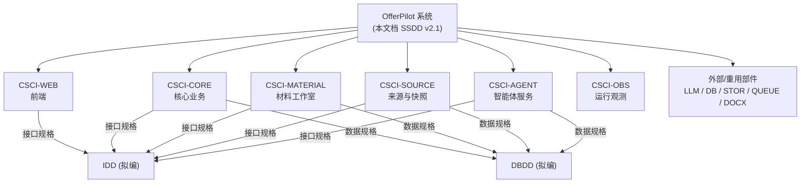

图 4-8 规格说明树

### 4.3 执行概念

#### 4.3.1 智能体与软件系统的集成

智能体层是后端的一个服务（CSCI-AGENT），不直接面向用户，不持有正式写入权。集成遵循四条边界：

- **触发边界**：用户操作经业务服务转换为带授权上下文的任务；Agent 不接收裸会话，也不登录或操作官方办理系统（只读访问公开页面）。
- **数据边界**：官方信息全局只读；事项信息仅当前事项；个人信息仅本人授权范围。团队质量保障只使用公开信息与虚构或脱敏样本，不可见真实个人事实与材料；事实/材料读取必须带用途，证件与成绩单原件不进入模型。
- **输出边界**：只产出候选要求、候选计划、候选稿、解释与建议；计划、事实与材料由确认门槛在用户确认后写入；官方信息经自动检查后登记为共享只读依据，用户导入内容仅在本人授权范围内使用、不转入官方信息层（D-31）。
- **依赖边界**：模型仅经出站网关（IF-04）由抽取/计划/起草工具调用；四态比较、计划校验、权限检查、映射检查均为确定性实现。Agent 不持有数据库凭据与用户会话；读取经 CORE/授权代理，写入只提交候选，由确认门槛在用户确认后落库。

集成结构如图 4-9。

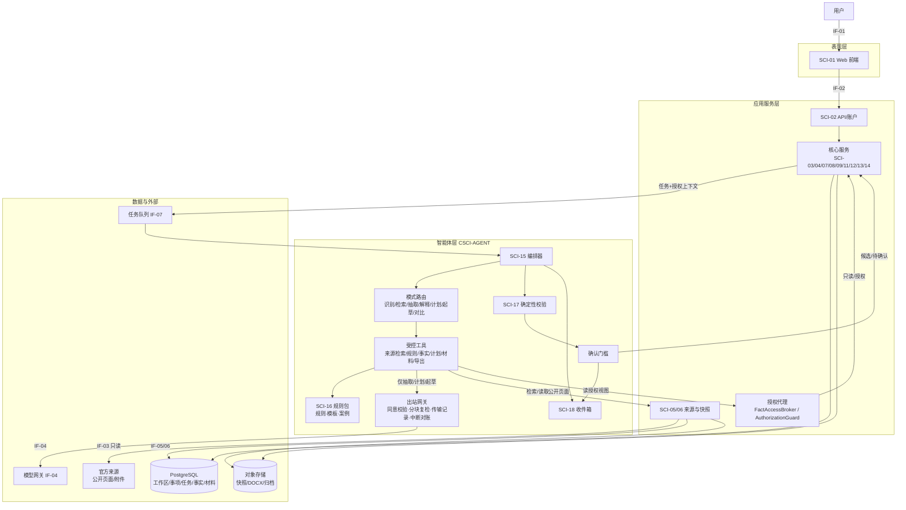

图 4-9 智能体与软件系统集成架构

领域知识、工具调用与任务流程三者的作用见表 4-2；Agent 的六种模式见表 4-3。

表 4-2 领域智能体三要素在系统中的作用

| 要素 | 系统载体 | 作用 | 约束 |
| --- | --- | --- | --- |
| 领域知识 | SCI-16 规则包：适用条件、公式、义务性质、材料栏目、案例、阈值 | 决定“适用哪条规则、材料怎么归类、什么算符合、哪种材料格式可用”；把领域口径从提示词剥离为可版本化资产 | 绑定事项类型/年度/scope_attrs（模板声明的院校、项目、批次、学位路径、赛道、奖项类别等）；版本随结果留存；回归记录可追溯；不作为官方信息使用前置 |
| 工具调用 | 受控工具：来源检索/查询、规则检索、事实/材料读取、计划生成、材料起草、DOCX 导出 | 把“找依据、取事实、出候选、写文件”拆成可观测、可单独校验的步骤；模型只出现在抽取/计划/起草，全部请求经出站网关（D-30） | 工具白名单；输入输出受 Schema 约束；事实/材料读取带用途；证件原件不进模型；服务端取回 URL 一律经 URL 校验层（D-24）；L3 需逐次确认；对外操作不属可授权范围 |
| 任务流程 | 模式化阶段序列 + 确认门槛 + 收件箱 | 固定“候选→校验→确认→写入”的顺序，保证失败即停、幂等重入、停止可恢复、人工介入点明确 | 单执行体；同一事项确认串行；候选不直接成为正式任务 |

表 4-3 智能体的运行模式

| 模式 | 输入 | 输出 | 授权等级 |
| --- | --- | --- | --- |
| 识别 | 用户目标、机会链接、已有资料 | 事项类型候选、追问或拆分建议 | L0 |
| 检索 | 事项类型、学校/学院、年度、阶段、用户导入链接 | 候选来源、附件文本、证据定位 | L0 |
| 抽取 | 快照、规则包、模板 | 候选要求、阶段、材料、期限、依赖与证据 | L1 |
| 解释 | 四态评估结果、规则、事实版本 | 依据、缺口、不确定性与下一步 | L0 |
| 计划 | 已通过自动检查的要求、用户负荷、材料现状 | 候选任务、期限、依赖、完成证据 | L1 |
| 起草 | 要求、已确认事实、原稿/模板 | 候选稿、区块差异、修改理由与引用 | L2 |
| 对比 | 新旧快照/条款（P1） | 变化要点、受影响项与证据 | L0 |

#### 4.3.2 典型执行场景

**场景一：发现机会并建立事项**（UC07）。类型含混时先追问，建草稿不等于决定参加（图 4-10）。

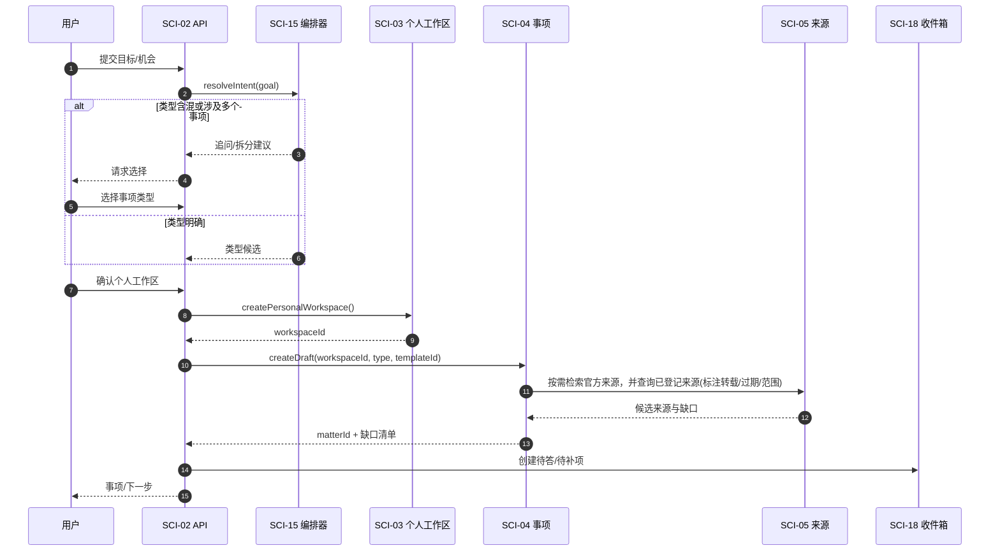

图 4-10 发现机会并建立事项时序图

**场景二：检索/导入来源、要求抽取、自动检查与四态自查**（UC01/UC02）。要求先成为候选，经自动检查且快照仍为来源当前版本后才用于判断；并发刷新时旧版本结果不登记为可用（图 4-11）。

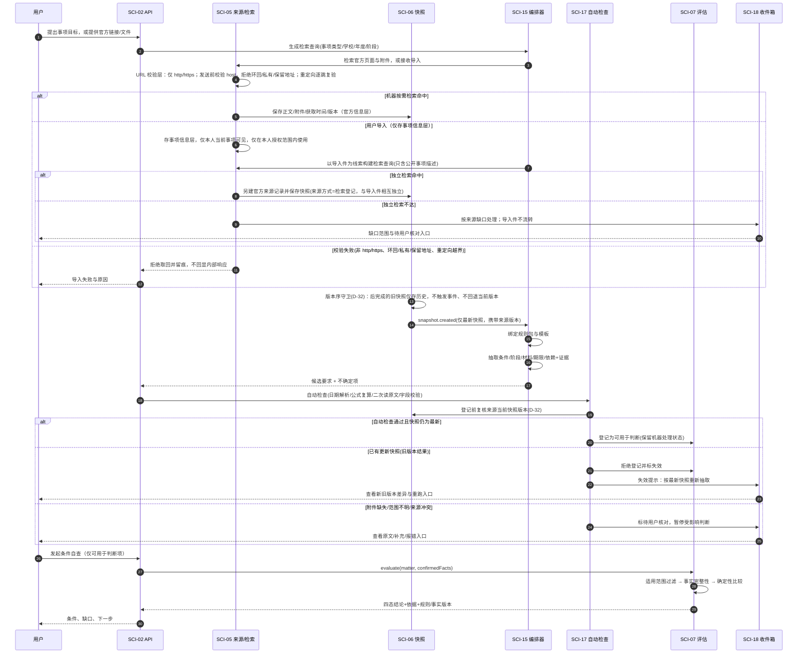

图 4-11 检索、抽取、自动检查与四态自查时序图

用户也可上传转载、通知截图、私人笔记或沟通记录作为**事项信息**；它们只作线索，不参与可作依据的判断，也不跨事项可见；通知截图、私人笔记与沟通记录等事项信息留在原事项，不随档案复用，也不能升级为官方规则（D-29）。用户导入的官方通知/章程同样仅存事项信息层，仅在本人授权范围内使用、不转入官方信息层；交给外部模型处理时须单独取得用户明确同意（D-30）；Agent 以其为线索独立检索官方入口，命中后另建官方来源记录，与原导入件相互独立，不改变导入件的使用范围；独立检索不达时按来源缺口处理，关键问题交当前用户核对（D-31）。

**场景三：候选计划确认并写入正式任务**（UC04）。确认时复查权限与版本，唯一操作键保证幂等（图 4-12）。

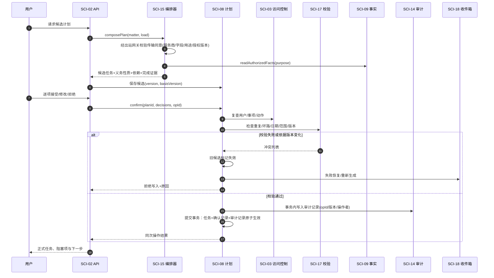

图 4-12 候选计划确认与任务写入时序图

**场景四：事实确认、材料起草与 DOCX 导出**（UC05/UC13）。事实未确认不得进入定稿；导出成功不代表满足官方提交格式（图 4-13）。

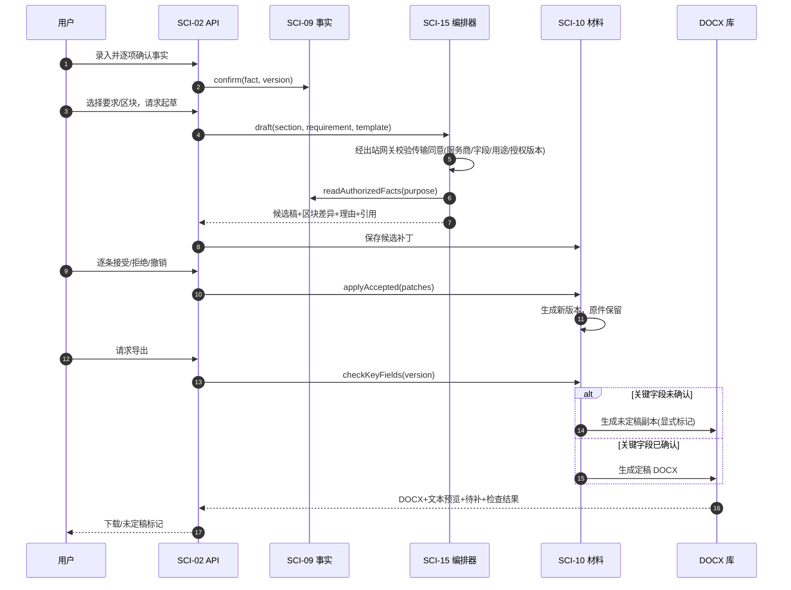

图 4-13 事实、材料与 DOCX 时序图

成绩单、学籍证明等个人材料从个人材料库引用具体版本；无有效版本、已过期或形式不符时，相关材料要求回到“待补充信息”，不因资料库有旧版本就算满足。

**场景五：提交前复核、证据登记与归档复用**（UC12）。内部完成不改变外部状态（图 4-14）。

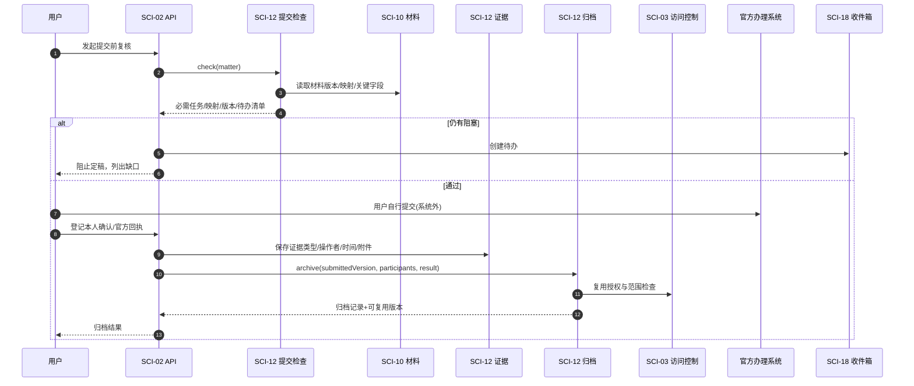

图 4-14 提交前复核与归档时序图

#### 4.3.3 关键算法时序

**算法一：四态判定**（UC02、AC15）。先过滤适用范围，再判事实完整性，最后做确定性比较；不产生第五态。

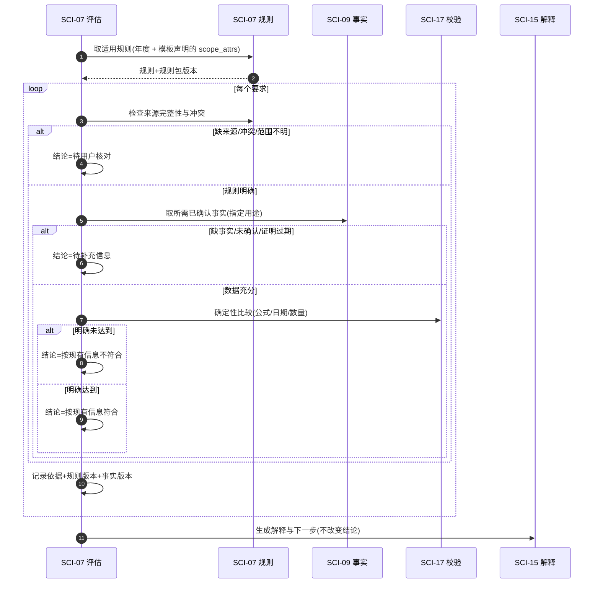

图 4-15 四态判定时序图

**算法二：计划校验与唯一写入**（UC04、AC05—AC07）。校验失败不写任务；同一操作标识重复提交返回同次结果。

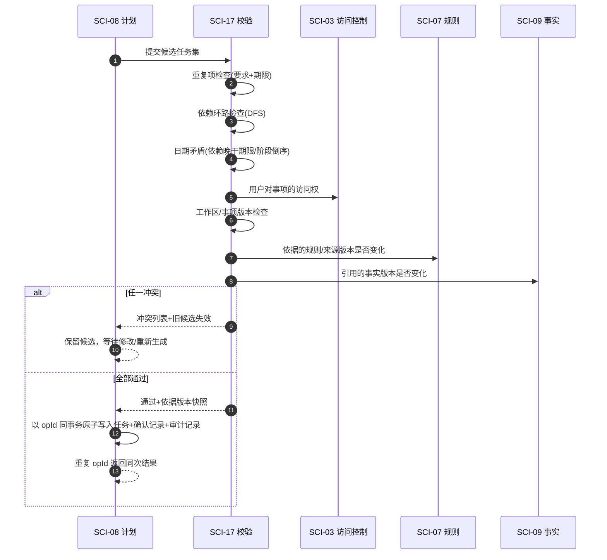

图 4-16 计划校验与唯一写入时序图

**算法三：材料差异接受与一致性检查**（UC05、AC08）。补丁按锚点定位，接受后才进入版本；原件不变。

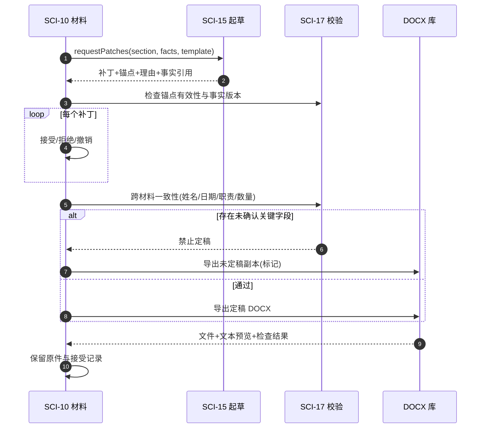

图 4-17 材料差异接受与导出的时序图

**算法四：个人数据访问与模型传输出站控制**（AC18、AC19、策划稿 §十、§九.5.3）。个人数据归用户；每次访问重新校验；未经同意不得向外部模型传输。全部模型请求统一经出站网关，撤回与发送共用同一串行化机制；在途与排队记录持有租约，进程中断后由启动与定期对账收敛为中止终态，发送范围无法确定时标“未知”。

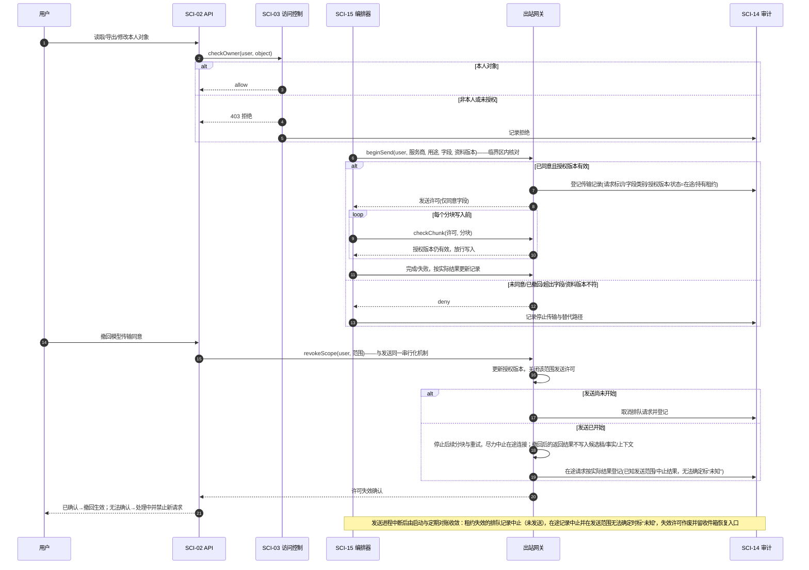

图 4-18 个人数据访问与模型传输出站控制时序图

#### 4.3.4 协作图

协作图（图 4-19）与图 4-12 描述同一次计划确认，突出对象链接与消息编号：编号表示顺序，`3.1` 表示消息 3 的嵌套调用。

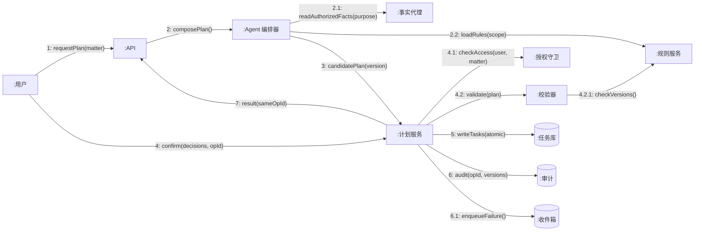

图 4-19 计划确认对象协作图

协作关系中有三处单向依赖：Agent 只向计划服务提交候选，不直接写任务库；授权守卫只做允许/拒绝判定，不修改业务对象；审计与收件箱只接收事件，不反向驱动业务状态。

#### 4.3.5 状态转换

**事项生命周期**（图 4-20）：探索草稿不等于已参加；归档后不再接受写入。

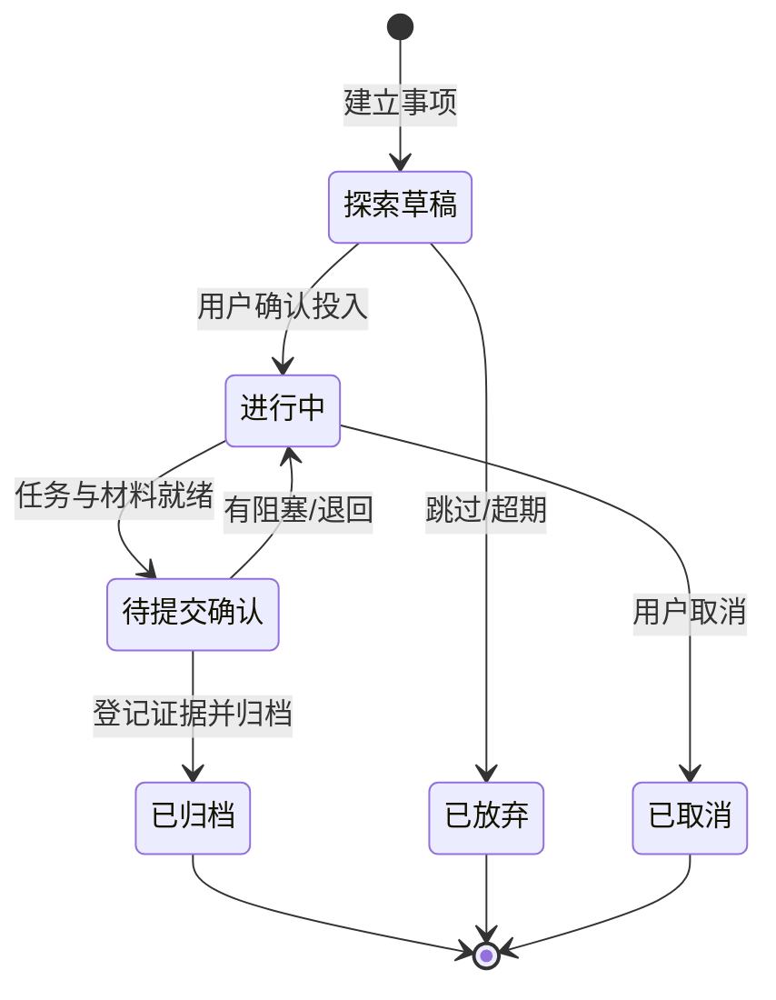

图 4-20 事项状态图

**候选计划与正式任务**（图 4-21）：候选的拒绝/失效与任务的阻塞/取消分开表达；取消可自已确认、就绪、阻塞与进行中任一非终态发起（F10），留痕且不可逆；被依赖任务取消后，下游任务收到无法就绪的提示，由用户重新规划或取消。

```mermaid
stateDiagram-v2
    [*] --> 候选草稿
    候选草稿 --> 待确认: 提交候选
    待确认 --> 已确认: 用户确认
    待确认 --> 已拒绝: 全部拒绝
    待确认 --> 已失效: 依据版本变化
    已确认 --> 就绪: 依赖满足
    已确认 --> 已取消: 用户取消
    就绪 --> 进行中: 开始执行
    就绪 --> 已取消: 用户取消
    进行中 --> 阻塞: 前置/外部依赖未满足
    阻塞 --> 进行中: 解除阻塞
    阻塞 --> 已取消: 用户取消
    进行中 --> 已完成: 完成证据
    进行中 --> 已取消: 用户取消
    已完成 --> [*]
    已拒绝 --> [*]
    已失效 --> [*]
    已取消 --> [*]
```

图 4-21 候选计划与任务状态图

图为单个任务的确认与执行生命周期；候选计划的整体状态仍按草稿、待确认、已确认、已拒绝、已失效记录。

**材料版本**（图 4-22）：定稿需关键字段确认；未定稿副本可导出但显式标记。

```mermaid
stateDiagram-v2
    [*] --> 草稿
    草稿 --> 候选: 生成改写差异
    候选 --> 修订中: 接受/拒绝补丁
    修订中 --> 候选: 重新生成
    修订中 --> 未定稿: 关键字段未确认导出
    修订中 --> 定稿: 关键字段确认
    未定稿 --> 定稿: 补齐确认
    定稿 --> 已提交: 登记提交版本
    已提交 --> [*]
```

图 4-22 材料版本状态图

**个人材料状态**：待确认 → 有效 → 即将过期 → 已过期；被事项引用并提交时标记“冻结”，资料库更新不改变已冻结版本。

**事项信息状态**：活跃 → 随事项归档或删除；不升级为个人信息，也不能升级为官方规则。

**工具执行状态**：待确认 → 执行中 → 成功/失败/已取消；失败可回到待确认重试。该状态记录在 SCI-18，用于收件箱与审计。

#### 4.3.6 并发、优先级与异常

- **确认串行**：同一事项的确认写入按 opId 串行；重复提交返回同次结果（D-16）。
- **材料并发**：同一材料版本使用乐观锁；后写者收到版本变化提示，必须重新合并，不静默覆盖（材料版本）。
- **任务并发**：同一事项的计划生成串行；不同事项可并行；P1 巡检低于用户操作。
- **访问与同意变更优先**：事实授权撤回、模型传输同意撤回、取消任务优先于新任务生成；后续读取/导出与模型调用立即重新校验（D-19、D-30）。模型传输撤回经出站网关同一串行化机制立即生效，取消排队请求并阻止后续分块与重试，已发出的在途请求按实际结果如实记录。
- **异常**：模型超时、DOCX 失败、存储失败、权限拒绝、版本冲突均写入收件箱与审计；失败不改变外部正式状态，保留恢复入口（D-25）。

### 4.4 接口设计

本节标识接口并给出关键特性；完全设计见 IDD。

#### 4.4.1 接口标识和图表

| 标识符 | 两端实体 | 类型 | 载体/协议 | 强加需求方 |
| --- | --- | --- | --- | --- |
| IF-01 | 用户 ↔ CSCI-WEB | 人机界面 | HTTPS 页面 | CSCI-WEB |
| IF-02 | CSCI-WEB ↔ CSCI-CORE | 软件—软件 | REST/JSON over HTTPS，JWT；Agent 进度经 SSE（`GET /agent-runs/{runId}/events`） | 双方均为本项目 |
| IF-03 | CSCI-SOURCE ↔ 官方来源 | 软件—外部系统 | P0 按需检索与人工导入（HTTP(S) 只读，取回一律经 URL 校验层）；P1 定期巡检 | 本系统受约束（D-24、D-31） |
| IF-04 | CSCI-AGENT ↔ CSCI-LLM | 软件—外部服务 | 模型 API（HTTPS，JSON） | 外部服务 |
| IF-05 | CSCI-CORE/MATERIAL ↔ CSCI-DB | 软件—软件 | SQL（PostgreSQL 5432） | CSCI-DB |
| IF-06 | CSCI-CORE/MATERIAL ↔ CSCI-STOR | 软件—软件 | S3 兼容 API | CSCI-STOR |
| IF-07 | CSCI-CORE/AGENT ↔ CSCI-QUEUE | 软件—软件 | 任务队列（消息 JSON） | 双方均为本项目 |
| IF-08 | 团队质量保障（交付期） ↔ 规则包/模板回归工作台 | 人机界面 | 页面/CI 任务（不接触真实个人数据） | CSCI-WEB |
| IF-09 | 各部件 ↔ CSCI-OBS | 软件—软件 | 日志/指标埋点 | 双方均为本项目 |
| IF-10 | CSCI-MATERIAL ↔ CSCI-DOCX | 软件—库 | 进程内库 API（DOCX） | CSCI-DOCX |
| IF-11 | CSCI-AGENT ↔ CSCI-CORE（业务服务/授权代理） | 软件—软件 | 内部服务 API（mTLS，JSON，服务身份） | 双方均为本项目 |

```mermaid
flowchart LR
    U1["用户"] ---|"IF-01"| WEB["CSCI-WEB"]
    U2["质量保障（交付期）"] ---|"IF-08"| WEB
    WEB ---|"IF-02 REST/JSON + SSE"| CORE["CSCI-CORE"]
    SRC["CSCI-SOURCE"] ---|"IF-03 导入/只读"| OFF["官方来源"]
    AG["CSCI-AGENT"] ---|"IF-04 模型API"| LLM["CSCI-LLM"]
    AG ---|"IF-11 内部API"| CORE
    CORE ---|"IF-05 SQL"| DB[("CSCI-DB")]
    MAT["CSCI-MATERIAL"] ---|"IF-05 SQL"| DB
    CORE ---|"IF-06 S3"| STOR[("CSCI-STOR")]
    MAT ---|"IF-06 S3"| STOR
    CORE ---|"IF-07 任务"| Q["CSCI-QUEUE"]
    AG ---|"IF-07 任务"| Q
    MAT ---|"IF-10 库调用"| DX["CSCI-DOCX"]
    CORE ---|"IF-09 日志/指标"| OBS["CSCI-OBS"]
    AG ---|"IF-09 日志/指标"| OBS
    SRC ---|"IF-09 日志/指标"| OBS
```

图 4-23 接口关系图

#### 4.4.2 IF-02 REST API（前端—后端）

- **会话**：登录签发 JWT；API 层校验；越权返回 403 并留痕（AC18、AC19）。
- **资源族**：`workspaces`、`matters`、`stages`、`sources`、`snapshots`、`requirements`、`evaluations`、`plans`、`tasks`、`facts`、`grants`、`consents`、`materials`、`versions`、`reviews`、`evidences`、`archives`、`inbox`、`agent-runs`；明细见 IDD 与 `database-design.md`。
- **Agent 进度推送（SSE）**：`GET /agent-runs/{runId}/events`，`text/event-stream`，与 IF-02 同会话鉴权；`EventSource` 不便携带 Authorization 头时改用短时一次性票据建立连接，不在 URL 存放长期令牌。事件类型与 SCI-18 收件箱口径对齐：`progress`（当前模式与阶段进度）、`question`（追问/待答，含选项）、`candidate`（候选要求/计划/稿件就绪，携带对象引用与版本）、`summary`（运行结束摘要：候选数、不确定项、失败步骤）、`failed`/`resumed`（失败与恢复入口）。事件载荷统一为 `runId、seq、type、matterId、对象引用、状态、时间`；断线以 `Last-Event-ID` 续传，超出事件缓冲时全量拉取 `GET /agent-runs/{runId}` 对齐；SSE 不可用时降级为轮询该端点与 `GET /inbox`（NFR-03）。
- **约定**：JSON UTF-8；错误响应含错误码、可读信息与下一步；写操作带 `opId` 与 `expectedVersion`；冲突返回 409 并列出差异。

#### 4.4.3 IF-03 来源检索与导入接口

- P0 支持按需检索：由事项类型、学校/学院、年度与阶段生成查询，定位官方发布入口，读取正文与附件；查询只含公开事项描述，不携带姓名、成绩、证件或私人沟通记录。同时接受用户人工导入的 URL/文件与元数据（发布主体、事项类型、年度、有效期、适用范围），记录获取时间与导入人；导入内容存事项信息层（仅本人当前事项可见），仅在本人授权范围内使用，不进入官方信息层，仅可作线索供 Agent 独立检索；用户可自行导出、撤回使用授权或删除；交给外部模型处理时须单独取得用户明确同意（D-31、D-30）。
- **URL 校验层**：服务端所有取回（检索命中与用户提交一律同口径）仅允许 http/https；发送前解析并校验 host，拒绝 localhost、环回、私有、链路本地与保留地址；跟随重定向时逐跳重新校验，任一跳校验失败即中止；校验失败提示不回显内部服务响应内容（D-24）。
- 打开事项、用户请求重新检查时按需刷新；无法访问时显示最后获取时间与缺失范围，不把旧记录标为最新。按需刷新、重新检查与 P1 巡检并发执行时按来源版本序守卫（D-32）：后完成的旧快照仅存历史、不回退当前版本；抽取结果登记为可用前复核来源当前快照版本，仅最新版本可登记，旧版本结果拒绝登记并标失效。
- P1 定期巡检仅限已登记、已授权的公开页面；遵守频率限制，不绕过访问控制；单次失败不判定撤回（D-24）。
- 转载、过期、范围不明必须标注，不得当作可作依据的官方信息（AC14）。

#### 4.4.4 IF-04 模型服务接口

- 调用方仅限 SCI-15 的模型支撑模式（抽取/计划/起草），一律经出站网关发送；调用携带规则包版本、事项范围与授权上下文（D-11、D-12、D-30）。
- **出站网关统一控制**：全部模型请求统一经出站网关（IF-04 唯一出口）。发送前在实际开始写入请求内容的临界区内核对本人访问权、服务商、用途、字段、资料版本与授权版本，并记录请求标识；排队任务与先前取得的许可不能绕过本次检查；校验与开始发送之间不释放该串行化控制（D-30、策划稿 §九.5.3）。
- **分块与重试**：正文以有限大小的数据块交给传输层，每块写入前均在同一串行化机制下重新检查授权版本；每次重试发起前同样重新校验；控制机制不覆盖等待服务商响应的时段。每次分块检查在同一临界区内于写入前持久化分块进度并续期在途租约。
- **撤回**：撤回与发送使用同一机制更新授权版本并关闭该范围发送许可。撤回先完成时，请求不得开始发送；发送已开始时，登记为已开始的在途请求。撤回取消排队请求，停止新请求、后续重试与新分块写入，并尽力中止在途连接；撤回后的模型返回结果不得写入候选稿、事实或后续上下文。界面在网关确认许可失效后显示撤回生效，无法确认时显示处理中并禁止新请求进入。
- **传输记录**：逐项登记服务商、字段类别、授权版本、发送开始与撤回时间、已知发送范围及中止结果；发送范围无法确定时明确标“未知”，不以“丢弃响应”表示内容未发出；审计记录不保存额外的敏感正文。
- **中断对账**：在途与排队记录由当前持有该请求的进程持有租约，租约随记录登记同事务写入并随分块检查与重试续期，到期时间不短于单次响应等待上限，存活进程的租约不误判失效；发送进程中断后，出站网关在启动与定期对账中将租约失效的记录收敛为终态：排队记录登记为中止（未开始发送，范围为未发送），在途记录登记为中止并在中止结果记录最后持久化的分块进度——分块进度在写入前随检查持久化，已写入传输层的分块不超过该进度，进度为 0 时范围为未发送，其余实际发送范围无法确定、已知发送范围标“未知”；失效许可一并作废，对账不续发旧请求，恢复经收件箱重新发起新发送并重新走发送前检查，对账动作留痕（D-30）。
- 输出必须为 Schema 约束的 JSON；缺失必填字段即判校验失败（D-08）。
- 超时按失败处理并保留旧状态；自报置信度只用于排序，不决定采用（D-25）。
- 事实、材料与用户导入件只发送已授权范围；处理方式不明确时停止传输（D-22）。
- 用户拒绝模型传输时，提供手工录入要求、原文查看、纯文本整理与模板化导出的替代路径；需要模型的步骤显示不可执行原因。重新授权只适用于用户再次明确同意的处理范围，旧请求不自动恢复。

#### 4.4.5 IF-05/IF-06 数据与文件存储接口

- **IF-05**：表结构与三条约束（4.1.2.3）在 `database-design.md` 定义；写操作带版本号，冲突 409。
- **IF-06**：对象键 `workspace/{workspaceId}/matter/{matterId}/snapshot/{snapshotId}/...`；材料 `.../material/{materialId}/{versionId}.docx`；归档 `.../archive/{archiveId}/...`；写后不可变，删除为逻辑删除并按策略清理。

#### 4.4.6 IF-10 DOCX 接口

- 支持导入 DOCX 与官方模板，保留段落、表格与基本样式；PDF 仅作要求或原稿参考，抽取文本、不承诺版式保留；不支持宏与外部链接执行。
- 导出带材料名、版本、定稿/未定稿标记、纯文本预览与检查结果；原件与接受记录不覆盖。
- 单文件上限 20 MB；转换失败返回可恢复错误，不产生半成品定稿。

## 5 运行设计

### 5.1 系统初始化

1. 加载配置并校验环境：数据库、对象存储、队列、模型网关与 DOCX 库可用性；
2. 建立 CSCI-DB/CSCI-STOR 连接池，执行数据库迁移检查；
3. 启动 CSCI-QUEUE 并注册任务类型（检索、抽取、计划生成、材料生成、P1 巡检）；
4. 加载生效的规则包与模板，校验版本与回归记录（不要求人工复核记录）；
5. 启动 CSCI-API、CSCI-AGENT、CSCI-OBS 与 CSCI-WEB；P1 调度器仅在显式启用时加载。

初始化失败的部件进入降级或停止状态，并在运行观测与收件箱中显式报告，不以“无数据”掩盖启动失败（NFR-03、NFR-04）。

### 5.2 运行控制

| 外界运行控制 | 参与模块 | 支持软件 | 资源占用 | 安全控制 |
| --- | --- | --- | --- | --- |
| 建事项（用户） | API→WS→MATTER→AG→SOURCE | DB、队列、模型（类型识别）、出网 | 轻量 | 仅本人可见；建草稿不等于参加；检索仅访问公开页面 |
| 检索/导入来源（用户） | API→AG→SOURCE→SNAPSHOT→VALIDATOR | DB、对象存储、模型、出网 | 网络/解析为主 | 仅访问公开页面；URL 校验层拒绝环回/私有/保留地址；导入仅本人授权范围内使用、仅作线索；转载/过期标注；自动检查留痕 |
| 条件自查（用户） | API→RULE→FACT→EVAL→AG | DB | 数据库读为主 | 事实按用途授权；四态不填零 |
| 计划确认（用户） | API→AG→PLAN→AUTH→VALIDATOR | DB、队列、模型 | 短时模型调用 | 版本复查；opId 幂等；越权拒绝；模型调用经出站网关校验同意（D-30） |
| 材料起草/导出（用户） | API→AG→FACT→MATERIAL→DOCX | DB、对象存储、模型、DOCX 库 | 内存/存储较高 | 只读已确认事实；未定稿标记 |
| 材料自审（用户） | API→MATERIAL→REVIEW | DB | 轻量 | 只审本人版本；确认后才可定稿 |
| 个人材料上传/更新（用户） | API→DOC→INBOX | DB、对象存储 | 存储写入 | 用户唯一可见；有效期/形式校验 |
| 事项信息上传（用户） | API→MATTER→INFO | DB、对象存储 | 存储写入 | 仅本人当前事项可见；不随档案复用，不升级为官方规则；可导出、撤回使用授权或删除 |
| 提交前复核/归档（用户） | API→CHECK→EVID→ARCHIVE | DB、对象存储 | 轻量 | 证据类型分离；复用重校验 |
| 规则包/模板发布（质量保障，交付期） | API→KP→REGRESSION→PUBLISH | DB、模型、固定案例 | 计算密集 | 版本与回归记录；劣化超阈值禁止发布 |
| 删除事实/撤回授权（用户） | API→AUTH/FACT→INBOX | DB、对象存储 | 轻量 | 立即生效；列出受影响对象 |
| 授权/撤回模型传输（用户） | API→CONSENT→GATEWAY→AUDIT | DB | 轻量 | 未同意不传输；撤回经出站网关同一串行化机制立即生效，取消排队请求并阻止后续分块与重试；在途请求按实际结果如实记录；界面在网关确认许可失效后显示撤回生效，无法确认时显示处理中并禁止新请求 |
| P1 来源巡检（调度器） | SCHED→SOURCE→SNAPSHOT→DIFF | 队列、DB、对象存储 | 网络 IO | 仅授权来源；登记前版本序复核，旧版本结果不覆盖新版本（D-32）；失败不判撤回 |

### 5.3 运行结束

计划内停止：停止接收新任务（API 返回维护提示）→ 等待在途抽取/计划/材料任务完成或安全落盘 → 刷新终态指标 → 关闭数据库与对象存储连接。计划外中断后，依据队列与数据库持久化状态恢复；已完成的确认按 opId 去重，未完成操作恢复或显式标记失败；恢复流程包含审计对账与中断对账：审计对账将已提交业务写入缺失审计记录的按确认记录补录并标记；中断对账由出站网关将租约失效的排队与在途传输记录收敛为中止终态，实际发送范围无法确定时已知发送范围标“未知”，失效许可作废并留收件箱恢复入口（SCI-14、D-16、D-25、D-30）。

## 6 系统出错处理设计

### 6.1 出错信息

| 类别 | 典型场景 | 系统行为 | 用户提示要点 | 验收 |
| --- | --- | --- | --- | --- |
| 导入失败 | 文件损坏、URL 不可达、URL 校验失败（非 http/https、环回/私有/保留地址、重定向越界）、附件缺失、登录或验证码不可取 | URL 校验失败拒绝取回并留痕，不回显内部响应；其余保留已获取部分；按缺口类型标注（官方入口未知/仅转载/页面删除/附件缺失/非公开）；不生成确定结论 | 哪些资料未取得、缺失范围，需补充或待用户核对 | AC02、AC14、D-24 |
| 规则冲突/歧义 | 来源冲突、范围不明、条款不完整 | 暂停受影响判断；转待用户核对 | 冲突点、涉及来源、待核实项与自行确认建议 | AC02、AC15 |
| 事实缺失/未确认 | 缺排名、证明过期、草稿未确认 | 结论=待补充信息；不填零 | 具体字段、用途与补交方式 | AC03、AC25 |
| 个人材料过期/形式不符 | 学籍证明过期、成绩单未盖章、证件照规格不符 | 结论=待补充信息；保留旧版本；提示补办 | 哪份材料、影响哪些要求 | F17、AC25 |
| 信息层误用 | 用户把转载/笔记当作官方依据 | 结论标“依据不足”；要求补官方来源；不进入正式任务 | 哪些依据不是官方信息 | D-29 |
| 计划冲突 | 重复任务、依赖成环、日期矛盾 | 拒绝写入；列出冲突；旧候选失效 | 冲突任务与修改建议 | AC06、AC07 |
| 版本冲突 | 依据变化、并发修改材料 | 409；要求重新合并；不静默覆盖 | 哪个版本变化、影响哪些内容 | AC06、AC08 |
| 来源版本竞态 | 并发刷新下旧快照后完成 | 拒绝登记为可用并标失效，仅存历史；不覆盖新版本、不回退当前版本；提示按最新快照重跑 | 检测到的更新版本与受影响结论 | D-32、F09 |
| 权限拒绝 | 越权读取、导出、向模型传输未同意字段 | 403/停止传输；留痕；不泄露对象存在性 | 无权访问该对象，或哪些字段未获同意 | AC18、AC19、D-30 |
| 模型传输未同意 | 用户未授权或已撤回同意 | 撤回经出站网关立即生效：取消排队请求，停止新请求、后续分块与重试，尽力中止在途连接；已发出的在途请求按实际结果记录，发送范围未知时标“未知”；启用不调用模型的替代路径 | 哪些字段未获同意、撤回生效状态、可用的替代方式 | D-30 |
| 发送进程中断 | 发送进程在记录收敛前崩溃或停机，传输记录滞留排队/在途 | 启动与定期对账按租约失效收敛为中止终态；未开始发送标未发送，已开始发送而实际范围无法确定时标“未知”；失效许可作废，收件箱留恢复入口 | 中断发生与对账时间、最后分块进度；实际发送范围未知时如实标注；可重新发起 | D-30 |
| 模型失败 | 超时、输出不合规、事实越界 | 候选不生成；保留旧状态；可重试 | 本次生成未完成，旧内容仍有效 | AC09 |
| DOCX 失败 | 版式不兼容、文件过大、转换失败 | 不产生半成品定稿；保留原件与已接受文本 | 失败步骤与可恢复入口 | AC09、AC28 |
| 外部结果缺失 | 未取得回执、结果待定 | 保持待确认；不生成录取/获奖 | 需登记的证据类型 | AC11、AC12 |
| 存储失败 | 数据库/对象存储写入失败 | 事务回滚；显式失败 | 保存失败，请重试；已有数据不受影响 | NFR-03 |
| 审计缺失 | 业务已提交而审计未落库（历史数据、极端故障） | 新缺口由确认事务内同库同事务写审计堵住；对账任务按确认记录补录并标“补录”，对账失败进收件箱与告警 | 补录对象、时间与补录标记；业务数据不变 | D-16、NFR-01 |

### 6.2 补救措施

1. **重试与恢复**：抽取、计划、材料生成失败按退避重试；opId 保证不重复写入，同 opId 重试发现缺审计记录先补录再返回（D-16）。
2. **人工兜底**：不可解析资料、来源缺失、规则冲突转人工导入、人工录入或待用户核对（D-24）。
3. **候选保留**：失败时保留候选、已接受补丁与决定记录，用户可修改后重试（AC05、AC08）。
4. **版本回退**：材料保留原件与历史版本；误接受可撤销，不覆盖已提交记录（AC08、AC29）。
5. **降级运行**：模型不可用时，工作区、事项、事实、任务、材料查看与导出仍可用；抽取/计划/起草显式暂停。
6. **授权撤回与删除**：删除事实或撤回授权后停止后续使用，并列出受影响材料；模型传输同意撤回经出站网关同一串行化机制立即生效，取消排队请求、阻止后续分块与重试并尽力中止在途连接；已发出的在途请求按实际结果如实记录，发送范围无法确定时标“未知”；按策略处理备份与审计引用（AC26、D-30）。
7. **审计对账**：确认/写入类事务将审计记录与业务数据同事务提交；启动与定期由 SCI-14 对账，扫描已提交业务写入中缺审计者，按确认记录补录并标“补录”，补录留痕且不改写业务数据（D-16、NFR-01）。
8. **中断对账**：启动与定期由出站网关将租约失效的排队与在途传输记录收敛为中止终态，中止结果记录最后持久化的分块进度，实际发送范围无法确定时已知发送范围标“未知”；失效许可一并作废，对账动作留痕，恢复经收件箱重新发起（D-30、NFR-01）。

## 7 系统维护设计

### 7.1 检测点

指标由 SCI-19 采集：

1. **要求抽取质量**：关键字段正确率、证据定位可达率、不确定项标记率、来源入口正确率（AC01/AC02）；
2. **四态一致性**：与人工标注样本的一致率、各态分布、待补充字段命中率（AC15）；
3. **计划质量**：冲突率、确认后修改率、依赖阻塞时长（AC06/AC07）；
4. **材料质量**：补丁接受率、跨材料一致性问题数、DOCX 导出成功率（AC08/AC09/AC27/AC28）；
5. **权限与隐私**：越权拒绝数、未同意模型传输的拦截数、撤回后分块/重试拦截数、在途请求记录完整率（含发送范围“未知”标注率）、中断对账滞留时长、事实授权覆盖率（AC18/AC19/AC26）；
6. **归档完整性**：提交证据类型完整率、结果待确认积压（AC11/AC12/AC29）；
7. **规则回归**：字段正确率、引用正确性、不确定项处理、人工修改量随版本走势（D-11）；
8. **收件箱负荷**：待答/阻塞/待批准/失败恢复的积压与处理时长（HHY §7）；
9. **个人资料完整性**：个人材料覆盖率、过期率、平均更新提前量（F17）；
10. **信息分层合规**：官方信息覆盖率、事项信息被误用为正式依据的次数、个人信息跨事项授权覆盖率（D-29）。
11. **导入与线索检索**：URL 校验层拦截数与类型分布、导入件仅本人授权范围内使用符合率、导入线索独立检索命中率与来源缺口分布（D-24、D-31）。
12. **审计对账**：缺失审计记录数、补录条数与补录占比、对账周期与耗时（SCI-14、D-16）。
13. **来源版本序**：旧版本结果拒绝登记次数、并发刷新冲突率、失效提示响应时长（SCI-13、D-32）。

### 7.2 检测专用模块

- **SCI-19 运行观测**：健康检查端点（IF-09 汇聚）、任务级观测、指标埋点与阈值告警；观测数据不含事实明文与材料内容（D-22）。
- **回归门禁（SCI-16 内）**：规则包/模板/提示词/模型版本变更时重跑固定案例，产出对比报告并阻断不合格发布（D-11）。
- **收件箱健康检查（SCI-18 内）**：失败恢复项超时升级、重复失败聚类、积压告警，避免失败静默堆积。

## 8 尚待解决的问题

1. **编号合并与主基线回流**：HHY-UC/F/AC 与继承基线的 FR/NFR/AC 尚未建立一一映射；验收前须冻结映射表，否则可追踪性存在双口径。主基线 v1.4 已将 F13、UC09、AC18、AC19、AC30 重定义为个人事项范围、三层信息、模型传输同意与自动检查条款（P0），本文档的功能、用例与追踪表已按 v1.4 同步；策划稿变更（按需检索、四态用语、L3 定义）已随 v1.4 回流。
2. **“证明过期”的四态归属**：本设计将过期证明归入“待补充信息”（缺有效证明），但若规则明确以取得时间为条件，可能应归“按现有信息不符合”；需在规则包中定稿。
3. **自动检查口径与抽检样本**：D-20 以程序检查替代人工复核；需冻结哪些字段必须过自动检查、抽检样本量与判定门槛，以及自动检查失败时的暂停范围（AC30）。
4. **DOCX 库选型与保真**：docx4j、python-docx 或商业库对表格、页眉页脚、编号的保真度不同；需在试点模板上验证，并明确“不支持任意版式”的边界。
5. **事实删除与审计留存**：删除事实后，审计引用、备份与已归档材料保留到什么程度，需与隐私说明一致（D-22）。
6. **质量保障样本边界**：交付期抽检与回归可使用的公开信息、虚构/脱敏样本范围与留存期限尚未冻结；不得接触真实个人事实与材料（D-19）。
7. **第二模板待团队拍板**：策划稿允许竞赛/项目/评优择一，本文档暂按竞赛模板设计。若改选项目或评优，F15、UC11、AC22/AC23 与 SCI-04 的阶段定义需同步替换后再冻结（策划稿 §五、§七、§九）。
8. **P1 定期巡检合规**：自动巡检的频率、范围、robots/服务条款与撤回判定规则需单独评审，不与 P0 按需检索混用（D-24）。
9. **官方回执的证据类型**：截图、PDF、邮件、系统回执的可信级别与验真方式未定义；首版只做类型区分与人工确认（AC12）。
10. **模型服务隐私条款**：服务商、传输字段、保留期、退出机制、第三方保留与删除机制、已发送内容的处理方式、撤回时在途请求的告知口径与同意文案需在隐私页与采购条款中确认；未同意时的替代路径需可用（D-22、D-30）。
11. **性能指标**：4.1.1.1 的时延为设计目标，未做压测；DOCX 大文件与并发导出可能成为瓶颈。
12. **个人材料有效期与模型边界**：学籍证明/成绩单的有效期以学校规则为准；身份证、学号等高敏材料是否允许 OCR、是否可进入模型上下文需在隐私评审中冻结。
13. **信息层边界**：官方信息更新/撤回如何影响多个用户的事项、个人信息跨事项复用的确认与留痕，需在验收前冻结（D-29）。
14. **按需检索的合规与覆盖**：检索频率、来源入口白名单/黑名单、robots 与服务条款、失败与反爬处理需单独评审；P0 只做公开页面只读访问，不绕过访问控制（D-24）。

## 9 需求的可追踪性

### 9.1 用例 → 系统配置项

| 用例 | 主责配置项 | 参与配置项 |
| --- | --- | --- |
| UC07 发现机会并建立事项 | SCI-04、SCI-15 | SCI-03、SCI-05、SCI-18 |
| UC01 检索或导入来源并核对要求 | SCI-05、SCI-06、SCI-07、SCI-17 | SCI-11、SCI-15 |
| UC02 条件初步自查 | SCI-07、SCI-17 | SCI-09、SCI-15 |
| UC03 判断导师联系要求 | SCI-07 | SCI-15 |
| UC04 确认计划并推进任务 | SCI-08、SCI-11 | SCI-15、SCI-17 |
| UC05 起草修改并导出材料 | SCI-10、SCI-15 | SCI-09、SCI-11、SCI-17 |
| UC06 对比变化并复核影响（P1） | SCI-13、SCI-15 | SCI-06、SCI-18 |
| UC08 判断可选事项是否值得投入 | SCI-07、SCI-15 | SCI-08 |
| UC09 管理个人事项范围和文件授权 | SCI-03、SCI-09 | SCI-04、SCI-20 |
| UC10 跟踪校内审核和外校子事项 | SCI-04、SCI-08 | SCI-07、SCI-12 |
| UC11 按赛项规则推进参赛事项 | SCI-04、SCI-07、SCI-08、SCI-10 | SCI-12 |
| UC12 提交前复核与归档复用 | SCI-11、SCI-12 | SCI-10、SCI-14 |
| UC13 管理可复用的个人资料 | SCI-09 | SCI-02、SCI-10、SCI-14 |

### 9.2 功能 → 系统配置项

见 4.1.5；17 项功能均有主责配置项，无无来源部件。领域规则 DYH-R01—R38 由 SCI-07（规则与要求）与 SCI-16（规则包）承接，逐条映射随规则包版本维护，不在此重复展开。

### 9.3 验收条款 → 系统配置项

| 验收 | 主责配置项 | 说明 |
| --- | --- | --- |
| AC01 | SCI-05/06/07/14/17 | 要求回原文、来源版本与自动检查记录 |
| AC02 | SCI-07/17/18 | 附件缺失/冲突转待用户核对，暂停判断 |
| AC03 | SCI-07/09 | 缺事实给字段与用途，不填零 |
| AC04 | SCI-07 | 硕士/直博分别匹配联系与证明条件 |
| AC05 | SCI-08 | 拒绝/关闭不产生正式任务 |
| AC06 | SCI-08/11/14 | 依据变化旧确认失效；重复确认同结果 |
| AC07 | SCI-08 | 前置未完成/环路说明阻塞 |
| AC08 | SCI-10 | 局部接受，差异可追溯，原件不变 |
| AC09 | SCI-10/18/19 | 导出失败/取消返回实际状态与恢复入口 |
| AC10 | SCI-13/15 | P1 差异、影响与调整建议 |
| AC11 | SCI-12 | DOCX 导出不自动完成外部提交 |
| AC12 | SCI-12 | 本人确认与官方回执分开登记 |
| AC13 | SCI-04/15 | 目标含混先追问/拆分 |
| AC14 | SCI-05/07 | 转载/过期标注，可存草稿 |
| AC15 | SCI-07/17 | 仅四种结论用语：按现有信息符合/按现有信息不符合/待补充信息/待用户核对 |
| AC16 | SCI-08/15 | 收益、成本、负荷、不确定性 |
| AC17 | SCI-08 | 跳过官方必需项显式告知 |
| AC18 | SCI-03/05 | 跨用户读取拒绝；上传件仅在本人授权范围内使用，不建立共享或后台审阅流程（D-29、D-31） |
| AC19 | SCI-09/03/14 | 撤回文件或外部模型传输同意：停止后续读取与传输，重新检查所有者及范围；未同意时提供手工或模板替代路径 |
| AC20 | SCI-04/07 | 未知校内节点显示需向学院确认 |
| AC21 | SCI-04 | 两个外校批次分建子事项 |
| AC22 | SCI-04/07 | 章程缺失保留草稿，停止确定判断 |
| AC23 | SCI-04 | 无答辩/选拔不强加节点 |
| AC24 | SCI-10/09/11 | 多人成果与贡献未确认不生成结果 |
| AC25 | SCI-09 | 事实/材料草稿逐项确认后才进长期档案 |
| AC26 | SCI-09/10/14 | 撤回/删除停止使用并列出影响 |
| AC27 | SCI-10/15 | 零散事实可起草，缺字段追问 |
| AC28 | SCI-10 | 关键字段未确认只出未定稿副本 |
| AC29 | SCI-12/03 | 复用只复制授权版本并重核范围 |
| AC30 | SCI-07/17/05 | 机器提取与程序校验状态分项记录；无人工发布队列；未解决项仅请当前用户核对 |

注：AC 编号沿用主基线 v1.4，不按表中顺序重排。

### 9.4 非功能约束 → 系统配置项

| 约束 | 配置项 |
| --- | --- |
| NFR-01 可追溯性 | SCI-06、SCI-07、SCI-10、SCI-14 |
| NFR-02 权限与隐私 | SCI-02、SCI-03、SCI-09、SCI-20 |
| NFR-03 可靠性 | SCI-05、SCI-06、SCI-08、SCI-19 |
| NFR-04 可用性 | SCI-01 |
| NFR-05 版本管理 | SCI-06、SCI-10、SCI-16 |
| NFR-06 操作边界 | SCI-01、SCI-12 |

### 9.5 策划稿 P0 功能 → 系统配置项

| 策划稿 P0 功能 | 主责配置项 | 参与配置项 | 策划稿验收要点 |
| --- | --- | --- | --- |
| 个人事项工作区引擎 | SCI-03、SCI-04 | SCI-02、SCI-14 | 新建套模板；事项数据隔离；不含成员邀请与共享团队空间 |
| 场景模板（推免＋一个非推免） | SCI-04、SCI-16 | SCI-07 | 两类事项走通“规则核验—计划—材料—确认—归档” |
| Agent 官方信息检索与整理 | SCI-05、SCI-15、SCI-17 | SCI-06、SCI-07、SCI-14 | 关键规则定位原文；无法读取/冲突/时效不明不猜测；无需人工维护资料库 |
| 三层信息与访问控制 | SCI-03、SCI-09、SCI-04 | SCI-07、SCI-20 | 跨用户拒绝；事项不自动读其他事项；个人档案按选择复用；保留机器处理标识 |
| 推免个人资格自查 | SCI-07、SCI-17 | SCI-09、SCI-15 | 只称个人自查；缺信息不判定；不向学校送审 |
| 导师联系判断 | SCI-07 | SCI-15 | 四类判断有来源；未说明不推断为必须；仅生成草稿 |
| Agent 计划与个人任务执行 | SCI-08、SCI-11 | SCI-15、SCI-17 | 动作可追踪/撤销；对外事项由用户自行办理 |
| 可选任务建议 | SCI-07、SCI-15 | SCI-08 | 每条建议解释收益、成本、依据与不确定性 |
| 材料写作与修改 | SCI-10、SCI-15 | SCI-09、SCI-17 | 原件不覆盖；未确认事实不定稿；要求可定位；导出 DOCX 副本 |
| 个人材料与成果区 | SCI-09、SCI-12 | SCI-10 | 材料关联要求；缺项/待核对/已确认/办理状态可分 |
| 用户确认与个人归档 | SCI-11、SCI-12 | SCI-09、SCI-14 | 未经确认不标已确认；保留来源与操作记录 |

**反向说明。** 20 个系统配置项均至少对应一项 UC/F/AC/NFR；未引入主基线之外的功能部件。P1 的定期巡检、条款对比与影响提示集中在 SCI-05、SCI-13、SCI-15；自选提醒与日历导出由 SCI-13 承载；更多格式由 SCI-10 承载，均不改变 P0 主链。

## 10 注解

### 10.1 术语

| 术语 | 定义 |
| --- | --- |
| 工作区 | 个人事项的容器，与用户一一对应，保存所有者、目标、适用范围与关联对象；不共享、不邀请 |
| 事项 | 一次申请、参与、申报或评优单元，类型由模板定义，可含子事项、阶段、要求、任务、材料与归档 |
| 模板 | 按事项类型预置的阶段、要求骨架、材料类型与规则包；类型特有字段由模板定义；未被官方资料确认的节点不成为必经步骤 |
| 阶段 | 事项在模板中的推进单元，如校内推荐、外校申请、竞赛报名、作品提交、答辩 |
| 候选要求 | Agent 从快照抽取、尚未通过自动检查的要求条目，不得直接生成正式任务 |
| 四态结论 | 按现有信息符合、按现有信息不符合、待补充信息、待用户核对；不设第五态；均为个人自查，不等于正式认定 |
| 义务性质 | 官方必需、官方建议、自主可选、待核实，与四态结论独立 |
| 候选计划 | Agent 生成、等待用户逐项确认的任务集合；确认前不产生正式任务 |
| 正式任务 | 经用户确认并写入的任务，含执行人（首版恒为用户）、期限、依赖与完成证据 |
| 质量保障（交付期） | 团队内部角色，执行规则包/模板/提示词回归与脱敏抽检；不是运行期角色，不访问真实个人事实与材料 |
| 事实档案 | 用户逐项确认的个人事实集合；草稿不进入长期档案 |
| 官方信息 | 由 Agent 按需检索、抽取并自动检查后登记；全系统共享只读；自动检查只记录机器提取、程序校验及未解决的疑点，不标官方核实 |
| 来源缺口 | 官方来源无法取得或不可用的类型与范围记录；不猜不补，受影响判断标待用户核对 |
| 事项信息 | 用户为当前事项上传的转载、通知截图、私人笔记或沟通记录，以及用户导入的链接与文件；仅本人当前事项可见，不随档案复用，也不能升级为官方规则 |
| 个人信息 | 用户确认并明确选用的事实与证明文件及其版本，仅本人可见、跨本人事项复用 |
| 信息分层 | 官方信息/事项信息/个人信息三层及其流转规则 |
| 信任等级 | 官方来源（机器提取/自动检查）、本人担保、未核实，决定能否作为正式结论依据 |
| 个人材料 | 学生证、学籍证明、成绩单等证据文件，由用户确认并明确选用后跨事项复用，按版本、有效期、形式与敏感级别管理 |
| 个人材料版本 | 个人材料的一次签发或上传，含签发日、有效期、形式与覆盖范围 |
| 敏感级别 | 个人材料的普通/敏感/高敏分级，决定掩码、访问与模型边界 |
| 事实授权 | 按对象、用途与有效期授予事实使用权限；可撤回并触发影响提示 |
| 材料版本 | 事项材料（个人陈述、推荐信等）的一次编辑快照，含 DOCX、接受补丁与定稿/未定稿状态 |
| 提交证据 | 本人确认或官方回执，两者分开记录、分别显示可信类型 |
| 归档 | 事项结束后的提交版本、参与者、结果、时间、来源与复盘记录 |
| 收件箱 | 新通知、待回答问题、阻塞任务、待批准变更与失败恢复的集中入口 |
| 授权等级 | L0 阅读解释、L1 规划建议、L2 内部可撤销操作、L3 高影响产品内操作（逐次确认）；对外操作不属授权等级 |
| 自动检查 | 日期解析、公式复算、字段校验与二次读取原文比对；只记录机器提取、程序校验及未解决的疑点，不代表规则正确或“官方核实”；不调用模型，不替代用户确认，关键问题交当前用户核对 |
| 按需检索 | 用户建事项、打开事项或请求重新检查时，检索官方公开页面与附件并登记来源；属 P0 |
| 定期巡检 | 按授权与频率定期检查指定官方页面是否更新；属 P1 |
| URL 校验层 | 服务端取回外部 URL 前的统一校验：仅 http/https，发送前解析并校验 host，拒绝环回、私有、链路本地与保留地址，重定向逐跳复验，失败即中止（D-24） |
| 版本序守卫 | 同一来源并发刷新时的写入顺序规则：当前快照按获取版本单调前进，仅最新快照可登记为可用依据，后完成的旧快照仅存历史并标失效（D-32） |
| 出站网关 | 模型传输的唯一出口：发送前在临界区内核对本人访问权、服务商、用途、字段、资料版本与授权版本并登记请求标识；每块写入前与每次重试前重新校验授权版本；撤回与发送共用同一串行化机制；进程中断后按租约对账将滞留的排队/在途记录收敛为中止（D-30、策划稿 §九.5.3） |
| 模型传输同意 | 用户对服务商、传输字段与用途的明确授权，含授权版本；未同意或撤回时停止传输并提供替代路径；撤回经出站网关立即关闭该范围发送许可 |
| 模型传输记录 | 出站网关登记的每次传输：请求标识、服务商、字段类别、授权版本、状态（排队/在途/完成/中止/失败）、已知发送范围、中止结果与持有租约；发送范围无法确定时标“未知”；进程中断后由对账收敛为中止（D-30） |
| 规则包 | 版本化的规则、模板、案例与阈值集合，决定适用范围与判定口径 |
| 证据引用 | 机器结论到原文的指针：来源标识、快照标识、定位片段、获取时间 |
| 发布门槛 | 候选进入正式状态前必须通过的条件集合：校验、版本复查、用户确认；机器检索登记的官方信息以自动检查记录为准（机器提取、程序校验及未解决的疑点），不经人工复核，关键问题交当前用户核对（D-31） |

### 10.2 缩略语

| 缩略语 | 全称/含义 |
| --- | --- |
| AC | Acceptance Criteria，验收条款 |
| API | Application Programming Interface，应用程序编程接口 |
| CSCI | Computer Software Configuration Item，计算机软件配置项 |
| DBDD | Database Design Description，数据库（顶层）设计说明 |
| DOCX | Office Open XML 文档格式 |
| HHY | 《需求流程说明》编号前缀 |
| HITL | Human-in-the-Loop，人在回路 |
| HWCI | Hardware Configuration Item，硬件配置项 |
| IDD | Interface Design Description，接口设计说明 |
| JWT | JSON Web Token，会话令牌 |
| KP | Knowledge Pack，知识/规则包 |
| LLM | Large Language Model，大语言模型 |
| mTLS | Mutual TLS，双向传输层安全 |
| P0/P1 | 首版必需 / 后续增强 |
| RAG | Retrieval-Augmented Generation，检索增强生成 |
| REST | Representational State Transfer，表述性状态转移 |
| SSE | Server-Sent Events，服务器单向事件推送（Agent 进度通道） |
| SCI | System Configuration Item，系统配置项（本文用法） |
| SSDD | System/Subsystem Design Description，系统/子系统设计（结构设计）说明 |
| UC | Use Case，用例 |
