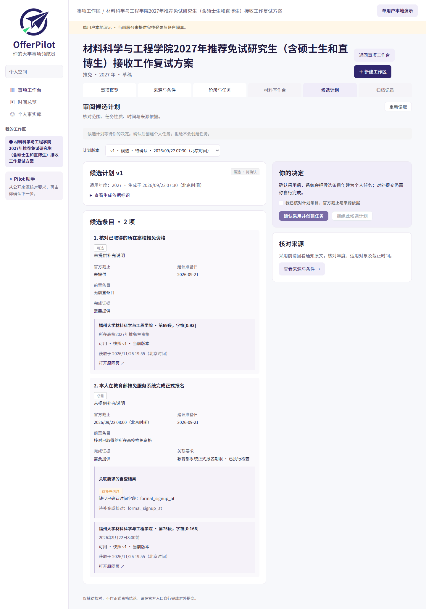
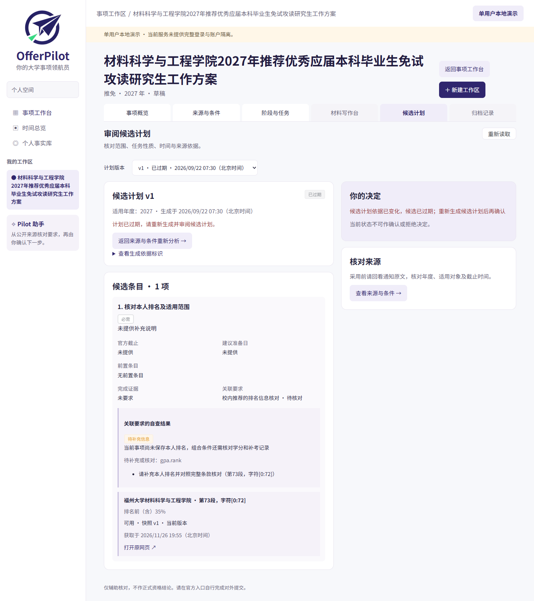

# 候选计划审阅模块

## 范围与入口

对应张锦昊的 Issue #76，承接 Alpha Issue #32。实现位于 `frontend/src/modules/plans/`，沿用工作区骨架的路由 `/matters/:matterId/plan`（路由名 `matter-plan`），可从工作区页签或来源与条件页进入。模块展示候选计划版本、条目、义务性质、官方期限、建议准备日、条目依赖及来源引文，允许用户确认或拒绝待决定的候选计划。

候选条目关联的要求包含 `self_check` 时，审阅页展示服务端返回的四态结论、原因、缺失字段和缺口定位。未提供结果时显示待核对提示，具体依据可返回来源与条件页查看。

Agent 结果可通过 `?plan=<plan_id>` 打开本次入库的候选。页面先从后端读取当前事项的候选列表，再读取属于该事项的指定候选详情。若链接目标未出现在列表中，页面提示手动选择版本。手动切换版本会同步链接，刷新后可恢复当前选择。

确认和拒绝由后端执行。页面只在收到符合当前计划、决定类型和操作标识的有效成功响应后提示决定已记录。确认后通过任务接口重读选中计划的任务，并可前往当前事项的正式任务页查看全部任务及依赖。

## 接口

接口以业务 PR #41 合入后的事项级个人事实及候选依据状态协议为准。

| 请求                                              | 用途                           |
| :------------------------------------------------ | :----------------------------- |
| `GET /api/v1/matters/{matter_id}/candidate-plans` | 列出当前事项的候选计划版本     |
| `GET /api/v1/candidate-plans/{plan_id}`           | 读取条目、出处、决定和关联事项 |
| `POST /api/v1/candidate-plans/{plan_id}/confirm`  | 确认候选并创建个人任务         |
| `POST /api/v1/candidate-plans/{plan_id}/reject`   | 拒绝候选，不创建任务           |
| `GET /api/v1/matters/{matter_id}/tasks`           | 重新读取当前事项的正式任务     |

POST 请求体为空，请求头携带 UUID 格式的 `Idempotency-Key`。响应由 Zod 校验，列表、详情及任务均校验事项关联。未知状态保留待识别文案，只有 `pending` 状态允许决定。

## 决定与重试

用户勾选已核对依据后，点击确认或拒绝。首次操作生成 UUID，并在提交前保存至当前标签页的 `sessionStorage`。保存内容仅为事项 ID、计划 ID、决定类型和操作 UUID，不保存材料、引文或个人资料。

网络超时、服务异常或响应校验失败时，页面不推断操作结果。同一决定的重试复用原 UUID；在结果未确定期间禁止改作相反决定。刷新页面后恢复未确定的操作标识，重新读取服务端状态。读取到已确认、已拒绝或已过期的终态后，清理标识并按真实状态展示。

服务端返回依据变化、期限已过、计划已决定、关键缺口或来源失效等已约定的 `409` 错误时，页面清理本次失败操作的标识并重读当前候选，展示实际状态及服务端提示。候选已过期或个人事实依据变化时提供返回来源与条件重新分析的入口。其他明确失败要求用户先重新读取；浏览器无法保存操作标识时仍允许只读查看。

列表及详情保留 `basis_status` 和 `stale_facts`。待确认候选的依据状态为 `stale` 或存在变化事实时，显示生成时与当前的事实版本，禁用确认入口并在提交逻辑再次拦截；拒绝仍遵守原决定与重试规则。事实保存只返回受影响候选，页面不将其直接标记为 `expired`；实际状态由后端读取及确认校验决定。较早接口未提供这两项时保留未知，由后端作最终确认校验。

决定提交期间禁止重复点击和切换计划版本。切换事项或离开页面会取消读取请求；已提交的决定请求不会因为离开页面而被解释为已撤销。晚到的响应不会更新其他事项的页面。

## 集成与验证

模块通过 `workspaceIntegrations.modules.plan` 注册，接收工作区传入的 `matterId` 和只读 `matter`。HTTP 客户端位于 `frontend/src/shared/http.ts`，与事项及来源页共用配置；页面依赖应用提供 Vue Router、所需 Element Plus CSS、业务样式和来源路由 `matter-sources`。

确认或拒绝成功后，模块发送 `changed` 事件，父工作区重读事项及任务摘要。同一事项刷新期间保留业务组件和所选计划，切换事项或归属读取失败时清除旧上下文。

启动及检查命令见 `source-conditions.md`。单元检查覆盖操作 UUID 的生成与复用、相反决定拦截及决定响应一致性。真实的确认、拒绝、重试防重、刷新读任务、依据过期、任务归属等场景需与实际业务服务及数据库联调。

当前模块使用已持久化候选的读取、确认和拒绝接口。来源页负责发起公开来源分析及查询运行状态，分析返回后重读已保存的来源与候选。后端 #41 已提供关键依据疑点与来源检查、自查保存及重启读取，仍需真实数据库和两入口一致性验收。排名事实按当前用户、当前事项隔离，来源页已接入事项级保存、读取及重新自查。计划模块不自行推断自查结论或业务拦截规则。独立检查通过不代表 Issue #32 的完整链路已经验收。

## QA 定位与恢复验收

### 页面示例

以下截图来自连接真实 API 和 PostgreSQL 的开发工作区。候选输入采用材料学院公开通知的固定样例，后端时钟为 2026 年 9 月 22 日 07:30（北京时间），用于历史通知回放。测试会话通过账户接口建立，注册与登录页面由账户模块接入。

候选审阅展示条目、出处以及关联要求的自查结论与缺项：

事项事实变化后，确认旧候选返回 `basis_changed`。页面重新读取已过期状态，保留服务端原因并提供重新分析入口：

### 操作与结果核对

入口为 `/matters/{matter_id}/plan`。页面与重读按钮使用 `getByTestId('plan-page')`、`getByTestId('plan-refresh')`；`#plan-version` 选择计划版本。决定区 `getByTestId('plan-decision')` 提供 `data-plan-id` 和 `data-plan-status`；确认及拒绝按钮分别为 `plan-confirm`、`plan-reject`。确认后任务区为 `plan-tasks`，按 `data-plan-id` 对照当前计划。

在真实测试库中分别使用两个待确认候选执行拒绝和确认；拒绝后核对无新增任务，确认后核对任务引用的计划 ID。刷新、重新进入以及重启后端后，重新读取同一候选和正式任务。关键依据疑点、来源异常与过期候选的拦截依赖后端统一检查，未接齐时保持待测。重启前尚未完成的 Agent 运行不属于候选恢复；运行中断提示及重新发起在来源页分析面板中验收。
